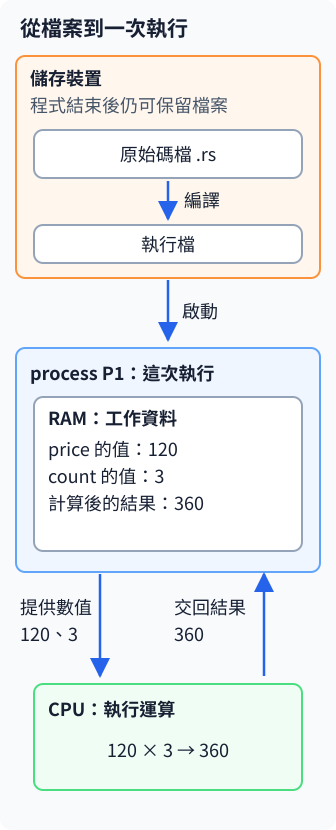
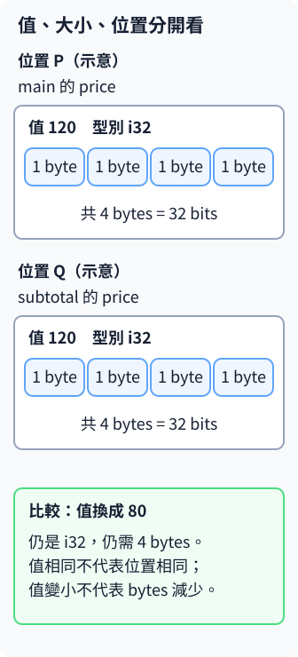
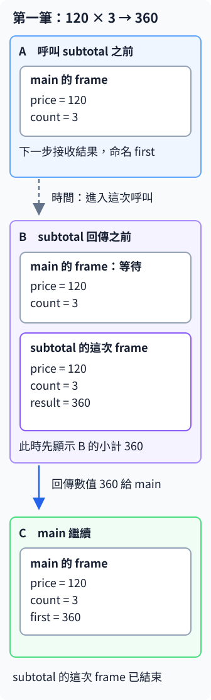
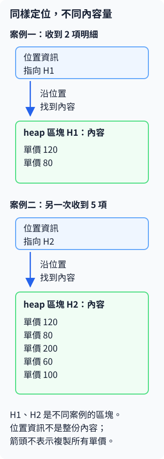
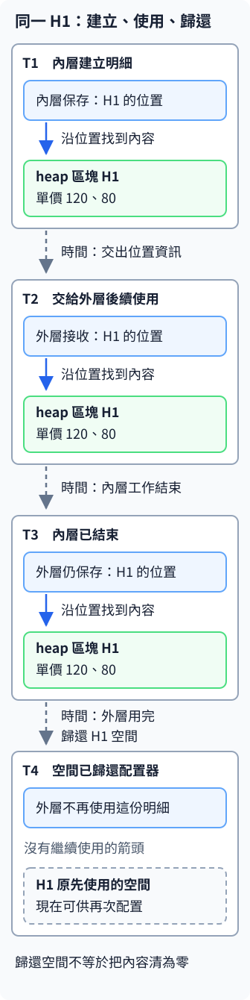

# 1.7 計算機基礎：程式、記憶體、stack 與 heap

上一節已經算出 `subtotal(120, 3)` 的結果是 360。現在追問：原始碼中的數字和執行中的數字在哪裡？`subtotal` 已經結束，為什麼 `main` 還能使用結果？這些問題會把型別、函式與電腦保存資料的方式連起來。

## 檔案留在儲存裝置，執行形成一次 process

你保存的 `.rs` 原始碼是一份檔案，編譯後產生的執行檔也是檔案。它們放在 SSD、硬碟等**儲存裝置**；關閉程式後，檔案仍能保留。上一節的 `cargo run` 則會建置需要更新的部分，再啟動執行檔。

**process**（行程）是這次正在執行的程式。它需要工作空間保存輸入、中間結果與目前做到哪裡。**RAM**（Random Access Memory，隨機存取記憶體）提供執行時使用的記憶體；本節談的資料位置，主要就在這個工作空間中。**CPU**（Central Processing Unit，中央處理器）依程式指令執行運算，例如讀取 120、3，再算出 360。

下面是角色圖。向下的「啟動」箭頭連起檔案與一次執行；RAM 與 CPU 之間的兩條箭頭分別表示提供運算材料、交回結果。



`let price = 120;` 在這次執行中建立資料，並沒有把 120 重新寫回 `.rs` 檔。修改原始碼、保存並重新建置，才會改變後續啟動的程式。也可以用同一個執行檔啟動多次，每次都有各自的執行狀態。

## 值、大小與位置是三件事

第 1.4 節說過，`i32` 名稱中的 32 是表示空間的 bit 數。**bit**（位元）是一個可表示 0 或 1 的單位；**byte**（位元組）由 8 個 bits 組成。因此，一個 `i32` 的表示大小是 32 bits，也就是 **4 bytes**。

這 4 bytes 用來表示整個整數，不是把十進位的 `1`、`2`、`0` 各存一格。現在先掌握所需空間，不必手算它的二進位編碼。

再把三個問題分開：**值**是保存什麼，例如 120；**大小**是這個型別的表示需要多少空間，例如 4 bytes；**位置**是這份資料放在哪裡。下面用 P、Q 標記兩個示意位置。它們不是程式印出的實際地址，變數名稱則寫在資料框外，方便對回程式。



同樣的 120 可以出現在兩個位置，不能因數字相等就把它們當成同一份存放。把一個 `i32` 的值換成 80，也不會讓型別需要的表示空間變成 2 bytes；**數值大小和占用多少 bytes 是不同問題**。

## 沿著 A、B、C 追蹤一次函式呼叫

先看同頁的完整程式。它只使用前面已學過的數值、變數、函式、乘法與顯示；`subtotal` 多保存一個 `result`，讓我們能在回傳前觀察它，再用尾端 expression 交出同一個值。

`//` 之後直到行尾是註解，不作為程式執行；本節用 A、B、C 標示觀察點。

```rust
--8<-- "examples/intro-workspace/steps/examples/memory.rs"
```

從教材 repo 根目錄執行：

```bash
cargo run --manifest-path examples/intro-workspace/Cargo.toml -p intro-steps --example memory --locked
```

```text
B：回傳前的小計=360
第一筆=360
B：回傳前的小計=160
第二筆=160
```

程式中的 A、B、C 註解是第一筆訂單的三個觀察點。**frame** 是用來追蹤一次函式呼叫的工作區：這次收到的參數、建立的區域變數，都能畫在同一個框中。尚未結束的函式呼叫形成 **stack**；新呼叫開始後，會先完成它，再回到等待它的呼叫者。

下圖由上往下表示時間前進。虛線箭頭連到下一個觀察點；實線回傳箭頭表示把數值 360 交給 `main`。



- **A**：`main` 已有 `price = 120`、`count = 3`，正要用它們呼叫 `subtotal`。`first` 的初始值尚未算好，所以圖中沒有把它畫成已存有 0 的變數。
- **B**：這次 `subtotal` 的參數分別取得 120、3，`result` 已算出 360。`main` 的那行宣告還在等待回傳；函式內的 `println!` 先顯示這個中間結果。
- **C**：`subtotal` 尾端的 `result` 交出 360，成為 `main` 的 `first`。這次 `subtotal` 的 frame 結束，`main` 才繼續顯示第一筆結果。

第二次呼叫用 80、2，會開始新的一次 `subtotal` 工作，這次 `result` 是 160。兩次呼叫使用相同的函式定義，卻各有本次的參數與結果；因此第二行小計觀察不會仍是 360。

frame 圖用來追蹤呼叫與值的關係；編譯器可能把數值放進 CPU 內部的暫存空間，或省掉不需要保留的資料，不保證照圖逐格存放。上一節內部 `{ ... }` 的 block 也沒有呼叫新函式，不能每看到一組大括號就新增一個函式 frame。scope 回答名稱在哪段程式可用，這裡則追蹤哪一次呼叫正在工作。

## 另一種需要：內容量不同的訂單明細

上面的數字程式沒有為這些數值額外配置 heap。接下來用訂單明細說明另一種安排：這次收到 2 項，下次收到 5 項，保存整份明細所需的空間會不同。這裡畫資料關係，後面再用可保存文字與多項資料的 Rust 型別操作它。

**heap** 提供可以獨立請求的記憶體區塊。程式需要一塊空間時，**記憶體配置器（memory allocator）**安排可用區塊，記錄它正在被使用；這個動作叫**配置**。使用這份資料時，還要能找到它，因此另外保存位置資訊。表示資料位置的值稱為 **pointer（指標）**：它回答「到哪裡找」，內容則回答「找到什麼」。

下圖每個案例都有一個位置資訊框，以及它所指向的內容區塊。實線箭頭表示「沿位置找到內容」，不是時間前進，也不是把整份內容複製到位置框裡。



H1、H2 是兩次不同案例的區塊名稱。內容項數不同，不需要把整份明細都塞進位置資訊框；位置資訊本身也不是那些單價的總和。這種分開安排能讓程式保存這次需要的內容量，再透過位置找到它。

這是 heap 的一種用途。**固定大小的值也可以放在 heap**；剛才 `i32` 的 4 bytes 只說明它的表示大小，不能單憑這個數字決定它一定放在哪裡。

## 呼叫結束與內容歸還，分開追蹤

再沿用兩項明細的 H1：假設內層工作負責建立明細，外層之後還要顯示它。這時內層可以交出找到 H1 的位置資訊；內層工作結束後，外層仍使用 H1，等後續工作完成才歸還空間。

下圖四個觀察點追蹤**同一個 H1**。虛線向下表示下一時刻，實線仍只表示找到內容的關係。



heap 區塊的使用期間不直接綁在建立它的那次呼叫上。圖中的 H1 因外層還要使用而保留；如果工作在內層就已完成，也可以在那裡歸還。不能把「heap」解讀成一律比函式活得久。

**釋放**是把這塊空間歸還給配置器，讓它能供後續配置使用；不是把原內容改成零。歸還後，不能繼續靠舊位置資訊使用原來的資料。過早歸還會妨礙後續使用；一直保留不再需要的區塊，則會占住可用空間。程式因此需要清楚的使用、交接與清理責任，第 3 章會用 ownership 正式處理。

配置與歸還都是程式執行時的工作。Rust 在編譯時檢查用法，與執行時才真的計算、取得空間、歸還空間，是兩個不同階段。

## 練習與完整答案

把第一筆的 `price` 改成 80、`count` 改成 2，只保留這一筆呼叫。執行前，先沿 A、B、C 回答：B 的 `result` 是多少？C 的 `first` 是多少？`price` 的型別仍是 `i32`，需要幾個 bytes？

完整參考答案如下，設定沿用第 1.3 節的 `intro-steps`：

```rust
--8<-- "examples/intro-workspace/steps/examples/memory_answer.rs"
```

```bash
cargo run --manifest-path examples/intro-workspace/Cargo.toml -p intro-steps --example memory_answer --locked
```

```text
B：回傳前的小計=160
第一筆=160
```

B 的乘法改成 `80 * 2`，所以 `result` 是 160；它回傳後，C 的 `first` 也是 160。改變的是本次的值，`i32` 的表示大小仍是 4 bytes。函式回傳這個數字就能讓外層繼續使用結果，不需要讓已結束的 `subtotal` frame 留下來，也不需要為此額外配置 heap。

[下一節：tuple 與 array](01-08-lesson.md)
