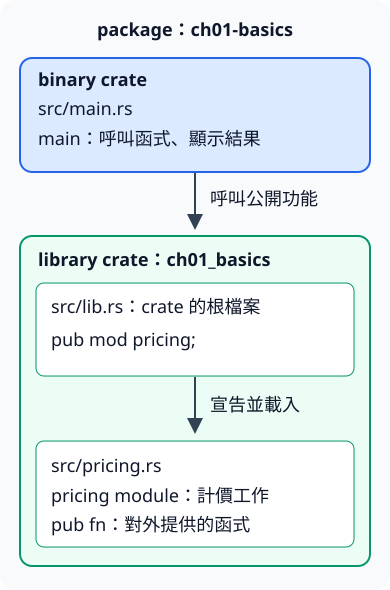

# 1.9 把計算工作放進 library

現在我們有計價與加總函式，也有負責顯示的 `main`。如果計算與啟動流程全擠在同一個檔案，找規則時就會混在顯示工作裡。這一節保留同樣的輸入與答案，改變的是程式的分工：計算可以被呼叫，啟動程式只負責組合與顯示。

## 檔案與 module 不是同一件事

**module** 是 Rust 組織程式名稱的範圍：它把一組相關函式收在同一個名稱底下，也控制外面能使用哪些內容。module 可以寫在同一份檔案裡，也可以拆成另一份檔案；這裡直接使用拆檔形式。

在 crate 的根檔案寫 `mod pricing;`，宣告名為 `pricing` 的 module，並讓編譯器從相鄰的 `pricing.rs` 載入內容。單純把一份 `.rs` 放在資料夾中，沒有對應的 module 宣告，並不會讓它自動加入這個 crate。

`pub` 表示公開。`pub mod pricing;` 允許外部使用者走進這個 module 的公開路徑，`pub fn subtotal(...)` 則允許透過該路徑呼叫函式。公開 module 不會自動公開裡面的所有函式；本例的運費細節函式 `shipping` 不加 `pub`，留給同一 module 內的計價函式使用。

**路徑**用 `::` 串起層級，例如 `ch01_basics::pricing::subtotal`，依序表示 library crate、module、函式。若是在同一個 crate 內要從根開始找，可以用 `crate::pricing::subtotal`；`crate` 在這裡表示目前的 crate，並非 package 名稱。

## 一個 package，兩個 crate

1.3 已區分 binary crate 與 library crate。當 package 同時有 `src/main.rs` 和 `src/lib.rs`，Cargo 預設分別把它們當作 binary 與 library 的根檔案。binary 有 `main`，library 提供公開功能；library 不需要 `main`。

本節的 package 名稱是 `ch01-basics`，Rust 程式內的 library crate 名稱則是 `ch01_basics`：package 名稱中的連字號在 crate 名稱中改成底線，因為 Rust 的名稱不能把減號當成名稱的一部分。

先看分工圖：上面的 `main` 呼叫 library 公開功能；下面 `lib.rs` 宣告 `pricing`，對應到 `pricing.rs` 的計算工作。兩種箭頭各標出自己的關係，拆檔沒有新增另一個可執行程式。



### 先定義計算工作

`src/pricing.rs` 使用前面已經教過的數值、函式、條件與迴圈：

```rust
--8<-- "examples/ch01-basics/src/pricing.rs"
```

`let subtotal = subtotal(price, count);` 的右邊呼叫函式，宣告完成後，左邊的新變數遮住同名函式名稱。本例後面不再呼叫 `subtotal`，所以不影響工作；你也可以把變數命名為 `amount`，避免同名。

這些函式仍遵守前節的小數值範圍約定。`sum_three` 明確接受三個 `i32`；現在沒有加入任意長度或外部輸入的需求。

### 再宣告 module

`src/lib.rs` 的本節內容只有一行。它把 `pricing.rs` 的內容接進 library crate，並公開這個 module：

```rust
--8<-- "examples/ch01-basics/src/lib.rs:library-root"
```

### 最後讓 binary 呼叫 library

`use 路徑;` 將某個項目的路徑引入目前的名稱範圍，讓後面可以只寫函式名稱。例如 `use ch01_basics::pricing::sum_three;` 後可寫 `sum_three(...)`，不用每次重寫完整路徑。`use` 不會執行函式，也不會下載依賴。

`src/main.rs` 因而只保留啟動時需要做的工作：

```rust
--8<-- "examples/ch01-basics/src/main.rs"
```

從 repo 根目錄執行 package 的主要 binary，不加 `--example`：

```bash
cargo run -p ch01-basics --locked
```

```text
訂單總額=180，價目總和=400
```

你仍得到前面驗證過的答案，但現在能分別找到「運費規則在哪裡」與「程式顯示什麼」。這是拆分工作的收益；小程式也能全部放同一檔案，拆檔不是讓乘法才開始能算對。

## 練習：同一份 library，另一個呼叫者

在練習副本的 `examples/ch01-basics/examples/my_order.rs` 自己寫一個可執行範例，先保留現有參考答案不看。用 `use` 引入 `subtotal` 與 `total_with_shipping`，對單價 80、數量 2 分別取得小計與含運費的總額。答案應為 160 與 180。從 repo 根目錄用 `cargo run -p ch01-basics --example my_order --locked` 執行你的版本。

這次範例有自己的 `main`，卻不用再複製運費規則；它是 library 的另一個使用者。若嘗試從 binary 或範例直接呼叫沒有公開的 `shipping`，編譯器會拒絕，因為那是 library module 內保留的細節。

完成後可對照 [參考程式](https://github.com/birdhackor/learn_rust/blob/main/examples/ch01-basics/examples/modules_solution.rs)，或執行 `cargo run -p ch01-basics --example modules_solution --locked`。下一節會用另一種呼叫者——測試——確認免運門檻前後的答案。
