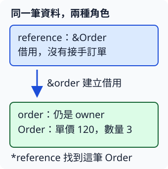

# 2.3 用 reference 借用資料

上一節的 `subtotal` 接手整筆訂單，只交回小計。如果呼叫者之後還要調整數量，便需要另外把訂單交回。現在的需要更直接：**函式只讀資料算答案，原訂單仍由呼叫者管理。**

## reference 是通往既有值的借用

**reference（參照）** 是借用既有資料的值，讓我們能找到資料並依借用方式使用它。它是一種 pointer，但具有 Rust 檢查的有效性與存取規則。reference 沒有取得所指資料的 ownership；借用結束，也不會因此結束原資料。

建立 reference 的動作稱為 **borrowing**。`&count` 借用 `count`，得到的型別是 `&i32`。在 expression 裡，`&` 表示「建立借用」；在型別裡，`&i32` 表示「借用一個 `i32` 的 reference」。不要把前一個當成數字本身。

`*reference` 稱為 **dereference**，也就是解參照：透過 reference 找到它所指的值。對 `i32` 而言，`let copied_count = *reference;` 會把讀到的數字 Copy 到新變數，而不是把原數字轉移走。`*` 寫在單一 expression 前是 dereference，寫在兩個數值中間則是前章的乘法。

這一種 `&i32`、`&Order` 稱為 **shared reference**。它允許讀取，並能和其他 shared borrow 一起使用；對本章的普通數值欄位，不能透過它修改資料。

圖中 `order` 仍管理原訂單。`reference` 的箭頭只表示借用，沒有產生另一份 `Order`：



## 函式接收 reference，回傳數字

把參數從 `order: Order` 改為 `order: &Order`，呼叫時提供 `&order`。這兩處分別表達「函式接受借用」與「呼叫者建立借用」。函式結束時，原訂單仍在呼叫者那裡。

透過 reference 讀欄位，可以明寫 `(*order).count`：先跟隨 reference，再取欄位。Rust 也允許簡寫成 `order.count`，欄位存取會自動跟隨這個 reference。下面採用後者；這不會替 `Order` 加上 Copy 能力。

```rust
--8<-- "examples/ch02-ownership/examples/shared_references.rs"
```

```bash
cargo run -p ch02-ownership --example shared_references --locked
```

```text
借用算出的小計=360，原數量=3
讀出的數字=3，原數字=3
```

`subtotal` 只借用訂單，所以 `main` 可以在呼叫後繼續讀 `order.count`。第二部分則把 `count_reference` 與讀出的 `copied_count` 分開：前者用來找到原資料，後者是一個新的 `i32`。

## mutable reference 讓函式修改借來的資料

如果函式要把訂單數量加一，就需要 **mutable reference**。`&mut order` 建立這種借用，型別是 `&mut Order`。它提供對所借資料的獨占存取：借用仍在使用期間，不能另外用衝突的途徑存取同一份資料。下一節會具體判斷這段期間。

要建立這種借用，原變數先宣告成 `mut`。函式參數寫 `order: &mut Order`，就能透過它修改欄位。`&mut` 沒有接手資料；函式完成後，呼叫者看見的就是修改後的同一筆訂單。

對單一數值，`*reference += 1;` 找到所指的數字並修改它。這裡修改的是 reference 所指的資料，不是把 reference 改指向另一個位置。

```rust
--8<-- "examples/ch02-ownership/examples/mutable_references.rs"
```

```bash
cargo run -p ch02-ownership --example mutable_references --locked
```

```text
原訂單改成數量=4，單價=120
透過 mutable reference 得到的數字=4
```

### `let mut reference` 與 `&mut i32` 改的是不同對象

mutable reference 不要求 reference 變數本身也用 `let mut`；上面的 `reference` 沒有換位置，只透過 `*reference` 修改數字。

反過來，`let mut reference: &i32` 允許把這個變數重新指派為另一個 shared reference，但它借來的數字仍不能透過 shared reference 修改：

```rust
--8<-- "examples/ch02-ownership/examples/reference_binding.rs"
```

```bash
cargo run -p ch02-ownership --example reference_binding --locked
```

你會依序讀到 3、8，原資料仍是 3 和 8。宣告名稱前的 `mut` 決定「這個變數能否重新指派」；型別中的 `&mut` 決定「能否透過借用修改所指資料」。

下面故意用 shared reference 修改 `i32`，因此無法編譯：

```rust
--8<-- "examples/ch02-ownership/fixtures/compile-fail/shared_write.rs"
```

錯誤碼為 `E0594`，重點是不能透過 `&` reference 指派。如果工作需要修改原數字，應重新選擇 mutable borrow；只在 reference 名稱前加 `mut`，並不會改變借用型態。

## 練習：讀取和修改各自選擇借用方式

寫 `set_count`，接收 `&mut Order` 與新的 `i32` 數量，修改訂單的數量；再寫接收 `&Order` 的 `subtotal`，只算小計。用單價 80、數量 2，先算 160，設成數量 3，再算 240。呼叫者始終保留這筆訂單。

先判斷每個函式需要的是讀取、修改還是接手完整值，再寫參數型別。完成後可對照 [參考程式](https://github.com/birdhackor/learn_rust/blob/main/examples/ch02-ownership/examples/borrow_solution.rs)，或執行 `cargo run -p ch02-ownership --example borrow_solution --locked`。

現在已能建立與使用兩種 reference。接下來還要確認：前一個借用何時用完，下一個修改從哪裡才可以開始？
