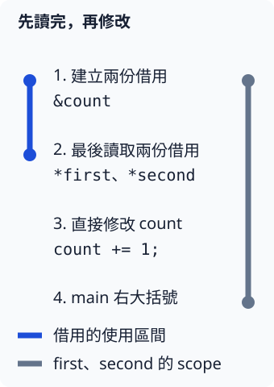

# 2.4 借用用到哪裡：lifetime 與 scope

我們已經會用 `&count` 讀取、用 `&mut count` 修改。現在要在同一段程式先讀後改。判斷的重點不只是建立了幾個 reference，還包括它們**接下來是否仍要使用**。

## 從最後一次使用判斷借用區間

**lifetime** 在這裡指 reference 需要保持有效的程式範圍。它不是執行時過了幾秒，也不等於變數名稱的 scope。編譯器會追蹤 reference 在哪些位置仍被使用，讓所指資料在這些位置都有效，並排除衝突的存取。

對這一節沒有分支的簡單程式，可以從建立 reference 追蹤到最後一次使用。最後讀完 shared reference，後面不再使用它，就可以再開始 mutable borrow；讀完 mutable reference 後，也能回到 owner 直接修改。這不需要增加額外的大括號。

```rust
--8<-- "examples/ch02-ownership/examples/last_use.rs"
```

```bash
cargo run -p ch02-ownership --example last_use --locked
```

```text
兩次 shared 讀取=3、3
mutable 借用讀到=4
借用結束後，owner 改成=5
```

`first` 與 `second` 都在第一個 `println!` 最後使用。它們的名稱仍位於 `main` 的 scope 內，但後面的程式不再使用這兩份借用。因此 `writable` 可以開始借用；它在第二個 `println!` 最後使用，接著 `count` 就能直接加一。

下圖把 `first`、`second` 的「名稱可以出現的 scope」與「這次借用的使用區間」分開。短藍線在最後一次借用讀取後結束，長灰線則到 `main` 右大括號；這兩條線不需要同長。



### 再加一次讀取，就可能延長借用

若先建立 shared reference，修改原值之後又透過它讀取，借用就必須涵蓋這次修改。下面的 fixture 因而不能編譯：

```rust
--8<-- "examples/ch02-ownership/fixtures/compile-fail/borrow_overlap.rs"
```

錯誤碼為 `E0506`，重點是 `count` 仍被借用，不能直接對它指派。訊息會指出建立借用的位置與後續使用的位置。把最後的讀取移到修改前，就能讓兩項工作依序發生；不是宣告 reference 後永遠不能修改 owner。

在這裡的普通數值資料上，shared borrow 允許一起讀，但不與修改同一資料的存取重疊；mutable borrow 需要獨占。這些約定讓函式的 `&i32` 與 `&mut i32` 參數能表示清楚的使用方式。

下面讓兩個 mutable reference 都還要使用，借用區間重疊，會收到 `E0499`：

```rust
--8<-- "examples/ch02-ownership/fixtures/compile-fail/double_mutable.rs"
```

若先完成 `first` 的操作，之後才建立並使用 `second`，便是兩次依序的 mutable borrow；是否衝突取決於實際使用，不能只數原始碼中出現幾次 `&mut`。

## 從 mutable reference 重新借一小段

已有 `parent: &mut i32` 時，不一定要把這份存取權完整交出去。`&mut *parent` 先找到它所指的資料，再短暫借出新的 mutable reference，這稱為 **重新借用**（reborrow）。`child` 還在使用時，原先的 `parent` 暫時不能用來衝突地存取資料；`child` 最後使用之後，便能繼續用 `parent`。

這個需要常出現在函式串接：我們用同一個 mutable reference，讓幾項工作先後修改資料。對明確接受 `&mut i32` 的參數，寫 `add_one(parent)` 時，Rust 也會自動作短暫的重新借用；呼叫結束後能繼續用 `parent`。下面同時寫出明確建立的短借用與這種函式呼叫：

```rust
--8<-- "examples/ch02-ownership/examples/reborrow.rs"
```

```bash
cargo run -p ch02-ownership --example reborrow --locked
```

輸出先是 `短借用讀到=4`，最後是 `parent 最後讀到=7`。追蹤每次加一：`child` 加到 4，`parent` 加到 5，兩次函式呼叫再分別加到 6 和 7。這些操作都修改同一個 `count`，沒有複製出四份數字。

重新借用也不是所有指派的自動效果。mutable reference 本身不具備 `Copy`；若寫 `let next = parent;`，會 move 這份 reference，之後不能再用 `parent`。選擇 `&mut *parent` 的意義，是留下原 reference，借出一段受限制的使用，而不是把它完整轉交。

## 資料必須活到 reference 用完

借用除了避免衝突，也不能指向已結束的值。下面的 block 建立 `inside`，卻想把 `&inside` 交到外層：

```rust
--8<-- "examples/ch02-ownership/fixtures/compile-fail/dangling_block.rs"
```

`inside` 隨內層 block 結束，但外面還想透過 reference 讀它，因此收到 `E0597`：`inside` 存活得不夠久。這裡的問題不是加一個名稱就能修好；reference 沒有取得所指資料的 ownership，不能把被借資料的存活時間延長。

若外層只需要保存數字 8，就在 block 尾端交出 `inside` 的 `i32` 值。`Copy` 讓外層得到自己的數值，和 1.5 的 block 計算結果相同；若要繼續借用原資料，就應讓原資料在外層存活。

## 練習：修正兩個不同問題

先把「shared borrow 後先修改再讀」改成先完成借用讀取，後修改 owner。再把上一個內層 block 的回傳改成數字本身，讓外層保存 owned 數值。兩個結果應分別是修改後的 4、保存下來的 8。

前一項修的是存取順序，後一項修的是資料存在的位置；它們不是同一個限制。完成後可對照 [參考程式](https://github.com/birdhackor/learn_rust/blob/main/examples/ch02-ownership/examples/lifetime_solution.rs)，或執行 `cargo run -p ch02-ownership --example lifetime_solution --locked`。

你現在能分開判斷 scope、borrow 的使用區間與原資料是否仍存在。本章先處理函式內與參數的基本借用；之後回傳借用資料時，才會學如何在函式簽名中表達來源關係。
