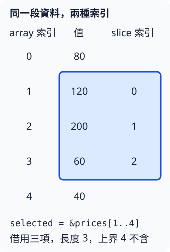

# 2.6 用 slice 借用一段數列

1.8 的 `sum_three(values: [i32; 3])` 只接收三項。現在有五筆價格，但有時只想加總中間三筆，有時要處理全部或兩筆。需要改的是**函式能接收哪段資料**，加總規則仍是把每項數字累加。

## &[i32] 表示一段連續的借用

**slice（切片）** 表示連續的一段元素。在這裡，`&[i32]` 是對這段 `i32` 資料的 shared reference：不複製整個 array，也不接手原 array。和 `[i32; 3]` 不同，型別中沒有寫固定元素數量；這份借用會攜帶開始位置與長度，讓函式知道目前能處理幾項。

對 `prices` 建立 `&prices[1..4]`，表示借用索引 1、2、3 的元素，和前章 range 一樣不包含上界 4。`&` 建立借用，方括號中的 range 選擇連續部分。原 array 仍由 `prices` 持有。

這裡的五項資料是 `[80, 120, 200, 60, 40]`。選到的三項是 120、200、60；它們在新 slice 裡的索引從零重新數，所以 `selected[0]` 是原本的 `prices[1]`，而非原 array 的第一筆 80。



**slice 的 `len()` 回傳目前這段的元素數量，型別仍是 `usize`。** `selected.len()` 是 3，原 array 的 `prices.len()` 是 5；這兩個長度回答不同範圍的問題。

## 同一個函式，接收不同長度

函式參數寫 `values: &[i32]`，即可用同一種借用介面接收不同長度的數列。要借用整個 array，寫 `&prices[..]`；省略 range 的起點與終點，表示從第一項到整個資料的結尾。

也能只省略一端：`&prices[..3]` 與 `&prices[0..3]` 相同，`&prices[3..]` 則取索引 3 到結尾。無論是否省略，range 上界都不包含在內。`&prices[2..2]` 是合法的空段，長度 0；不是從索引 2 取出一個元素。

shared reference 本身具有 `Copy`：把 `selected` 傳入函式，複製的是這份借用的位置與長度資訊，沒有複製整個 array。因此呼叫後仍可繼續使用 `selected`，也仍須遵守 shared borrow 的限制；這和前節 mutable reference 本身不能 Copy 的行為不同。

對借用的 `&[i32]` 使用 `for value in values` 時，每次得到的是 **`&i32`**，因為正在走訪借來的資料；它和前章直接走訪數值 array 時每次取得 `i32` 的具體行為不同。因此 body 用 `*value` 找到數字，Copy 進加法。現在先使用這項 slice 走訪契約，之後才會進一步研究走訪介面的設計。

```rust
--8<-- "examples/ch02-ownership/examples/slices.rs"
```

```bash
cargo run -p ch02-ownership --example slices --locked
```

```text
選到的長度=3，第一項=120
選到的總和=380
全部總和=500
空區間總和=0
兩項資料的總和=200
```

所有呼叫都使用同一個 `sum_values`。空段沒有任何元素讓 body 執行，初始的 `total = 0` 就成為回傳值；兩項 array 也不需再寫另一個加總函式。slice 改變的是輸入表示，並沒有替這個簡單迴圈加入新的加總演算法。

## 邊界依 slice 本身判斷

建立 slice 的 range 必須落在原資料邊界內，而且起點不能超過終點。取 slice 中的元素時，則依**slice 自己的長度**判斷邊界；借用三項後，有效索引是 0、1、2。

下面故意取 `selected` 的索引 3。原 array 雖然有第五項，這份 slice 卻沒有第四項，因此會和前章的越界案例一樣 panic：

```rust
--8<-- "examples/ch02-ownership/fixtures/runtime-fail/slice_bounds.rs"
```

把這段放到練習專案執行，會收到 `index out of bounds`；它不是正常示例目標。range 表達的是借用範圍，不是對整個 array 所有元素的存取權。

shared slice 也延續借用規則：你還要透過它讀取的期間，不能修改同一份被借資料。最後一次使用之後，才可以接著修改原 array；借用區間與名稱 scope 的區別仍和上一節相同。

## 練習：只提高借來的兩筆價格

除了 shared slice，也能建立 **mutable slice**，型別寫 `&mut [i32]`。`&mut prices[1..3]` 借出原 array 的第二、第三項，允許修改那段資料；原變數需要 `mut`。這延續 `&mut i32` 的契約，只是一次借用連續的多項資料。

對 `&mut [i32]` 寫 `for value in values`，每次取得 **`&mut i32`**，因此可以用 `*value += amount;` 修改當前數字。迴圈處理的是原 array 中被借出的元素，沒有另建一個相同內容的 array。

請寫 `increase(values: &mut [i32], amount: i32)`，把這段資料的每個值加上 `amount`。用五筆價格 `[80, 120, 200, 60, 40]`，只讓索引 `1..3` 加 10。完成函式呼叫後，再從 owner 讀取，應得到：

```text
80、130、210、60、40
```

用五個數值 assertion 確認，特別要檢查借用段之外的第一、第四、第五項沒有變動；完整總和應是 520。再把空段 `2..2` 傳入同一函式，資料應完全不變。

這項練習的關鍵是「哪一段資料被借來修改」，不是把每次修改寫成新的 array。完成後可對照 [參考程式](https://github.com/birdhackor/learn_rust/blob/main/examples/ch02-ownership/examples/slices_solution.rs)，或執行 `cargo run -p ch02-ownership --example slices_solution --locked`。

現在已完成本章的三項關係：struct 把欄位角色放進型別；ownership 決定值如何交接；reference 與 slice 表達不接手資料的使用方式。下一章會用 enum 表示多種不同情況，再把這些資料表示與借用方式用在文字和可增長清單。
