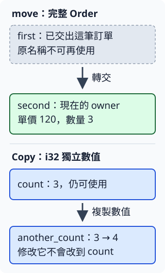

# 3.2 ownership 與 move：交出整筆值，或複製一個數字

上一節的 `order` 持有一筆訂單。現在要把整筆資料交給另一個名稱，再交給計算函式。我們需要知道：交出去後，原名稱是否仍能使用？先用只有兩個數字欄位的 Order 觀察，再與 `i32` 對照。

## ownership 管理使用與清理責任

第 1.7 節分開了資料的位置與管理責任。**ownership** 是 Rust 管理值的規則：值由誰持有、可以從哪裡交出去，以及最終由誰負責結束。在這裡的局部變數安排中，建立 `let first = Order { ... };` 後，`first` 就持有這個值，稱為它的 **owner**。

若一個值仍由局部變數持有，該變數離開 scope 時，Rust 會結束這個值；有需要清理的資源時，依該型別的規則處理。本節的 Order 只有兩個數字，沒有額外配置的 heap 資料；第 3.8 節再把責任連到實際文字空間。

**move** 是把值的 ownership 交出去。我們的 Order 不會自動複製整筆值，因此 `let second = first;` 把它交給 `second`，之後不能再經由 `first` 使用這筆訂單。這是值的使用規則，不表示必須在機器上搬動幾個 bytes，也不是只有 heap 資料才會 move。

`i32` 已具備 **`Copy`** 能力：把它指派給另一個變數時，會複製出另一個獨立數字，原來的變數仍可用。

下圖上半部只追蹤這次交接。實線箭頭是責任轉交；它沒有畫實際記憶體地址：



## 函式參數也會接手值

把參數寫成 `order: Order`，表示函式接受完整值。這個 `subtotal` 接手訂單，算出一個小計數字：

```rust
--8<-- "examples/intro-workspace/ownership/examples/moves.rs:consume"
```

傳入 Order 時會發生 move。計算完成後，函式只交回 `i32`；接手的訂單隨這次呼叫結束，不需要讓已結束的函式 frame 繼續存在。

在完整程式的 main 中，`first` 先建立單價 120、數量 3 的 Order，接著依序交出：

```rust
--8<-- "examples/intro-workspace/ownership/examples/moves.rs:move"
```

`second` 接手後可以讀自己的欄位；將它交給 subtotal 後，main 接下來只使用小計 `total`。每一次交接都要依參數或指派的型別判斷，不能把「前面取過欄位」當成整筆值已經複製。

## Copy：指定之後，原數字仍可用

把同樣的指定換成 `i32`，結果不同：

```rust
--8<-- "examples/intro-workspace/ownership/examples/moves.rs:copy"
```

`another_count` 加一變成 4，不會把 `count` 的 3 一起改掉，對應上圖下半部的兩份值。

本章已用的整數、浮點數與 bool 都有這項能力。但**自訂 struct 不會因為欄位全是數字，就自動具備 Copy**。目前的完整 Order 會 move，單獨讀出它的 `i32` 欄位則可 Copy。第 6 章再學如何讓自訂型別提供這類能力；此刻先依這兩種實際型別分辨行為。

## 完整範例與執行

```toml
--8<-- "examples/intro-workspace/ownership/Cargo.toml"
```

```rust
--8<-- "examples/intro-workspace/ownership/examples/moves.rs"
```

```bash
cargo run --manifest-path examples/intro-workspace/Cargo.toml -p intro-ownership --example moves --locked
```

```text
second 的數量=3
接手訂單後算出的值=360
count=3，another_count=4
```

## 交出之後再用原名稱

下面是完整的預期編譯失敗例。`first` 已交給 second，最後卻又想讀 first.count：

```rust
--8<-- "examples/intro-workspace/ownership/fixtures/compile-fail/use_after_move.rs"
```

要重現，可放入第 1.2 節獨立練習專案的 `src/main.rs`，再執行 `cargo check`。錯誤碼 **E0382** 的重點是 `use of moved value`；訊息會連起交出與後續使用的位置。即使這筆 Order 沒有 heap 資料，限制仍成立。先依目前需要選擇交接方式，不必把診斷中尚未學過的其他建議都加進程式。

## 練習與完整答案

寫 `add_one` 接手一筆完整 Order，將數量加一，再交回完整 Order。以單價 80、數量 2，確認回傳的數量為 3、小計為 240。呼叫者將結果保存成 updated，不再使用已交出的原變數。

先從簽名決定「接收 Order、回傳 Order」；函式要修改接手後的資料，因此參數寫 `mut order: Order`。它和 `let mut` 一樣，允許修改這個參數所持有的值。

```rust
--8<-- "examples/intro-workspace/ownership/examples/ownership_answer.rs"
```

```bash
cargo run --manifest-path examples/intro-workspace/Cargo.toml -p intro-ownership --example ownership_answer --locked
```

答案顯示 `交回的數量=3，小計=240`。值先交到參數，再由回傳值交到外層，管理責任沿著程式移轉。若函式其實只需要讀資料，下一節就不必讓它先接手整筆訂單。

[下一節：shared reference 與 dereference](03-03-lesson.md)
