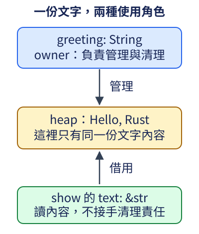

# 3.4 擁有文字，或借用文字

前面的文字只是 `println!` 中固定顯示的內容。現在要把兩段文字接成問候語，交給函式顯示，再繼續追加驚嘆號。我們需要分辨：誰管理這份可改變的文字？函式只是讀取時，是否需要接手整份資料？

## String 與 &str 的角色不同

Rust 的 **`String`** 是標準函式庫提供的文字型別，持有文字的 ownership，能保存長度可變的內容。它與 Option 一樣，已能直接使用名稱，不需另加外部依賴。以 mutable 變數持有 String 時，可以透過本節的方法追加內容。

文字以 **UTF-8** 編碼保存。UTF-8 是 Unicode Transformation Format, 8-bit，也就是 8 位元的 Unicode 轉換格式；Unicode 提供跨語言的文字表示，UTF-8 把它編成 **byte（位元組）** 序列。一個 byte 是 8 個 bits。下一節會具體觀察不同文字需要幾個 bytes；這裡先需要知道 String 保存的是符合此編碼規則的文字。

**`str`** 表示這段 UTF-8 文字內容的型別；本節透過 **`&str`** 使用它。`&str` 是借用一段文字的 shared reference，攜帶開始位置與 byte 長度，讓函式知道能讀哪一段；它不接手文字的 ownership，也不負責回收原資料。

因此 String 和 &str 不是「兩個名字代表相同型別」：前者管理 owned 文字，後者借用既有內容。雙引號 literal，例如 `"Rust"`，本身提供的是 `&str`，內容由程式保存，不是另建立一個 String。這也解釋了前面直接顯示固定文字為何不需要手動建立文字容器。

## 先認識建立、追加與借用的接口

| 操作 | 需要的資料 | 完成後的結果與用途 |
| --- | --- | --- |
| `String::new()` | 不需既有 String 或參數 | 建立空的 String，成為接下來追加文字的 owner。它是已教的 associated function 形式。 |
| `text.push_str(part)` | mutable 的 String，以及一段 `&str` | 把 part 的文字內容追加到原 String，回傳 unit；沒有接手輸入文字。 |
| `text.as_str()` | 借用既有 String | 回傳借用整段內容的 `&str`，沒有建立第二份文字。借用仍在使用時，原 String 不能被衝突地修改。 |

`push_str` 需要 mutable 存取原 String；`as_str` 只需要 shared 存取。method 的借用形式沿用 2.5 的 receiver 規則，不因為它們由標準函式庫提供而改變。

非空 String 管理 heap 上的文字空間，並保存找到內容所需的位置資訊。空 String 可以先沒有已配置的文字空間；追加時若現有空間不足，會請求可容納內容的空間。owner 結束時，依 String 的清理規則歸還它管理的空間。

現在把 `show` 的參數寫成 `text: &str`。這個函式只顯示內容，不需要接手整份 String。String 與 &str 都支援本書已用的 `{}` 文字顯示形式，顯示的是內容。main 把驚嘆號保存為 `ending: &str`，作為追加時借來的片段；整份 String 仍由 greeting 持有。下面透過 `as_str()` 把文字視圖交給 show：

```rust
--8<-- "examples/ch03-data/examples/strings.rs"
```

```bash
cargo run -p ch03-data --example strings --locked
```

```text
借來的文字=Hello, Rust
借來的文字=Hello, Rust!
借來的文字=Hello, Rust!
```

第一次呼叫時，String 保存 `Hello, Rust`，show 的 text 借用同一份內容。圖中兩個箭頭標出不同關係：上方是管理與清理責任，下方只借用來讀。這是一張關係模型，不是 String 的完整欄位布局。



show 完成後，那次借用已用完，greeting 因而能追加 `!`。第二次呼叫再取得現在的完整內容。借用沒有讓原文字 immutable 到整個 scope 結束；仍是依 2.4 的實際使用範圍判斷。

## move 轉交的是管理責任

String 沒有 Copy 能力。`let moved = greeting;` 交出整個 String 的 ownership，後面只能透過 moved 使用它。這個 move 不要求把 heap 中的全部文字另外複製一份，也沒有留下兩個可以獨立清理同一份文字的 owner。

下面故意在 move 後使用舊名稱，會收到 `E0382`：

```rust
--8<-- "examples/ch03-data/fixtures/compile-fail/string_after_move.rs"
```

若只是想讓另一段工作讀文字，選擇 `as_str()` 建立借用，而非把 String 交出去。&str 這份 shared reference 可以 Copy，複製的是借用的位置與長度資訊，沒有複製全部內容；所指資料仍須活到借用用完。

### 保存著借用時，不能同時追加

下例先保存 view，接著修改 String，最後又使用 view。借用必須涵蓋最後的顯示，因此和 mutable 存取衝突，錯誤碼為 `E0502`：

```rust
--8<-- "examples/ch03-data/fixtures/compile-fail/string_borrow_overlap.rs"
```

String 追加時可能需要更換文字的存放空間，而原 view 指向先前借到的內容；Rust 不讓這樣的衝突操作並存。把 view 的最後讀取放在追加之前，讓兩項工作依序發生，就能回到前面正常範例的方式。不是每次追加必定更換空間，而是借用契約不能依賴「這次剛好沒有更換」。

## 練習：借來一段標籤，追加到呼叫者的 String

寫 `append_label(output: &mut String, label: &str)`，把 label 的內容追加到 output，回傳 unit。這個函式需要修改呼叫者的原文字，但不需要取得 label 的 ownership。

在 main 建立空 String，先追加 `"Rust"`，再追加 `" 教學"`；最後由呼叫者顯示內容，應得到 `Rust 教學`。不要在函式中另建立一個新的 output，否則原資料不會得到追加結果。

完成後可對照 [參考程式](https://github.com/birdhackor/learn_rust/blob/main/examples/ch03-data/examples/strings_solution.rs)，或執行 `cargo run -p ch03-data --example strings_solution --locked`。下一節會觀察文字的實際 byte 分界，解釋安全取出一段文字需要哪些條件。
