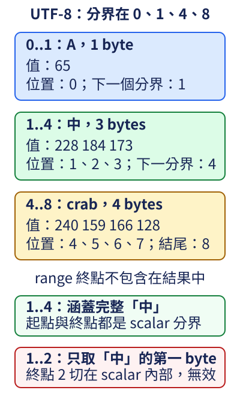

# 3.5 文字範圍：byte 不等於你看到的字

我們已能建立文字與借用整段內容。現在只想從 `A中🦀` 取出中間的「中」。1.7 的 array 可以用位置數字索引；文字還有另一個問題：UTF-8 中一項文字不一定只占一個 byte，範圍不能任意切在其中一項的內部。

## 先決定正在數哪個單位

Unicode 中一個可用來表示文字的基本數值叫 **Unicode scalar（純量值）**。UTF-8 把一個 scalar 編成 1 到 4 個 bytes。**`char`** 是 Rust 保存一個 Unicode scalar 的型別；literal 用單引號，例如 `'中'`，與表示一段文字的雙引號 `"中"` 不同。char 也支援已用的 `{}` 顯示形式，顯示它表示的文字。

一個 char 不一定等於人眼看到的一個完整字形。例如字母 e 和另外一個結合重音符號，可以一起顯示成一個有重音的字母，但其內容有兩個 scalar。因此本節的「完整分界」指 UTF-8 scalar 的分界，沒有保證正好切出一個語言中的字或完整顯示字形。

**str 的 `len()` 回傳 byte 數量，型別是 `usize`。** `"Rust"` 的四個 scalar 各用一個 byte，len 是 4；`A中🦀` 則分別用 1、3、4 bytes，len 是 8。這份長度能界定文字的儲存範圍，但不直接回答有幾個 scalar 或幾個字形。

下面是本例確定的 UTF-8 編碼資料；不是所有中文或所有符號的通用長度規則：

| 文字 | byte 值 | 在整段文字的 byte 位置 | 可取完整項目的 range |
| --- | --- | --- | --- |
| A | 65 | 0 | `0..1` |
| 中 | 228、184、173 | 1、2、3 | `1..4` |
| 🦀 | 240、159、166、128 | 4、5、6、7 | `4..8` |

合法分界因此是 0、1、4、8，最後的 8 是整段文字的結尾。圖中的 crab 標記對應正文第三項 🦀；每張卡片的上界仍沿用「不包含終點」的 range 規則。



取 `1..4` 正好涵蓋「中」的全部三個 bytes。`1..2` 只取得它的第一個 byte，無法獨立構成這個文字內容。因此「兩個數字都在長度內」還不夠，兩端還要位於有效分界。

## get 讓不合法的範圍成為 None

**str 的 `get(start..end)`** 接收一個 byte range，合法時回傳 **`Option<&str>`** 中的 Some，借用那段原文字；不合法時回傳 None。它不會為了這項範圍失敗而 panic，也沒有另外建立 owned String。

合法 range 要求起點不大於終點、兩端不超過文字長度，而且兩端都在 UTF-8 scalar 分界。空 range 也要符合分界：`8..8` 合法，回傳 Some 中的空文字；`2..2` 雖然長度為零，卻位於「中」的內部，仍是 None。

對 String 先使用 `as_str()` 取得 `&str`，再呼叫文字內容的操作。`text.as_str().get(1..4)` 表示先借用整段內容，再從這份借用選出中間區段；這裡每一步的接收型別與用途都是明確的。

下面的 show_range 接收 &str 與兩個 usize，用 match 處理取得與失敗。因為回傳文字仍借自原值，只在原資料有效期間使用；這個函式只顯示，不把借用交回外層。

```rust
--8<-- "examples/ch03-data/examples/utf8.rs"
```

```bash
cargo run -p ch03-data --example utf8 --locked
```

```text
一個 char=中
UTF-8 長度=8 bytes
0..1：有文字「A」
1..4：有文字「中」
4..8：有文字「🦀」
1..2：不是有效文字區段
8..8：有文字「」
4..9：不是有效文字區段
```

Some 的 part 是 `&str`，包含一段符合 UTF-8 的文字；None 沒有 part 可讀。失敗情況 1..2 是切斷 scalar，4..9 是超過範圍，兩者都得到 None；Option 本身沒有保存是哪一種失敗原因。

## 直接 range 索引仍可能 panic

str 能用 `&text[start..end]` 借用一段文字，但它要求相同的有效範圍；不符合時會 panic。單一整數索引則不能用來取得「第幾個 char」，也不是選擇一個 byte 的文字操作。

下面先顯式借用 String 的完整 &str，再以 `1..2` 直接索引，故意切在「中」的內部：

```rust
--8<-- "examples/ch03-data/fixtures/runtime-fail/utf8_boundary.rs"
```

放進練習專案執行，會收到包含 `not a char boundary` 的 panic。這不是 get 的行為；get 正是把這種範圍失敗改成可處理的 None。當位置不是自己已確認過的有效分界時，應保留並處理取得結果。

## 練習：有效空段與無效區段不同

寫 `selected_byte_len(text: &str, start: usize, end: usize) -> Option<usize>`。先用 get 取得區段；Some 時回傳 Some 中的 byte 長度，None 時仍回傳 None。這次交回的是 owned 的長度數字，不是文字 reference。

以同一份 `A中🦀` 驗證：1..4 得到 Some 中的 3；1..2 得到 None；8..8 得到 Some 中的 0。不能把失敗直接改成 0，否則又會丟掉「合法空文字」與「沒有取得文字」的差別。

參考函式放在本章 library 的 text module，沿用 1.9 的 pub mod／use 分工；你也可以先在自己的練習檔案寫函式，完成後再看 [參考函式](https://github.com/birdhackor/learn_rust/blob/main/examples/ch03-data/src/text.rs) 與 [呼叫程式](https://github.com/birdhackor/learn_rust/blob/main/examples/ch03-data/examples/utf8_solution.rs)。執行 `cargo run -p ch03-data --example utf8_solution --locked`，應看到取得 3 bytes、無效區段、取得 0 bytes。

現在已能把原始位置、文字分界與 Option 的取得結果連起。下一節會處理可增長的數值清單，它的索引單位是元素，和本節文字的 byte range 要分開。
