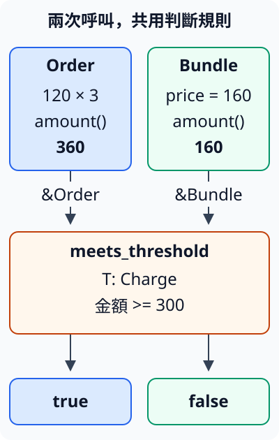

# 4.1 用 trait 說清楚型別要提供的能力

2.5 的 `Order` 能由單價與數量算小計。現在又有一種組合商品，直接保存固定價格。兩者的資料欄位不同，但接下來的工作相同：**判斷這筆金額是否至少為 300**。我們希望門檻規則有一個位置，不必為每種資料各寫一次相同的判斷。

這裡的單價、數量與組合價都採非負小整數，相關運算不超過 `i32` 範圍。我們只判斷金額是否達到門檻，沒有在本節追加運費或處理缺少報價的政策。

## 先保留兩種資料各自的角色

`Order` 沿用單價 `unit_price` 與數量 `count`；`Bundle` 是本節新定義的 struct，其 `price` 已經是整組商品的價格。因此 `Order` 的金額是相乘結果，`Bundle` 的金額直接取已保存的價格。

本章把資料與函式放進 library 的 `charges` module，另由 example target 呼叫，延續 1.9 的分工。`pub struct` 公開型別；欄位前的 `pub` 讓 library 外的呼叫者也能建立與讀取這些欄位。本例需要在呼叫程式中提供單價、數量或組合價，所以公開它們：

```rust
--8<-- "examples/ch04-traits/src/charges.rs:charge-model"
```

它們仍是兩個不同型別。把共同行為接起來，並不需要把 `Bundle` 改成也有單價和數量。

## trait 定義共同的操作契約

**trait** 用來描述一個型別必須提供哪些能力。本例定義 `Charge`，只要求一項操作：`amount` 借用這筆資料，交回它的 `i32` 金額。

`trait Charge { ... }` 宣告契約。裡面的 `fn amount(&self) -> i32;` 是 method 簽名：`&self` 延續 2.5 的 shared 借用，對實作的型別是 `&Order` 或 `&Bundle`；`-> i32` 表示交回數字。這裡先不寫 method body，以分號結束簽名，讓各型別稍後提供自己的做法。`pub trait` 使這項契約可由 library 外使用：

```rust
--8<-- "examples/ch04-traits/src/charges.rs:charge-trait"
```

定義 `Charge` 並沒有替所有型別自動加上 `amount`。它先把使用者所需的介面說清楚：只讀原資料，取得金額；不要求呼叫者知道金額由哪些欄位算出。

## 每個型別實作自己的做法

`impl Charge for Order { ... }` 表示為 `Order` **實作** `Charge`。和前文 `impl Order` 相比，現在額外指出遵循哪項 trait 契約。實作中的 method 簽名要符合契約；body 則依該型別自己的欄位取得答案。

在 `Order` 的實作中，`self` 借用訂單，將單價乘數量；在 `Bundle` 的實作中，`self` 借用組合資料，交回 `price`。trait 實作中的 method 依公開契約供呼叫，這裡不在 `fn` 前再加 `pub`：

```rust
--8<-- "examples/ch04-traits/src/charges.rs:charge-implementations"
```

現在兩者都有 `amount`，而且共享相同的意義與輸出型別。它們的 body 不必相同：我們重用的是「取得金額」這項能力，不是強迫所有資料使用相同欄位。

## 泛型 bound 讓共同工作可以呼叫這項能力

3.3 的泛型函式只保存 `T`，因為它不知道每個 `T` 能做什麼。現在要在函式裡呼叫 `amount`，就需要把這項要求寫進簽名。

**trait bound** 是對型別參數的能力要求。`T: Charge` 的意思是：這個 `T` 必須實作 `Charge`。編譯器檢查每個呼叫所選的具體型別是否符合，因此函式 body 可以依契約呼叫 `value.amount()`。

`meets_threshold` 接收 `&T` 與門檻數字，回傳 `bool`；shared reference 讓它只借用原資料。它先取得金額，再做前文已教的 `>=` 比較。`pub fn` 使兩種資料的呼叫者都能重用這份判斷：

```rust
--8<-- "examples/ch04-traits/src/charges.rs:charge-bound"
```

當 `T` 是 `Order`，`amount` 使用訂單實作；當 `T` 是 `Bundle`，則使用組合實作。兩次呼叫都使用相同的門檻比較，差別留在各型別如何提供金額。

下圖的左右兩條線各代表一次呼叫，沿著各自的資料與結果追蹤。它們分別提供 `&Order` 與 `&Bundle`；中間方框是同一份泛型判斷規則，不是把兩筆資料合成一個值：



函式 body 不需取 `unit_price`、`count` 或 `price`，因為 `Charge` 已提供這項工作的必要資訊。原本也可以為兩種型別分別寫判斷函式；現在把「如何取得金額」留給各實作，把共同的門檻規則留在一處。

## 從 library 外呼叫

用點號呼叫 trait method 時，這項 trait 也要在目前的名稱範圍中。因此下列程式除了引入 `Order`、`Bundle` 和判斷函式，也用 `use ...::Charge;` 引入提供 `amount` 的 trait。這是讓編譯器找到 method 的契約，沒有下載依賴或取得資料的 ownership。

本章 package 名稱是 `ch04-traits`，Rust 中的 library 名稱是 `ch04_traits`，仍沿用 1.9 的連字號與底線規則。因此路徑從 `ch04_traits::charges` 找到下列公開項目：

```rust
--8<-- "examples/ch04-traits/examples/traits.rs"
```

從 repo 根目錄執行：

```bash
cargo run -p ch04-traits --example traits --locked
```

```text
訂單小計=360，組合價=160
訂單達300=true
組合達300=false
訂單仍可讀，數量=3
```

360 達到 300，160 則沒有。最後仍能讀 `order.count`，因為 `amount` 與判斷函式都只借用資料。trait 沒有取消上一章的 ownership 或 borrowing 規則。

### 移除 bound，會失去哪項保證

以下是故意不能編譯的 fixture。先保留 `Charge` 定義，但從函式的 `T` 移除 `: Charge`。函式 body 此時沒有任何理由能假定所有 `T` 都有 `amount`：

```rust
--8<-- "examples/ch04-traits/fixtures/compile-fail/missing_bound.rs"
```

錯誤碼是 `E0599`，重點是找不到此型別參數可用的 `amount` method。問題發生在編譯這份泛型定義時，不必等到執行某筆訂單才發現。補回 bound 表達的是函式本來就需要的能力，不是把某個結果硬塞進程式。

## 用測試保存相同契約

先對各型別交回的數字做 assertion，再驗它們能交給同一個門檻函式。300 應包含在「至少300」之中，301 的門檻則不接受金額300。以下只用已教的數值／布林 assertion；不直接比較整個 struct：

```rust
--8<-- "examples/ch04-traits/src/charges.rs:charge-tests"
```

```bash
cargo test -p ch04-traits --locked
```

目前這個 module 有兩項測試。它們驗證兩份實作提供的金額與門檻邊界；不表示編譯器能自動證明每個實作者都使用了正確的商業規則。trait 檢查簽名和能力，計算是否符合需求仍要由實作與測試確認。

## 練習：加入新的資料，不修改門檻函式

在自己的 example target 定義 `DiscountedBundle`，保存 `original_price: i32` 與 `discount: i32`。輸入採非負小數值，折扣不超過原價；金額等於原價減折扣。為它實作 `Charge`，再使用既有 `meets_threshold`。

以原價360、折扣80驗證金額280：300門檻應是false，280門檻應是true。先自行寫method body與assertion，確認沒有為這個型別再複製一次門檻比較。

完成後可對照 [完整參考程式](https://github.com/birdhackor/learn_rust/blob/main/examples/ch04-traits/examples/traits_solution.rs)，或執行：

```bash
cargo run -p ch04-traits --example traits_solution --locked
```

現在已能定義、實作並要求一項共同能力。下一節會把這個關係用在標準能力上：哪些型別可以比較、顯示完整內容、明確複製，或在交出數值時仍保留原值。

延伸閱讀：[Rust Book：Traits](https://doc.rust-lang.org/book/ch10-02-traits.html)、[繁體 Rust Book：Traits](https://rust-lang.tw/book-tw/ch10-02-traits.html)。兩者使用文字摘要作例子，本節先採數值資料，避免為了教trait提前加入新的文字格式操作。
