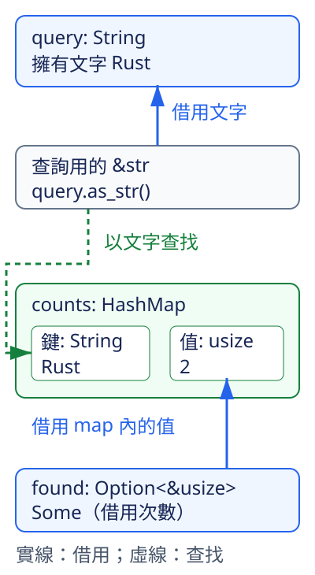

# 4.3 用 HashMap 按名稱分組

第 3 章的 `Vec<String>` 保存一串文字，適合按位置讀取。假設清單依序是 `Rust`、`Python`、`Rust`，現在想得到各名稱出現幾次：

| 名稱 | 出現次數 |
| --- | --- |
| `Rust` | 2 |
| `Python` | 1 |

用既有迴圈也能掃描清單找出每個名稱。我們這次要把結果保存成「名稱對應次數」，之後就可以拿名稱查詢，而不必把清單的位置當成名稱的身分。

`HashMap<K, V>` 保存鍵（key）與值（value）的對應，其中 `K` 是鍵型別，`V` 是值型別。同一個 map 的鍵都用同一型別，值也都用同一型別；相等的鍵只有一筆對應值。本例選擇 `HashMap<String, usize>`：map 擁有名稱文字，次數則是非負整數。

## 鍵要如何判斷是同一個名稱？

上一節的 `PartialEq` 提供 `==`。它的相等判斷需要一致：交換左右仍得到相同結果；若第一個值等於第二個、第二個等於第三個，第一個也應等於第三個；`!=` 的結果則與 `==` 相反。

`Eq` 以 `PartialEq` 為基礎，另外承諾**每個值都與自己相等**。它沒有新增方法，而是要求更完整的相等規則。HashMap 需要用這種規則辨認同一個鍵，避免連相同鍵本身都被判成不同。`String`、`str`、`i32` 和 `usize` 的標準實作都符合本節所需的 `Eq` 契約。

另一項鍵能力是 `Hash`。這裡的 hash 是由鍵的資訊算出、用來引導尋找的數值。HashMap 利用 `Hash` 把鍵的內容提供給這個計算流程，再用 hash 縮小尋找位置，最後用相等比較確認是否為同一個鍵。因此鍵需要 `Eq` 與 `Hash`，而且兩項實作必須配合：

- 相等的鍵，在同一套計算條件下必須得到相同的 hash，查詢才會到正確的地方找它。
- 不同的鍵仍可能得到相同 hash，這叫 collision；所以相同 hash 不能代替最後的相等比較。

本節使用標準型別既有的實作，不需要自己選擇 hash 演算法或計算 hash 數字。稍後自訂鍵時，也會讓欄位的相等與 Hash 使用同一套資料。

## 建立與查詢：保存 String，用 &str 找它

`HashMap` 在標準函式庫的 `std::collections` 中，要先以 `use std::collections::HashMap;` 把名稱放進 scope。這是使用 Rust 自帶的 collection，不需要在 Cargo manifest 加入第三方依賴。

對本例的 `HashMap<String, usize>`，先看四個操作的契約：

| 操作 | 需要什麼 | 得到什麼／改變什麼 |
| --- | --- | --- |
| `HashMap::new()` | 指定或推導鍵與值的型別 | 空 map |
| `counts.insert(name, count)` | mutable 借用 map；傳入 `String` 與 `usize` | 保存鍵值，回傳 `Option<usize>`：新鍵是 `None`，相等鍵已有值則取代值、回傳舊值 |
| `counts.get(name)` | shared 借用 map；傳入查詢文字 `&str` | 找到是 `Some`，其中借用 map 的次數 `&usize`；缺鍵是 `None`，完整結果型別是 `Option<&usize>` |
| `counts.len()` | shared 借用 map | 鍵值對的數量，型別為 `usize`；本例也是不同名稱的數量 |

`insert` 取得傳入鍵與值的 ownership。`String` 名稱因此移入 map；`usize` 是 `Copy`，數值可以複製進去。如果傳入相等鍵，map 保留原先的鍵，替換它對應的值；不是增加另一筆同名項目，也不是自動把兩個次數相加。

為什麼鍵是 `String`，`get` 卻可以用 `&str`？因為這次只是辨認既有名稱，不需要再擁有另一份名稱文字。

`Borrow` 描述這種借用表示的契約：它以型別參數表示要借成什麼型別，並透過 `borrow` 方法取得該表示的 shared reference。標準函式庫已替 `String` 實作 `Borrow<str>`，表示它能提供 `&str`；其文字相等與 Hash 行為和 owned 的 `String` 保持一致。因此 HashMap 可以用 `&str` 的內容去找 `String` 鍵，不必為每次查詢建立一個新 `String`。

這個一致性是必要條件。假設某個自訂鍵把 `Rust` 與 `rust` 算成相等，原樣的 `str` 卻把大小寫視為不同，就不能直接宣稱這兩種表示具有相同的鍵身分。單純「能取得一個 reference」還不夠滿足這個 Borrow 契約。

下面直接用已教的 `.as_str()` 取得查詢文字；map 內部使用既有的 Borrow 實作。查詢文字只供查找，回傳的 `&usize` 是借用 **map 裡的值**，不是借用查詢文字。



圖中藍色實線箭頭指向被借用的資料，綠色虛線箭頭表示查找。上方 `&str` 借用 `query` 的文字；下方 `found` 裡的 reference 借用 map 中的 `2`。因為這兩個來源不同，完成查詢後可以修改 `query`，仍然讀取找到的次數；但在使用結果期間，要保持 map 的借用規則。

先準備一個沿用第 3 章操作的小函式。`owned_text` 接收 `&str`，以 `String::new()` 和 `push_str` 把文字拷入新 `String`，再回傳它。它只讓下面的名稱建構比較短：

```rust
--8<-- "examples/ch04-traits/src/counts.rs:owned-text"
```

完整 example 中，第一次加入 `Rust` 的次數為 `1`，第二次用相等名稱把值換成 `2`。查詢時先用 `query` 的 `Rust` 找到數值，再把 `query` 改為 `Rust 課程`，對照圖中的兩個借用來源。另一個查詢名稱 `JavaScript` 沒有加入，會得到 `None`。

```rust
--8<-- "examples/ch04-traits/examples/hashmaps.rs"
```

```bash
cargo run -p ch04-traits --example hashmaps --locked
```

程式輸出：

```text
第一次加入，沒有舊次數
取代舊次數=1
查到 Rust 次數=2
查詢文字改成=Rust 課程
JavaScript 尚未收錄
不同名稱數=2
```

第二次 `insert` 回傳的是舊次數 `1`，之後查到的是新次數 `2`。`Rust` 與 `Python` 共兩個名稱，所以 `len()` 是 `2`。這些結果都依名稱查詢；map 不承諾按插入順序排列，不能把它的整體印出順序當成固定答案。

## 借用查詢結果仍在使用時，先不要修改 map

第 2 章的 borrowing 規則也適用於 HashMap。`get` 的成功結果借用 map；如果之後還要讀取它，就不能在中間呼叫需要 mutable 借用的 `insert`。

這個故意失敗的例子，先取得 `found`，中間加入另一個名稱，最後才讀 `found`：

```rust
--8<-- "examples/ch04-traits/fixtures/compile-fail/map_borrow_conflict.rs"
```

編譯器會以 `E0502` 指出 shared 借用與 mutable 借用衝突。雖然新增的是另一個名稱，`get` 的回傳契約仍然借用這個 map；不能只依我們知道鍵名不同，就跳過 collection 的借用規則。

若這個任務是先報告舊次數再新增名稱，可以把最後的 `if let` 讀取移到 `insert` 前。結果最後一次使用結束後，便能重新 mutable 借用 map，沿用第 2 章的最後使用規則。

## 從文字清單累加次數

回到本節開頭的需要：遇到同名標籤應該加一，而不是把舊次數換成 `1`。

`get_mut` 和 `get` 的查詢方式相同，但需要 mutable 借用 map。對本例而言，它回傳 `Option<&mut usize>`：找到時可以透過 `*count` 修改 map 內的次數；缺鍵仍是 `None`。

因此每次讀一個標籤，分兩種情況：

1. 已有同名鍵：取得次數的 mutable reference，加一。
2. 尚無同名鍵：加入新鍵與次數 `1`。

輸入清單只借用為 `&[String]`，不能把其中的 `String` 轉移走。`for label in labels` 逐一得到 `&String`；`.as_str()` 借出它的查詢文字。只有缺鍵需要讓 map 擁有名稱時，才用 `(*label).clone()` 複製該 `String`：`*label` 指到原值，`.clone()` 再借用它建立另一個 owned 值，沒有把原清單的元素移走。

```rust
--8<-- "examples/ch04-traits/src/counts.rs:count-labels"
```

`Some` 分支透過目前的 mutable reference 修改值，不再另外借用 map。`None` 分支沒有取得可供後續使用的值 reference，這次查詢的借用可以結束，再用 `insert` 加入新鍵。這正是分開處理兩種結果的用途。

對 `Rust`、`Python`、`Rust`，逐步變化是：

| 這次標籤 | 原本是否存在 | 工作 | 處理後對應次數 |
| --- | --- | --- | --- |
| `Rust` | 否 | 複製名稱並加入 | `Rust` 為 1 |
| `Python` | 否 | 複製名稱並加入 | `Python` 為 1 |
| `Rust` | 是 | 修改既有次數 | `Rust` 為 2 |

函式回傳新建的 map，裡面的鍵是獨立擁有的 `String`，不借用輸入清單。原清單保留 ownership，回傳結果也能在原清單結束後繼續使用。

下面先列出固定的三個查詢名稱。這個 `&str` array 的迴圈逐一取得 `&str` 元素；查不到的名稱在這份報表顯示為 `0（未收錄）`，map 裡並沒有因此新增那個名稱。

```rust
--8<-- "examples/ch04-traits/examples/label_counts.rs"
```

```bash
cargo run -p ch04-traits --example label_counts --locked
```

程式輸出：

```text
Rust=2
Python=1
JavaScript=0（未收錄）
原清單仍有3個標籤
```

### 檢查空清單、重複名稱與回傳 ownership

`usize` 也有 `Debug` 與 `PartialEq`。為了讓測試簡潔，這裡再使用標準 `Option` 的比較：若內部型別可以比較，`Option` 也可以比較；`None` 與 `None` 相等，`Some` 必須兩邊內部值相等才相等，`None` 與 `Some` 不相等。

shared 的數值 reference 比較它借到的數值。因而 `Some(&2)` 表示「成功借到數值 `2`」，可與 `get` 的結果比較。`Option` 和數值 reference 也能用 `Debug` 顯示，所以 `assert_eq!` 可以在失敗時顯示這個查詢結果；`{:?}` 印出成功結果時，例如會得到 `Some(2)`。

以下測試分別確認：重複標籤合併、空清單沒有鍵，以及原清單在內層 scope 結束後，map 的 owned 鍵仍然可查。

最後一個測試先用 `let counts;` 宣告外層名稱，稍後在內層以 `counts = ...;` 給它初值。這次是初始化，並非修改既有值，因此不需要 `mut`；型別可由後面的初值推導。Rust 會檢查在讀取前已完成初始化。名稱宣告在外層，交回的 owned map 因而能留到內層結束後使用。

```rust
--8<-- "examples/ch04-traits/src/counts.rs:counts-tests"
```

```bash
cargo test -p ch04-traits --locked
```

這個 package 現在也包含 4.1 的兩項測試；本節新增三項，執行時五項應全部通過。

## 自訂鍵：兩個欄位一起決定身分

有時名稱不足以分組。例如庫存同時依「地區編號」與「類別編號」區分，地區 `1` 的類別 `2` 和類別 `3` 應該是不同組。

用 `GroupKey` 保存兩個 `i32` 欄位，再採用全部欄位一起判斷的規則。上一節教過 derived `PartialEq` 逐欄比較；derived `Eq` 則要求欄位也有 `Eq`，才能保證每個組合都與自己相等。derived `Hash` 使用全部欄位的 Hash 資訊，因此每個欄位也須有 `Hash`。

這些整數欄位已具備能力，把 `PartialEq`、`Eq` 與 `Hash` 一起生成，就能讓相等判斷和 Hash 遵守同一份欄位結構。若之後自行修改其中一個實作，例如比較時忽略某欄，便需要重新核對相等鍵的 hash 一致性，不能任意混搭不同身分規則。

查詢這個鍵時使用同型別的借用，傳入 `&same`、`&different` 或 `&different_region` 即可；這次借用表示就是鍵本身。下面分別只改類別、只改地區，檢查兩個欄位都參與鍵的身分判斷：

```rust
--8<-- "examples/ch04-traits/examples/custom_keys.rs"
```

```bash
cargo run -p ch04-traits --example custom_keys --locked
```

程式輸出：

```text
地區1、類別2=3
地區1、類別3未收錄
地區2、類別2未收錄
```

如果只生成相等能力，卻少了 `Hash`，呼叫 `insert` 就不符合鍵的要求。以下故意保留這個差別：

```rust
--8<-- "examples/ch04-traits/fixtures/compile-fail/key_without_hash.rs"
```

編譯器會以 `E0599` 指出 `insert` 的 trait 條件未滿足，其中缺少的是 `GroupKey` 的 `Hash`。這和 4.1 一樣，都是使用者還沒提供該操作所需的能力。

## 練習：按名稱合計庫存

這次把「一個標籤算一次」改成「每筆資料附帶數量」。建立 `StockItem`，欄位為 `name: String` 和 `quantity: usize`；輸入依序為 `Rust` 兩件、`Python` 三件、`Rust` 六件。這些是小範例數量，加總不會超過 `usize` 可表示範圍。

寫 `quantity_by_name(items: &[StockItem]) -> HashMap<String, usize>`，只借用原清單，回傳擁有名稱的結果。你要保留本節缺鍵才建立鍵、已有鍵才修改數量的做法，把每次加一改成加上這筆的 `quantity`。沿用第 2 章從 reference 讀取欄位的方式，迴圈中的 `item` 是 `&StockItem`。

完成後檢查：`Rust` 總量是 `8`、`Python` 是 `3`，map 只有兩個名稱，原清單仍有三筆資料。用 `get` 的 `Option` 結果確認不存在的 `JavaScript`，並思考重複名稱為什麼不能每次都直接 `insert` 新數量。

可參考[完整答案](https://github.com/birdhackor/learn_rust/blob/main/examples/ch04-traits/examples/hashmaps_solution.rs)，並執行：

```bash
cargo run -p ch04-traits --example hashmaps_solution --locked
```

下一節會更仔細說明函式回傳 reference 時，如何在簽名中描述它借自哪個來源。

## 延伸閱讀

- [Rust Book：Hash Maps](https://doc.rust-lang.org/book/ch08-03-hash-maps.html)
- [繁體 Rust Book：透過雜湊映射儲存鍵值配對](https://rust-lang.tw/book-tw/ch08-03-hash-maps.html)
- [std：HashMap](https://doc.rust-lang.org/std/collections/struct.HashMap.html)、[Borrow](https://doc.rust-lang.org/std/borrow/trait.Borrow.html)
