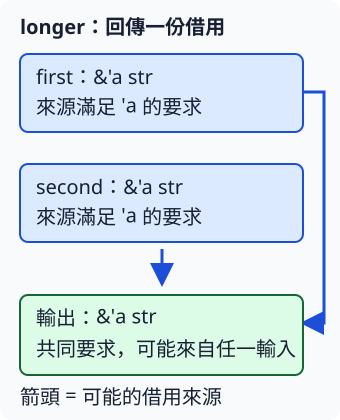

# 4.4 把回傳 reference 的來源寫進契約

3.5 的文字函式借用文字，再交回一個長度數字。現在想讓函式**交回借用的文字本身**，呼叫者之後繼續使用。這不需要重建內容，但還要知道一件事：呼叫後的 reference 借自哪份資料，哪個 owner 必須繼續存活？

2.4 已看到，reference 不能延長被借資料的存活。這一節把相同問題從函式內延伸到輸入與回傳值之間。資料仍用已教的 String／&str，選擇規則只用 str 的 byte 長度與數值比較；沒有增加文字走訪或新的容器。

## 單一來源，省略的關係也存在

先寫一個只把輸入 reference 交回的 `same`。它收到 `&str`，回傳的仍是借自同一份資料的 `&str`；呼叫本身不接手 String，也不複製整份文字。shared reference 可以 Copy，這裡交回的是借用資訊。

當函式只有一個輸入 reference 的 lifetime，Rust 的 **lifetime elision（省略規則）** 會讓省略的輸出 lifetime 連到這個輸入。因此這個函式可以不寫額外標註；省掉的是符號，資料仍必須在回傳借用使用期間有效。

本節使用新的 `ch04-lifetimes` package，library 的 `source` module 提供函式。`pub mod source;`、`pub fn` 與呼叫程式的 `use ch04_lifetimes::source::...;` 都沿用 1.9 的分工，沒有新增依賴。先看 `source.rs` 的第一項契約：

```rust
--8<-- "examples/ch04-lifetimes/src/source.rs:single-source"
```

呼叫程式建立 owned 文字，再把 `as_str()` 借出的內容交給函式：

```rust
--8<-- "examples/ch04-lifetimes/examples/single_source.rs"
```

```bash
cargo run -p ch04-lifetimes --example single_source --locked
```

你會看到 `借回的文字=Rust，長度=4`。`text` 還存在，所以回傳的 view 仍能讀；不是 `same` 結束之後，所有輸入資料都跟著消失。

## 兩個可能來源，不能略去來源關係

現在選兩段文字中 byte 較長的那段，長度相同就選第一段。這裡比較的是 3.5 已教的 byte 數量，和 reference 的 lifetime 長短是兩個不同問題。

函式可能回傳 first，也可能回傳 second。若兩個輸入的 lifetime 都省略，Rust 先把它們視為分開的輸入關係；它無法用單一來源省略規則決定輸出。因此以下是故意不能編譯的完整 fixture：

```rust
--8<-- "examples/ch04-lifetimes/fixtures/compile-fail/ambiguous_output.rs"
```

錯誤碼 `E0106` 的重點是：簽名沒有說輸出借自哪個輸入。Rust 依函式簽名檢查呼叫後的借用，不替每個呼叫者執行 body、猜哪個分支會被選中；這份介面需要描述兩種可能來源都能滿足的使用要求。

## lifetime annotation 描述關係，不延長存活

**lifetime annotation（標註）** 用名稱描述 reference 之間的有效性關係。`'a` 是一個 lifetime 參數名，前面有單引號；它不是文字資料或秒數。

`fn longer<'a>(...)` 在函式名稱後宣告這個參數，和 3.3 宣告型別參數的位置相同。`&'a str` 把它用在 reference 型別中，表示借來的資料至少能滿足 `'a` 所要求的有效範圍。

我們把兩個輸入與輸出都寫成 `&'a str`：呼叫者需要把結果用到哪裡，兩個候選來源就都必須可借到那裡。**這不要求兩個原值在同一時刻建立或結束，也不會把短命資料變長命。** 它描述本次共同可以使用的範圍。

```rust
--8<-- "examples/ch04-lifetimes/src/source.rs:two-sources"
```

下圖兩條箭頭表示輸出可能借自哪個輸入，不表示複製兩份文字。相同 `'a` 表達共同要求，箭頭最後只有一個回傳 reference。



呼叫程式使用前文已教的 `String::new`、`push_str` 與 `as_str`：

```rust
--8<-- "examples/ch04-lifetimes/src/main.rs"
```

```bash
cargo run -p ch04-lifetimes --locked
```

```text
byte 較長的是=Python
交換參數後=Python
```

兩次結果都借自保存 Python 的 String。兩個來源在使用結果時都還存在，因此符合簽名的共同要求。

## 原文字較長，也不能替另一來源延長 lifetime

以下 fixture 的 outside 保存 `Rust tutorial`，inside 保存 `hi`。人可以看出函式會選 outside；但簽名仍允許回傳任一來源，而 inside 在內層 block 結束。把結果帶到外層再讀，便不符合契約：

```rust
--8<-- "examples/ch04-lifetimes/fixtures/compile-fail/source_too_short.rs"
```

這次錯誤碼是 `E0597`，指出 inside 存活得不夠久。annotation 沒有讓 inside 延長；也不是換一個參數名字就能讓它延長。若保留「可能選任一來源」的功能，就在兩來源都存在的區域使用結果。

如果功能改成**只回傳第一來源**，第二來源便不需要約束輸出。以下對照函式刻意保留第二個參數，但用已教的 `_` pattern 略過它、不取名稱；它只為展示不同的來源契約：

```rust
--8<-- "examples/ch04-lifetimes/src/source.rs:first-source"
```

這不是修正較長文字選擇函式的同一種實作，因為現在的需求變了。回傳值只連到 first，第二來源先結束不會使 first 的資料消失。執行下面的兩種合法情況，先在內層使用 longer 的結果，再把只接第一來源的結果帶到外層：

```rust
--8<-- "examples/ch04-lifetimes/examples/source_scope.rs"
```

```bash
cargo run -p ch04-lifetimes --example source_scope --locked
```

兩行都顯示 `Rust tutorial`，但能在哪裡使用結果的理由不同：第一項依兩來源契約留在內層，第二項只依第一來源的有效性。

## 要獨立保存結果，就交出 owned 資料

若函式內新建了一份 String，不能用任意 `'a` 把它的 reference 交出去；原 String 仍隨函式結束。下面是故意不能編譯的 fixture，錯誤碼 `E0515` 指出回傳值借自區域變數：

```rust
--8<-- "examples/ch04-lifetimes/fixtures/compile-fail/local_output.rs"
```

若呼叫者要在來源結束後獨立保存文字，就回傳 owned String。下面用已教的建構與追加操作，把輸入內容放進另一個 String，再交出它的 ownership：

```rust
--8<-- "examples/ch04-lifetimes/src/source.rs:owned-copy"
```

`copy_text` 的名稱表示本次重建文字的工作，不表示 String 具備 `Copy`。它確實建立另一份內容，因此結果不再借用原來源；代價是需要保存另一份文字。

```rust
--8<-- "examples/ch04-lifetimes/examples/owned_output.rs"
```

```bash
cargo run -p ch04-lifetimes --example owned_output --locked
```

輸出是 `來源結束後，owned 結果=Rust`。borrowed 回傳適合讓呼叫者繼續讀已有資料；owned 回傳適合把獨立結果交給呼叫者管理。選擇依需求，不是加越多 annotation 就越好。

## '_ 仍依省略規則推導

**`'_`** 是 lifetime placeholder：保留 lifetime 出現的位置，讓 Rust 依省略規則推導。它不是像 `'a` 一樣宣告的新名稱，也不表示任意存活時間。

對前面唯一來源的 same，把輸入與輸出寫成下面的形式，仍然會連到同一個輸入：

```rust
--8<-- "examples/ch04-lifetimes/src/source.rs:placeholder"
```

執行 `cargo run -p ch04-lifetimes --example placeholder --locked` 會顯示 `placeholder 推導的借用=Rust`。若有兩個獨立的可能來源，改用 `'_` 也不會使歧義自動消失；先說清楚來源契約才是需要完成的工作。

## 不同名稱的有效範圍如何涵蓋

另一種具體需求是：已選片段可能不存在，以 `Option<&str>` 保存；Some 就用原片段，None 則改用 backup。回傳結果要求的範圍叫 `'a`，backup 的可借用範圍叫 `'b`。要從 backup 提供這個結果，就需要 `'b` 至少涵蓋 `'a` 的要求。

**`'b: 'a`** 是 lifetime bound，常讀作「`'b` outlives `'a`」。這裡的意思是「至少涵蓋」，允許同樣範圍，不是必須多活幾秒。我們在宣告 `'b` 時寫 `: 'a`，讓函式能在 None 分支回傳 backup：

```rust
--8<-- "examples/ch04-lifetimes/src/source.rs:outlives"
```

如果原本已選的片段是空文字，它仍是 Some，不改選 backup；這和 3.2 區分有值的零與缺值相同。執行 `cargo run -p ch04-lifetimes --example outlives --locked`，會看到有值時選 Rust、缺值時選 backup。

移除這項 bound 的 [故意失敗 fixture](https://github.com/birdhackor/learn_rust/blob/main/examples/ch04-lifetimes/fixtures/compile-fail/missing_outlives.rs) 會收到 `lifetime may not live long enough`：body 在 None 分支需要從 `'b` 提供 `'a` 的結果，但簽名沒有保證這項涵蓋關係。這裡補的是介面本來需要的保證，不是改變 backup 實際存活多久。

## 練習：第一段空，才選第二段

寫 `first_nonempty`，接收兩個 &str。第一段 byte 長度為零才回傳第二段，否則回傳第一段；兩段皆空就回傳第二段的空文字。先說清楚有哪些可能來源，再寫必要的 lifetime 參數。

用空文字／Rust 得到 Rust，用 Rust／Python 仍得到 Rust，再檢查兩段皆空的結果長度 0。本練習用數值 assertion 檢查長度，並顯示文字核對選擇，先聚焦可能的借用來源；4.2 已教的文字內容比較也能用來檢查結果。

完成後可對照 [參考函式](https://github.com/birdhackor/learn_rust/blob/main/examples/ch04-lifetimes/src/source.rs) 與 [呼叫程式](https://github.com/birdhackor/learn_rust/blob/main/examples/ch04-lifetimes/examples/lifetime_annotation_solution.rs)，或執行 `cargo run -p ch04-lifetimes --example lifetime_annotation_solution --locked`。library 的測試另外檢查兩來源都能提供較長片段、owned 結果不隨來源修改，以及合法空片段不被當成缺值。

現在已能描述函式回傳借用的來源。下一節把 reference 放進 struct：資料模型能保存這份借用，也仍需要遵守相同的有效性關係。
