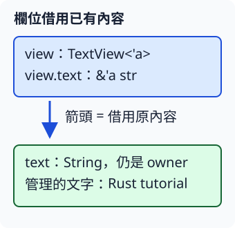

# 4.5 在 struct 中保存借用

上一節讓函式交回 reference。現在想把借來的文字和其他操作收在一個資料模型裡，讓後面的工作使用這份視圖。需要保存的是「如何找到原內容」，沒有需要重建另一份文字。

## 欄位保存 reference，原文字仍有自己的 owner

`TextView` 保存一個 `text: &str` 欄位。這個欄位的有效性要成為型別的一部分，因此定義寫 `TextView<'a>`，欄位寫 `text: &'a str`。`<'a>` 宣告欄位會使用的 lifetime 參數，位置和 3.3 的 struct 型別參數相同。

這個模型**持有 reference 值，但沒有取得被借文字的 ownership**。當我們還要透過它讀文字時，原文字必須保持有效；把 reference 放進 struct，不會延長原 String 的存活。

這次在同一個 library 新增 `views` module，仍由 `src/lib.rs` 的 `pub mod views;` 載入。`pub struct` 與欄位的 `pub` 沿用 4.1：`views` module 外的 example target 需要建立與讀取這個模型，所以公開它們。先定義一個借用欄位：

```rust
--8<-- "examples/ch04-lifetimes/src/views.rs:single-view"
```

圖中 `view.text` 借用原文字；owner 仍是建立 String 的 `text` 變數。雖然兩處都叫 text，`view.text` 是模型中的 reference 欄位，外面的 `text` 是持有 String 的變數。



## 函式回傳含借用的資料模型

要把建立視圖也整理成函式，`make_view` 接收一個 &str，回傳 `TextView<'_>`。這裡將 4.4 的 lifetime placeholder 用在型別路徑：`TextView` 裡的 reference 借自唯一輸入，所以 `'_` 依省略規則連到該來源。它沒有說這份模型可以任意存活。

```rust
--8<-- "examples/ch04-lifetimes/src/views.rs:make-view"
```

下面先直接建立視圖，再由函式建立。兩種方式都保存一份借用資訊，不重建 String；`built.text.len()` 是對 &str 的既有 byte 長度操作：

```rust
--8<-- "examples/ch04-lifetimes/examples/borrowed_model.rs"
```

```bash
cargo run -p ch04-lifetimes --example borrowed_model --locked
```

```text
欄位借來的文字=Rust tutorial
函式建立的視圖=Rust tutorial，bytes=13
```

若改成在內層建立原 String，卻把 TextView 帶到外層再讀，其來源仍會過早結束。下面的 fixture 雖然有 `'a`，仍收到 `E0597`：

```rust
--8<-- "examples/ch04-lifetimes/fixtures/compile-fail/model_source_too_short.rs"
```

被指出的是 inside，而不是「忘了複製 struct」。要讓外層繼續借用，就讓來源存活到外層使用完；若要獨立保存內容，就需要上一節的 owned 結果。

## 借用模型，與模型借用原資料，是不同關係

為這個型別定義 method，寫 `impl<'a> TextView<'a>`：`impl` 後的 `<'a>` 宣告可使用的 lifetime 參數，型別後的 `<'a>` 表明這組 method 適用於使用該參數的 TextView。它不是建立一個固定 lifetime 的全域模型。

method 的 `&self` 是**對這個模型的另一次 shared borrow**。它可以很短，並不必和欄位來源的 `'a` 完全相同。例如原文字存活在外層，TextView 只在內層建立；呼叫 method 又只是內層的一部分工作。

method 有 `&self` 或 `&mut self` receiver 時，省略的輸出 lifetime 會接到這次 receiver 借用。若希望回傳 reference 明確接到欄位的原來源，則可以寫出欄位已有的 lifetime 參數：

| method 契約 | 回傳 reference 的有效性依據 |
| --- | --- |
| `text(&self) -> &str` | 輸出省略，依規則接到這次借用模型的 receiver。 |
| `original(&self) -> &'a str` | 明確接到欄位所借的原文字來源，回傳值不必繼續借用模型本身。 |
| `byte_len(&self) -> usize` | 回傳 owned 數字，沒有要交回的 reference 來源。 |

兩個文字 method 的 body 都讀 `self.text`，但簽名給呼叫者的契約不同。欄位保存的是可以 Copy 的 shared reference，所以交回這份 reference 不需要把整個 TextView move 出去：

```rust
--8<-- "examples/ch04-lifetimes/src/views.rs:view-methods"
```

下面把視圖建在內層。`text()` 的結果在內層使用，`original()` 的結果則交回外層；外部 String 還存在，所以後者符合它的來源契約：

```rust
--8<-- "examples/ch04-lifetimes/examples/method_source.rs"
```

```bash
cargo run -p ch04-lifetimes --example method_source --locked
```

```text
借用 view 時讀取=Rust tutorial
view 結束後，來源仍存在=Rust tutorial
```

這沒有延長 view。模型結束後，回傳的 reference 仍借自有效的原文字。若把上述交出結果的 `view.original()` 換成 `view.text()`，省略的輸出契約會要求借用 view；以下完整 fixture 因 view 在內層結束而收到 `E0597`：

```rust
--8<-- "examples/ch04-lifetimes/fixtures/compile-fail/method_receiver_too_short.rs"
```

修正要依需求：若只在模型被借用期間用結果，省略形式已足夠；若確實想把原來源的借用交出去，就用明確的來源契約。不能把 `&self` 的 lifetime 一概固定成欄位 `'a`，這會混淆兩次借用的角色。

## 多個欄位可以借自不同來源

現在把原模型擴成 `TextPair`，保存 first 與 second。兩份原文字不一定同時結束，因此分別宣告 `'a` 與 `'b`，各欄位連到自己的來源。

當整份模型仍被使用時，必須維持其所需欄位的有效性；兩個名稱沒有使資料變長命。分開命名的用途是讓方法能表達「這項輸出只連到第一來源」或「只連到第二來源」，不必把無關來源也綁到每項結果。

下面的 `first_source` 回傳 &'a str，`second_source` 回傳 &'b str；byte_len 只把兩個已知 byte 數量相加，仍只處理小段文字：

```rust
--8<-- "examples/ch04-lifetimes/src/views.rs:two-view"
```

呼叫程式把 first 放在外層，second 與模型放在內層。內層需要同時讀兩份資料，然後只把第一來源的 reference 交出去：

```rust
--8<-- "examples/ch04-lifetimes/examples/two_models.rs"
```

```bash
cargo run -p ch04-lifetimes --example two_models --locked
```

```text
兩段合計 bytes=17
第二來源=note
第二來源結束後，第一來源=Rust tutorial
```

外層的 saved 不再借用已結束的模型或第二份 String，只連到仍存在的第一來源。這是不同 lifetime 參數讓我們能表達的關係；並非用多個符號使所有資料一起存活。

## 練習：短暫標籤，保留原來源的借用

寫一個只有 `text: &str` 欄位的 `Label`，補上來源 lifetime 參數。為它定義 original method，讓結果連到欄位的來源。

在外層建立內容為 Rust 的 String，內層建立 Label 並取得 original 的回傳值，外層再顯示 Rust。先說明為什麼這段 reference 不依賴 Label 繼續存在，再用長度 4 作數值檢查。不要把來源 String 也移到內層，那會改變這項練習的可用條件。

完成後可對照 [參考程式](https://github.com/birdhackor/learn_rust/blob/main/examples/ch04-lifetimes/examples/borrowed_model_solution.rs)，或執行 `cargo run -p ch04-lifetimes --example borrowed_model_solution --locked`。`cargo test -p ch04-lifetimes --locked` 另檢查模型的文字來源，以及第一來源的結果可以跨越另一來源與模型的結束。

你已經能把 borrowed 資料放在函式與資料模型中，並分開來源與 receiver 的有效性。下一章會依這些介面基礎，為失敗資料設計可讀的格式、轉換方式與傳遞流程。
