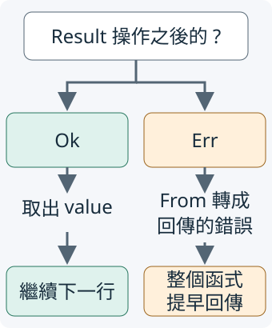

# 5.6　? 傳遞錯誤，把決策留給呼叫者

上一節的解析函式做兩個步驟：解析整數、檢查件數。它知道如何描述失敗，卻不一定知道呼叫者希望停止整批工作，還是先報告這一筆、再處理下一筆。這個決定仍放在呼叫者。

下面先把同一項工作寫成完整的手動傳遞，再使用 `?` 簡化。輸入、檢查規則與 `ParseCountError` 都維持相同，這樣才看得出新寫法改變了哪項工作。

## 先追蹤兩個手動的早退

`parse_count_manual` 接收 `&str`，回傳 `Result<Count, ParseCountError>`。每一步的 `match` 做同一種選擇：成功就取出值，失敗就將錯誤轉成函式宣告的 `ParseCountError`，並以 `return Err(...)` 從整個函式回傳。

`return` 的作用與第 1.6 節相同：不是只離開這個 `match` 或 block。第一步失敗，後面的件數檢查不會執行；第二步失敗，最後的 `Ok(count)` 不會執行。第 5.5 節的兩個 `From` 實作負責封裝原原因。

```rust
--8<-- "examples/ch05-errors/src/propagation.rs:manual-propagation"
```

## ? 保留同一條成功路與失敗路

`?` 是接在可能失敗結果後面的運算子。對本節的 `Result<T, E>`，它做兩件事：

- 遇到 `Ok(value)`，這個表達式交出 `value`，繼續執行目前函式。
- 遇到 `Err(error)`，以 `From::from` 轉成目前函式回傳型別中的錯誤，然後讓**整個函式提早回傳 `Err(...)`**。

來源與目的錯誤型別相同時，也符合這個條件：標準庫已為每個 T 提供從 T 到同一個 T 的 From，原樣交回收到的值。因此 `ParseCountError` 傳回同一型別的錯誤，不需要另寫一份轉換實作；它仍是交接原錯誤的 ownership。

因此 `let value = i32::from_str(text)?;` 取得的是 `i32`，不是 `Result<i32, ParseIntError>`；失敗的路徑已經提早回到呼叫者。成功的最後一行仍要寫 `Ok(count)`，表示整項工作完成。



圖中的箭頭表示這一次執行的方向，只會走其中一條路。左側繼續下一行，右側回到呼叫者，不會走回左側接著檢查。右側的 From 由函式的錯誤型別決定；這裡就是第 5.5 節已提供的 `ParseCountError::from`。

```rust
--8<-- "examples/ch05-errors/src/propagation.rs:question-propagation"
```

第一個 `?` 可能收到 `ParseIntError`，第二個可能收到 `CountError`；它們分別透過已有的 `From` 實作變成 `ParseCountError::Integer` 與 `ParseCountError::Range`。使用 `?` 沒有讓這兩種原因混成一種，也沒有增加新的輸入檢查。

它省下的是反覆寫「成功取值，失敗轉換並早退」的分支。若遇到錯誤時要在這一層選替代值或繼續某段工作，就仍用已學的 `match` 表達那項政策。

## 呼叫者仍決定是否繼續

下面把同一個輸入交給兩種寫法，比較完整的 `Result`。呼叫者再用 `match` 報告成功或失敗，接著處理下一筆。

```rust
--8<-- "examples/ch05-errors/examples/propagation.rs"
```

```bash
cargo run -p ch05-errors --locked --example propagation
```

0、3、100 都取得件數；`abc` 是整數解析失敗；-1 與 101 是件數規則失敗。全部處理後還會列出「呼叫者已決定報告失敗並繼續下一筆」。`?` 讓 helper 提早回傳失敗，沒有替 `main` 決定停止迴圈或停止程式。

## 回傳型別必須接得住失敗

`?` 不能用在任何函式中。例如我們目前的 `main()` 沒有宣告回傳型別，回傳的是 `()`，無法接住解析失敗的 `Err`：

```rust
--8<-- "examples/ch05-errors/fixtures/compile-fail/question_in_unit.rs"
```

編譯器以 `E0277` 指出目前函式不具備使用 `?` 所需的回傳條件。前面的正常程式把 `?` 放在回傳 `Result` 的 helper 裡，`main` 再以 `match` 處理它的結果。

即使函式回傳 `Result`，它的錯誤型別也必須能接住來源。下面刻意只宣告 `CountError`，但整數解析可能產生 `ParseIntError`，而我們沒有提供從它到這個 `CountError` 的 `From` 實作：

```rust
--8<-- "examples/ch05-errors/fixtures/compile-fail/question_without_conversion.rs"
```

這也會得到 `E0277`，重點是 `CountError` 缺少 `From<ParseIntError>`。這個 `CountError` 只描述負數，沒有描述整數文字失敗的 variant；不能為了讓程式編譯，就把任何解析失敗虛構成某個負數。正常版用 `ParseCountError` 保存兩種原因，並提供正確的封裝。

## Option 的 ?：缺值就回傳 None

若工作本來是找資料、缺少時回傳 `None`，`?` 也能接在 `Option<T>` 後面。此時 `Some(value)` 交出值，`None` 讓目前回傳 `Option` 的函式提早回傳 `None`；這條路沒有錯誤 payload 可供 From 轉換。

下面只想讀第二個數字。`values.get(1)` 回傳 `Option<&i32>`；成功後 `value` 是 `&i32`，所以用已學的 `*value` 讀出 Copy 的數字，再以 `Some` 交回。

```rust
--8<-- "examples/ch05-errors/src/propagation.rs:option-question"
```

例中空 array 型別寫成 `[i32; 0]`：沿用第 1.7 節的 `[元素型別; 長度]`，長度為 0。

```rust
--8<-- "examples/ch05-errors/examples/option_question.rs"
```

```bash
cargo run -p ch05-errors --locked --example option_question
```

```text
零筆：None
一筆：None
兩筆：Some(20)
```

缺第二筆不是失敗原因分類的工作，所以用 `Option` 已足夠。

回傳 `Result` 的函式不能直接把 `Option` 上的 `None` 當成自己的錯誤。若需要把缺值轉成某個錯誤，先用 `match` 決定 `None` 的具體原因、回傳相應的 `Err`；`?` 不會替你選擇那個原因。

## 比較行為，並練習多步傳遞

測試用有效邊界、普通成功值與兩種失敗比較手動版和 `?` 版；另一項測試確認第二筆不存在時回傳 `None`，存在時回傳原數字。

```rust
--8<-- "examples/ch05-errors/src/propagation.rs:propagation-tests"
```

```bash
cargo test -p ch05-errors --locked
```

練習：寫 `fn count_pair(first: &str, second: &str) -> Result<(Count, Count), ParseCountError>`，依序呼叫本節的 `parse_count`，兩筆成功才回傳 tuple。使用 `?` 傳遞失敗，不要改寫解析規則。

預測並驗證三種情況：`("0", "100")` 成功；`("abc", "101")` 在第一筆整數解析時就回傳；`("3", "101")` 第一筆成功，第二筆回傳件數規則錯誤。

??? note "參考答案"

    ```rust
    --8<-- "examples/ch05-errors/examples/propagation_solution.rs"
    ```

    執行：`cargo run -p ch05-errors --locked --example propagation_solution`。

現在我們能把失敗政策、錯誤資料、顯示文字、轉換與傳遞接在一起：底層保留原因，函式宣告可回傳的錯誤，上層決定怎麼回應。下一章會學 closure 與 Iterator，再用它們安排清單處理的流程。
