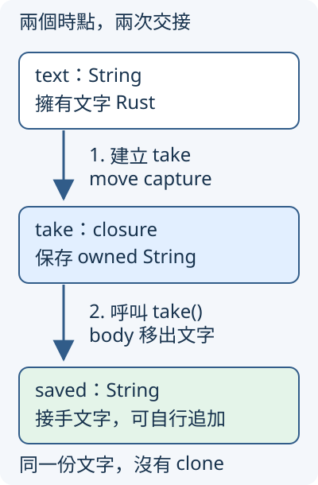

# 6.1 把小段工作和它需要的環境保存在 closure

1.5 已把計算整理成函式。這次想先保存一個運費計算工作，之後交給不同訂單使用；免運門檻已經保存在旁邊的變數，不想在每次呼叫時再傳一次。

普通函式也能完成計算，只要把門檻列為參數。本節要學的是另一種組合：把這段工作與它使用的周圍資料收在一起，形成一個可以保存、之後呼叫的值。

## closure 是可以保存的工作，也可以捕捉環境

**closure（閉包）** 是沒有另取函式名稱的函式形式，可以保存到變數中。它除了收到呼叫時的參數，還可以使用定義位置周圍的變數。這項保存所需資料或借用資訊的行為叫 **capture（捕捉）**；「環境」在這裡指那些外部變數，不是電腦的作業系統。

本章使用 `ch06-iterators` package；Rust 路徑中的 library 名稱是 `ch06_iterators`，沿用 1.9 的連字號／底線規則。這節的各個 example 先各自保存在獨立檔案，還不需要 library 共同介面。

closure 用兩個直線符號包住參數，例如 **`|amount: i32|`**。後面可以接 `-> i32` 與 body，輸入、回傳值和 block 的規則沿用 1.5。將它存進 `shipping_fee` 後，以 `shipping_fee(280)` 呼叫。

下面的 `amount` 是每次呼叫才提供的訂單金額；`free_limit` 則在建立 closure 的位置就已存在，body 從環境取得它。只有門檻這項資料需要 capture：

```rust
--8<-- "examples/ch06-iterators/examples/closure_fee.rs"
```

```bash
cargo run -p ch06-iterators --example closure_fee --locked
```

```text
280 元訂單運費=60
320 元訂單運費=0
```

建立 closure 時還沒有計算某筆訂單的運費；呼叫時才執行 body。這兩個時點分開，才能把準備好的工作先保存，再處理後來到達的金額。

## 省略型別後仍有固定的型別

編譯器常能從 body 與呼叫位置推導 closure 的輸入、輸出型別。單一 expression body 可以略去大括號，像下面的 `|number| number * 2`；若有多個 statement，仍用 block。

`let result: i32` 讓這次計算的型別要求清楚可見。推導成功後，同一個 closure 的參數型別不會在每次呼叫時任意更換：

```rust
--8<-- "examples/ch06-iterators/examples/closure_inference.rs"
```

執行 `cargo run -p ch06-iterators --example closure_inference --locked` 得到 `推導後的數字結果=8`。

這與 3.3 的泛型函式有別。下面先要求 identity 接收、回傳 `i32`，再想用同一個 identity 處理 `bool`，會得到 `E0308`：

```rust
--8<-- "examples/ch06-iterators/fixtures/compile-fail/closure_inference.rs"
```

省略註記讓編譯器補出型別，不代表宣告了泛型參數。初學時可以先寫完整型別，看清輸入／輸出契約，再省略容易辨認的部分。

## 只讀原資料，保存 shared borrow

接著把材料換成已教的 `String`，以便分辨 owner 與借用。工作只需讀取 byte 長度，不需要接手整份文字。

無參數的 closure 寫 **`||`**，這裡兩個直線之間沒有參數；它出現在 closure 的開頭，不是在兩個布林值之間做運算。下面 body 只使用 `as_str()` 和 `len()`，因此編譯器可以用 shared borrow capture `text`。closure 保存這份借用，原 `String` 仍由 `text` 管理：

```rust
--8<-- "examples/ch06-iterators/examples/closure_shared.rs"
```

```bash
cargo run -p ch06-iterators --example closure_shared --locked
```

```text
呼叫前，原文字=Rust
closure 讀到 bytes=4
再呼叫仍是 bytes=4
```

讀原文字和呼叫 closure 都只需要 shared borrow，可以同時保持這些讀取用途。這不是複製另一份 owned 文字；若原文字過早結束，借用它的 closure 也不能繼續使用，和 4.5 保存 reference 的模型相同。

## 要修改原資料，保存 mutable borrow

現在換一項工作：每次呼叫，將原計數增加一，並交回新數字。body 需要修改 `count`，因此 capture 改成 mutable borrow。

`count` 要宣告為 `mut`，才允許修改原數字；保存工作的 `tick` 也要宣告為 `mut`，因為呼叫需要透過 mutable 借用操作它保存的環境。兩個 `mut` 分別作用在原資料與 closure 值，不能只留其中一個：

```rust
--8<-- "examples/ch06-iterators/examples/closure_mutable.rs"
```

```bash
cargo run -p ch06-iterators --example closure_mutable --locked
```

```text
第一次計數=1
第二次計數=2
最後一次使用 tick 後，原計數=2
```

最後一次使用 tick 之後，這份 mutable borrow 不再需要，於是可以直接讀 `count`。2.4 的最後使用點規則沒有因 capture 而消失。

如果在建立 tick 與後續呼叫之間讀 `count`，兩項用途就重疊：closure 仍要持有 mutable borrow，格式化輸出又需要借用原數字。以下完整失敗範例得到 `E0502`：

```rust
--8<-- "examples/ch06-iterators/fixtures/compile-fail/closure_borrow_overlap.rs"
```

把直接讀取移到 tick 的最後一次使用之後，才是這裡符合需要的安排。不是要替 count 建立更多副本，也不是 closure 一建立就永遠鎖住原資料。

## move capture 決定保存什麼，不決定呼叫幾次

如果工作需要自己擁有那份文字，在參數直線前加 **`move`**，寫成 `move || ...`。它要求按值保存所使用的環境資料，和前面的借用 capture 不同。

對沒有 `Copy` 的 `String`，這表示 ownership 從外面的變數交給 closure。下面 body 仍然只讀它保存的文字，沒有把文字交出去，所以能重複呼叫：

```rust
--8<-- "examples/ch06-iterators/examples/closure_owned_read.rs"
```

執行 `cargo run -p ch06-iterators --example closure_owned_read --locked`，兩次都讀到 `4`。這時不能再使用外面的 `text`，但 closure 自己持有的文字仍在。

對 `Copy` 資料，按值 capture 會複製值本身。下面的 `i32` 與 shared reference 都符合；特別注意，複製 `&str` 是複製借用資訊，並沒有取得原 `String` 的 ownership：

```rust
--8<-- "examples/ch06-iterators/examples/closure_move_copy.rs"
```

執行 `cargo run -p ch06-iterators --example closure_move_copy --locked`，第一行兩個數字都是 `300`；第二行仍能直接讀 `view`，closure 讀到 `4`。原 `text` 仍要在這份 reference 使用期間有效。`move` 不會把借來的文字變成獨立 owned 文字。

## 呼叫時移出內容，才需要消耗這份工作

最後把 body 改成直接交回保存的 `String`：`move || text`。這次先在建立時把文字交給 closure，再在呼叫時把文字交給呼叫者，讓後者可以獨立管理、追加內容。

```rust
--8<-- "examples/ch06-iterators/examples/closure_take.rs"
```

```bash
cargo run -p ch06-iterators --example closure_take --locked
```

```text
呼叫後交回的 owned 文字=Rust 教學
```

圖中第一條箭頭對應建立 `take`，第二條對應執行 `take()`。文字的 owner 從 `text` 轉到 closure，再轉到 `saved`；不是先 clone 兩份文字。



這裡交出的 `String` 沒有 `Copy`；呼叫 take 會消耗這份 closure，不能再要求同一份 take 交出第二份文字。若重複呼叫，下面的 fixture 得到 `E0382`：

```rust
--8<-- "examples/ch06-iterators/fixtures/compile-fail/closure_take_twice.rs"
```

所以要分開追蹤兩件事：建立時，環境按值或借用保存；呼叫時，body 讀取、修改或移出什麼。前一個 `move` 只讀範例能呼叫兩次，這個移出範例則消耗 closure，差別在 body 的工作。

## 練習：同一份運費工作也累計處理次數

保留 `free_limit = 300`，另外建立從零開始的 `visits`。讓 shipping_fee 每次收到金額時，先把 visits 加一，再依原門檻交回 `0` 或 `60`。

處理 `280` 與 `320`，確認運費分別是 `60` 與 `0`；在最後一次呼叫後讀 visits，確認是 `2`。先說明哪份資料只讀、哪份需要修改，再決定兩個變數與 closure binding 的 `mut`。

可對照 [參考程式](https://github.com/birdhackor/learn_rust/blob/main/examples/ch06-iterators/examples/closure_solution.rs)，或執行 `cargo run -p ch06-iterators --example closure_solution --locked`。

現在可以把工作保存成值，並追蹤它保存環境的方式。6.2 先建立 trait 的輸出型別關係，接著 6.3 才把這些可呼叫工作的輸入、輸出與呼叫能力寫成函式契約，讓共用函式能接收 closure。

延伸閱讀：[英文 Rust Book：Closures](https://doc.rust-lang.org/book/ch13-01-closures.html)、[簡體 Rust Book：閉包](https://kaisery.github.io/trpl-zh-cn/ch13-01-closures.html)。本節先不使用教材中的 thread 或排序工作，以便把 capture 與呼叫本身讀清楚。
