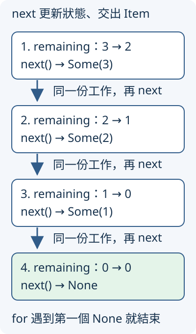

# 6.5 逐筆取得資料：Iterator、IntoIterator 與 ownership

3.6 的清單整理器用索引迴圈，每次要處理下一項，同時維護索引與結束條件。現在希望把「怎麼取得下一筆」收在來源中，讓讀取端不必知道來源是否有索引、是否已先保存全部資料。

本節先建立一個只保存剩餘數字的倒數來源，再將同一套讀取方式用在清單。索引迴圈仍然能完成原工作；新的分工是讓來源負責推進，讀取端只處理交來的每筆資料。

## Iterator 的 Item 與 next

**iterator（迭代器）** 是可逐筆交出資料的值，在 Rust 中由標準 trait **`Iterator`** 描述。它保存推進所需的狀態，例如下一個數字或清單目前位置。

這個 trait 的 associated type 叫 **`Item`**，表示每次交出資料的型別，沿用 6.2 的型別關係。Item 可以是 owned 值，也可以是 reference；不能只由「走訪」一詞判斷 ownership。

核心 method 是 **`next(&mut self) -> Option<Self::Item>`**：透過 mutable receiver 更新 iterator 狀態；有下一筆就交回 Some 包住的 Item，這次走訪結束則交回 None。沒有額外的輸入參數，也不以數字零當成結束訊號。

Iterator 的一般契約允許某些實作在 None 後再次交出 Some；後面的 for 會在**第一個 None** 結束。這節的有限倒數與 slice iterator 則在結束後持續回傳 None，不把這份實作的性質推成所有 iterator 的必要保證。

## 狀態推進由來源實作

倒數來源從 `start` 開始，每次交出目前正整數，再把 remaining 減一。start 小於或等於零，直接交回 None；沒有需要先建立一份倒數清單。

我們在 `streams` module 定義 Countdown 與實作。remaining 不公開，呼叫端透過 `count_down` 建立工作，再使用公開的 Iterator 能力，不直接修改內部狀態。`Iterator` 和稍後的 `IntoIterator` 都是 Rust 預先放進名稱範圍的常用 trait，和 4.2 的 Clone 一樣不必另寫 use。

`type Item = i32` 選定每筆數字型別。factory 的 `impl Iterator<Item = i32>` 則回收 6.4 的 opaque 回傳與 6.2 的 equality bound：回傳某個 Iterator，且每筆 Item 必須是 i32。

```rust
--8<-- "examples/ch06-iterators/src/streams.rs:countdown"
```

建立工作只保存 start，尚未取得第一筆。**lazy（惰性）** 在本例表示數字由 next 推進時才逐筆交出，不是在建立時就先算出並保存整份清單。建構值本身仍然有發生，不表示任何初始化都沒有成本。

下圖追蹤從 3 開始的前四次 next。remaining 是保留在同一份 Countdown 中的狀態，Some 中的數字則交給呼叫者；第四次沒有下一筆，剩餘狀態仍是零。



## 手動呼叫，觀察 Option 結果

4.2 已教 Debug 與 PartialEq。標準 `Option<i32>` 也提供這兩項能力：Debug 顯示 Some 與內容或 None；比較時同為 Some 且內容相等才相等，兩個 None 也相等。因此下面可以用 `{:?}` 直接看結果，library 測試也可以用 assert_eq 檢查這些數值 Option。

保存 iterator 的 stream 要是 mut，因為直接呼叫 next 需要 mutable receiver。第一次仍得到原 start，更新的狀態留給下次呼叫：

```rust
--8<-- "examples/ch06-iterators/examples/iterator_next.rs"
```

```bash
cargo run -p ch06-iterators --example iterator_next --locked
```

```text
第一次 next=Some(3)
第二次 next=Some(2)
第三次 next=Some(1)
第四次 next=None
第五次仍是=None
```

## IntoIterator 建立工作，for 反覆推進它

**`IntoIterator`** 描述「這種輸入如何轉成 iterator」。它與 Iterator 分工不同：前者建立走訪工作，後者負責逐筆交出 Item。

它也有 Item，另外有 **`IntoIter`**，指定所建立的 iterator 型別。對 IntoIter 的要求是 **`Iterator<Item = Self::Item>`**：工作交出的元素，必須和這份 IntoIterator 宣告的一致。associated type 也可以有這種能力要求，不是只放一個沒有條件的名稱。

**`into_iter(self) -> Self::IntoIter`** 按值接收輸入，交回工作。若輸入本身是 reference，接收的是那份 reference；若輸入是 owned collection，接收的才是該 collection。方法名稱中的 into 不會讓所有情況都自動取得原資料的 ownership。

`for value in source` 會先依 source 的 IntoIterator 建立工作，再反覆呼叫 next。Some 的內容進入這次迴圈，第一個 None 結束。所有 Iterator 本身也有 IntoIterator，轉換時直接交回同一份 iterator，所以 Countdown 可以直接交給 for：

```rust
--8<-- "examples/ch06-iterators/examples/iterator_for.rs"
```

執行 `cargo run -p ch06-iterators --example iterator_for --locked`，依序取得 `3`、`2`、`1`，合計 `6`。這裡 for 接手 stream，自己以可修改的方式推進，原 binding 不必寫 mut。沒有重新建立另一個從 3 開始的 iterator。

### 自訂清單也提供同一個建立介面

`Vec<i32>` 的 owned `into_iter()` 會接手 Vec，從頭到尾逐筆交出 i32。回傳工作有標準型別名稱 **`std::vec::IntoIter<i32>`**：std 是標準函式庫 crate，vec 是其中的 module，IntoIter 是 iterator 的型別名稱，不是 IntoIterator trait。

現在以 NumberList 包住 Vec，讓它也能直接交給 for。它的 into_iter 只把欄位中的 owned Vec 轉成工作，沒有重建元素。實作的 `IntoIter` 必須寫出具體型別，所以使用剛才的標準工作型別：

```rust
--8<-- "examples/ch06-iterators/src/streams.rs:into"
```

共用的加總函式只要求 **`S: IntoIterator<Item = i32>`**，不需要知道欄位名稱，也不需要來源能依索引存取。它接手 source、逐筆相加，空來源交回零：

```rust
--8<-- "examples/ch06-iterators/src/streams.rs:sum"
```

1.8 的 range 與剛才的 Countdown 都符合 i32 Item 的要求，所以同一個函式能接收三種來源：

```rust
--8<-- "examples/ch06-iterators/examples/iterator_sources.rs"
```

執行 `cargo run -p ch06-iterators --example iterator_sources --locked`，三種合計都是 `6`。共同的逐筆操作不再綁住特定清單欄位；它仍沒有自動證明資料或加總的商業規則正確。

## 同一份清單，有三條 ownership 路徑

資料改成 `Vec<String>`，才能看清楚是否複製文字、借用文字或交出文字。依工作需要選以下建立方式，Item 型別也跟著不同：

| 建立工作 | 借用或接手什麼 | Item | 結束後原 Vec |
| --- | --- | --- | --- |
| `texts.as_slice().iter()` | shared borrow slice | `&String` | 仍可用；沒有交出 owned String |
| `texts.as_mut_slice().iter_mut()` | mutable borrow slice | `&mut String` | 借用結束後可用，內容可能已改 |
| `texts.into_iter()` | 接手 owned Vec | `String` | 原 Vec 已交出，不能再用 |

**slice 的 `iter`** 從頭到尾交出各元素的 shared reference。**`iter_mut`** 從頭到尾交出各元素的 mutable reference，讓每個元素能個別修改。建立這些 iterator 本身不會走完所有元素；空 slice 的下一筆就是 None，不會因為空清單越界。

借用來源必須在 iterator 與交出 reference 的使用期間保持有效；mutable 路徑也仍遵守其他借用不能重疊的規則。本節顯式使用 as_slice／as_mut_slice，讓取得的視圖與其方法可辨認。

下面分成三段：先借來讀，再借來追加 ending 保存的驚嘆號片段，最後接手每個 String，追加 saved 並保存在新清單。這裡 `for mut item` 讓第三段取得的 owned String binding 可以修改；第二段則透過 mutable reference 修改原元素：

```rust
--8<-- "examples/ch06-iterators/examples/iterator_ownership.rs"
```

```bash
cargo run -p ch06-iterators --example iterator_ownership --locked
```

```text
shared item=Rust
shared item=Python
mutable 走訪後，原第一項=Rust!
owned 第一項=Rust! saved
owned 第二項=Python! saved
```

沒有呼叫 clone。前兩段的 String owner 都在原清單中；第三段把元素交回、再 move 進 saved。最後的結果擁有這些文字，原 texts 已不能使用。

### reference 本身也能是 for 的輸入

標準函式庫也為 `&Vec<T>` 和 `&mut Vec<T>` 提供 IntoIterator，Item 分別是 `&T` 與 `&mut T`。因此可以直接將 reference 交給 for，不先寫 iter；這是 reference 型別自己的 IntoIterator 實作。

```rust
--8<-- "examples/ch06-iterators/examples/iterator_borrowed_forms.rs"
```

執行 `cargo run -p ch06-iterators --example iterator_borrowed_forms --locked`，先讀到 1、2，再將原值改成 11、12。for 接手的是借用資訊，原 Vec 沒有被移走；第二段用 2.3 的 `*item` 修改 reference 指向的數字。

### 借用規則與 move 規則仍存在

以下 iterator 還要繼續交出 mutable reference，卻先讓 Vec 再作一次 mutable 操作。兩份 mutable borrow 重疊，得到 `E0499`：

```rust
--8<-- "examples/ch06-iterators/fixtures/compile-fail/iterator_mut_overlap.rs"
```

owned into_iter 則是另一項限制：整個 Vec 已被接手，不能再用原值。即使元素是 Copy 整數，Vec 本身也沒有 Copy；以下 fixture 得到 `E0382`：

```rust
--8<-- "examples/ch06-iterators/fixtures/compile-fail/iterator_after_move.rs"
```

## 練習：每次減二的倒數工作

建立 StepDown，保存 remaining，實作 `Iterator` 並把 Item 選成 i32。remaining 大於零才交出目前數字，再減二；否則回傳 None。先用小整數 5，避免算術超出範圍。

先直接 next 取得 Some(5)，再把**同一份**工作交給 for，應只剩 3、1，合計 4。這可檢查 for 使用目前進度，沒有從頭重跑。再確認從零開始的工作沒有資料。

可對照 [參考程式](https://github.com/birdhackor/learn_rust/blob/main/examples/ch06-iterators/examples/iterator_solution.rs)，或執行 `cargo run -p ch06-iterators --example iterator_solution --locked`。library 測試另檢查一般倒數的連續狀態、零／負數來源，以及共用函式能處理不同來源與空來源。

現在能分開來源、建立 iterator 與 next 推進，也能追蹤每筆 Item 的 ownership。下一節把逐筆篩選、轉換與收集加入這份流程，仍以明確的輸入／輸出型別讀每個步驟。

延伸閱讀：[英文 Rust Book：Iterators](https://doc.rust-lang.org/book/ch13-02-iterators.html)、[簡體對應章](https://kaisery.github.io/trpl-zh-cn/ch13-02-iterators.html)、[std：Iterator](https://doc.rust-lang.org/std/iter/trait.Iterator.html)、[IntoIterator](https://doc.rust-lang.org/std/iter/trait.IntoIterator.html)。
