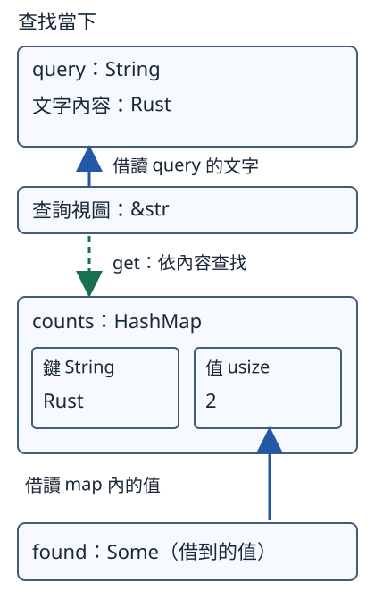

# 6.5 HashMap：用名稱查值與修改既有值

Vec 適合按位置讀資料。現在要保存「Rust 有幾件、Python 有幾件」，再用名稱查詢，不想把清單索引當成名稱的身分。**`HashMap<K, V>`** 保存鍵（key）對應到值（value）；同一個 map 的鍵採用同一型別，值也採用同一型別。

本節先用 `HashMap<String, usize>`：map 擁有名稱文字，對應值為非負整數。同一個相等鍵只保留一筆對應；後面才把這些操作連成掃描清單的分組函式。

## 鍵的相等與 Hash 要配合

第 6.2 節已用 PartialEq 比較內容。**`Eq`** 在相等比較上另外承諾每個值都與自己相等；它沒有新增方法。HashMap 用這種規則認出同一個鍵。String、str、i32、usize 的標準實作都符合本節所需的 Eq。

**`Hash`** 讓鍵提供資訊給 hash 計算，用計算結果縮小尋找位置，最後再以相等比較確認鍵。這兩項能力必須配合：在同一套計算條件下，相等鍵要有相同 hash；不同鍵也可能得到相同 hash，稱為 **collision**（碰撞），所以仍需最後的相等比較。

本節先用標準 String 已有的 Eq 與 Hash，不自己選 hash 演算法或計算數字。map 也不保證按插入順序列出資料，因此我們會指定名稱查值。

## 建立 map，第一次加入一個名稱

HashMap 位於標準函式庫的 `std::collections`，要以 `use std::collections::HashMap;` 引入名稱，不需增加第三方依賴。`HashMap::new()` 建立空 map，接收變數的 `HashMap<String, usize>` 註記決定鍵與值型別。

`insert(key, value)` 需要 mutable 借用 map，取得傳入鍵與值的 ownership，回傳 `Option<usize>`。若原本沒有相等鍵，新增後回傳 None；若原本已有，稍後會看到回傳舊值的情況。String 因而 move 進 map，usize 則可 Copy。

先準備一個只負責建立文字的小 helper。`owned_text` 全部使用第 3.8 節已教的操作；它把借來的文字拷進新 String，再交回：

```rust
--8<-- "examples/intro-workspace/trait-stages/examples/map_support/mod.rs"
```

下面第一次加入 Rust→1；match 回傳的 None，顯示沒有舊次數：

```rust
--8<-- "examples/intro-workspace/trait-stages/examples/map_lookup.rs:new-insert"
```

## 同鍵 insert 取代值，不會自動相加

再放入內容相等的 Rust 鍵，這次值為2。insert 取代對應值，回傳 Some 中的舊值1；原先保存的鍵保留，不會多出另一筆相等鍵。接著加入不同的 Python：

```rust
--8<-- "examples/intro-workspace/trait-stages/examples/map_lookup.rs:replace"
```

處理後是 Rust→2、Python→1。新值2是呼叫者這次提供的，不是 insert 把1自動加上1。累加需要我們另外指定更新工作。

## get 借讀值：String 鍵可以用 &str 找

`counts.get(name)` 只需 shared 借用 map；對這個 map，可以提供查詢文字 `&str`。結果型別是 **`Option<&usize>`**：找到時 Some 保存 map 內值的 shared reference，缺鍵時 None，不移除資料或建立新鍵。

這裡鍵是 String，查詢卻用 &str，依靠標準的 **`Borrow<str>`** 契約。Borrow 用型別參數表示要借成哪種型別，並透過 borrow 方法提供該型別的 shared reference。String 已有這份實作，能提供 &str；借出表示的 Eq 與 Hash 行為必須與 owned 鍵一致，查找才能回到同一個鍵。

我們已會用 `as_str()` 取得視圖，這裡不需要自己實作或呼叫 borrow。它也不只是「能取得任意 reference」：若某自訂鍵把 Rust 與 rust 當相等，原樣的 str 卻區分大小寫，就不能宣稱兩者有相同的鍵身分。

查詢文字與查到的值來自不同對象。圖畫的是**查找當下**：藍色實線表示借讀，綠色虛線表示依文字查找。上面的視圖借 query，下面結果中的 reference 借 counts 內的2：



查找完成後，對 query 的暫時借用結束；結果的 reference 仍借 map。因此接著修改 query 的文字，不會把剛才找到的 map 值改掉：

```rust
--8<-- "examples/intro-workspace/trait-stages/examples/map_lookup.rs:query"
```

found 仍讀到 Rust 的2，query 則顯示 Rust 課程。不能把 found 當作借自 query 的結果。

## 缺鍵與不同名稱的數量

JavaScript 沒加入，所以 get 回傳 None。`len()` 只借讀 map，回傳鍵值對數量 usize；本例也是不同名稱數2：

```rust
--8<-- "examples/intro-workspace/trait-stages/examples/map_lookup.rs:missing"
```

這裡的 `assert_eq!` 使用第 6.2 節已教的 usize 能力。缺鍵並沒有因查詢而新增。

## 借讀結果仍要使用時，不能插入

get 的結果借 map，後面仍要讀取它時，中間不能呼叫需要 mutable 借用的 insert。即使新插入的名稱不同，這個回傳契約仍然借用 map。

下面完整的預期編譯失敗例，先取 found，中間插入 Python，最後才讀 found，會得到 **E0502**：

```rust
--8<-- "examples/intro-workspace/trait-stages/fixtures/compile-fail/map_borrow_conflict.rs"
```

若工作是先顯示舊值再插入，把最後的 if let 讀取移到 insert 前。借讀的最後使用完成後，便能再 mutable 借用，沿用第 3.5 節的順序規則。

## get_mut 借改既有值

**`get_mut`** 使用相同的查詢方式，但需要 mutable 借用 map，結果為 **`Option<&mut usize>`**。找到時經由 `*count` 修改 map 內的數字；缺鍵仍是 None，不會自動插入。

下面完整程式先把 Rust 的2加成3，再觀察不存在的 JavaScript。`Some(&3)` 的比較依第 6.2 節：Some 的 reference 比較借到的數值。

```rust
--8<-- "examples/intro-workspace/trait-stages/examples/map_update.rs"
```

```bash
cargo run --manifest-path examples/intro-workspace/Cargo.toml -p intro-trait-stages --example map_update --locked
```

```text
更新後=Some(3)
JavaScript 尚未收錄，沒有新增
```

map 仍只有一個鍵。這裡完成一項查詢後更新，尚未掃描清單或決定新鍵何時加入。

## 完整設定與查詢程式

這些 targets 只載入同頁的 map_support，其完整內容只有 owned_text。沒有載入下一節的分組函式。完整 member manifest 與查詢根檔案：

```toml
--8<-- "examples/intro-workspace/trait-stages/Cargo.toml"
```

```rust
--8<-- "examples/intro-workspace/trait-stages/examples/map_lookup.rs"
```

```bash
cargo run --manifest-path examples/intro-workspace/Cargo.toml -p intro-trait-stages --example map_lookup --locked
```

```text
第一次加入，沒有舊次數
取代舊次數=1
查到 Rust 次數=2
查詢文字改成=Rust 課程
JavaScript 尚未收錄
不同名稱數=2
```

## 練習與完整答案

加入 Rust→5、Python→3，再以 insert 把 Rust 改成7，確認回傳舊值5。用 get_mut 將 Python 加2，最後確認 Rust7、Python5、缺少JavaScript，map仍有兩個名稱。

完整答案沿用本頁 manifest 與 map_support：

```rust
--8<-- "examples/intro-workspace/trait-stages/examples/map_lookup_answer.rs"
```

```bash
cargo run --manifest-path examples/intro-workspace/Cargo.toml -p intro-trait-stages --example map_lookup_answer --locked
```

輸出 `Rust=Some(7)，Python=Some(5)`。取代值、借改值、缺鍵三種情況已各自可觀察；下一節才把它們連成完整的分組工作。

[下一節：分組、owned 鍵與自訂鍵](06-06-lesson.md)
