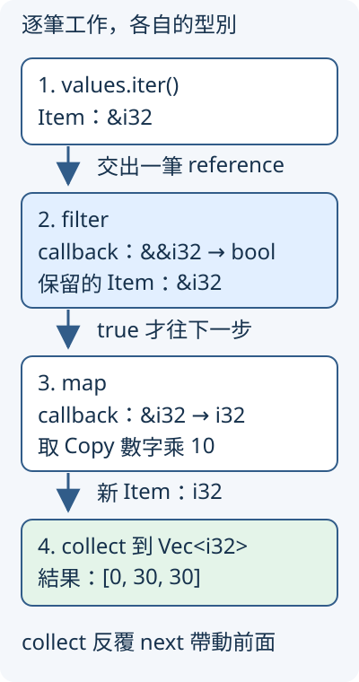

# 6.6 逐筆篩選、轉換，再依目標收集

3.6 的整理器保留非負數；現在多一項需要：保留大於或等於門檻的數字，再乘上指定倍率，保存結果供後面的工作使用。材料 `[-2, 0, 3, 3]`、門檻 0、倍率 10，應得到 `[0, 30, 30]`，保留原順序與重複值。

既有迴圈仍能完成這件事。這次把逐筆工作拆成可組合的 iterator 步驟，讓每一步的資料型別與操作可辨認。本節的算術都用不溢位的小整數。

## map 接手 Item，交出下一種 Item

**iterator adaptor** 是取得原 iterator、建立另一份逐筆工作的 method。新工作按值接收原 iterator，保存它與需要的 callback，不主動呼叫 clone；交接仍依來源型別的 Copy／move 規則。它也不是先把全部元素整理成另一份清單。

**`map`** 接收原 iterator 與一份 `FnMut` callback。每次需要下一筆時，它取得原 Item，交給 callback，再交出 callback 的回傳值。callback 因而可以改變 Item 型別；map 本身回傳的是另一個 Iterator，還沒有收集全部結果。

先只將數字乘二。slice 的 iter 交出 `&i32`，所以 map callback 接收 `&i32`，以 `*item` 讀出 Copy 數字，再交回 i32；新工作的 Item 就是 i32。

```rust
--8<-- "examples/ch06-iterators/examples/adapter_map.rs"
```

```bash
cargo run -p ch06-iterators --example adapter_map --locked
```

```text
建立完成，尚未走訪
map 處理=10
for 收到=20
map 處理=20
for 收到=40
實際 callback 次數=2
```

建立 map 後先出現「尚未走訪」，callback 的訊息則和 for 收到的資料交錯：每次推進才處理當筆。visits 被 callback mutable 借用，最後一次使用工作之後才讀它，沿用 6.1 的 capture 規則。

## filter 借用 Item 判斷，保留的仍是原 Item

**`filter`** 也建立新 iterator，但 callback 只判斷是否保留。它收到 **`&Item`**，回傳 bool；true 讓原 Item 繼續交出去，false 略過它，再尋找後續符合條件的資料。它不因判斷而將 Item 改成 bool。

本例的原 Item 已是 `&i32`，所以 callback 參數會是 **`&&i32`**：外層 reference 借用這次取得的 Item，裡面的 reference 指向原數字。`**item` 連續取出兩層借用指向的 Copy 數字，才拿來比較。filter 之後的 Item 仍是 `&i32`，下一個 map 只需要一個 `*`。

第二組改用 owned String：into_iter 的 Item 是 String，filter callback 才是 `&String`；判斷後保留的 Item 仍是 owned String。文字以 5.5 的 `to_owned` 建立，沒有新增字元走訪方法：

```rust
--8<-- "examples/ch06-iterators/examples/adapter_filter.rs"
```

執行 `cargo run -p ch06-iterators --example adapter_filter --locked`，數字依序保留 0、3、3，文字保留 Rust。`hi` 的 byte 長度不足 4，所以略過；不是把全部文字轉成長度數字。

若對 shared slice 的 filter callback 只寫 `&i32`，和要求的 `&&i32` 就不同。以下 fixture 得到 `E0631`，指出 callback 的參數契約不符：

```rust
--8<-- "examples/ch06-iterators/fixtures/compile-fail/filter_reference_level.rs"
```

## collect 由目標型別決定如何建立結果

篩選與轉換都只產生工作。要保存全部結果，使用 **`collect`**：接手 iterator，反覆取得 Item，依指定的目標型別建立產物。

建立產物的能力由 **`FromIterator<A>`** 描述，A 是輸入元素型別。這個 trait 的 `from_iter` 接收能提供 A 的 IntoIterator，交回目的型別自身；和 6.5 的 IntoIterator 建立走訪方向相反。標準 `Vec<T>` 能從 T 元素依取得順序建立，例如 `Vec<i32>` 接收 i32 元素。

collect 沒有一個固定回傳型別。`let result: Vec<i32> = ...collect();` 指定結果是 Vec；在下面的 helper，回傳型別 `Vec<i32>` 也提供相同線索。map 已把 `&i32` 變成 owned i32，這份目標才能接住：

```rust
--8<-- "examples/ch06-iterators/src/adapters.rs:organize"
```

| 步驟 | 這一步的 callback | 交給下一步的 Item |
| --- | --- | --- |
| slice iter | 沒有 callback | `&i32` |
| filter | `&&i32 -> bool` | 原來的 `&i32` |
| map | `&i32 -> i32` | i32 |
| collect 到 `Vec<i32>` | 沒有 callback | 完成的 owned Vec |

下圖的箭頭是逐筆資料與型別的流向；collect 的推進會帶動前面的工作，不是先建立圖中每一站的完整中間清單。



標準 `Vec<T>` 當元素有 Debug 時也能 Debug，顯示元素清單；元素有 PartialEq 時，同長度且各位置相等才相等，因此本節能用 `{:?}` 顯示結果、用 assert_eq 比較 `Vec<i32>`。

如果直接把 `&i32` 收進 `Vec<i32>`，collect 不會自動把 reference 變成數字。這個 fixture 以 `E0277` 指出目標沒有從這種 Item 建立的契約；先 map 取出 Copy 數字，才是前面正常版的安排：

```rust
--8<-- "examples/ch06-iterators/fixtures/compile-fail/collect_reference_items.rs"
```

### 自訂目的型別也能提供 FromIterator

6.5 的 NumberList 已能交出 i32。現在讓它也能**從 i32 元素建立**：實作 `FromIterator<i32>`，其中泛型 S 只要求 `IntoIterator<Item = i32>`，用原來的 for 與 push 保存資料，最後交回 Self。

下面 source 的 trait 名稱來自 `use std::iter::FromIterator;`，NumberList 來自 `use crate::streams::NumberList;`，都沿用先前的逐條 use 路徑：

```rust
--8<-- "examples/ch06-iterators/src/adapters.rs:from-iterator"
```

下面先執行整理，再用不同的目標表示法收集 range。`collect::<Vec<i32>>()` 在 method 指定結果型別，回收 3.3 的 turbofish；**`Vec::<i32>::from_iter`** 則先在型別路徑指定 Vec 的元素型別，再透過 `::` 呼叫這個型別提供的 from_iter。自訂 NumberList 以變數型別註記指定目標，選同樣的 i32 Item，但建立的結果型別不同：

```rust
--8<-- "examples/ch06-iterators/examples/adapter_collect.rs"
```

執行 `cargo run -p ch06-iterators --example adapter_collect --locked`，整理結果是 `[0, 30, 30]`，自訂目的型別的 values 是 `[1, 2, 3]`。FromIterator 不替本例做額外驗證；它依我們寫的建立方式保存資料。

## fold 把每筆資料收進一份累計狀態

如果只需要總和，不需要保存所有轉換結果，可以用 **`fold`**。它接手 iterator、初始值與 `FnMut` callback，按序把「目前累計狀態、這次 Item」交給 callback。callback 交回下一份累計狀態，最後整個 fold 回傳它；空 iterator 則直接回傳初始值。

這份狀態叫 **accumulator（累計狀態）**。本例選 i32、初始值 0；map 之後的 Item 也是 i32，所以 callback 是 `|total: i32, value: i32| total + value`。狀態與 Item 是兩個角色，不必在所有 fold 中選相同型別：

```rust
--8<-- "examples/ch06-iterators/src/adapters.rs:fold"
```

執行 `cargo run -p ch06-iterators --example adapter_fold --locked` 得到合計 60。累計依序是 0 + 0、0 + 30、30 + 30；沒有建立 `[0, 30, 30]` 的中間 Vec。這也能用 for 累計，fold 的用途是將初值和每筆更新放在同一份介面，沒有承諾比原迴圈更快。

## Result collect：全部成功，才交回成功清單

接著把材料換成整數文字。5.5 的 `as_str().parse::<i32>()` 回傳 `Result<i32, ParseIntError>`，現在希望把整批解析結果收成一份成功清單；遇到第一個失敗，就保留那個原因交回。

標準 Result 提供相應的 FromIterator 實作，目標是 **`Result<Vec<i32>, ParseIntError>`**：

- 每筆 Ok 的 i32 進入 Vec；全都成功，交回 Ok 包住的 Vec。
- 第一次遇到 Err，就停止取得後面的 Item，交回那個 ParseIntError。之前的成功清單不作為部分結果回傳。
- 空來源沒有失敗，結果是 Ok 包住空 Vec。

這份收集保留同一個錯誤型別，**不會像 5.6 的 ? 一樣替你套用 From 改成另一個錯誤型別**。它選擇的是這次整批工作遇錯就回傳的政策，不是把所有失敗一次收集起來。

對 `&[String]`，iter 的 Item 是 `&String`；map 收到 `&String`、回傳 `Result<i32, ParseIntError>`；collect 才取得這些 Result，交出整批結果。本節錯誤型別以 `use std::num::ParseIntError;` 引入，沿用 5.5 的標準型別：

```rust
--8<-- "examples/ch06-iterators/src/adapters.rs:parse-all"
```

下面額外計數，觀察第三筆 `30` 是否真的沒有解析。callback 每次先把 visits 加一，再 parse；把整數文字變成 owned String 的 to_owned 同樣來自 5.5：

```rust
--8<-- "examples/ch06-iterators/examples/adapter_results.rs"
```

執行 `cargo run -p ch06-iterators --example adapter_results --locked`，會顯示 ParseIntError 的失敗訊息，以及 `實際解析次數=2，原清單筆數=3`。第一筆 10 成功，第二筆 bad 失敗，第三筆沒有執行 callback。借用原清單不會把第三筆或原 String 消耗掉，但這次 collect 沒有交回第一筆成功值。

如果需要逐筆報告並繼續，仍用 5.1 的 for／match 政策；不能在使用這項 Result collect 的同時，假定後面的每筆工作都已執行。

## 練習：整批解析成功才合計

寫 parse_total，接收 `&[String]`，回傳 `Result<i32, ParseIntError>`。重用本節 parse_all，成功取得 Vec 後再用 owned into_iter 與 fold 合計；失敗用 5.6 的 ? 交回。這裡兩層錯誤型別相同，保留原 ParseIntError，不需要新增轉換規則。

`0`、`3`、`-2` 得到 Ok(1)；空清單得到 Ok(0)；含 bad 的清單得到解析失敗。只用不溢位的小數字，這項練習沒有增加溢位政策，也不把無效文字當成零。

可對照 [參考程式](https://github.com/birdhackor/learn_rust/blob/main/examples/ch06-iterators/examples/adapter_solution.rs)，或執行 `cargo run -p ch06-iterators --example adapter_solution --locked`。library 測試另核對保留順序與重複值、空來源、原輸入保留、自訂目的型別與第一個錯誤後的 callback 次數。

現在可以依序讀每一步的 Item、callback 參數與最後目標，也能分辨完成所有工作和遇錯短路。下一節把相同流程用到文字與統計，最後明確排序產生可重現的輸出。

延伸閱讀：[英文 Rust Book：Iterator Adaptors](https://doc.rust-lang.org/book/ch13-02-iterators.html#methods-that-produce-other-iterators)、[簡體對應章](https://kaisery.github.io/trpl-zh-cn/ch13-02-iterators.html#产生其他迭代器的方法)、[FromIterator](https://doc.rust-lang.org/std/iter/trait.FromIterator.html)、[Result 收集](https://doc.rust-lang.org/std/result/enum.Result.html#impl-FromIterator%3CResult%3CA,+E%3E%3E-for-Result%3CV,+E%3E)。
