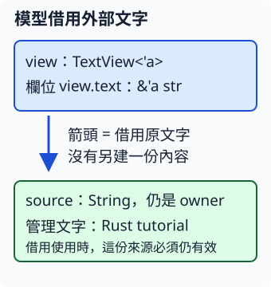

# 7.3 struct 保存 reference：讓模型借讀原資料

第 7.2 節讓函式交回借用。現在想把這份借用保存在一個模型裡，讓相關操作都從模型取得文字。我們需要保存的是已有文字的視圖，沒有需要重建 String；因此欄位保存 `&str`。

## lifetime parameter 也能寫進 struct

`TextView` 的 text 欄位保存 reference。欄位的來源要求要跟著型別走，所以在型別名稱後宣告 `<'a>`，欄位寫成 `&'a str`：

```rust
--8<-- "examples/intro-workspace/lifetimes/examples/view_basic/views/mod.rs:text-view"
```

這與第 5.1 節在 struct 後宣告型別參數的位置相同；這次的參數描述借用有效範圍。`pub struct` 與欄位的 `pub` 各自公開型別和欄位，沿用第 3.1 節的規則，讓 module 外的呼叫者可以建立模型。

TextView 持有一個 reference 值，**沒有取得被借文字的 ownership**。當程式還要經由模型使用這個欄位時，來源必須有效。將 reference 放進 struct，不會讓原 String 多活一段時間。



圖的上框是模型 view，下框的 source 才是原 String 的 owner；箭頭表示借用原內容。`view.text` 是模型的 reference 欄位，source 是持有文字資源的外部變數，兩者角色不同。

## 函式可以交回含借用的模型

直接建立 TextView 時，用欄位初始化提供 `source.as_str()`。也可以把建立工作收在 make_view：接收 `&str`，回傳包含這份借用的模型。

回傳型別的 **`TextView<'_>`** 把第 7.2 節的 placeholder 用在型別名稱後。這裡只有一個輸入 lifetime，`'_` 依省略規則連到輸入；回傳模型的欄位便借自該來源。

```rust
--8<-- "examples/intro-workspace/lifetimes/examples/view_basic/views/mod.rs:make-view"
```

`TextView { text }` 是第 3.6 節的欄位簡寫，相當於 `TextView { text: text }`。它把參數收到的 reference 放進欄位，沒有複製文字內容。

## method 先只交出數字

接著新增 `byte_len`，讓模型回答所借文字有幾個 bytes。`impl<'a> TextView<'a>` 的第一個 `<'a>` 宣告這個 impl 可使用的 lifetime 參數；型別後的 `<'a>` 把它用於 TextView。

`&self` 仍是第 3.6 節的 shared 借讀，這次借讀模型本身。方法再沿著 self.text 找到欄位借來的文字，呼叫既有的 len：

```rust
--8<-- "examples/intro-workspace/lifetimes/examples/view_basic/views/mod.rs:byte-len"
```

回傳的是 owned 的 usize 數字。它沒有把模型或文字的 reference 交出去，因此這次查詢用完後，數字可以獨立保存；下一節才處理 method 也交回 reference 的情況。

## 完整程式：兩種建立方式，都保留外部 owner

這個階段使用前兩節相同的 no-lib package，完整設定如下：

```toml
--8<-- "examples/intro-workspace/lifetimes/Cargo.toml"
```

folder example 根檔案是 `examples/view_basic/main.rs`。它的 `mod views;` 只載入旁邊的 `views/mod.rs`，完整 helper 只有本頁的 TextView、make_view、byte_len：

```rust
--8<-- "examples/intro-workspace/lifetimes/examples/view_basic/views/mod.rs"
```

完整呼叫者先直接建立 view，再由函式建立 built；最後也讀原 source，觀察文字沒有被交走：

```rust
--8<-- "examples/intro-workspace/lifetimes/examples/view_basic/main.rs"
```

```bash
cargo run --manifest-path examples/intro-workspace/Cargo.toml -p intro-lifetimes --example view_basic --locked
```

```text
直接建立，欄位文字=Rust tutorial
函式建立，欄位文字=Rust tutorial
方法查到的 bytes=13
owner 仍持有文字=Rust tutorial
```

兩種建立方式都借讀同一份來源，byte_len 得到 13。這次把借用收進模型，是讓文字視圖與相關查詢放在一起；原文字仍由 source 管理。

## 模型不能把已結束的來源帶出去

把原 String 放到內層，只讓 TextView 到外層，仍會失敗。下面是全部程式：

```rust
--8<-- "examples/intro-workspace/lifetimes/fixtures/compile-fail/model_source_too_short.rs"
```

放進獨立練習專案執行 `cargo check`，得到 **E0597**。inside 在 block 結束時結束，外層卻還要使用 view.text；模型持有 reference，沒有接手或延長原 String。完整 `.expected` 如下：

```text
--8<-- "examples/intro-workspace/lifetimes/fixtures/compile-fail/model_source_too_short.expected"
```

若外層需要繼續借讀，就把來源保留在外層，如前面的成功程式。若只需要一個查詢結果，則可在內層先算出 owned 數字再交出去。

## 練習與完整答案

建立只有 text 借用欄位的 `Label<'a>`，提供 byte_len method。在內層建立內容為 Rust 的 String 及 Label，顯示標籤，再把 byte_len 的數字交到外層。外層檢查長度 4；不要把借自內層的 Label 或 `&str` 帶出去。

完整答案沿用本頁 manifest，沒有其他 helper：

```rust
--8<-- "examples/intro-workspace/lifetimes/examples/view_answer.rs"
```

```bash
cargo run --manifest-path examples/intro-workspace/Cargo.toml -p intro-lifetimes --example view_answer --locked
```

```text
內層借讀標籤=Rust
來源與模型結束後，留下 bytes=4
```

saved_length 是獨立的 usize，不再依賴內層模型或原文字。下一節保留外部文字、縮短模型的 scope，再比較 method 交回 reference 時可以依賴哪個來源。

[下一節：receiver 借用與欄位來源](07-04-lesson.md)
