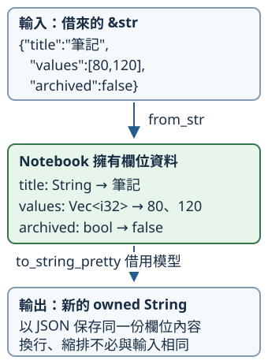

# 7.7 JSON 與 Serde：文字和 owned 資料模型

7.3 已能讀到完整 UTF-8 文字。現在筆記不只是一段內容，還要保存標題、數值清單與是否封存，讓下一次程式啟動能讀回這些角色。

我們使用 **JSON（JavaScript Object Notation，JavaScript 物件表示法）**：一種讓不同程式交換資料的文字格式，不需要執行 JavaScript。先決定檔案的資料形狀，再把它轉成已教的 Rust 型別。

本節用 `ch07-json` package。從 repo 根目錄執行 `cd examples/ch07-cli/json`；之後的範例與指令以此工作目錄讀取 fixtures 資料夾中的教材檔。

## 先看要保存的資料與格式

`fixtures/notebook.json` 是真正的輸入檔：

```json
--8<-- "examples/ch07-cli/json/fixtures/notebook.json"
```

JSON 的 **object** 以大括號保存名稱與值，名稱要以雙引號包住，冒號後是值，逗號分隔各項。**array** 以方括號保存依順序排列的值。下面的對應就是我們希望讀回的資料：

| JSON 資料 | 格式中的角色 | 本次 Rust 欄位 |
| --- | --- | --- |
| `"title": "筆記"` | 名為 title 的文字值 | `title: String`，擁有標題 |
| `"values": [80, 120]` | 名為 values 的 array，兩項整數依序排列 | `values: Vec<i32>`，擁有數值清單 |
| `"archived": false` | 名為 archived 的 boolean，值為 false | `archived: bool` |

JSON 還有 null 與其他組合，但它們不會自動成為這個模型接受的資料。例如 values 裡若放 `"120"`，那是文字，不是數字；若放超出 i32 範圍的整數，也不能塞進此欄位。

這些大括號是檔案格式，不是 Rust 的 struct 建立語法。JSON 不接受註解或最後一項之後的逗號。文字值中的換行要寫成 `\n`，雙引號要寫成 `\"`，這些 **escape（跳脫）** 形式讓格式能分辨資料內容與文字的邊界。

## Serde 的能力，與 serde_json 的格式工作

**serialization（序列化）** 把資料轉成可以保存或交換的格式；**deserialization（反序列化）** 從格式讀出資料。**Serde** 是 Rust 的相關能力框架，名稱由 serialize／deserialize 組成：

- **`Serialize`** 描述資料型別如何交出要編碼的內容。
- **`Deserialize<'a>`** 描述資料型別如何從一份輸入解碼。它有 lifetime 參數，用來連到當次輸入來源；不同模型可以選擇 owned 或借用的內容。

**`serde_json`** 則是選定 JSON 格式的實作，使用模型提供的上述能力，將文字與模型接起來。Serde 的能力並不限於 JSON；在本節使用它們，是為了讓相同欄位規則有明確的 JSON 編碼與讀回方式。

沿用 7.1 的 dependencies／版本要求／features，serde 的 **derive feature** 提供生成這兩項 trait 實作的能力。下面版本仍是範圍要求，實際選定版本由 repo 的 Cargo.lock 保存：

```toml
--8<-- "examples/ch07-cli/json/Cargo.toml:dependencies"
```

`#[derive(Serialize, Deserialize)]` 的安排和 4.2 相同：讓編譯時的生成工作依欄位建立實作。Serde 已替 String、`Vec<i32>`、bool 提供必要能力，所以這個模型的全部欄位都能參與。

我們另選 **`#[serde(deny_unknown_fields)]`**，要求反序列化時拒絕模型沒有的欄位。預設 JSON 的未知欄位會被忽略；這個筆記檔希望拼錯或多出的名稱得到回饋，因此明確選擇拒絕。它是給 Serde derive 的 attribute 設定，不是執行時呼叫的函式。

保留已教的 Debug／PartialEq 供檢查。String 的比較看文字內容；`Vec<i32>` 的相等要求長度相同、各位置的數值也相同，因此 Notebook 的 derive 會檢查全部欄位與清單內容：

```rust
--8<-- "examples/ch07-cli/json/src/model.rs"
```

這是 **owned model**：欄位中沒有 reference。標題與清單屬於 Notebook，不需要像 4.5 的 TextView 一樣，繼續依賴原輸入 String 的存活。

## from_str 讀模型，to_string_pretty 產生新文字

這次只選用兩項 API：

| API | 需要的資料與能力 | 成功／失敗結果 |
| --- | --- | --- |
| `serde_json::from_str::<Notebook>(text)` | `text: &str`；Notebook 提供對該輸入的 Deserialize 能力 | `Result<Notebook, serde_json::Error>` |
| `serde_json::to_string_pretty(&notebook)` | shared 借用 Notebook；模型有 Serialize | `Result<String, serde_json::Error>`，含方便閱讀的換行與縮排 |

這裡的 from_str 是 serde_json 提供的泛型函式，依 Deserialize 能力解碼；模型不需要另實作 5.5 的 FromStr。

from_str 對結果型別 T 的要求是 `Deserialize<'a>`，其中 `'a` 代表借入的 JSON 文字來源。這是 trait 使用 lifetime 參數的形式，延續 4.5 在型別契約中表達來源的規則。**它不要求每個結果都保存輸入 reference**；我們生成的是欄位全為 owned 的 Notebook，所以成功後可以讓原文字結束。

`serde_json::Error` 保存 JSON 工作的失敗，已有 Debug／Display。解碼時可能是語法不合法、缺少必要欄位、欄位型別不符、未知名稱，或數字不能由模型型別表示；不是所有 UTF-8 文字都能成為 Notebook。編碼 API 同樣回傳 Result，caller 要依接口保留其可能的錯誤。

library 的 codec module 沿用 1.9 的公開函式分工，把這個模型的編解碼放在一起：

```rust
--8<-- "examples/ch07-cli/json/src/codec.rs:codec"
```

使用 String 作輸入時，先以 as_str 明確借出 &str。接下來的程式讀取教材檔，解析、檢查角色，再借用模型產生 JSON；開檔失敗和 JSON 失敗各在自己的步驟處理：

```rust
--8<-- "examples/ch07-cli/json/src/main.rs"
```

```bash
cargo run -p ch07-json --locked
```

會先顯示 `標題=筆記，資料項數=2`，再得到：

```json
{
  "title": "筆記",
  "values": [
    80,
    120
  ],
  "archived": false
}
```

values 的排版改成多行，但順序與值相同。這個例子用標題訊息協助核對，不是對外只交出 JSON 的完整 CLI；7.9 會把程式邊界接起來。

圖中的三個方框是**不同資料表示**。from_str 借入上方文字，建立中間 owned 模型；to_string_pretty 再借用中間模型，建立下方新 String。沒有把模型變成一份仍借原文字的 reference：



資料往返要保存欄位的內容，不保證恢復原檔案的空白、縮排或其他文字排版。若標題有換行或雙引號，JSON 也需要正確的跳脫形式；交給格式實作處理，可以再解析確認原資料沒有被改掉。

## 用具體錯誤串起文字讀取與 JSON

先前兩個步驟各自用 match。現在把「讀到 Notebook」整理成 helper：可能遇到 io::Error，也可能遇到 serde_json::Error。這是 5.5 的封裝場景，使用具體 **NotebookError**，兩個 variants 保存原錯誤。

它只 derive Debug，不比較完整錯誤。Display 借用其中的原因顯示，依 5.3 已教的 `&T: Display` 契約；From 實作則把各種原錯誤交進正確 variant：

```rust
--8<-- "examples/ch07-cli/json/src/files.rs:file-error"
```

read_notebook 的兩個 `?` 沿用 5.6：讀檔失敗就以 From 封裝 Io，文字解析失敗則封裝 Json。第一個步驟沒拿到文字時，不會執行第二個：

```rust
--8<-- "examples/ch07-cli/json/src/files.rs:read-notebook"
```

caller 可以直接以 variant 判別來源，不依顯示文字猜測：

```rust
--8<-- "examples/ch07-cli/json/examples/file_errors.rs"
```

執行 `cargo run -p ch07-json --example file_errors --locked`。合法檔案得到標題；不存在是 Io／NotFound；文字已讀到但 JSON 語法錯是 Json；非 UTF-8 的 not-utf8.bin 在文字讀取時就成為 Io／InvalidData。

## 檢查模型、往返與拒絕政策

以下第一項測試把輸入 String 放在內層，原文字結束後仍使用 Notebook，再編碼與讀回，核對全部欄位。第二項使用真實的 UTF-8 教材檔，分別確認語法、缺欄位、未知名稱、錯型別與數字超出範圍都會被拒絕。第三項確認換行與雙引號的資料可以往返，沒有手寫一套跳脫規則：

```rust
--8<-- "examples/ch07-cli/json/src/codec.rs:codec-tests"
```

另一項 files module 測試核對 Io 與 Json 來源。執行 `cargo test -p ch07-json --locked`，共四項。這些檢查保存的是我們的模型與政策，不是證明任何 JSON 都符合任意 Rust 型別。

## 練習：只改封存狀態，再交回 JSON

寫 `archive(filename: &str) -> Result<String, NotebookError>`。先使用本節 read_notebook，將 archived 設為 true，再使用 encode 交回 JSON String；兩項失敗都由既有的 From 與 `?` 傳回。

以原 notebook.json 驗證，標題仍是筆記、數值仍依序為 80、120，只有 archived 改為 true。要檢查資料本身，就將結果 decode 再核對欄位，不只看輸出文字是否出現 true。

??? note "完整參考答案"

    ```rust
    --8<-- "examples/ch07-cli/json/examples/json_solution.rs"
    ```

    執行 `cargo run -p ch07-json --example json_solution --locked`。

現在文字格式、模型能力與具體錯誤已串起來。下一節要建立專用測試資料，啟動真正的 CLI，驗收它和呼叫者之間的完整介面。

延伸閱讀：[Serde：Using derive](https://serde.rs/derive.html)、[serde_json：from_str](https://docs.rs/serde_json/latest/serde_json/fn.from_str.html)、[Rust Cookbook：Structured Data](https://rust-lang-nursery.github.io/rust-cookbook/encoding/complex.html)、[中文 Rusty Book：結構化資料](https://rusty.course.rs/encoding/structured.html)。後兩者還展示通用資料表示，本節先固定 owned 模型與前文已教的String／Vec。
