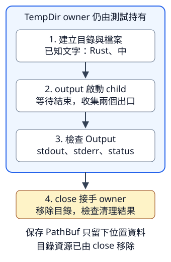

# 7.8 fixture：用專用檔案驗收真正的 CLI

前面先測 library，再以命令列觀察輸出。現在要把「指定一份筆記，得到原內容；失敗有診斷與狀態」保存為可重複執行的測試，讓日後調整 main 也能發現出口或狀態被改壞。

**test fixture（測試材料）** 是為特定檢查準備、內容與用途已知的資料。本節的 fixture 是測試自己建立的目錄與檔案；每項測試使用自己的目錄，既不依賴別人的筆記，也不共用會被同時覆寫的固定檔名。

本節使用 `ch07-fixtures` package。從 repo 根目錄執行 `cd examples/ch07-cli/fixtures`；Cargo 可從此處執行測試，子行程的工作目錄則由每項測試另行指定。

## 固定要驗收的程式介面

先沿用 7.5 的單檔筆記工具，這樣新增工作集中在測試工具。本 package 以 7.1 已教的 path dependency 重用 `ch07_path_cli::parse_filename`，自己的 src/main.rs 使用同樣的讀取與分流行為。測試啟動的是**本 package 的 binary**，不是拿另一個 package 的執行檔路徑猜測。

| 資料與呼叫 | 工具應交出的結果 |
| --- | --- |
| 文字檔內為 `Rust\n中\n`，檔名含中文與空白 | stdout 正好是原內容，stderr 空白，狀態 0 |
| 指定未建立的檔名 | stdout 空白，stderr 有讀取診斷，狀態 1 |
| 指定含 byte 255 的檔案 | 不符合 UTF-8，stdout 空白、stderr 有讀取診斷，狀態 1 |
| 沒有提供檔名 | stdout 空白，stderr 說需要檔名，狀態 2 |

tempfile 是建立臨時檔案／目錄的 library。它只在測試中使用，放在已教的 dev-dependencies；版本要求與 lock 的分工仍和 7.1 相同：

```toml
--8<-- "examples/ch07-cli/fixtures/Cargo.toml:dependencies"
```

這份受測 main 沿用 7.5 的輸出完成條件：write_all 後還要檢查 flush，再選成功狀態。沒有新的 Rust API：

```rust
--8<-- "examples/ch07-cli/fixtures/src/main.rs"
```

## TempDir 持有測試目錄，PathBuf 只保存位置

先選用 **`tempfile::tempdir()`**。它在系統的臨時位置建立新目錄，名字由 library 產生，回傳 `io::Result<TempDir>`；建立失敗就是 io::Error。**TempDir** 是管理這份目錄的 owner，**`directory.path()`** 只借出 `&Path`，供 join、讀寫與後面的子行程使用。

TempDir 正常離開 scope 時會嘗試刪除目錄及其中的內容，但自動清理遇到的錯誤會被忽略。如果需要知道清理是否成功，使用 **`directory.close()`**：它接手 TempDir，移除目錄，回傳 `io::Result<()>`。close 之後原 owner 已 move，不能再借它的 path；這是此型別的使用契約，8.2 再說明實作資源收尾的 Drop trait。

不要只留下 PathBuf 就讓 TempDir 先結束。PathBuf 擁有的是路徑資料，**沒有接管目錄資源**；依 7.5 的區分，保存路徑不會讓檔案持續存在。測試將 owner 留到讀寫／子行程結束，才清理。

為了建立與核對材料，另外選用三項操作：

| 操作 | 本次契約與用途 |
| --- | --- |
| `fs::write(filename.as_path(), text)` | 接收 `&Path` 與 `&str`，回傳 io::Result<()>；不存在就建立，存在就完整取代內容。也接受 `&[u8]`，稍後用來建立非法 UTF-8。文字會以其 UTF-8 bytes 寫入；資料符合 `AsRef<[u8]>` 的借用能力。 |
| `path.to_path_buf()` | shared 借用 Path，建立 owned PathBuf 複本；保存位置，方便在 TempDir 結束後查詢。 |
| `path.try_exists()` | 查詢當下是否存在，回傳 `io::Result<bool>`；能確定有／沒有就回 true／false，無法判定則 Err，不把查詢失敗算成不存在。 |

fs::write 不替我們建立缺少的上層目錄；這裡的目錄已由 tempdir 建好。try_exists 只用來核對我們剛建立與移除的 fixture，不能保證之後讀取時位置仍未改變；工具本身仍直接讀檔並處理結果。

第一項 integration test 放在 tests/directory.rs，形式沿用 7.2。先檢查材料，再以 close 確認清理，保存的 PathBuf 最後仍能表示原位置，但該位置已不存在：

```rust
--8<-- "examples/ch07-cli/fixtures/tests/directory.rs"
```

這裡的 expect 用來說明測試需要的環境條件，例如能在自有臨時目錄寫入；不是受測工具處理使用者檔案的策略。材料準備失敗，測試要失敗，不能假裝工具已被驗收。

## Command：準備呼叫，再等待完整 Output

**`std::process::Command`** 是新行程的設定物件。測試程式是 parent（啟動者），被啟動的筆記工具是 child（子行程）；兩者各有工作目錄與結束狀態。

先看這次的操作順序與 caller 契約：

| 操作 | 需要與效果 |
| --- | --- |
| `Command::new(program)` | 從程式路徑建立設定；本次傳 `&str` 或 `&OsStr`，能以 AsRef 借成 OsStr。此時還沒有啟動。 |
| `command.current_dir(directory)` | 傳 `&Path`，設定 child 的工作目錄；parent 的工作目錄不變。 |
| `command.arg(argument)` | 本次傳 `&OsStr`，加入**一筆**原生 argument；沒有透過 shell 再拆成多筆。 |
| `command.output()` | mutable 使用設定，啟動 child、等待它結束並收集 stdout／stderr，回傳 `io::Result<Output>`。 |

current_dir／arg 修改 Command 的設定，回傳 `&mut Command` 供接續操作；本節直接分行呼叫，不需要保存這份回傳 reference。arg 的空白仍是資料：傳入「中文 筆記.txt」一筆，就不是把「中文」與「筆記.txt」分開。也不在其中加入 shell 的引號或 `>` 語法。

**`Output`** 保存已結束 child 的三個公開欄位：

- **`status: ExitStatus`** 是觀察 child 的結束結果。它和由我們自己的 main 回傳的 ExitCode 是不同角色。
- **`stdout: Vec<u8>`** 與 **`stderr: Vec<u8>`** 分別保存捕捉到的 bytes，不保證本來就是文字。

**`output.status.success()`** 回 bool，正常成功的零狀態才是 true。**`output.status.code()`** 回 `Option<i32>`：有正常數字狀態時是 Some；在 Unix 被 signal（作業系統送出的行程控制訊號）終止可能是 None，因此不能一律當成數字。本節期待受測工具正常返回的 Some(0)／Some(1)／Some(2)。

output 的 **Ok 不等於工具工作成功**。如果子行程啟動並完成，自己回傳 1，仍得到 Ok(Output)，失敗在 status；沒能啟動、無法收集輸出或等待失敗，才是外層 io::Error。不要把使用者缺檔和測試沒能啟動工具混為一談。

output 會等到結束才交回收集好的資料，適合這個有界、小輸出的測試；不拿它收集可能一直輸出的服務。本工具不讀標準輸入，本節也不設定額外的輸入串流。

## 讓 Cargo 提供實際執行檔的位置

**environment variable（環境變數）** 是建置／執行環境提供的具名資料。這次選用 **`env!("名稱")`** macro：在編譯時取指定環境變數，產生 `&str`；沒有該值會使編譯失敗，不是執行中查詢 Option／Result 的函式。

Cargo 建置 integration test 時，提供 **`CARGO_BIN_EXE_<name>`**，值是該 package 對應 binary 的絕對執行檔路徑，並建好該 binary。name 是 binary target 名稱，連字號保留；本 package 的預設 binary 叫 ch07-fixtures，因此寫 `env!("CARGO_BIN_EXE_ch07-fixtures")`。它供此測試使用，不是每份 main／unit test 都有的通用變數，也不會替我們定位 dependency 的 binary。

最後先教讀取捕捉 bytes 的選用方法：**`std::str::from_utf8(bytes)`** 接收 `&[u8]`，檢查 UTF-8 後回傳 `Result<&str, Utf8Error>`，錯誤有 Debug／Display。這次只是借出 Output bytes 的文字 view，和 7.4 接手 Vec 的 String::from_utf8 不同；Output 仍保存兩份原 bytes，讓我們分項檢查。

tests/cli.rs 的 helper 只負責設定與執行，不自行解讀 status。相對檔名由 child 的工作目錄解讀：

```rust
--8<-- "examples/ch07-cli/fixtures/tests/cli.rs:cli-helper"
```

## 從完整 CLI 結果驗收資料與失敗

第一個 child test 用含中文與空白的相對檔名，核對完整 stdout、空 stderr、正常成功與數字 0。同一個 TempDir owner 一直留到 output 返回與 assertions 完成：

```rust
--8<-- "examples/ch07-cli/fixtures/tests/cli.rs:success-test"
```

圖中箭頭是**操作先後**；外框是 TempDir 仍由測試持有的範圍。先讓 child 用完資料，才 close；下面留下的 PathBuf 只是位置表示，不能延長資源的存在：



失敗情況還要保持相同的介面判準。為了驗收我們的診斷前綴，選用 **`text.starts_with("無法讀取 ")`**：shared 借用 str，檢查是否以這段文字開頭，回 bool；OS 後面的詳細錯誤文字可能不同，不把它整份寫死。

下面分別檢查不存在的檔案、非法 UTF-8、缺少 argument，還有**不存在的執行檔**。最後一項在自有目錄指定刻意沒建立的程式位置，應得到外層 NotFound；沒有 Output 或 child status 可供檢查。Output 也提供 Debug，若意外得到 Ok，測試可以在 panic! 中列出它。不依權限、特權帳號或外部服務碰巧失敗：

```rust
--8<-- "examples/ch07-cli/fixtures/tests/cli.rs:failure-tests"
```

執行已教的 `--test` 先只選 cli target，再執行全部測試：

```bash
cargo test -p ch07-fixtures --test cli --locked
cargo test -p ch07-fixtures --locked
```

cli 的四項主文測試，加上下面空檔練習的答案共五項；directory 有一項，共六項。CLI 每次都是真正啟動 binary，沒有拿 library 回傳值當成已驗收 stdout／stderr／status。零項 main unit tests 也不代表這六項沒執行。

## 練習：空內容可以是成功

加入一項 integration test：建立 empty.txt，寫入空文字，啟動工具。預期兩個出口都是零 bytes，但狀態是成功的 Some(0)。它和讀取失敗都沒有 stdout 資料，差別在 status 與 stderr，所以三項一起檢查。

??? note "完整參考答案"

    ```rust
    --8<-- "examples/ch07-cli/fixtures/tests/cli.rs:empty-solution"
    ```

    執行 `cargo test -p ch07-fixtures --test cli an_empty_file_is_successful_empty_data_not_a_read_failure --locked`。

我們已能準備專用材料、保留資源 owner、等待真正的 child，並分別驗收資料、診斷與狀態。下一節把前面可分開測試的參數、文字工作、JSON 與這份行程邊界組成完整 CLI。

延伸閱讀：[TempDir](https://docs.rs/tempfile/latest/tempfile/struct.TempDir.html)、[Command](https://doc.rust-lang.org/std/process/struct.Command.html)、[Cargo：Integration tests](https://doc.rust-lang.org/cargo/reference/cargo-targets.html#integration-tests)、[English Rust Cookbook：External Command](https://rust-lang-nursery.github.io/rust-cookbook/os/external.html)、[中文 Rusty Book：呼叫系統命令](https://rusty.course.rs/os/command.html)。英中命令章使用外部程式與額外 library；本節只啟動 Cargo 建好的本 package 工具，保留固定的驗收介面。
