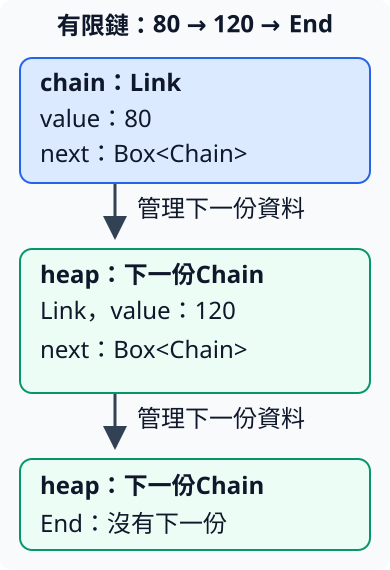

# 8.1 型別需要多大空間：Sized、DST 與 Box

前面用 array、slice 與 Vec 保存數列。現在想試另一種表示：每個連結保存一個數字，以及「接下來的連結」；最後用一個結束標記收尾。實際資料只有有限項，但型別希望能表示不同長度。

這份資料也可以放進 Vec。這裡採連結表示，是為了理解更一般的問題：**當一個型別裡又包含同一個型別，編譯器如何知道每個值需要多大空間？**樹狀資料、含子運算的式子也會遇到這種關係。本節先用一條有限數字鏈觀察，不引入那些任務的其他規則。

## 固定的是型別大小，不是資料內容

`i32` 使用固定的 4 bytes；`[i32; 3]` 的元素數量寫在型別裡，這份 array 使用 12 bytes。兩個 array 的內容不同，不會讓相同型別的大小不同。

**`Sized`** 是 Rust 標準函式庫中的 trait，表示「這個型別的大小在編譯時可確定」。它來自 `std::marker::Sized`，也由5.4已教的 prelude 提供，因此這裡可以直接使用 Sized 名稱。它沒有要求我們提供 method body，編譯器依型別判斷這項性質；不是自己寫一份 impl 告訴它想要幾個 bytes。一般的局部變數與按值傳遞的參數，需要這種已知大小的表示。

**DST** 是 dynamically sized type，意思是資料大小不能僅由型別在編譯時確定。例如 `str` 可能是零個或很多 UTF-8 bytes，`[i32]` 可能有兩項或五項。它們與 `&str`、`&[i32]` 要分開：後兩種 reference 自身有固定大小，保存找到資料需要的位置與長度；所借資料可以有不同大小。這正是 2.6／3.4 已使用的「借用一段內容」表示。

要親眼觀察這個差別，本節先介紹兩個新的標準函式：

| 操作 | 所需材料與結果 |
| --- | --- |
| `std::mem::size_of::<T>()` | 型別參數 T 必須是 Sized；不接收值，回傳這個型別的大小，型別為 usize、單位為 bytes。`::<T>` 是3.3的turbofish。 |
| `std::mem::size_of_val(value)` | 接收借用某個 T 的 `&T`，包括 DST；回傳被借資料的大小，而不是這份 reference 自身的大小。 |

`std::mem` 是標準函式庫中與記憶體操作有關的 module；本例只使用安全的大小查詢，不讀取 raw address。下面把它們放進 library 的 `sizes` module，供數值範例呼叫。

## 泛型預設要求 Sized，?Sized 可以放寬

4.1 的 bound 說明函式需要哪種能力。泛型型別參數還有一項預設要求：寫 `<T>` 通常包含 `T: Sized`。因此 `fixed_bytes<T>` 可以交給 `size_of::<T>()`，但不能拿 `str` 當成 T。

**`T: ?Sized`** 移除這項預設要求，表示 T 可以是 Sized，也可以不是；它不表示「T 必須是 DST」，也不是可以略過型別檢查。當函式只透過 reference 處理資料，就可以讓 reference 本身保持固定大小，而接受不同大小的資料。

下列 `borrowed_bytes` 接收 `&T`，用已介紹的 `size_of_val` 查詢資料大小。函式沒有取得原資料，也沒有回傳 reference，因此仍是前文熟悉的「借用輸入、交回數字」：

```rust
--8<-- "examples/ch08-smart-pointers/src/sizes.rs:sizes"
```

本章 package 是 `ch08-smart-pointers`，Rust library 名稱為 `ch08_smart_pointers`。module 與 example target 的分工沿用1.9／4.1，Cargo 命令仍從 repo 根目錄執行。

```rust
--8<-- "examples/ch08-smart-pointers/examples/sizes.rs"
```

```bash
cargo run -p ch08-smart-pointers --example sizes --locked
```

在本教材驗證的64-bit環境，輸出是：

```text
i32型別的bytes=4
三項array的bytes=12
slice reference自身的bytes=16
借來的兩項資料bytes=8
str reference自身的bytes=16
借來的文字bytes=5
```

重點是資料與借用表示的區別：`part` 借到兩個 i32，所以資料使用8 bytes；reference 自身保存位置與長度，在這個環境使用16 bytes。`word` 的文字有5 bytes，reference 自身仍是固定的表示。reference 的數值大小依目標平台而定，不把本次16當作所有平台的保證。

### 只寫 &T，仍沒有移除預設 bound

下面是故意不能編譯的 fixture。雖然函式只接收 reference，但 `<T>` 仍要求 Sized。`word` 的型別是 `&str`，對應到參數的 `&T` 時，T 是 str，不是 &str：

```rust
--8<-- "examples/ch08-smart-pointers/fixtures/compile-fail/sized_default.rs"
```

錯誤碼是 `E0277`，重點是 str 的大小無法在編譯時確定。把函式的 T 改成上面的 `T: ?Sized`，才能使用接受 DST 的契約。不是只在參數前加 `&`，就自動解除所有型別要求。

## 常數泛型也能保留array的固定長度

`[i32; 3]` 與 `[i32; 2]` 的長度是型別的一部分，和前面的slice不同。若要一份函式處理不同元素型別與不同固定長度，同時在簽名保留完整array型別，可以讓元素型別和長度都成為泛型參數。

**常數泛型（const generics）** 讓泛型參數代表編譯時確定的值。`<T, const N: usize>` 有兩種參數：T是3.3已教的**型別**參數，例如i32或bool；N是usize型別的**常數值**參數，例如3或2。這裡的const宣告N的角色，不是接收執行時才決定的數字。

本次函式只借完整array、交回已選定的N。使用前先分清N在哪個位置：

| 寫法 | 在本次函式中的角色 |
| --- | --- |
| `const N: usize` | 在泛型參數列表中宣告N，呼叫時必須選定可在編譯時確定的usize值。 |
| `[T; N]` | 在型別位置使用N，表示元素型別為T、長度為N的array。每次具體選定T與N後，仍是大小固定的型別。 |
| `&[T; N]` | 借用這份完整array，沒有把它的型別改成slice，也不接手元素。 |
| body中的 `N` | 在值的位置使用這個參數，交回usize；不需要讀取array內容或以迴圈數元素。 |

參數位置的 `_` 表示不替這份輸入保留名稱，因為body只需要N；它仍要符合 `&[T; N]` 的型別契約。這沿3.1的忽略pattern用途，只是用在函式參數位置：

```rust
--8<-- "examples/ch08-smart-pointers/src/fixed_arrays.rs:fixed-len"
```

呼叫 `fixed_len(&counts)` 時，編譯器由array型別推導T與N。也能沿3.3的turbofish寫 **`fixed_len::<i32, 3>(&counts)`**，依宣告順序明選型別argument i32與常數argument 3；第二項是值，不是另一個型別。

```rust
--8<-- "examples/ch08-smart-pointers/examples/const_generics.rs"
```

```bash
cargo run -p ch08-smart-pointers --example const_generics --locked
```

```text
由i32 array推導N=3
由bool array推導N=2
明選型別i32與常數3，得到N=3
只借array，原資料仍可讀=10
```

這三次呼叫使用同一份定義；N分別由型別推導或由caller明選。改array的內容不會改它的N，借完後原array也仍可讀。N在編譯時已選定，本例仍以普通函式呼叫與println在執行時取得、顯示這項值。

若明選N為3，卻傳入長度2的array，就不符合參數的 `&[i32; 3]`。下面fixture得到 `E0308`，指出預期長3、實際長2；不是等到執行時再比較或調整N：

```rust
--8<-- "examples/ch08-smart-pointers/fixtures/compile-fail/const_generic_length.rs"
```

N直接保留array的長度。它和前面Sized的關係是：長度可作泛型參數，但每次具體array型別的長度仍固定；接下來的Box則處理另一種「以間接存放取得固定表示」的工作。

## Box 擁有另一處的值

2.2 已介紹 heap 配置與 pointer 的角色。**`Box<T>`** 是標準函式庫提供的型別，持有放在另一處的 T，負責它的 ownership 與清理。它來自 `std::boxed::Box`，同樣由 prelude 提供，因此使用 Box 不需要另寫 use。對本節非零大小的資料，`Box::new(value)` 取得 value，為它安排 owned heap 空間，回傳 `Box<T>`。如果 value 沒有 Copy，呼叫後不能再從舊名稱使用它。

當 T 是 Sized，`Box<T>` 自身用固定大小的單一 pointer 表示，T 的內容另外保存。Box 自身也能是另一個 struct 或 heap 資料的一部分，不必然在 stack。這裡只是把「保存連結」與「保存連結指向的資料」分開；String／Vec 已經能自行管理其 heap 資料，不需要再套 Box 才有這項能力。

使用 Box 前，先說清本節採用的具體操作：

| 寫法 | 在本節的行為 |
| --- | --- |
| `*boxed` | 找到 Box 裡的 T。讀出 i32 時會 Copy 數字；透過可修改的 Box 可以修改該數字。 |
| `&*boxed`／`&mut *boxed` | 先找到 T，再建立它的 shared／mutable reference。只借用資料，Box仍是owner；衝突與最後使用規則和2.3／2.4相同。 |
| `let next = boxed;` | 轉移整個Box的ownership。Box自身沒有因T是i32而變成Copy；只有接手者負責這份值與配置。 |
| `let taken = *boxed;`，T沒有Copy且自己持有Box | Box支援將內部值move出來，接收者取得T，原Box不再可用。這和從shared reference移出owned值不同；也不把這項Box契約推成所有pointer都允許。 |

本節先使用 Box 這項標準型別的具體契約。8.3 會把借用式 dereference 接回 Deref 的 trait 機制；現在不需要寫未知的 associated type 或自訂 pointer 實作。

下面先借用120，再加20，最後轉交Box。`Amount` 只有數值欄位，和2.2的Order一樣沒有自動Copy能力；把它從Box取回，就能觀察owned值的交接：

```rust
--8<-- "examples/ch08-smart-pointers/examples/boxes.rs"
```

```bash
cargo run -p ch08-smart-pointers --example boxes --locked
```

```text
借用Box中的數字=120
接手Box後的數字=140
從Box取回的資料=80
```

第一份view最後讀完後才開始mutable借用；writable最後使用後才把Box交給second。這些仍是已有的borrowing規則。轉交Box不需要把它指向的完整T再複製一份。

下面故意在轉交後讀first，會收到與2.2／3.4相同的 `E0382`：

```rust
--8<-- "examples/ch08-smart-pointers/fixtures/compile-fail/box_after_move.rs"
```

## 用間接存放中斷尺寸的循環

回到開頭的數字鏈。`End` 沒有後續，`Link` 有一個數字與下一段鏈。**遞迴型別**是這裡的新概念：型別透過自己的欄位關係，又回到自身。若直接把 next 寫成 Chain，就會讓 Link 的完整內容又包含一份相同型別，而那份又要能容納 Link，無法得到固定大小：

```rust
--8<-- "examples/ch08-smart-pointers/fixtures/compile-fail/recursive_inline.rs"
```

這份fixture的 `E0072` 表示遞迴型別的大小無法收束。即使實際建立的鏈只有兩項，編譯器仍要為同一個Chain型別找出可容納各種合法值的固定表示，不會替每個長度建立另一個型別。

把 next 改成 **`Box<Chain>`**，當前Link只保存指向下一份Chain的owned handle；下一份Chain的內容在另一個配置中。每一份Chain需要的表示就不再直接內嵌無止境的Chain。

下圖追蹤程式中的80、120與End。實線箭頭表示Box管理另一份Chain，不是額外shared borrow。三個框不是按比例的記憶體布局，也不暗示enum標記或padding有幾個bytes：



完整操作仍用已學的loop與match。`into_total` 接收owned Chain；遇到Link時，pattern取得數字與Box，累加後用 `*next` 取得下一份owned Chain，再處理下一輪。遇到End就回傳總和。輸入限制為本節短鏈與小整數，加總不超過i32範圍：

```rust
--8<-- "examples/ch08-smart-pointers/src/chain.rs:chain"
```

型別定義能表示不同的有限長度，不表示一定要為處理函式也加入遞迴呼叫。這裡沿連結逐項處理，原鏈被消耗；若呼叫後仍需要原鏈，就要另外選擇借用介面。

```rust
--8<-- "examples/ch08-smart-pointers/examples/chain.rs"
```

```bash
cargo run -p ch08-smart-pointers --example chain --locked
```

```text
沿連結加總=200
空連結加總=0
```

第一條鏈依序提供80、120，最後End讓迴圈結束；空鏈第一次就遇到End，初始總和0直接成為答案。Box改變的是存放方式與ownership關係，數字加總規則沒有改變，也沒有由此證明這種表示一定比Vec快。

library的三項測試驗證：借來的資料大小依區段變化；空鏈、一項與兩項的總和；零和負數仍作為資料參與加總。測試只比較數字，不要求尚未教的Debug或整個enum比較：

```bash
cargo test -p ch08-smart-pointers --locked
```

## 練習：三個連結，仍是同一個型別

建立40、80、120三項鏈，最後以End收尾；交給同一個into_total，確認結果240。先從最內層的End往外組，說出每一個Box負責哪份Chain，再寫程式。

完成後可對照 [完整參考程式](https://github.com/birdhackor/learn_rust/blob/main/examples/ch08-smart-pointers/examples/box_solution.rs)，或執行 `cargo run -p ch08-smart-pointers --example box_solution --locked`。

現在你已能分開型別的固定大小、DST的資料大小，以及Box建立的owned間接存放。下一節會具體觀察ownership結束時的收尾工作，以及如何讓自訂型別在清理前做一項工作。

延伸閱讀：[Rust Book15.1](https://doc.rust-lang.org/book/ch15-01-box.html)、[繁體Book15.1](https://rust-lang.tw/book-tw/ch15-01-box.html)。
