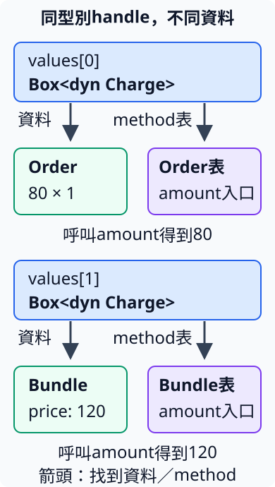

# 8.5 用 dyn 保存不同型別的共同能力

4.1的Order與Bundle都能提供amount，但資料形狀不同：Order保存單價與數量，Bundle保存固定價格。現在想把它們放進同一份費用清單，依序取得amount並加總；呼叫端還可能加入自己的運費型別。

這裡需要的結果很具體：80的訂單加120的組合，得到200；再加20的運費，得到220。加總工作只需要每項的amount，不需要讀每種型別的全部欄位。這一節把這項需要接到trait object，也比較已教的enum、泛型與impl Trait各自能表達什麼。

## 先保留相同資料與計算

本節在library的dyn_charges module重新放入4.1的同款Order、Bundle與Charge介面，讓本章package保持獨立可跑；沒有增加外部dependency。價格與數量仍採不溢位的小整數，兩項實作分別做乘法或回傳固定價格：

```rust
--8<-- "examples/ch08-smart-pointers/src/dyn_charges.rs:models"
```

3.6的Vec每一份清單仍只能選定一種元素型別。下面完整fixture直接混放Order與Bundle，得到 `E0308`，驗證不同型別的值不能這樣進入同一份Vec。前面的Charge實作提供共同amount能力，仍不會把Order與Bundle變成同一種T：

```rust
--8<-- "examples/ch08-smart-pointers/fixtures/compile-fail/mixed_charge_vec.rs"
```

已教的enum可以包住兩種資料：讓每個元素都成為KnownCharge，variant再說明它是哪一種。對borrowed enum作match，取出相應的borrowed欄位，呼叫原本的amount：

```rust
--8<-- "examples/ch08-smart-pointers/src/dyn_charges.rs:known-charges"
```

如果費用種類已經固定，這個做法可以完成同一項加總需要，而且match清楚列出所有種類。現在額外希望library使用者能自己定義費用型別，不需每增加一種，就回來改KnownCharge的variant與match分支。這才是接下來介面選擇要回應的需要。

## &dyn Charge 是借用共同介面的視圖

**trait object** 保存具體資料與它的trait介面之間的對應，讓使用處依共同能力操作，而不在那個位置寫出具體資料型別。型別寫 **`dyn Charge`**；dyn是此處明確使用trait object的關鍵字，不是把Rust變成動態型別語言。

dyn Charge本身是8.1的DST：只看這份介面，不能確定內部是多大的Order或Bundle。因此像str一樣，要透過reference或owned pointer使用。**`&dyn Charge`** 是shared借用視圖；外部owner仍持有原資料，也不需要為了使用dyn而先配置Box。

當需要 `&dyn Charge` 時，符合Charge的 `&Order` 或 `&Bundle` 可以轉成這份視圖。這是把具體型別的reference轉成trait object reference的 **unsizing coercion（轉成DST視圖）**，不等於8.3透過Deref逐層借用欄位，也不會在此clone原資料。編譯器在轉換處確認具體型別實作Charge。

trait object reference還保存找到相應method的資訊。一般借用形式的object lifetime會跟著外層reference要求推導，因此借自局部值的視圖，仍只在原值有效時使用；dyn不取消4.4的來源關係。

下面把4.1的泛型讀取與新的dyn讀取放在一起。兩個函式都借用輸入、回傳i32；主要差別是介面是否保留具體T：

```rust
--8<-- "examples/ch08-smart-pointers/src/dyn_charges.rs:amount-interfaces"
```

```rust
--8<-- "examples/ch08-smart-pointers/examples/dyn_borrowed.rs"
```

```bash
cargo run -p ch08-smart-pointers --example dyn_borrowed --locked
```

```text
泛型讀訂單=80
dyn借用訂單=80
dyn借用組合價=120
原訂單仍有數量=1
```

兩種介面都能讀80，dyn介面也能借讀另一種Bundle。呼叫後仍能從原Order讀數量，說明這個視圖沒有拿走ownership。

## Box保存owned資料與dyn介面

要把費用交進清單、由清單持有，就改用 **`Box<dyn Charge>`**。`Box::new`仍先接手具體資料；在需要這個型別的位置，`Box<Order>` 或 `Box<Bundle>` 能轉成同一種Box trait object介面。owned配置仍保存原來那份具體資料，不把兩種struct重新改造成同樣的欄位。

本頁的Charge沒有自身的lifetime bound。在**函式簽名或struct欄位**寫 `Box<dyn Charge>`，省略的object lifetime預設是 `'static`，也就是 `Box<dyn Charge + 'static>`。依8.4，這要求內部具體型別不依賴短命borrow，沒有要求Box永遠存活。此處的Order／Bundle只有owned數字，符合這項要求；後面再示範真正含borrow的型別如何寫不同契約。

加總函式total借用一段Box清單，不接手整份清單。它沿用len、索引與while逐項呼叫amount；Box的Deref讓method查找連到dyn介面，實際讀取仍借用內部資料：

```rust
--8<-- "examples/ch08-smart-pointers/src/dyn_charges.rs:dyn-total"
```

### 呼叫哪份實作，由這個handle的method資訊決定

**dispatch** 是選擇並呼叫對應method實作的過程。泛型在具體T已確定的版本中可以使用 **static dispatch**：編譯時就知道要使用哪份實作。編譯器以實際型別處理泛型的過程稱為 **monomorphization**，可以理解為把通用的T帶入具體型別，建立相應的程式。

trait object提供 **dynamic dispatch**：呼叫透過handle保存的method資訊找到實作。這份資訊對應到 **virtual method table（簡稱vtable）**，表裡包含相應型別的method入口，例如Order實作的amount。呼叫時同時找到原資料，讓對應的實作處理它。

下圖對應清單中80的Order與120的Bundle。兩個handle的Rust型別相同，找到的資料與method表卻不同。箭頭只表示找到資料或method，不表示clone或move；圖是關係示意，不是承諾實際位元組排列。



下面先以enum計算80+120，再用dyn處理同一批費用。Shipping是在example的呼叫端定義的型別，它實作Charge，只回傳fee；library的total沒有新增Shipping分支：

```rust
--8<-- "examples/ch08-smart-pointers/examples/dyn_list.rs"
```

```bash
cargo run -p ch08-smart-pointers --example dyn_list --locked
```

```text
已知enum種類的總額=200
同一批資料用dyn的總額=200
使用者新增運費後總額=220
```

Vec裡的T仍只有一種：`Box<dyn Charge>`。不同元素的Box裡可以保存不同的Charge實作。extended接手原Vec，push運費後，既有total逐項取得80、120、20並相加。這項變化支持「使用者新增型別，仍沿同一份介面加總」，不是證明enum無法算費用。

dyn也沒有讓任何型別都能混進清單。下面故意把沒有實作Charge的i32當成Box中的資料，會收到 `E0277`；是否有amount介面在編譯時就被檢查：

```rust
--8<-- "examples/ch08-smart-pointers/fixtures/compile-fail/dyn_missing_trait.rs"
```

## 回傳具體型別、impl Trait或owned dyn介面

6.4已教：回傳位置的impl Trait隱藏具體型別，但同一函式仍選定一種具體結果。下面故意在兩個分支分別回傳Order與Bundle，得到 `E0308`；它們都符合Charge，不代表是同一個opaque型別：

```rust
--8<-- "examples/ch08-smart-pointers/fixtures/compile-fail/opaque_charge_branches.rs"
```

如果需要兩種資料形狀，就讓分支各交出Box，再轉成共同的 `Box<dyn Charge>` 結果。make_charge的兩個分支因此能選不同型別。對照函式make_bundle直接交回Bundle，make_opaque_bundle則保存單一Bundle實作、只公開Charge能力：

```rust
--8<-- "examples/ch08-smart-pointers/src/dyn_charges.rs:charge-factories"
```

這也能回應6.4的兩個不同closure表達式。現在make_adjuster讓兩個分支各建立自己的closure，再轉成 `Box<dyn Fn(i32) -> i32>`：這是具有相同呼叫能力的owned trait object。Box中的工作可以透過這份Fn介面用 `work(value)` 呼叫；本例只按值保存Copy的base，所以符合Box回傳介面的 `'static` 要求。

```rust
--8<-- "examples/ch08-smart-pointers/src/dyn_charges.rs:closure-factory"
```

```rust
--8<-- "examples/ch08-smart-pointers/examples/dyn_factories.rs"
```

```bash
cargo run -p ch08-smart-pointers --example dyn_factories --locked
```

```text
具體回傳可讀price欄位=120
opaque介面提供amount=120
dyn工廠選訂單=80
dyn工廠選組合=120
兩種closure經dyn呼叫=20、40
```

| 介面選擇 | 適合本例的需要 |
| --- | --- |
| 回傳Bundle | 呼叫者需要知道具體模型，能讀price等公開內容。 |
| 泛型 `T: Charge`／參數impl Charge | 呼叫者提供具體型別，每次使用的T明確，不需要在同一個T內混放任意不同型別。 |
| 回傳impl Charge | 實作選定一種具體型別，只承諾Charge介面；如6.4，也能在同一種資料形狀內依設定選行為。 |
| KnownCharge enum | 已知種類的集合，用variant保存不同資料，match明確處理各種情況。 |
| `Box<dyn Charge>` | 保存不同具體型別的共同能力，允許呼叫端新增實作，或在回傳分支選不同形狀。 |

dyn呼叫一般需要間接找到method，Box形式另有owned配置；泛型／enum則有其他表示與程式碼安排。這些是選擇時要理解的機制與責任，不是這幾個輸出就能證明的效能排名。編譯器在看清楚目標時也可能消除間接呼叫；不要把dyn說成每次必然慢，或說它的method永遠不能被最佳化。

## trait object內部也能保存borrow

前面回傳 `Box<dyn Charge>`，採用預設的 `'static` object bound。現在保存一份borrowed prices slice：BorrowedCharge只借用原價格，逐項加總；沒有重建清單。

`dyn Charge + 'a` 表示被保存的具體型別內借用至少符合 `'a`，與8.4的T:'a是同一種有效性要求。寫 `Box<dyn Charge + '_>`，則沿4.4的placeholder省略規則，讓單一輸入reference的來源連到回傳object bound。Box本身仍是owned，內容型別仍借外部資料。

在impl的型別路徑寫 `BorrowedCharge<'_>`，表示這個實作適用於相應來源lifetime的模型，沒有把來源固定為 `'static`；body不需要替這個lifetime取新名字。

```rust
--8<-- "examples/ch08-smart-pointers/src/dyn_charges.rs:borrowed-charge"
```

```rust
--8<-- "examples/ch08-smart-pointers/examples/dyn_lifetime.rs"
```

```bash
cargo run -p ch08-smart-pointers --example dyn_lifetime --locked
```

```text
owned Box中的模型借原資料=200
借成dyn reference仍讀同一總額=200
原資料仍有項目=2
```

原prices仍有效，所以Box裡的模型能借它加總。這個Box不能在原Vec結束後繼續讀；owned外層沒有改變內容的來源。

若把回傳型別改回預設 `Box<dyn Charge>`，函式便宣告內部型別符合 `'static`。下面完整fixture得到 `lifetime may not live long enough`：輸入slice的borrow沒有這份保證。修正就是前面明寫 `+ '_` 的介面，讓回傳結果跟著實際來源。

```rust
--8<-- "examples/ch08-smart-pointers/fixtures/compile-fail/dyn_borrow_default_static.rs"
```

兩種lifetime位置要分開讀：

| 在本頁Charge介面中的型別位置 | 所要求的關係 |
| --- | --- |
| `&'a dyn Charge` | 借用介面可用於 `'a`；object bound由外層reference推導為 `'a`。 |
| `&'a (dyn Charge + 'static)` | 這次reference借用仍可很短，但內部型別不依賴短命外部borrow。括號把dyn與它的bound收成被借型別。 |
| 函式回傳 `Box<dyn Charge>` | Box內容採預設 `'static`；Box值仍可以很快drop。 |
| 函式回傳 `Box<dyn Charge + '_>` | 依這個函式的省略規則連到輸入borrow，符合本頁borrow_charge需要。 |

例如借用一個owned Order時，外層reference可以很短，而Order本身符合 `'static`。這和8.4分開資料的borrow要求與值的scope相同。區域變數中的object lifetime也可能由使用處推導；**不要把函式簽名的Box預設規則，推成所有省略位置都一律 `'static`。**

## dyn compatibility：這份介面能否在隱藏具體型別後使用

**dyn compatibility** 表示trait符合建立trait object的規則；較舊文件也稱 **object safety**。Charge的 `amount(&self) -> i32` 合適：receiver提供原資料位置，輸入與結果型別已確定，呼叫處不必再知道Self是Order還是Bundle。

以下幾種已能理解的介面則需要注意。每份fixture都只用當下的trait／泛型規則，但trait本身無法成為dyn介面，錯誤碼是 `E0038`。

### 不能要求整個trait的Self都是Sized

在trait名稱後寫 `: Sized`，是 **supertrait要求**：實作這個trait的型別同時必須符合Sized。8.3的DerefMut要求Deref也屬於這種「要實作它，先滿足另一份trait契約」的關係。

dyn Trait本身是DST，不能符合整份介面要求Self:Sized的條件。下面的SizedCharge因此不能用成trait object：

```rust
--8<-- "examples/ch08-smart-pointers/fixtures/compile-fail/dyn_requires_sized.rs"
```

### 可動態呼叫的method不能另有泛型型別參數

method也能像3.3的函式，在名稱後宣告 `<T>`，由呼叫處選T。但一份dyn介面的method表不提供任意T的所有泛型實作入口；下面amount_with因此不能作為可動態呼叫的method：

```rust
--8<-- "examples/ch08-smart-pointers/fixtures/compile-fail/dyn_generic_method.rs"
```

### 可動態呼叫的method不能直接回傳未知的Self

`Self` 仍代表實作型別。若method回傳Self，caller透過dyn卻不知結果是多大的哪個型別，就不能使用這份按值結果契約。下面rebuild因此不適合直接動態呼叫：

```rust
--8<-- "examples/ch08-smart-pointers/fixtures/compile-fail/dyn_returns_self.rs"
```

需要保留這種便利method時，可以把它限定給具體型別，而讓其餘method仍能透過dyn使用。新的 **`where` clause** 把bound寫在簽名尾端、body或分號之前；**`where Self: Sized`** 在某個method上表示只有已知Sized的Self能呼叫它，這個method不提供給trait object動態呼叫。

下面RebuildCharge以 `: Charge` 要求相同的amount能力；Charge本來就dyn compatible，所以能作為它的supertrait。rebuild則個別排除動態呼叫。Bundle的實作重建相同price，沒有把這項method當作Clone trait或隱含Copy：

```rust
--8<-- "examples/ch08-smart-pointers/src/dyn_charges.rs:rebuild"
```

具體Bundle能呼叫rebuild，dyn RebuildCharge仍能呼叫繼承來的amount。若對dyn硬要呼叫rebuild，下面fixture的訊息是 `the rebuild method cannot be invoked on a trait object`：

```rust
--8<-- "examples/ch08-smart-pointers/fixtures/compile-fail/dyn_rebuild_call.rs"
```

同樣原則也要用來判斷在參數中直接使用未知Self的method。6.4的回傳impl Trait則是另一份opaque具體結果契約，不能直接當作dyn中可動態呼叫method的回傳形式。這些規則約束的是dyn介面，不表示上述method在一般具體型別上都不能使用。

### 普通associated type可以使用，但要選定結果

associated type不是全部禁止。沿6.2定義Measure，讓每份實作選Output，method透過shared receiver回傳這種Output：

```rust
--8<-- "examples/ch08-smart-pointers/src/dyn_charges.rs:measure"
```

trait object型別需要選定 **`dyn Measure<Output = i32>`**，caller才能知道measure的結果型別。這裡 `<Output = i32>` 沿用6.2的associated type equality語法，只是放在dyn介面中。若只寫dyn Measure，下面fixture會收到 `E0191`，指出尚未指定Output：

```rust
--8<-- "examples/ch08-smart-pointers/fixtures/compile-fail/dyn_missing_output.rs"
```

把合法的限定method與associated Output一起跑：

```rust
--8<-- "examples/ch08-smart-pointers/examples/dyn_compatibility.rs"
```

```bash
cargo run -p ch08-smart-pointers --example dyn_compatibility --locked
```

```text
具體型別可rebuild=120
dyn仍可呼叫amount=120
已選定Output的dyn結果=80
```

這些是本節介面需要的規則，不是列出所有進階trait寫法的完整清單。重點是判斷：共同method的輸入、輸出與receiver，能否在不要求呼叫處知道具體Self時保持明確。

## 練習：呼叫端增加一種費用

在自己的example target定義ExtraFee，保存amount40，實作本節Charge。把80的Order、120的Bundle與這份ExtraFee放進 `Vec<Box<dyn Charge>>`，交給原本total，確認240。不要修改library的KnownCharge variant或total body。

完成後可對照 [完整參考程式](https://github.com/birdhackor/learn_rust/blob/main/examples/ch08-smart-pointers/examples/dyn_solution.rs)，或執行 `cargo run -p ch08-smart-pointers --example dyn_solution --locked`。

library測試還檢查空清單、外部定義的費用一起加總、borrowed object仍讀原資料、不同closure分支的呼叫結果，以及選定associated Output的dyn結果。這些結果支持共同介面確實執行了工作；是否選dyn，仍回到資料種類、ownership與公開介面的需求。

延伸閱讀：[英文Book trait objects](https://doc.rust-lang.org/book/ch18-02-trait-objects.html)、[繁體Book對應舊章號17.2](https://rust-lang.tw/book-tw/ch17-02-trait-objects.html)、[dyn compatibility規則](https://doc.rust-lang.org/reference/items/traits.html#dyn-compatibility)。
