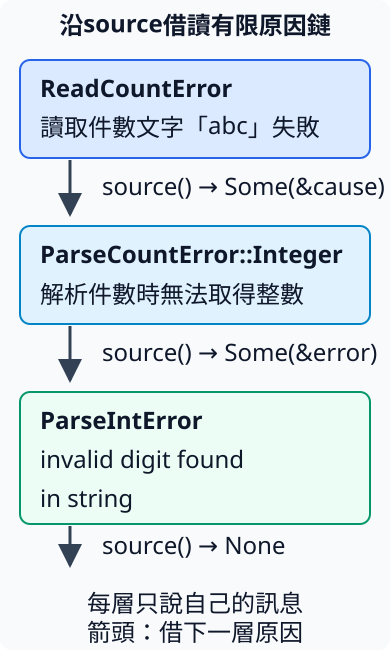

# 8.6 以Error介面借讀原因，形成完整報告

5.5／5.6已把整數解析失敗與件數規則失敗保存成具體enum，呼叫者可以用match分類、決定是否繼續。現在想加一個報告器：它不知道每個module的variant名稱，但希望顯示「哪一項工作失敗」，再沿著保存的下層原因繼續說明。

這不是為了讓Result開始能保存錯誤；Result本來就沒有要求E一定實作某個trait。新的工作是讓不同錯誤提供**同一份顯示與原因借用介面**，使報告器不用為每個具體enum重寫分類。**`std::error::Error`** 是這份標準介面。

## Error需要Debug與Display，沒有原因時可以沿用預設

Error要求型別同時有4.2的Debug與5.3的Display。`Error: Debug + Display` 是8.5的supertrait關係，`+` 表示兩項要求一起成立；因此透過Error介面借用資料時，也能顯示它。

Error提供 **`source(&self) -> Option<&(dyn Error + 'static)>`**，用來借出較下層的原因。None表示這份錯誤沒有提供下一層，Some則保存指向下一個Error的shared reference。此處 `'static` 限制原因型別的內部borrow；回傳reference本身仍借自這次self，不是可以永久保留的reference。稍後以具體資料逐層拆開這項區別。

這項method有標準的**預設實作**，回傳None。trait可以替method提供body，具體型別沒覆寫它時就沿用；所以沒有下層原因的型別可以寫空的 `impl Error for CountError {}`，不必只為回傳None再寫一次method。

本節在errors module沿用0到100的件數規則與CountError資料形狀，保持本章package獨立可跑。Display仍由數值形成訊息；新的部分只是讓這份型別符合Error介面：

```rust
--8<-- "examples/ch08-smart-pointers/src/errors.rs:leaf-error"
```

source是trait method，因此呼叫端用 `use std::error::Error;` 讓名稱可用，沿4.1的規則。下面同時觀察Debug、Display與預設None：

```rust
--8<-- "examples/ch08-smart-pointers/examples/error_leaf.rs"
```

```bash
cargo run -p ch08-smart-pointers --example error_leaf --locked
```

```text
Debug檢查=Negative(-1)
Display訊息=件數 -1 不能為負數
這個錯誤已是最後原因
```

它保存了失敗資料與對人顯示的方式，source沒有憑空發明另一個原因。反過來，若少了Debug，即使有Display與空Error impl，也不符合Error要求。下面完整fixture會收到 `E0277`：

```rust
--8<-- "examples/ch08-smart-pointers/fixtures/compile-fail/error_without_debug.rs"
```

## 封裝原因，借出的介面不限定某個enum

5.5的ParseCountError分成Integer與Range，分別擁有ParseIntError或CountError。本節保留先解析、再驗證的步驟與兩項失敗分類；成功使用5.1已檢查的i32件數，省去另建Count模型，並讓source借出原錯誤。

標準ParseIntError也提供Error，因而能和已實作Error的CountError一起借成dyn Error視圖。下列source對 `&self` 作match，得到兩種不同的欄位reference，再依8.5的unsizing轉成同一份介面。

這次Display只說**目前這一層工作**，例如「解析後的件數不合法」，下層的原數字與原因留在source裡。若Display也把原因訊息全部接進來，再逐層顯示source，就會重複報告同一項原因。這是本節報告器的分工選擇，沒有刪除原資料。

From封裝與 `?` 都沿5.5／5.6：成功取得值，失敗時轉成對應variant並從整個函式回傳；Error的實作沒有改變這項控制流程。

```rust
--8<-- "examples/ch08-smart-pointers/src/errors.rs:parse-error"
```

再加一個外層ReadCountError，保存原輸入與ParseCountError。read_count在失敗時使用5.5的 `to_owned()` 保存輸入文字，並把原cause交進struct；它的Display說明是哪份輸入，source則借到cause：

```rust
--8<-- "examples/ch08-smart-pointers/src/errors.rs:read-error"
```

這裡的「讀取」只處理傳入文字，不使用檔案或新的I/O API。下圖對應abc的三層資料，向下箭頭都是借讀原錯誤，沒有複製或接手它們：



report接收 **`&dyn Error`**，只使用共同Display與source能力；不知道具體variant也能沿本節有限的原因鏈讀取。它先format外層訊息，再以loop／match處理Some或None；每次Some把這層文字加進String，再借下一層。這些型別的source都朝下層前進，最後None結束，沒有在本例中循環回自己。

```rust
--8<-- "examples/ch08-smart-pointers/src/errors.rs:report"
```

```rust
--8<-- "examples/ch08-smart-pointers/examples/error_chain.rs"
```

```bash
cargo run -p ch08-smart-pointers --example error_chain --locked
```

```text
成功件數=3
處理失敗：讀取件數文字「abc」失敗
原因：解析件數時無法取得整數
原因：invalid digit found in string
處理失敗：讀取件數文字「-1」失敗
原因：解析後的件數不合法
原因：件數 -1 不能為負數
```

abc保留標準解析錯誤的英文Display；−1先解析成功，再保留CountError的數字與規則原因。兩條路都經同一份report，沒有以顯示文字猜variant，也沒有把 `?` 當成停止整個main。

## source的 'static 不表示回傳reference可以永久保存

把完整簽名再拆開：**`Option<&(dyn Error + 'static)>`** 的兩層borrow要求與8.5相同。

- 外面的 `&` 是這次借用原因的reference；沒有寫出的lifetime依4.5的receiver省略規則，連到這次 `&self`。
- 裡面的 `dyn Error + 'static` 要求**原因的具體型別**不依賴短命外部borrow。ParseIntError與只保存owned數字的CountError符合它。

所以 `source()` 可以把存在於局部error中的欄位借回，reference只用到那份error仍有效的地方；它不是 `&'static dyn Error`。這項區別直接回應「原因型別符合 `'static`，為何還不能把reference帶到原error結束之後」。

下面的Cause只有owned數字，符合 `'static`；Outer在內層建立並擁有它。source固定是Some，所以用5.1已教的expect取得reference，但Outer在block結束，這份fixture仍收到 `E0597`：

```rust
--8<-- "examples/ch08-smart-pointers/fixtures/compile-fail/error_source_escape.rs"
```

需要繼續借用，就維持owner有效；要在error結束後保留報告，就用前面的report取得owned String。String保存的是顯示結果，不是讓原錯誤的借用變長命。

### 外層Error本身也不必全部符合 'static

Error本身只要求Debug與Display，沒有整體的 `'static` bound。BorrowedParseError可以借用一個label，另外擁有ParseIntError作cause；它的整個型別受label來源限制，source借出的**cause型別**仍符合 `'static`。

with_context明寫4.4的label lifetime，把它連到回傳錯誤；輸入text只用來解析數字，不保存在結果中。這項函式聚焦整數解析，沒有另外做0到100的規則檢查：

```rust
--8<-- "examples/ch08-smart-pointers/src/errors.rs:borrowed-error"
```

```rust
--8<-- "examples/ch08-smart-pointers/examples/error_borrowed.rs"
```

```bash
cargo run -p ch08-smart-pointers --example error_borrowed --locked
```

```text
處理失敗：資料欄位A：無法解析件數
原因：invalid digit found in string
原因借自本次error=invalid digit found in string
原標籤仍在=資料欄位A
```

report只借用error，因此可以接受這份帶有borrow的外層錯誤；來源label仍有效。它沒有把外層型別強制變成 `'static`，source則仍借這次error裡擁有的ParseIntError。

若**cause本身**改成含短borrow的BorrowedLeaf，就不能把它借成source要求的 `dyn Error + 'static`。下面的BorrowedLeaf能實作Error，但Outer的source契約不符合，診斷為 `lifetime may not live long enough`：

```rust
--8<-- "examples/ch08-smart-pointers/fixtures/compile-fail/error_non_static_source.rs"
```

這不是說所有borrowed錯誤都非法，而是這份標準source介面對「下一層原因型別」有特定要求。選擇錯誤資料形狀時，要分開外層context、原cause與回傳借用的角色。

## 在只需統一報告的邊界使用Box dyn Error

具體ParseCountError適合caller需要以match分辨Integer／Range的介面。若某一層只想接收不同來源的錯誤、沿共同Error介面報告，不需要把所有來源固定成自己的enum，可以回傳 **`Box<dyn Error>`**。

依8.5，本頁沒有另選object bound的Box回傳形式要求內部型別符合 `'static`。標準庫提供符合 **`Error + 'static`** 的具體錯誤到 `Box<dyn Error>` 的From實作，保存原錯誤的owned資料；所以5.6的 `?` 可以使用這項From轉換，不必由我們為每個來源重寫boxing。

下列count_for_report先解析i32、再檢查件數。第一個 `?` 把ParseIntError包成Box，第二個把CountError包成Box；兩個原型別保留不同資料與Display規則，但caller收到同一種owned handle。這個介面省略了ReadCountError那份輸入context，因為這個對照只顯示兩種來源如何在報告邊界交接。

```rust
--8<-- "examples/ch08-smart-pointers/src/errors.rs:boxed-count"
```

caller用 `&*error` 借到Box中的dyn Error，再交給原report；報告器不接手Box，這份錯誤仍由本次Err分支持有到分支結束。

```rust
--8<-- "examples/ch08-smart-pointers/examples/error_boxed.rs"
```

```bash
cargo run -p ch08-smart-pointers --example error_boxed --locked
```

```text
成功件數=3
處理失敗：invalid digit found in string
處理失敗：件數 101 超過批次上限100
```

選Box並沒有把兩種失敗改成同一段文字，也沒有要求所有library介面都改用dyn。需要穩定分類、提供明確回復分支時，具體enum仍更直接；只負責接收不同錯誤並報告的邊界，才選共同Error介面與owned Box的安排。

本節使用穩定的source；較舊的cause／description已被淘汰，官方文件中的部分新方法仍屬實驗介面。實作這份教材的錯誤不需要照貼整張Rustdoc method清單。

## 練習：自己的context仍能交給同一報告器

建立OrderError，保存id7與 `CountError::TooLarge(101)` cause。derive Debug，Display只顯示 `訂單7的件數檢查失敗`，Error的source借回cause。把它交給同一個report，確認兩行輸出包含外層訂單與下層原件數，不把cause訊息重複接進外層Display。

完成後可對照 [完整參考程式](https://github.com/birdhackor/learn_rust/blob/main/examples/ch08-smart-pointers/examples/error_solution.rs)，或執行 `cargo run -p ch08-smart-pointers --example error_solution --locked`。

library測試確認具體enum仍保存超限原因、報告每層只出現一次、借用context能提供owned原因，以及Box邊界能接住兩種來源。Std Error讓「各層保存自己的資料」與「上層沿共同介面報告」相接，source只是借回下一層，不轉移它的ownership。

延伸閱讀：[Error官方契約](https://doc.rust-lang.org/std/error/trait.Error.html)、[Rust By Example boxing errors](https://doc.rust-lang.org/rust-by-example/error/multiple_error_types/boxing_errors.html)、[中文版對應](https://doc.rust-lang.org/rust-by-example/zh/error/multiple_error_types/boxing_errors.html)。
