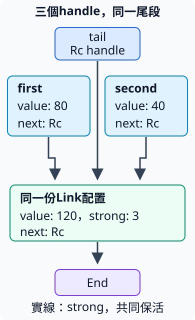
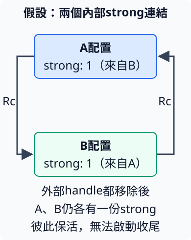

# 8.7 用 Rc 共享 ownership，用 Weak 觀察

8.1的Box清單每一段都有一份owned接手關係。現在想建立兩條清單：第一條是80接120，第二條是40接120，而且尾端的120是**同一份資料**。其中一條清單結束，另一條仍要能讀那份尾段。

重建兩份120也能算出相同總額，但沒有保存「兩條路共用同一份尾段」的資料關係。借用同一尾段也可以，只是需要另外維持其owner。現在要讓各條清單自己持有尾段的共享owner，而不先指定哪一條必須活得最久。

## Rc讓多個handle共同保活一份資料

**`Rc<T>`** 位於 `std::rc`，Rc來自 **Reference Counted**。它使用 **reference counting**：以計數追蹤有多少個共享owner還持有同一份heap資料。這些保活資料的owner稱為 **strong handle**；每個handle本身也是一個普通Rust值，仍有自己的move與scope規則。

只要還有strong handle，內部T就保持有效；最後一個strong handle結束，才清理T。這裡數的是Rc handle，不是每一份 `&T` 借用。借來的reference仍按原本的有效性規則使用，沒有因為借用一次就自動新增strong owner。

Rc用於**單一thread內**的共享ownership；本節不把它交給不同thread一起管理。跨thread的共享會有另一組要求，留到並行章節處理。

先用 `use std::rc::Rc;` 引入名稱。本節第一份程式需要以下操作，先看各自取得什麼、改變什麼：

| 操作 | 契約與結果 |
| --- | --- |
| `Rc::new(value)` | 接手T，配置保存它的heap資料，回傳第一個 `Rc<T>`；strong數量從1開始。 |
| `Rc::clone(&handle)` | 借用原handle，回傳指向同一份配置的新 `Rc<T>`，strong加1；不clone內部T。 |
| `Rc::strong_count(&handle)` | 借用handle，回傳這份配置目前的strong數量，型別是usize。 |
| `Rc::ptr_eq(&first, &second)` | 回傳bool，檢查兩個handle是否指向同一份配置；不是比較兩份T的內容是否相等。 |

4.2已教Clone的效果由型別實作決定。`Rc::clone(&handle)` 是Rc的Clone呼叫形式；也能寫 `handle.clone()`，這裡用Rc名稱讓「複製handle」更明確。T不需要因此實作Clone，因為操作沒有建立另一份T。

Rc也有 `Deref<Target = T>`：shared borrow能連到內部T，沿用8.3的借用轉換與method查找；讀取內部struct欄位時，也能透過這層Deref找到欄位。因此下面的second.id讀的是共享Tracked的id。

Tracked只沿用8.2的數字標記與Drop輸出，沒有Clone或Copy。先建立兩個handle，再分別drop：

```rust
--8<-- "examples/ch08-smart-pointers/examples/rc_handles.rs"
```

```bash
cargo run -p ch08-smart-pointers --example rc_handles --locked
```

```text
建立後strong=1
clone後strong=2
兩個handle指同一配置=true
第一個handle結束，仍讀到id=1
剩餘strong=1
清理原資料id=1
最後一個handle已結束
```

ptr_eq確認兩個handle共同指向一份配置，計數則由1變2。drop(first)只移除一個共享owner，沒有清理Tracked；second仍能讀id。drop(second)使strong降到0，這時才執行Tracked的Drop，而且只出現一次原資料的清理輸出。

這也區分move與clone：如果寫 `let second = first`，只是交接同一個handle，first不再可用，strong不因為換變數名增加。本例另用Rc::clone，才真正多出第二個handle。

## 兩個開頭，接到同一份尾段

回到清單，新增 `SharedChain`。它沿用8.1的End／Link表示，只把next改成 `Rc<SharedChain>`。next現在持有下一段的共享owner；enum的固定大小問題仍靠間接存放解決。

這次total不消耗清單，參數是 `&SharedChain`。依3.1對borrowed enum作match，value會是 `&i32`，next會是 `&Rc<SharedChain>`。`*value`取得Copy數字；`chain = next` 在需要 `&SharedChain` 的位置使用Rc的Deref借用轉換，所以繼續讀下一段，不move或clone其中的Rc。

```rust
--8<-- "examples/ch08-smart-pointers/src/shared_chain.rs:shared-chain"
```

先建立value120的尾段，由tail保存第一個Rc。first與second各保存Rc::clone取得的next。因此圖中三條指向120的實線，分別是tail、first.next、second.next三個strong handle；同一份尾段內還有自己的next，接到End。



```rust
--8<-- "examples/ch08-smart-pointers/examples/shared_tail.rs"
```

```bash
cargo run -p ch08-smart-pointers --example shared_tail --locked
```

```text
共同尾段的strong=3
第一條總額=200
第二條總額=160
第一條結束後strong=2
原tail handle結束，第二條仍是=160
```

兩個總額分別是80+120與40+120，共同的120並沒有因Rc::clone重建一份。first結束時，它擁有的next一起清理，尾段strong由3降到2；再drop外部tail，second.next仍持有最後一個strong，因此第二條清單繼續得到160。

這完成原本需要的關係：任何一條清單可以先結束，其他持有者還能繼續讀共同尾段。代價是每次Rc clone／清理都要更新計數，配置也要保存這項管理資訊；不因為避免clone完整T，就宣稱所有共享工作都沒有成本。

## 共享owner不等於可以隨意修改共享T

Rc提供Deref，沒有提供DerefMut。即使handle變數宣告為mut，也不能直接取得內部T的mutable borrow；否則不同handle可能同時把同一個T視為自己的獨占修改對象。

下面故意用 `*owner += 20` 修改Rc中的i32，會收到 `E0594`。mut允許修改handle變數本身，沒有改變Rc對共享T提供的介面：

```rust
--8<-- "examples/ch08-smart-pointers/fixtures/compile-fail/rc_mutate.rs"
```

也不能像Box一樣，直接用星號move出Rc裡面的非Copy String。Rc的Deref提供的是借用，不是把其他共享owner仍需要的owned內容拿走。下面fixture會收到 `E0507`：

```rust
--8<-- "examples/ch08-smart-pointers/fixtures/compile-fail/rc_move_out.rs"
```

本節的清單只讀資料，這個介面已足夠。需要多個持有者共用可修改狀態時，下一節會先教清楚另外的修改與借用檢查介面，再組合使用；這裡不先把那些API放進例子。

## Weak只記住資料位置，不要求T繼續存活

有時候我們只想記得「那份資料若還存在，就取來讀」，但不想因為觀察者還存在，就讓原資料一直無法清理。**`Weak<T>`** 也是 `std::rc` 中的handle，表示這種不保活T的關係。

它不是一般的 `&T`：Weak可以在T已清理後繼續存在，但不能直接當成有效T讀取。使用前要嘗試取得新的strong handle，由回傳值說明資料能否使用。以下操作在範例之前先定好契約：

| 操作 | 契約與結果 |
| --- | --- |
| `Rc::downgrade(&owner)` | 借用Rc，建立指向同一配置的 `Weak<T>`；沒有減少原owner，也不增加strong數量。 |
| `Weak::new()` | 建立不指向任何配置的空Weak；T由型別註記或使用處決定。 |
| `observer.upgrade()` | 借用Weak，回傳 `Option<Rc<T>>`。本節正常建立的配置還有strong時，取得Some中的新strong；T已結束或Weak為空時，得到None。 |

upgrade成功不是交回一份普通borrow，而是建立一個新的Rc owner，因此strong加1。Some裡的這個Rc用完後也要正常清理；若一直保留它，它本身就會讓T繼續有效。

**T的清理與整份配置的釋放也要分開。** 最後strong結束就會清理T，包含T擁有的String等內容；若還有Weak，Rc用來保存計數與資料位置的配置仍會保留。Weak存在不表示T還能讀，upgrade也不會把已清理的T復活。最後Weak也結束，才不再因Weak保留那份配置。

下面先試空Weak，再觀察有owner的Tracked。第一次Some的temporary只留在match分支，用完離開分支就移除；之後drop真正的owner，再試一次upgrade：

```rust
--8<-- "examples/ch08-smart-pointers/examples/weak_observer.rs"
```

```bash
cargo run -p ch08-smart-pointers --example weak_observer --locked
```

```text
空Weak沒有資料
建立Weak後strong=1
upgrade讀到id=1
暫時取得strong=2
暫時handle結束後strong=1
清理原資料id=1
最後strong結束，Weak不能再取得資料
觀察handle也已結束
```

建立observer後strong仍是1，支持它沒有成為共享owner。upgrade時暫時升到2，分支結束再回1。drop(owner)立即出現Tracked收尾；即使observer還在，後面的upgrade仍得到None。原資料是否存在，由strong關係決定。

如果把第一次upgrade的Some留在外層，drop(owner)之後仍可能得到Some，因為那個先取得的Rc也算strong。檢查Weak行為時，要把這項新增owner一起算進來，不能只看最早建立的變數是否還在。

## 所有外部handle結束，strong循環仍可能保活

**reference cycle（循環連結）** 是資料沿連結回到原來位置的關係。對共享ownership尤其要問：這條循環上的連結是否都在保活對方？

下圖是**假設的資料關係**，用來推理計數，不是本節已能建立的可執行程式。A裡保存指向B的Rc，B裡也保存指向A的Rc。即使外部handle全部移除，A還因為B中的Rc而有strong1，B也因為A中的Rc而有strong1。



Rc的收尾條件是strong降到0。這裡兩邊都達不到0，所以兩份T都無法開始清理，內部Rc也就無法跟著移除；沒有外部使用者仍留下資料，形成memory leak（記憶體未能釋放）。Rust的安全借用規則不自動找出並清除這種shared ownership循環。

若B→A只是「想找到A」，而不應該負責讓A存活，就應把這一方向設計成Weak。它不再讓A的strong增加；當外部owner結束，這個循環就不會靠該連結繼續保活。B要找A時仍須upgrade，並接受A可能已結束的None。

選Rc或Weak依關係的責任：需要共同保活，用Rc；只想觀察可能已結束的對象，用Weak。不是所有互相連結都必然洩漏，也不是把隨意一個欄位改成Weak就解決所有圖中的循環；要找出實際的strong循環及哪些方向不應擁有對方。

## 練習：三份共享owner與一個觀察者

建立保存120的Rc，clone出第二份與第三份handle，再由第一份建立Weak。先確認strong為3；drop前兩份後，第三份仍能讀到120，strong為1。

在一個短暫match分支中upgrade、讀120，讓取得的Rc隨分支結束。再drop第三份，最後確認upgrade得到None。用已教的match、bool與assert檢查成功／缺值，並把升級取得的Rc也算進owner數量。

完成後可對照 [完整參考程式](https://github.com/birdhackor/learn_rust/blob/main/examples/ch08-smart-pointers/examples/rc_solution.rs)，或執行 `cargo run -p ch08-smart-pointers --example rc_solution --locked`。

library測試另外檢查兩個開頭移除其中一個後仍能讀共同尾段，以及已upgrade取得的Rc能接替原owner，直到它自己結束才讓Weak失去資料。最後一項以match取得剩餘strong數量，None記成0；Some中的Rc本身就會讓數量至少為1，因此能辨認是否仍有owner。

延伸閱讀：[Rust Book15.4](https://doc.rust-lang.org/book/ch15-04-rc.html)、[中文Book15.4](https://kaisery.github.io/trpl-zh-cn/ch15-04-rc.html)、[Weak官方契約](https://doc.rust-lang.org/std/rc/struct.Weak.html)。
