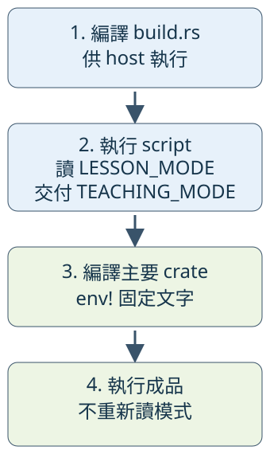

# 9.2 在編譯程式之前執行 Rust 工作

有時候設定應由「這次建置」決定。例如練習版程式要記錄自己是 `demo` 還是 `practice`，執行後都能回報同一份建置設定，而不是每次啟動都重新讀環境。

9.1 已教 Cargo 選擇 profile、feature 與 target。這一節再加一個步驟：**Cargo 先執行一支 Rust 程式，把結果交給接下來的 crate 編譯。** 這支程式叫 build script，通常放在 package 根目錄的 `build.rs`；它不是 `src/main.rs`。

本節另用 `examples/ch09-build-script`，package 名稱是 `ch09-build-script`。因此它的 script 不會改動 9.1 的建置工作。以下 Cargo 命令從 repo 根目錄執行。

## 分清楚哪支程式在何時執行

build script 自己也要先編譯成可執行檔。Cargo 在 **host** 上執行它，再編譯 package 的主要 crate，最後才有讀者執行的程式：



圖中的向下箭頭表示先後次序；第二個框交出的 `TEACHING_MODE` 會在第三個框變成程式中的文字。最後一個框已不需要重新讀取 `LESSON_MODE`。這就是把建置設定固定在成品中的方法。

package manifest 的 `build = "build.rs"` 指定 script 檔案，路徑相對於**這個 package** 的根目錄。Cargo 也會自動發現根目錄的 `build.rs`；本例明寫這個欄位讓工作入口看得見。其餘繼承欄位延用 9.1 的設定：

```toml
--8<-- "examples/ch09-build-script/Cargo.toml"
```

### 執行時讀環境，得到的也是 Result

`std::env::var("名稱")` 讀取**正在執行的這支程式**的環境變數，回傳 `Result<String, VarError>`。本例的這支程式是 build script。

`std::env::VarError` 有兩個 variants：`NotPresent` 表示沒有這項值；`NotUnicode(OsString)` 表示有值，但不能表示成 Rust `String`。`VarError` 可用 `Debug` 顯示，所以也符合 5.1 的 `expect` 契約。

我們替 `LESSON_MODE` 訂出政策：沒有值時用 `demo`；有值時只接受 `demo` 或 `practice`；非 Unicode 或其他文字都讓建置失敗。7.5 已教 OS 字串不一定是 Unicode，這裡不能把無法轉換的值也當成「沒設定」。

`CARGO_CFG_TARGET_OS` 則不是使用者自行提供的模式，而是 Cargo **執行 script 時**提供的主要 crate 目標作業系統名稱。它是文字，例如 `linux`、`windows`。本例只由 Cargo 啟動 script，這項保證是程式使用 `expect` 的依據。

### stdout 是交付結果的協定

build script 不透過 `return` 把設定交給 Cargo。它在 stdout 印出指定格式，Cargo 再按每一行的指令處理。這個逐行約定叫**建置協定**；本節使用的 `cargo::` 形式由目前固定的 Rust 工具鏈支援。

| stdout 指令 | 本例的作用 |
| --- | --- |
| `cargo::rerun-if-changed=build.rs` | 告訴 Cargo 追蹤這個檔案的變動，縮小預設追蹤整個 package 的範圍。script 自身需要重新編譯時，Cargo 也會處理。 |
| `cargo::rerun-if-env-changed=LESSON_MODE` | 追蹤啟動 Cargo 時這項環境值的變動，包括設定與取消設定，必要時重新執行 script。 |
| `cargo::rustc-env=名稱=值` | 為接下來的 package crate 編譯提供環境值，讓程式使用已教的 `env!` 取得。 |
| `cargo::error=訊息` | 記錄建置錯誤；script 結束後，Cargo 讓這次建置失敗。即使 `main` 正常回傳也不算建置成功。 |

`rerun-if-env-changed` 用來追蹤外部配置，不是用來追蹤 Cargo 自己提供的 `TARGET` 等變數。Cargo 的建置選擇本身另有追蹤。本例先驗證有限的模式名稱，才輸出 `rustc-env`，也就不會把任意外部文字中的換行誤當成另一條協定指令。

現在才看 script。`&&` 是 1.6 已教的「兩個條件都成立」；不等於兩種可接受名稱時，走錯誤分支：

```rust
--8<-- "examples/ch09-build-script/build.rs"
```

### script 看的是 host，傳入的資料可以描述 target

9.1 的 `cfg!(target_os = "windows")` 看**正在編譯的這個 crate**的目標。build script 必須在 host 執行，所以 script 中這項判斷描述 host。相對地，Cargo 傳入的 `CARGO_CFG_TARGET_OS` 描述主要 crate 的 target。

平常在 Linux 上建置 Linux 程式，兩者碰巧都是 Linux；如果替另一種平台建置，它們可能不同。因此 script 若要決定主要 crate 的平台設定，應讀 Cargo 傳入的 target 資料，不能用 script 自己的 `cfg!` 代替。本例保存兩項資訊，讓這個來源差異留在程式輸出中。

## 把建置結果固定在主要 crate

7.8 已用過 `env!` 取得 Cargo 提供的測試 executable 路徑。這個 macro 在**編譯時**讀值，回傳 `&'static str`；8.4 已說明這種文字可在程式剩餘執行期間使用。它不會在函式每次呼叫時重新讀環境。編譯時缺值或值不能表示成 Unicode，則是編譯錯誤。

所以 library 可以提供三個普通函式，把 script 的結果借給呼叫者：

```rust
--8<-- "examples/ch09-build-script/src/lib.rs"
```

`TEACHING_HOST_WINDOWS` 保存的是 `true`／`false` 的**文字**，所以第三個函式回傳 `&str`，沒有暗中把它解析成 `bool`。binary 只顯示這三項：

```rust
--8<-- "examples/ch09-build-script/src/main.rs"
```

### 改變建置環境，再改變執行環境

以下採用本 repo 示範環境的 Bash。`NAME=value command` 表示只把這個環境值交給這次命令及其啟動的子程序，不是永久修改 shell 設定：

```bash
LESSON_MODE=demo cargo run -p ch09-build-script --locked
LESSON_MODE=practice cargo run -p ch09-build-script --locked
```

第一個程式輸出 `建置時選的模式=demo`；第二個變成 `practice`。因為 Cargo 看見它追蹤的 `LESSON_MODE` 改變，重新執行 script，接著重編主要 crate。Linux 示範環境的另外兩行是 `主要 crate 的 target OS=linux` 與 `script 的 host 是 Windows=false`；你的平台資訊以實際建置為準。

接著**直接執行剛才的成品**。這裡的路徑是示範環境中 dev profile 的 binary：

```bash
LESSON_MODE=demo ./target/debug/ch09-build-script
```

它仍輸出 `建置時選的模式=practice`。這次沒有啟動 Cargo，也沒有再次編譯，因此改變 runtime 環境不能改寫已嵌入的文字。若需求是每次啟動都讀新設定，才應在主要程式呼叫 `env::var`。

### 配置錯誤應在建置時停止

```bash
LESSON_MODE=wrong cargo check -p ch09-build-script --locked
```

這次命令失敗，訊息包含 `LESSON_MODE 只接受 demo 或 practice`。失敗來自 script 的 `cargo::error`，不是 Rust 型別錯誤，也不是生成的成品啟動失敗。改回 `demo` 再執行就能繼續；不需要刪除 `target`。

script 一般 stdout 不會像 CLI 輸出那樣直接顯示；需要查看建置過程時，`cargo ... -vv` 提供更詳細的建置訊息。已是最新且輸入未變時，Cargo 可能沿用結果，不重新執行 script；不能把「沒有看到再次執行」解讀成 script 壞了。

## 有生成檔案或第三方依賴時，工作放在哪裡？

Cargo 在 script 執行時也提供 `OUT_DIR`，指向建置輸出目錄。若 script 要產生供編譯使用的檔案，寫入這個目錄；不要任意修改原始碼目錄。`OUT_DIR` 可能保留前次檔案，不能假設每次都是空目錄。本例只交付文字設定，沒有生成檔案，也就不需要再引入讀取生成檔案的 macro。

若 script 自己需要第三方 Rust crate，把它列在 package 的 `[build-dependencies]`。這組依賴供 host 上的 script 編譯使用；`[dependencies]` 則供主要 crate 使用，兩組不會因為同屬一個 package 就自動互通。本例只用標準函式庫，兩組都不用新增依賴。

## 練習：提供一行建置識別

想讓使用者回報問題時附上 package 名稱、建置模式及 target。請建立一個 example，把它們組成一個 `String`，例如：

```text
package=ch09-build-script; mode=practice; target=linux
```

先把任務拆成三步：

1. Cargo 在編譯 package 的 crate 時，自動提供 `CARGO_PKG_NAME`，內容是 manifest 的 package 名稱。用已教的 `env!` 取得，不必為這個值另寫 script 指令。
2. 模式與 target 已由 library 函式提供。借用它們，用 5.3 的 `format!` 組成一個 `String`。
3. 最後才顯示組好的字串。不要改成主要程式的 `env::var`，否則模式會變成執行環境的值，違背這次識別建置的需求。

??? example "完成後對照可執行答案"

    ```rust
    --8<-- "examples/ch09-build-script/examples/build_identity_solution.rs"
    ```

    ```bash
    LESSON_MODE=practice cargo run -p ch09-build-script --example build_identity_solution --locked
    ```

這次 build script 把外部模式驗證、target 資訊取得及 Cargo 協定交付集中在編譯之前；library 留下可借用的文字，binary 才負責顯示。它解決的是**把建置當下的資訊固定在成品**。接下來的檔案工作則發生在執行時，需要對讀到的路徑、檔案與錯誤另外訂出政策。
