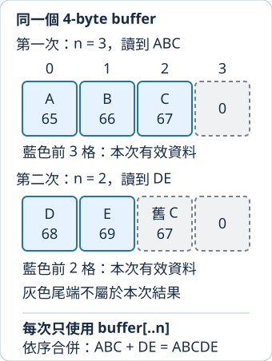

# 10.4 bytes 與 buffer：只處理這次有效的前段

前節把完整 UTF-8 文字一次保存成 String。現在希望分批讀取檔案，或處理不一定是文字的資料。讀取來源每次交出多少資料，要由結果告訴我們；不能要求每次剛好填滿，也不能把 buffer 原本留下的內容混入新結果。

本節使用 `intro-io-bytes` package。從 repo 根目錄執行 `cd examples/intro-workspace/io-bytes`，接著都在此處執行本節指令。前節材料位於旁邊的 io-text 資料夾，`../io-text/fixtures/note.txt` 的 `..` 表示先回上一層，再進入 io-text；起點仍是目前的工作目錄。

## 一個 byte 的型別，與暫存資料的區域

**`u8`** 是 8-bit unsigned integer，也就是不保存負數、可表示 0 到 255 的整數型別。這份範圍剛好保存一個 byte 的值。它有 Copy、Debug 與數值比較能力，能沿用先前數字的讀取、顯示與檢查。

因此 `[u8; 4]` 是四個 byte 值的 array，`&[u8]` 借用一段 byte 資料，`&mut [u8]` 則允許修改借來的那段。`Vec<u8>` 擁有可增長的 byte 清單；使用第 5.4 節的 new／push／as_slice，就能保存分次收到的資料。

**buffer（緩衝區）** 是這次讀取暫時放資料的區域。本節用四格 array，寫成 `let mut buffer: [u8; 4] = [0; 4];`。右側的 **`[值; 次數]`** 會用同一個 Copy 值初始化每一格，此處四格都先是零；它和型別位置的 `[u8; 4]` 分別指定初始值與資料形狀。

## Read::read 回傳的 n，決定哪些 bytes 是新資料

第 10.3 節已引入 Read trait。現在選用其 **`read(&mut buffer[..])`** method：mutable 借用來源與一段可填入的 byte 空間，回傳 **`io::Result<usize>`**。成功的 `n` 表示本次讀入多少 bytes，這些新資料位於 **`buffer[0..n]`**；符合契約的來源不會回傳大於 buffer 長度的 n。

先用 ASCII 的 `ABCDE` 觀察長度，因為每個字母恰是一個 byte。假設來源第一次交出 ABC、第二次交出 DE；同一個四格 buffer 可以留下以下狀態：



圖中第一列的 0、1、2、3 是 buffer 索引。藍格代表這次 n 指定的前段；灰格即使有數字，也不屬於這次新資料。第二次的索引 2 還是上次留下的 C，只能加入 DE，不能加入 DEC。上次的 ABC 已在當時處理過，不靠 buffer 替我們永久保存。

**短讀取** 指成功的 n 小於 buffer 長度。它不是錯誤，也不代表來源結束：第一次的 3 小於 4，後面仍有 DE。只要 n 大於零，就處理有效前段，再要求下一次讀取。

**EOF** 是 end of file（檔案結尾）。本節處理有結尾的有限來源，使用非空 buffer；`Ok(0)` 表示這次沒有更多資料，就結束此輪完整讀取。若給零長度 buffer，同樣可能得到 Ok(0)，卻不能藉此判斷來源已結束，所以我們固定使用四格。檔案之後若又被追加，也可能再次讀到資料；這裡沒有承諾它從此永遠不會改變。

讀取可能回傳 **`ErrorKind::Interrupted`**，表示這次操作被中斷，應再重試。read 回傳 Err 時，這次沒有成功讀入可供處理的 bytes；其他錯誤則傳回 caller，不把先前已收集的部分資料當成完整成功。

## 同一個讀取流程，接收任何實作 Read 的來源

下面把流程放進 library 的 read_all。`R: Read` 沿用第 6.1 節的 trait bound；`reader: &mut R` 只借用來源來推進讀取，不接手它。

每次先取得 n，再處理 `&buffer[..n]`；for 的 byte 是 `&u8`，所以以已教的 `*byte` 讀出 Copy 的 byte，push 到結果。Interrupted 用 continue 重試，來源結束才回傳完整 Vec：

```rust
--8<-- "examples/intro-workspace/io-bytes/src/lib.rs"
```

四格 buffer 可以重用，結果 Vec 則保存全部 bytes，所以總記憶體仍隨輸入增長。這個例子教的是分次讀取的正確接合；如果工作只需統計，可以像本節練習那樣不保存整份資料。

### 收集完整 bytes 之後，才驗證文字

**`String::from_utf8(bytes)`** 接手 `Vec<u8>`，檢查完整資料是否為合法 UTF-8，回傳 `Result<String, std::string::FromUtf8Error>`。成功取得 owned String；失敗原因是 UTF-8 格式，而非讀檔 I/O。FromUtf8Error 已有 Debug／Display，可以檢查或顯示；本節只用這項回饋。

一個 UTF-8 scalar 可能跨越兩次讀取。如果每次都把短 buffer 當成完整文字檢查，合法檔案也可能被誤判。例如「中」的三個 bytes 在不同批次到達時，各批都不一定是完整 UTF-8。本次先收集完整資料，再轉成 String。

File 已實作 Read，所以相同 library 函式可以接收真實檔案。`Ok(mut file)` 的 pattern 先取出 File，再把接收它的 binding 宣告為 mutable，供 `&mut file` 使用。依第 2.6 節的 package／crate 規則，`intro-io-bytes` 的 library 路徑從 `intro_io_bytes` 開始：

```rust
--8<-- "examples/intro-workspace/io-bytes/src/main.rs"
```

```bash
cargo run --manifest-path Cargo.toml -p intro-io-bytes --locked
```

得到 `取得=9 bytes` 和 `完整文字="Rust\n中\n"`。如果換成前節的 not-utf8.bin，byte 讀取仍可成功，但文字轉換失敗。開啟、讀取與文字格式是三個不同步驟，各自保留失敗。

## 刻意短讀取的來源，讓規則可以驗收

真實 File 不保證每次讀取的批次大小；若它剛好一次填滿 buffer，就不能由此確認我們有處理短讀取。現在自己實作 **ShortReader**：資料已在記憶體中，每次最多交出指定數量，供相同 read_all 使用。

它保存三項狀態：data 是全部 owned bytes；position 是下一個尚未交出的資料索引；max_per_read 是每次最多交幾個 bytes，本節建立它時都使用正數。

**`impl Read for ShortReader`** 提供 read 的具體做法，簽名遵循剛才的契約。每次從 copied=0 開始，直到 buffer 滿、達到本次上限，或原資料用完；每交一個 byte，就更新 copied 與 position。空 buffer 不進入 while，回傳零；原資料結束也回傳零。它不把任何舊 buffer 值算成新資料。

```rust
--8<-- "examples/intro-workspace/io-bytes/examples/short_reader.rs:short-reader"
```

為了建立原資料，再選用 **`str::as_bytes()`**：只借出該文字的 UTF-8 byte slice `&[u8]`，不複製或解析內容。沿用第 8.5 節的 ToOwned，這份 byte slice 的 `to_owned()` 建立 `Vec<u8>`，複製 byte 值供 ShortReader 擁有；只複製 reference 本身則沒有得到 owned 資料。ToOwned 也由 prelude 提供名稱，本例仍明寫 `use std::borrow::ToOwned;` 方便對照來源，後面可直接使用這個已教的 method。

```rust
--8<-- "examples/intro-workspace/io-bytes/examples/short_reader.rs:short-reader-main"
```

執行 `cargo run --manifest-path Cargo.toml -p intro-io-bytes --example short_reader --locked`，取得完整 ABCDE。這份來源對四格 buffer 依序回傳 3、2、0，直接呈現圖中兩段新資料與結束點。

### 中斷之後重試，真正失敗則保留原因

再設計一份可預測的來源：第一次 Interrupted，第二次交出一個 byte，第三次 PermissionDenied。**`PermissionDenied`** 是權限不允許這項操作的 ErrorKind；此例是在記憶體中指定錯誤來驗證流程，沒有改動真實檔案權限。

標準庫提供 **`io::Error::from(kind)`**，以 From 把 ErrorKind 建成具體 io::Error；這個錯誤只保存類別，不需要額外文字。slice 的 **`is_empty()`** 回傳 len 是否為零的 bool；先處理空 buffer，可避免存取不存在的第一格。

這份來源以 step 保存下一次要發生的事件。讀取 Err 沒有交出 bytes，但測試來源仍可更新自己的事件狀態：這是模擬「中斷已發生，下一次再試」的安排，不是把讀取位置前進一個 byte。

```rust
--8<-- "examples/intro-workspace/io-bytes/examples/error_reader.rs:error-reader"
```

```rust
--8<-- "examples/intro-workspace/io-bytes/examples/error_reader.rs:error-main"
```

執行 `cargo run --manifest-path Cargo.toml -p intro-io-bytes --example error_reader --locked`。結果確認總共三次呼叫，且最後回傳 PermissionDenied。先前取得的 R 不能把後續失敗變成完整成功，Interrupted 也沒有直接讓整個工作結束。

## 短寫入：成功一次，不代表全部寫完

第 10.3 節的 write! 負責把格式化文字寫出。現在處理 byte slice，選用 Write 的兩項 methods：

| method | 輸入與結果 | caller 需要判斷什麼 |
| --- | --- | --- |
| `write(bytes)` | 接收 `&[u8]`，回傳 `io::Result<usize>` 中已寫入的 n | 成功可能只接受前 n bytes，剩餘資料仍需處理。 |
| `write_all(bytes)` | 接收 `&[u8]`，回傳 `io::Result<()>` | 會重複寫到全部完成，並重試 Interrupted；其他失敗就回傳 Err。 |

對非空資料，write_all 遇到 write 回傳零，會以 **`ErrorKind::WriteZero`** 回報無法繼續完成。它不能永遠重試一個沒有進展的出口。寫入已部分完成後才遇到錯誤時，先前寫入不會自動撤回。

Write 的另一項必要操作 **`flush()`** 回傳 `io::Result<()>`，要求把中間緩衝的資料推送到出口。它不等同保證資料已保存到永久儲存裝置；此處要依輸出型別的契約理解完成位置。

以下 ShortWriter 的出口就是記憶體中的 bytes。write 每次最多接受兩個 bytes；accepts_data 為 false 時則不再接受，回傳零。flush 沒有中間緩衝需要推送，所以直接 Ok。write_all 是 Write 已提供的方法，會依這份實作的 write 反覆完成工作；我們不用再實作一份 write_all。

```rust
--8<-- "examples/intro-workspace/io-bytes/examples/short_writer.rs:short-writer"
```

先呼叫一次 write，再把**尚未寫入的後段**交給 write_all：

```rust
--8<-- "examples/intro-workspace/io-bytes/examples/short_writer.rs:short-writer-main"
```

執行 `cargo run --manifest-path Cargo.toml -p intro-io-bytes --example short_writer --locked`，先寫入 2 bytes，剩下 3，再得到完整 ABCDE。這個出口是記憶體資料，不是新增的檔案；將最後 owned Vec 轉成文字，只為核對我們沒有漏寫或重寫。

## 用可控制的來源與出口保存契約

ShortReader 的第一項測試直接檢查 3、2、0 與舊 C，第二項換不同短讀取上限，確認 UTF-8 bytes 分批後仍能接成原文字，第三項確認空來源是成功：

```rust
--8<-- "examples/intro-workspace/io-bytes/examples/short_reader.rs:short-reader-tests"
```

ShortWriter 的兩項測試確認反覆短寫入得到完整資料，以及無進展時的 WriteZero：

```rust
--8<-- "examples/intro-workspace/io-bytes/examples/short_writer.rs:short-writer-tests"
```

分別選擇三份 example 執行測試：

```bash
cargo test --manifest-path Cargo.toml -p intro-io-bytes --example short_reader --locked
cargo test --manifest-path Cargo.toml -p intro-io-bytes --example short_writer --locked
cargo test --manifest-path Cargo.toml -p intro-io-bytes --example error_reader --locked
```

error_reader 另有一項測試，確認三次事件與最終錯誤。三個 targets 合計六項，不依真實檔案的短讀寫次數或目前登入者權限決定結果。

## 完整設定、來源與輸入

完整 member `Cargo.toml` 只有已教的基本欄位，沒有額外 dependency：

```toml
--8<-- "examples/intro-workspace/io-bytes/Cargo.toml"
```

`src/lib.rs` 與 `src/main.rs` 已在前面完整列出；下面列出三份 example 的完整內容，也包含它們實際載入的測試。它們都只依賴本頁的 read_all library，沒有隱藏 helper：

??? example "展開 short_reader.rs、error_reader.rs、short_writer.rs 全檔"

    `examples/short_reader.rs`：

    ```rust
    --8<-- "examples/intro-workspace/io-bytes/examples/short_reader.rs"
    ```

    `examples/error_reader.rs`：

    ```rust
    --8<-- "examples/intro-workspace/io-bytes/examples/error_reader.rs"
    ```

    `examples/short_writer.rs`：

    ```rust
    --8<-- "examples/intro-workspace/io-bytes/examples/short_writer.rs"
    ```

真實檔案來自相鄰 io-text 的三份教材材料。note.txt 完整內容如下，兩行末尾都有換行：

```text
--8<-- "examples/intro-workspace/io-text/fixtures/note.txt"
```

empty.txt 是0 bytes；not-utf8.bin 的完整 byte 序列為單一255（十六進位FF），沒有換行。檔案已提供，不要以三個文字字元255取代原始byte。記憶體 ShortReader/ShortWriter 的資料、事件與預期答案則完整保存在上面的Rust來源中。

## 練習：只統計，不保存完整內容

寫 `count_bytes<R: Read>(reader: &mut R) -> io::Result<usize>`，重用四格 buffer，只累加每次成功的 n，直到非空 buffer 得到 Ok(0)。維持 Interrupted 重試與其餘錯誤傳回的政策，不建立累積全部內容的 Vec。

驗證前節三個已存在的檔案：note 是 9、empty 是 0、not-utf8 是 1。這次只數 bytes，不要求資料是 UTF-8，因此最後一份也能成功；和第 10.3 節的文字讀取需求不同。

??? note "完整參考答案"

    ```rust
    --8<-- "examples/intro-workspace/io-bytes/examples/byte_count_solution.rs"
    ```

    執行 `cargo run --manifest-path Cargo.toml -p intro-io-bytes --example byte_count_solution --locked`。

讀取資料的型別、有效長度與完整結果已經分開。接著回到檔名：路徑不一定能表示成 UTF-8 文字，程式也要從作業系統取得 arguments，並把資料、診斷與結束狀態各交到正確位置。

[下一節：原生路徑與 CLI](10-05-lesson.md)

延伸閱讀：[std：Read](https://doc.rust-lang.org/std/io/trait.Read.html)、[Write](https://doc.rust-lang.org/std/io/trait.Write.html)、[String::from_utf8](https://doc.rust-lang.org/std/string/struct.String.html#method.from_utf8)、[英文 Rust By Example：read_lines](https://doc.rust-lang.org/rust-by-example/std_misc/file/read_lines.html)、[中文版對應章原文](https://github.com/rust-lang-cn/rust-by-example-cn/blob/master/src/std_misc/file/read_lines.md)。後兩者以逐行處理展示工作分批，本節先處理原始 bytes，之後需要文字行時再接已教 Iterator。
