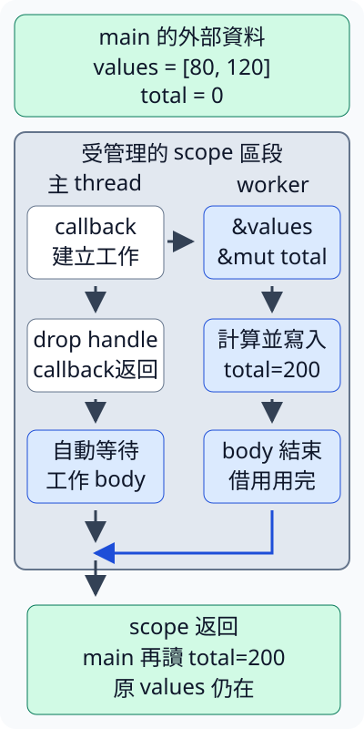

# 10.4 scoped thread：借用外部資料，安排區段收尾

10.2 用 move closure 接手數列，讓普通 thread 算出200。現在希望 **worker 只借讀 `[80, 120]`，工作完成後，原 owner 還能繼續修改數列**。普通 spawn 的 static bound 不會因為我們打算立刻 join 而消失；這次需要由介面保證：借用工作的有效區段結束前，一定先完成這些工作。

## scope 管理工作，也提供借用的邊界

`std::thread::scope` 建立一段管理 scoped threads 的區段。它接收一份 callback，向 callback 提供 `&Scope`：這個 **Scope context** 是在本區段建立工作、追蹤收尾的管理物件。callback 在呼叫 scope 的 thread 執行；用 context 的 spawn method 才建立新的 worker。

scoped thread 可以借用非 static 的外部資料。scope 返回前，會自動等待本區段中未被手動 join 的工作 body 完成，所以那些借用不會被留到區段外繼續使用。普通 borrowed 資料必須在這段工作仍需要它時保持有效。

先分清一個清理界線。**thread-local data（執行緒局部資料）** 是每個 thread 各自持有的一份資料，與函式 body 裡的一般局部變數不同；它可能在工作 body 返回後才繼續清理。本節只需知道這種資料的角色，不使用其 API。Rust 1.99 的 scope 自動等待保證工作 body 完成，thread-local 的清理可能仍在進行；下面 ScopedJoinHandle 的手動 join 則連這種清理也會等待。不要把這兩種等待概括成相同範圍。

### 兩個 lifetime 各自描述哪一段關係

`Scope<'scope, 'env>` 有兩個 lifetime 參數：

- `'scope` 描述本次受管理區段。它在管理 callback 執行之前開始，callback 返回後還要等待 scoped 工作 body，最後才結束這個區段。
- `'env` 描述 worker 借用的外部環境有效期。例如 main 先建立的 Vec 可以被借用；來源必須覆蓋這次 scope 呼叫所需的區段。
- 型別的 `'env: 'scope` 沿8.4的 outlives bound，表示外部來源至少能支援完整的 `'scope`。它沒有要求 Vec 存活整個 process。

下面只摘型別與函式的 API 簽名；Scope 的 private fields 與實作 body 省略，不是讓我們自行建構空的 Scope：

```rust
pub struct Scope<'scope, 'env: 'scope> { /* private fields */ }
```

```rust
pub fn scope<'env, F, T>(f: F) -> T
where
    F: for<'scope> FnOnce(&'scope Scope<'scope, 'env>) -> T,
```

10.3 的 for 在這裡派上用場。scope 自己安排 context 的借用有效期，F 要能接受各次合法的這種借用；`'env` 仍描述捕捉的外部來源。T 位於 for 的選擇之外，是 callback 整體交回的結果，不把 context 的局部借用帶到外面。scope 的 callback 沒有 Send bound，因為它在呼叫的 thread 執行。

### 透過 context 建立工作

Scope 的 **spawn method** 接手工作 closure，回傳 `ScopedJoinHandle<'scope, T>`，也就是這份 scoped 工作的 owned 等待權限。method 的 receiver 是 `&'scope self`，沿4.5把借用 context 的有效期寫出來：

```rust
pub fn spawn<F, T>(&'scope self, f: F) -> ScopedJoinHandle<'scope, T>
where
    F: FnOnce() -> T + Send + 'scope,
    T: Send + 'scope,
```

與10.2的普通 spawn 比較：工作及成果的 Send 都保留；原來的 static 改成這次的 scope 有效期。因此可以依靠仍有效的外部借用，仍需符合跨 thread 的型別能力。這個 method 在作業系統無法建立 thread 時也可能 panic；下面先處理成功建立的工作。

以上兩個簽名的 F／T 各在自己的函式宣告：scope 的 F 是管理 callback、T 是整體結果；spawn 的 F 是 worker 工作、T 是 worker 的成果。不能把兩份 F 當作相同 closure。

`worker.join()` 消耗 ScopedJoinHandle，等待其 thread 完全結束，包含 thread-local 清理，再得到10.2的 `thread::Result<T>`：正常回傳 Ok(T)，Rust panic 的 payload 是 Err。錯誤型別仍是 `Box<dyn Any + Send + 'static>`；工作可以借短資料，並沒有改變 panic payload 的錯誤型別。

## 只借讀數列，原 owner 留在 main

沿用10.2的 sum 與同一份小數列。這次 closure 沒有 move，借用外面的 values；它的 `Vec<i32>` 符合 Sync，shared reference 符合 Send，來源又能覆蓋這次 scope，所以可以交給 worker：

```rust
--8<-- "examples/ch10-concurrency/examples/scoped_borrow.rs"
```

```bash
cargo run -p ch10-concurrency --example scoped_borrow --locked
```

```text
借讀的工作小計=200
scope返回後，原owner仍可更新，長度=3
```

worker 得到200，手動 join 把結果交回；scope 返回這個 Result 後，main 再判斷它。外面的 values 沒有被移走，工作借用也已用完，因此可以 push 30，長度由2變3。這個結果支持「保留 owner、安排借用收尾」，沒有量測加速。

### callback 裡才建立的局部資料，仍可能活得太短

`'scope` 包括 callback 返回後的等待。若把 values 移到 callback 的 body 裡，它可能在自動等待開始前就結束，不能當成覆蓋完整區段的外部來源。以下完整 fixture 即使手動 join，仍收到 `E0373`：

```rust
--8<-- "examples/ch10-concurrency/fixtures/compile-fail/scoped_local_source.rs"
```

Scope::spawn 的 bound 要求工作能支援 `'scope`，不因這次程式打算立刻 join 而改變。可以把來源移到 scope 呼叫之前，像正常例子；若確實要由 worker 接手 owned Vec，也可以重新依 move 的契約安排。scope 沒有替局部資料延長存活。

## scoped handle 丟棄後，scope 還是會等待

10.2 的普通 JoinHandle 被丟棄會 detach。**ScopedJoinHandle 被丟棄時，工作仍由 scope 追蹤，區段結束前自動等待其 body**；丟棄這個 handle 本身不立即等待，也不取消工作。

現在讓 worker 把200寫到外部 total。mutable reference 也可以跨 thread，條件是被借的 T 符合 Send；此處是 i32。它保留普通獨佔 borrowing 的要求，因此這段工作仍在使用 total 時，其他路徑不能同時使用同一份獨佔借用。

```rust
--8<-- "examples/ch10-concurrency/examples/scoped_auto_wait.rs"
```

```bash
cargo run -p ch10-concurrency --example scoped_auto_wait --locked
```

輸出 `scope已等待工作body，小計=200，原數列長度=2`。worker 借讀 values、獨佔借用 total，並回傳 unit；我們沒有要透過 handle 取得額外成果。callback 丟棄 handle 後返回，scope 繼續等工作 body。外面的 assertion 在 scope 返回後才讀 total，因此能確定這次寫入已完成。

圖示一種可能的進度安排：callback 先返回，worker 稍後才完成；也可能 worker 早已完成。灰箭頭是建立工作或目前 thread 的流程；藍色路徑表示 worker body 完成後，主 thread 的等待才能完成。縱向距離不是量測時間。外部資料框在受管理區段外，body 內的借用結束後，原 owner 才在後續流程讀取結果：



看左邊的「callback 返回」與「scope 返回」：兩者之間還有等待。看右邊的200：它寫進外部 total，沒有因丟棄 handle 而遺失這次寫入；main 只在 scope 返回後讀取。圖中的結束指工作 body，不把尚可能進行的 thread-local 清理也算進自動等待。

### 借用規則與 Send／Sync 都保留

想讓兩個 worker 同時各持 total 的 mutable borrow，會違反獨佔規則；以下完整 fixture 收到 `E0499`：

```rust
--8<-- "examples/ch10-concurrency/fixtures/compile-fail/scoped_two_mutable.rs"
```

scope 會安排收尾，沒有讓同一份普通 i32 同時有兩個可用的 mutable reference。需要共享更新的工作，後面才用同步介面安排；這裡先保留不同來源的獨佔借用。

Cell 的 shared borrowing 也沒有因此變成可跨 thread。以下把讀取 Cell 的 closure 交給 scoped spawn，仍收到 `E0277`：

```rust
--8<-- "examples/ch10-concurrency/fixtures/compile-fail/scoped_cell_shared.rs"
```

closure 捕捉 `&Cell<i32>`，需要 Cell 的 Sync 才能滿足工作 Send；10.1已教 Cell 沒有這項能力。scope 處理來源有效期，沒有替 Cell 的內部操作增加同步保護。

## 借用成果可以來自外部，等待權限不能帶出去

如同10.3，整體結果 T 可以保留外部來源的借用。下面 worker 回傳原 Vec 的 slice view，再由手動 join 把它交回；`[i32]` 的元素符合 Sync，所以這份 shared slice 符合 Send。來源 values 仍在 main，能支援這份 view 在 scope 之後的使用：

```rust
--8<-- "examples/ch10-concurrency/examples/scoped_borrowed_result.rs"
```

執行 `cargo run -p ch10-concurrency --example scoped_borrowed_result --locked`：

```text
結果仍借自外部數列，長度=2，小計=200
最後一次借讀後，原數列長度=3
```

這份 view 借自 `'env` 所描述的外部資料。match 中讀完 view 後，main 才 push；沒有把來源移到 worker 裡，也沒有借用已結束的 Scope context。scope 返回後，若結果仍含外部資料的借用，仍要等最後一次借讀結束，才能修改來源。

ScopedJoinHandle 則帶有本次的 `'scope`。把它直接當作 scope callback 的結果，想在 scope 返回後再 join，會使等待權限逃出自己的有效區段：

```rust
--8<-- "examples/ch10-concurrency/fixtures/compile-fail/scoped_handle_escape.rs"
```

診斷包含 `lifetime may not live long enough`。10.3的固定結果 T 不能依賴 for 裡當次 context 的借用；這份 handle 不能像借自外部 values 的 view 那樣留下。應在 scope 內等待，交出適當的工作結果。

## 工作 panic：手動 join，或由 scope 繼續 panic

沿10.2的 unwind 設定，scoped worker panic 也能透過手動 join 取得 payload。**已手動 join 的工作，不再由 scope 的自動等待替我們繼續這次工作 panic**；呼叫端自己處理收到的 Err。

下面 worker 先借讀外部 text，再故意 panic。管理 callback 手動 join 並回傳 Result，main 使用10.2已教的 panic_message；外部 String 一直在有效區域：

```rust
--8<-- "examples/ch10-concurrency/examples/scoped_panic.rs"
```

```bash
cargo run -p ch10-concurrency --example scoped_panic --locked
```

main 的 stdout 是：

```text
手動join收到panic：借用工作故意panic
scope正常返回，原文字=Rust
```

如同上一節，stderr 還會有 worker 的標準 panic 診斷；這份 main 正常結束。scope 的 T 在此是整份 `thread::Result<i32>`，不把 callback 的正常回傳錯認成 worker 沒有 panic。

若改成丟棄 handle，就沒有手動取得這份 Err。scope 在等待全部所追蹤的工作 body 後，會因未處理的工作 panic 而 panic；以下是完整的 **故意執行失敗 fixture**：

```rust
--8<-- "examples/ch10-concurrency/fixtures/runtime-fail/scoped_auto_panic.rs"
```

它可以通過編譯，執行卻以非零狀態結束；stderr 包含 `a scoped thread panicked`，main 最後的「scope正常返回」不會印出。這與前面的 compile-fail 是不同種類的失敗。

管理 callback 本身若在 unwind 下 panic，scope 也會先等已追蹤的工作 body，再繼續這份 panic。完成等待不會自動還原先前的修改：若工作先更新資料再 panic，外部資料可能已部分改變。保證借用工作收尾，與保證業務操作全部成功，是不同要求。

## 練習：兩份不同數列，各自獨佔更新

main 保留兩個不同的 Vec：第一份 `[80, 120]`，第二份 `[1, 2, 3]`。用兩個 scoped workers 分別借用它們的 mutable slice，逐個加一，再回傳各自的長度。scope 返回後，由 main 讀更新後的資料。

1. 一份 worker 只借用一個 Vec，使用3.6已教的 as_mut_slice 與2.6的 mutable slice 走訪，寫 `*value += 1`。材料仍採這些小整數。
2. 兩個 handle 都先手動 join，把結果存進 tuple 後才判斷，避免因第一份 Err 提前停止等待第二份。
3. 兩份都正常回傳時，確認長度2與3、兩份小計202與9，合計211。至少一份 panic 時，只報告失敗與可能的部分修改，不把成功小計冒充完整答案。

??? example "完整參考答案"

    ```rust
    --8<-- "examples/ch10-concurrency/examples/scoped_solution.rs"
    ```

    執行 `cargo run -p ch10-concurrency --example scoped_solution --locked`，輸出 `兩份獨佔借用工作完成，長度=2、3，總和=211`。兩份 mutable borrow 指向不同的 Vec，source 不衝突；兩次等待都在判斷前完成，main 的讀取在 scope 之後。

下一節讓 worker 透過 channel 交接多份成果，仍會保留這裡學到的工作生命週期與收尾判斷。

## 來源與延伸閱讀

- [Comprehensive Rust：Scoped Threads](https://google.github.io/comprehensive-rust/concurrency/threads/scoped.html)、[RustCourse：1.63 scoped threads 段](https://course.rs/appendix/rust-versions/1.63.html)。
- [`thread::scope` 的 lifetime、等待與 panic](https://doc.rust-lang.org/std/thread/fn.scope.html)、[`Scope::spawn`](https://doc.rust-lang.org/std/thread/struct.Scope.html#method.spawn)。
- [`ScopedJoinHandle::join` 的完整等待範圍](https://doc.rust-lang.org/std/thread/struct.ScopedJoinHandle.html#method.join)。
