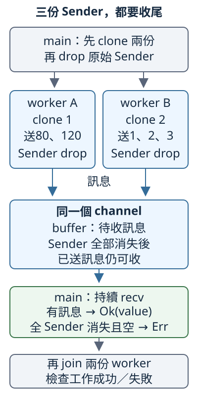

# 10.5 channel：交接訊息，也安排工作收尾

10.2 用 join 取得 worker 最後回傳的一份成果。現在希望 **worker 能逐項交出資料，main 持續收取，最後確認收完整份資料並等待 worker 結束**。例如一份工作依序提供80與120，另一份提供1、2、3，main 收到五項後加總成206。join 仍可取得最後成果；這次另外需要工作進行中的訊息交接。

**message passing（訊息傳遞）** 是把資料當成訊息，交給接收方使用。標準函式庫的 **channel（通道）** 提供傳送端和接收端：傳送端把值交進 channel，接收端再取出值。它不是新 thread；哪個 thread 傳、哪個 thread 收，由程式安排。

## 一個 channel，兩種端點

`std::sync::mpsc` 是提供這些 channel 的 module。**mpsc** 展開為 **multiple producer, single consumer**：多個傳送方可以交出訊息，由一個接收端取走。先用一個傳送端，稍後再增加傳送方。

`mpsc::channel::<T>()` 建立一個 channel，回傳 `(Sender<T>, Receiver<T>)`。`Sender<T>` 是傳送權限，`Receiver<T>` 是接收權限；這個 tuple 的兩個值連到同一個 channel。T 是每份訊息的型別。下面只摘 API 簽名，供閱讀介面，不是有完整 body 的獨立程式：

```rust
pub fn channel<T>() -> (Sender<T>, Receiver<T>)
```

channel 會保留已送入、尚未取走的訊息；這段待收空間叫 **buffer（緩衝區）**。這個 channel 沒有預先設定訊息數量上限，送得比收得快時，待收訊息可能累積並占用更多記憶體。這不表示電腦有無限記憶體。

先教兩個 method 的當下契約：

`sender.send(value)` 回傳 `Result<(), SendError<T>>`：成功交回 unit，失敗帶回未送值。它不為了等 buffer 空位而 blocking。

`receiver.recv()` 回傳 `Result<T, RecvError>`：成功取得一份訊息的 T。空且至少還有一個 Sender 時 blocking；沒有 Sender 且已收完時回傳 Err。

send 的 receiver 是 `&self`，會保留 Sender，能再送下一份；訊息參數是 owned T。recv 的 receiver 也是 `&self`，每次成功取走一份 T，能再收下一份。**send 成功只表示本次傳送被 channel 接受，不保證接收方最後一定收到，更不保證已完成處理**：接收端仍可能在成功傳送後被丟棄。

### 失敗時，未送值在哪裡？

`SendError<T>` 持有本次沒有送成的 T。它是 **tuple struct（以位置命名欄位的 struct）**：型別有自己的名字，欄位不像之前的 struct 叫 amount，而是像 tuple 用 `.0`、`.1` 存取。這個型別只有一個公開欄位，官方宣告如下：

```rust
pub struct SendError<T>(pub T);
```

外層 `pub` 表示型別公開，括號裡的 `pub T` 表示第0個欄位公開。match 取得 `Err(error)` 的 ownership 後，可以用 `error.0` 取出原 T；非 Copy 的值會從 error 移出。SendError 沒有偷偷替我們重試。`RecvError` 則只表示再也收不到新訊息，沒有一份未送的 T 可以取回。

### 先交接一份 owned Vec

沿用 `[80, 120]` 和已教 sum。跨 thread 交接 owned 訊息仍受10.1的 Send 規則限制：**T 符合 Send，`Sender<T>` 才符合 Send**。這裡的 `Vec<i32>` 有 Send，這份 Sender 也不依賴局部借用，能滿足普通 spawn 的 Send 與 static bound。channel 的建立本身沒有要求所有 T 都是 static；此處是工作介面的限制。

worker 接手 Sender，把自己的 Vec 交進 channel；main 收到的是 owned Vec，仍能借用它的 slice 加總。worker 的最後回傳值是 send 的 Result，所以 join 還有10.2已教的兩層結果：外層看 thread 是否正常回傳，內層看傳送是否成功。

```rust
--8<-- "examples/ch10-concurrency/examples/channel_single.rs"
```

```bash
cargo run -p ch10-concurrency --example channel_single --locked
```

輸出 `收到owned數列，長度=2，小計=200；worker已收尾`。main 先收，再 join，最後同時判斷兩份結果。recv 的 Ok 讓我們得到數列；join 的 Ok(Ok(_)) 讓我們知道工作正常回傳、傳送成功。沒有把「收到數列」當作「worker 的其餘程式也已完成」。

send 取得 T 的 ownership。對 Vec 而言，傳送後不能再透過原名稱讀同一份 owned 值；這份完整 compile-fail 收到 `E0382`：

```rust
--8<-- "examples/ch10-concurrency/fixtures/compile-fail/channel_value_moved.rs"
```

若傳送本來就是 Copy 的 i32，呼叫時複製那個數值，原 binding 還能使用；channel 沒有取消既有 Copy 規則。

## 沒有新訊息，與不會再有訊息

recv 等待的理由是「現在沒有訊息，但仍可能有人送」。只要任一 Sender 還存在，空 buffer 的 recv 就不能把它當作結束；**原始 Sender 和每一份 clone 都必須丟棄**，才表示不會有新的傳送。

全部 Sender 消失時，已送入 buffer 的訊息仍可取出。要先收完它們，之後的 recv 才會回傳 RecvError。用同一個 thread 先送後收，讓這個邊界直接可見：這不是建立並行工作的範例，是專門看 channel 保留訊息的行為。

下面會用5.1的 expect 檢查已知條件。expect 要求錯誤 E 符合 Debug，以便失敗時產生診斷；標準函式庫的 `SendError<T>` 與 RecvError 都有 Debug，因此這裡可以使用它。

```rust
--8<-- "examples/ch10-concurrency/examples/channel_drain.rs"
```

```bash
cargo run -p ch10-concurrency --example channel_drain --locked
```

```text
Sender已關閉，仍收到=80、120
待收訊息已空，recv回傳Err
```

expect 沿5.1的用法檢查本例已知條件：傳送時 receiver 還在，兩次收取也已有已送訊息。它沒有取代一般程式的失敗處理。這裡只有一份 Sender；若還保留它的 clone，第三次 recv 便可能繼續等待。

### 接收端先消失，傳送會失敗

反過來，丟棄 Receiver 後，send 得到 SendError。沿用同一份 Vec，從 error 的第0欄取回它，再加總：

```rust
--8<-- "examples/ch10-concurrency/examples/channel_recover.rs"
```

執行 `cargo run -p ch10-concurrency --example channel_recover --locked`，輸出 `傳送失敗，取回原數列，長度=2，小計=200`。原名稱 values 已移進 send；這次透過 Err 取回的 recovered 才是後續 owner。接收端不在時，傳送不會替我們建立另一個 Receiver。

## 多個 producer，收完訊息後再等工作

要讓兩份 worker 都傳送到同一個 channel，可以呼叫 `sender.clone()`。這個 Clone **建立連到同一 channel 的另一份傳送權限**，不複製 channel 中的訊息，也不要求訊息 T 本身符合 Clone。每份 Sender 都要納入收尾。

跨 thread 時仍看10.1的型別能力：T 符合 Send，`Sender<T>` 才符合 Send 和 Sync，`Receiver<T>` 才符合 Send。**Receiver 不符合 Sync，也沒有 Clone**；不要把它當成可以任意複製、讓多份 shared reference 同時收訊息的物件。本節讓 main 獨自持有 Receiver，各 worker 各持有一份 Sender。

channel 本身不強制 T 一定 Send：同 thread 使用 channel 的情境可以持有其他 T。到了普通 spawn，才必須符合工作的 Send bound。下面的完整 fixture 在 worker 裡才建立 Rc，closure 捕捉的只有 `Sender<Rc<i32>>`，仍收到 `E0277`，因為訊息 Rc 沒有 Send：

```rust
--8<-- "examples/ch10-concurrency/fixtures/compile-fail/channel_rc_message.rs"
```

### 逐項傳送，回報這份工作是否送完

現在把單份 Vec 訊息改為逐項 i32：main 希望一項到達就能處理一項。兩組材料仍是80、120與1、2、3，不改變最後的206。

library 的 messages module 提供下面的 helper。它接手 Sender 和 owned Vec，依6.5的 owned 迭代逐項送出。`sent: usize` 的型別由回傳的 Result 推得；sent 只在 send 成功後加一。兩處錯誤型別都是 `SendError<i32>`，所以沿5.6的 `?`：失敗時立刻回傳這份 Err，後面的數值不再傳送；成功送完才回傳筆數。函式返回時，其 Sender 也會丟棄。

```rust
--8<-- "examples/ch10-concurrency/src/messages.rs"
```

這個 helper 的成功筆數表示 send 成功幾次，還沒有單憑它證明接收方收到幾次。完整程式讓 main 持續收取到 RecvError，再 join 兩份 worker；由兩邊結果共同確認完成。

收取迴圈使用 **while let**，沿3.1已教的 if let 加上重複判斷：`while let Ok(value) = receiver.recv()` 每次重新呼叫 recv，符合 Ok 時把取得的訊息綁到 value、執行 body，然後再判斷下一次；不符合這個 pattern，也就是收到 Err 時，就離開迴圈。它不把 Err 當成 panic。這裡只需等待訊息並累加，沒有其他接收錯誤要另外處理。

```rust
--8<-- "examples/ch10-concurrency/examples/channel_producers.rs"
```

```bash
cargo run -p ch10-concurrency --example channel_producers --locked
```

輸出 `收完5項，總和=206；兩個worker已收尾`。主 thread 不在傳送，因此建立兩份 clone、把它們交給 worker 後，就丟棄自己的原始 Sender。收取迴圈每次成功只加一筆，Err 才退出；之後兩個 handle 都先 join，再判斷。

每一份 producer 依呼叫順序送出的數值會保持順序，但兩份 producer 的訊息可能交錯：80、1、120、2、3與1、2、80、3、120都是可接受的收取次序。本例不指定交錯次序，加總與計數都不依賴它；只有兩份工作都成功送完，才把206當成完整答案。此處採小 i32，所有順序中的部分和也都在範圍內。

下圖把 **傳送權限、待收訊息和工作完成** 分開。灰箭頭指向 clone 的持有者或後續收尾，藍箭頭表示訊息交接，綠框是 main 的接收操作。這些是關係，不是固定排程或量測時間：



看頂部的三份 Sender：main 的原始端點也算一份；看中央的 buffer：最後一份 Sender 消失不會直接丟掉待收訊息。main 必須先 drain（收完待收訊息），空了才收到 Err；圖底還有 join，因為關閉傳送權限並不等於 worker 的所有工作都已結束。

若刪掉 `drop(sender)`，main 仍持有一份可傳送的權限。收完目前資料後，recv 會等下一份訊息，main 卻打算等迴圈結束才返回、丟棄 sender，於是無法走到收尾。這個反例依等待條件就能推得；不要執行它來等待一個不會自行發生的關閉。

## 限制待收數量：bounded channel

channel 沒有訊息數量上限。若 producer 持續供應、consumer 處理較慢，待收資料可能累積；希望 **最多只在 buffer 裡保留固定筆數，滿了就讓 producer 等待**，可以使用 `mpsc::sync_channel`。這種有容量限制的 channel 叫 **bounded channel**；滿了會反過來限制供應進度，這種作用叫 **backpressure（背壓）**。

先摘 API：容量的型別是已教的 usize；傳送端換成 `SyncSender<T>`，接收端仍是 `Receiver<T>`。

```rust
pub fn sync_channel<T>(bound: usize) -> (SyncSender<T>, Receiver<T>)
```

SyncSender 的 `send(&self, value: T)` 仍回傳 `Result<(), SendError<T>>`，但 buffer 滿時會 blocking，直到有空位或 Receiver 消失。成功放入有容量的 buffer，仍不表示對方已取走或處理；接收方消失時得到 Err，未送值仍可取回。SyncSender 也可 clone 成連到同 channel 的額外傳送權限，所有端點同樣要納入收尾。

這裡的「同步」指這份傳送等待契約，沒有要求兩份 thread 固定輪流執行。容量只限制 buffer 中的訊息筆數，不限制已被 consumer 取走的資料、producer 自己的 Vec 大小或整個程式的記憶體總量。

bounded_messages module 的 helper 與上一份逐項流程相同，只把 Sender 換成 SyncSender；新的差異由這個傳送端的契約提供：

```rust
--8<-- "examples/ch10-concurrency/src/bounded_messages.rs"
```

這份例子容量是1，逐項送80、120、30，main 持續取走訊息來騰出空位，收完後再 join：

```rust
--8<-- "examples/ch10-concurrency/examples/channel_bounded.rs"
```

執行 `cargo run -p ch10-concurrency --example channel_bounded --locked`，輸出 `容量1，收完3項，總和=230；worker已收尾`。這次執行核對三筆資料和收尾；「滿時會等待」依上述 API 契約，不由總和230或這次看不見的排程證明。

### 為什麼這裡先收，最後才 join？

容量1，worker 要傳送三項。如果 main 在第一個 recv 之前先 join，可能形成 **deadlock（死鎖）**，也就是各方互相等對方才能繼續的情況：

1. worker 放入第一項後，第二次 send 要等 main 取走訊息，騰出空位。
2. main 卻在 join 等 worker 結束，還沒開始 recv。
3. worker 無法結束，main 也無法完成等待；兩邊都到不了讓對方前進的操作。

目前程式先持續收取，讓 producer 有機會送完，最後才 join。不需要靠增加 sleep 或猜哪個 thread 先跑來解開這個等待循環。無容量上限的 channel 對這三筆資料不會有「等空位」這項依賴，但仍需要前面已教的端點關閉與收尾。

## consumer 提早停止：讓 worker 收到失敗，再 join

如果 main 已不需要後面的訊息，丟棄 Receiver 會讓後續 send 失敗；正在等空位的傳送也能得到失敗。producer 要檢查這份 Result，決定結束自己的工作。**這是協作停止**：消費端關閉接收，producer 在傳送處得知後自行返回；丟棄接收端沒有強制取消任何 thread。

為了讓停止發生在哪一筆可以確定，這次用容量0。這是 **rendezvous channel（傳送和接收會合的通道）**：不放待收 buffer，send 要與一次 recv 配對，成功返回時對方已收到那一項。這仍不保證對方已處理完它。

沿用80、120、30，只接收第一項80，然後 drop receiver。第二項120不可能在沒有第二次 recv 時先送成功，因此 helper 的下一次 send 得到 SendError，`?` 把它交回；第三項30不再傳送。最後 join 的正常回傳裡包含這份傳送 Err：

```rust
--8<-- "examples/ch10-concurrency/examples/channel_stop.rs"
```

```bash
cargo run -p ch10-concurrency --example channel_stop --locked
```

```text
收到第一項=80
停止後取回未送值=120；worker已收尾
```

`Ok(Err(error))` 是 worker 正常回傳傳送失敗；`Err(payload)` 才是 thread panic。容量0及唯一的一次 recv 確定未送值是120，不依賴呼叫 drop 時 worker 剛好跑到哪一行。main 仍 join，才知道 worker 已結束；如果 worker 一直做其他工作、不再碰 send，單憑 receiver 消失並不能讓它自行停止。

這個 helper 只取回第一次失敗的值。owned Vec 迭代尚未走到的後續值隨 helper 離開而清理；它不是「保留所有未完成工作」的介面。前面已成功交出去的80也沒有被撤銷。若應用需要保留剩餘工作，必須另行設計回報資料。

## 練習：容量1，兩份工作都可收尾

把前面的多 producer 加總改成容量1。材料仍是 `[80, 120]` 與 `[1, 2, 3]`；一份訊息就是一個 i32，main 逐項加總。使用已教的 send_bounded_values，不引入新的等待 API。

1. 建立一個 bounded channel、兩份 SyncSender clone。兩份 worker 各接手一份 clone 和各自數列；main 丟棄自己不再需要的原始傳送端。
2. main 先 recv 到 Err，然後把兩個 handle 都 join，再判斷兩份 nested Result。不要在收取前先等 worker。
3. 兩份工作都正常送完才確認：傳送筆數2與3、收到5項、總和206。至少一份傳送失敗或 panic 時，說明已等待兩份工作，不把部分資料當完整答案。
4. 用文字說明：若把最後的兩次 join 移到 recv 迴圈之前，誰在等誰？即使知道兩組數列的長度，也不能靠筆數消除「誰先騰出空位」的等待問題。

??? example "完整參考答案"

    ```rust
    --8<-- "examples/ch10-concurrency/examples/channel_solution.rs"
    ```

    執行 `cargo run -p ch10-concurrency --example channel_solution --locked`，輸出 `容量1，收完5項，總和=206；兩個worker已收尾`。兩個 producer 的交錯次序仍不固定，main 透過不受這些交錯次序影響的加總與計數取得穩定答案。若先 join，producer 可能在 buffer 滿時等 main 收取，main 又在等 producer 結束，形成上面的等待循環。

本節用 channel 交接資料，讓 main 集中處理收到的值。下一節改成多個 worker 需要更新同一份共享資料，學習如何安排存取與保護；這裡不把 Send／Sync 或「沒有提前使用已移走的值」當作所有工作都會成功的保證。

## 來源與延伸閱讀

- [Rust Book：Message Passing](https://doc.rust-lang.org/book/ch16-02-message-passing.html)、[正體中文對應章](https://rust-lang.tw/book-tw/ch16-02-message-passing.html)。
- [`channel`](https://doc.rust-lang.org/std/sync/mpsc/fn.channel.html)、[`Sender::send` 與 clone](https://doc.rust-lang.org/std/sync/mpsc/struct.Sender.html)、[`Receiver::recv` 的 buffer／關閉契約](https://doc.rust-lang.org/std/sync/mpsc/struct.Receiver.html#method.recv)。
- [`SendError<T>` 的未送值](https://doc.rust-lang.org/std/sync/mpsc/struct.SendError.html)、[`sync_channel`](https://doc.rust-lang.org/std/sync/mpsc/fn.sync_channel.html)、[`SyncSender::send`](https://doc.rust-lang.org/std/sync/mpsc/struct.SyncSender.html#method.send)。
