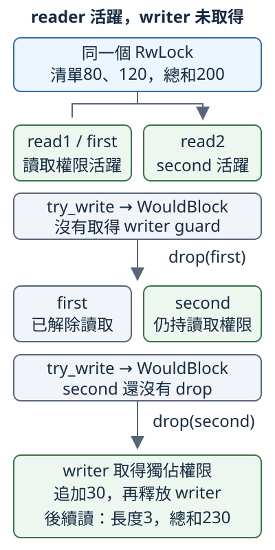

# 10.7 RwLock 與同步設計：共享讀取，獨佔修改

上一節用 Mutex 讓每份工作輪流取得一份獨佔 guard。現在希望 **多位呼叫者各自取得同一清單的 shared view，這些 view 可以並存；要追加資料的 writer，則等所有 view 都釋放後才修改**。材料沿用 `[80, 120]`，最後追加30得到230。本節先學這種權限分工，再討論何時釋放、重取或轉換它；不以這份小加總比較速度。

## read 與 write 是兩種不同權限

**`std::sync::RwLock<T>`** 是 **reader-writer lock（讀寫鎖）**，擁有 T，並追蹤目前的讀取或寫入權限。**reader** 是持有 shared 讀取權限的呼叫者，**writer** 是持有獨佔修改權限的呼叫者：多份 read guard 可以並存；write guard 不與其他 read 或 write guard 並存。

它仍沿8.8及10.6的 guard 模型。先分清兩種管理值，才讀方法的回傳型別：

- **`RwLockReadGuard<'a, T>`** 有 `Deref<Target = T>`，提供 shared borrowing。對普通 Vec，可以讀 len／as_slice，不能取得 mutable borrowing 來 push；它沒有 DerefMut。
- **`RwLockWriteGuard<'a, T>`** 有 Deref 和 DerefMut，mutable guard 可以修改普通 Vec。
- 兩者的 `'a` 都連到被借的 RwLock；正常 Drop 分別釋放那份讀取或寫入權限。read guard 最後一次使用，不會因此立即 drop。
- **兩種 owned guard 都沒有 Send**。worker 可以在自己的 thread 取得、使用、清理 guard，再交回長度或小計；不要把 owned guard 當成可移交的成果。

`RwLock::new(value)` 接手 T，建立尚無持鎖者的 RwLock。以下是選用的介面簽名，沒有實作 body，不是獨立程式：

```rust
pub fn read(&self) -> LockResult<RwLockReadGuard<'_, T>>
pub fn write(&self) -> LockResult<RwLockWriteGuard<'_, T>>
```

read 可以等待 writer 釋放；成功取得時仍可有其他 read guard。write 則要等其他 reader／writer 的權限都釋放，才能成功取得。兩者都是 shared receiver `&self`，由內部狀態安排存取。

`LockResult` 沿10.6：Ok 帶回 guard，poison Err 也含已取得的 guard。**RwLock 只可能因持有 write guard 的 panic 而 poison；持 read guard 的 panic 不會讓它 poison。** 這與 Mutex 不分讀寫的 guard 有差別。PoisonError 已有 Debug，因此本節的 expect 可檢查所列的已知條件；失敗時 panic，不會替應用復原資料。

### 一次嘗試，不等待：try_read 與 try_write

要觀察「現在可不可以取得」，不讓這次檢查停在等待中，可以用 `try_read()` 或 `try_write()`。成功仍回傳各自的 guard；無法立即取得就回 Err，**不等待、也不自動重試**。

它們的結果是 `TryLockResult<G>`。這裡 G 仍代表整份 guard 成果，沿已懂的 alias 和 enum 來讀：

```rust
pub type TryLockResult<G> = Result<G, TryLockError<G>>;

pub enum TryLockError<G> {
    Poisoned(PoisonError<G>),
    WouldBlock,
}
```

`TryLockError::WouldBlock` 表示當下無法取得，**沒有新 guard**；`TryLockError::Poisoned(error)` 則表示取得後帶 poison 警告，error 仍含那份 guard。不要把兩種 Err 當成相同狀態。TryLockError 也有 Debug，所以後面的 expect 可以用在 try 的 Result。

標準 RwLock 的取得優先順序由作業系統實作決定，**沒有指定 reader 或 writer 一定先取得**；等待中的 writer 可能阻擋新 reader。因此下面先只在 main 看兩份 read guard，沒有其他 writer、也沒有等待中的 writer。第二份用 try_read，不把重複 blocking read 當成普遍保證。

## 兩份 reader 都結束，writer 才能取得

```rust
--8<-- "examples/ch10-concurrency/examples/rwlock_guards.rs"
```

```bash
cargo run -p ch10-concurrency --example rwlock_guards --locked
```

```text
兩份read guard同時存在，小計各為200
兩份read guard仍在，try_write回WouldBlock
只drop第一份，第二份仍阻止writer
兩份reader都drop後追加30，長度=3，總和=230
```

前兩份 guard 指向同一 Vec，不是複製出兩份清單。try_write 的 WouldBlock 讓我們觀察權限仍被占用；只丟第一份還不夠，第二份仍持有讀取權限。兩份都 drop 後，writer 才取得 guard、push 30，再釋放供下一份 reader 讀回。

圖中的 read1／read2 對應程式的 first／second，箭頭表示這份單 thread 例子的操作順序，不是多 thread 排程或量測時間。中間兩組 reader 框用綠色表示仍活躍、灰色表示已解除；標示 try_write 的灰框表示沒有取得新 guard，最下方則整理 writer 更新與後續讀取的結果：



看中間的 read2：它早已完成小計計算，仍在第一次 drop 之後阻止 writer。最後的230是同一清單被追加後的結果，不是因為讀取 guard 的名字消失就自動算出來。

read guard 沒有普通 Vec 的修改能力，外層加 mut 也不補 DerefMut。以下完整 compile-fail 收到 `E0596`：

```rust
--8<-- "examples/ch10-concurrency/fixtures/compile-fail/rwlock_reader_no_deref_mut.rs"
```

## 讓不同 thread 各自取得 reader

沿10.6，Arc 保活同一個容器；RwLock 管理內部權限。`RwLock<T>` 有 Send 需要 T:Send；**要有 Sync，則需要 T 同時有 Send 和 Sync**，因為各 reader 能各自提供對同一 T 的 shared borrowing。

所以 `Arc<RwLock<Vec<i32>>>` 能交給 worker。每份 closure 接手 Arc clone，再在自己的 thread 取得 read guard、讀完並清理，只回傳已教的 usize 或 i32：

```rust
--8<-- "examples/ch10-concurrency/examples/rwlock_readers.rs"
```

執行 `cargo run -p ch10-concurrency --example rwlock_readers --locked`，輸出 `兩份reader工作已收尾，長度=2，總和=200`。RwLock 允許這兩份工作各自持有讀取權限；本次輸出不證明它們一定同時執行，也沒有量測加速。main 保留兩個 handle，兩次都 join 後才綜合判斷。

這次不能把10.6的 `Mutex<Cell<i32>>` 直接換成 RwLock。Cell 沒有 Sync，不能讓不同 reader 任意共同借用同一份 Cell；以下完整 fixture 的 `Arc<RwLock<Cell<i32>>>` 不符合 Send，收到 `E0277`：

```rust
--8<-- "examples/ch10-concurrency/fixtures/compile-fail/rwlock_cell_not_sync.rs"
```

兩種 owned guard 的 no-Send 也分別由這份完整 bound fixture 檢查。reader 借 first，writer 借另一份 second，避免把「同一鎖的讀寫衝突」混進能力測試；兩個 require_send 都收到 `E0277`：

```rust
--8<-- "examples/ch10-concurrency/fixtures/compile-fail/rwlock_guards_not_send.rs"
```

## 先讀再寫：重取權限後，要重新檢查條件

現在希望 **清單最多三項；若尚未滿，就追加30**。先讀到長度2，不代表稍後取得 write guard 時仍是2。標準 API 沒有把這份 read guard 直接升成 write guard 的操作；要先釋放 reader，再取得 writer。**兩份權限之間有窗口，另一條路徑可能更新清單。**

下面在同一 thread 主動插入另一段 writer 更新，把這個窗口變化清楚呈現；沒有用 sleep 製造一個碰運氣的交錯。原 reader 讀到2後結束，另一份 writer 先追加30，最後才輪到需要判斷是否再追加的 writer：

```rust
--8<-- "examples/ch10-concurrency/examples/rwlock_recheck.rs"
```

執行 `cargo run -p ch10-concurrency --example rwlock_recheck --locked`，輸出 `舊讀取長度=2，持write guard重查=3，沒有重複追加`。

observed 是舊觀察的 usize 副本，不是仍持有的 guard。它繼續是2，但清單已是3；真正判斷 `len() < 3` 要在 **目前的 write guard** 下做，判斷到更新之間保留同一份 guard。如果用舊 observed 決定 push，就可能把已滿的清單加到四項。

## 寫完仍要保留這份狀態：downgrade

另一種需要是 **剛追加完30，接著讀這份寫完的狀態，同時允許其他 reader 取得讀取權限**。若先 drop writer 再 read，兩次取得之間可能已有另一份 writer 更新，讀到的就不一定是剛才那份狀態。

本專案的 Rust 1.99 可以用1.92已穩定的 **`RwLockWriteGuard::downgrade(writer)`**。它取得 write guard 的 ownership，直接交回同一 RwLock 的 read guard，不回傳 Result，因為呼叫時已經持有寫權限。

這個轉換是 **atomic**：沿10.6不可拆開的操作角色，這裡指從獨佔改成共享權限，中間沒有讓另一份 writer 插入的解鎖窗口。新的 reader guard 留下時，writer 仍不能取得；其他 reader 可按 RwLock 的規則取得。**它是 write→read，不是 read→write upgrade。**

```rust
--8<-- "examples/ch10-concurrency/examples/rwlock_downgrade.rs"
```

```bash
cargo run -p ch10-concurrency --example rwlock_downgrade --locked
```

```text
write轉read後仍讀剛寫的230，另一份reader也可取得
兩份read guard釋放後，下一次write得到總和270
```

writer 被移進 downgrade，不能再透過原名稱修改；view 只保留讀取能力。這份例子沒有其他 writer 或等待者，因此第二份 try_read 能成功。兩份 reader 都 drop 後，下一份 writer 才追加40，得到270。

230驗證本例的使用結果；「中間不讓其他 writer 插入」由 downgrade 的官方契約保證，不是因為這份沒有競爭 writer 的程式跑出了230就證明。

## reader 和 writer 的 panic，對 poison 有不同影響

沿10.2的 unwind 設定，兩種工作 panic 仍由 join 的 Err 攜帶 payload。第一份 worker 只持有 read guard，故意 panic：

```rust
--8<-- "examples/ch10-concurrency/examples/rwlock_reader_panic.rs"
```

執行 `cargo run -p ch10-concurrency --example rwlock_reader_panic --locked`。main 正常結束，stdout：

```text
已等待reader，收到panic：持read guard的工作故意panic
後續read得到Ok，原總和仍是200
```

stderr 仍有 worker 的 panic 診斷。後一次 read 是 Ok，符合 reader panic 不 poison 的契約；這不表示 reader 工作沒有失敗。原 Vec 在這份程式沒有被修改，也沒有其他 writer，所以仍是80、120。

### writer panic：先檢查，再決定保留或修復

現在 writer 完整 push 30後，再持著 write guard 故意 panic。後續 read 得到 poison Err，error 內含 **read guard**，因為我們呼叫的是 read；不是永遠拿不到權限，也不是自動拿到可修改的 write guard。

這份例子的資料政策是：**每一筆是獨立的完整數值，已完整追加的30可以保留；確認內容依序是80、120、30後，就把這份清單當作有效狀態**。它不同於10.6要求總額與筆數一體更新的模型。檢查用3.6已教的 len、slice 與索引，先確認長度3再逐項比對；僅長度3與總和230不足以證明三項的確切內容。

`RwLock::clear_poison(&self)` 清除本容器的 poison 標記、回傳 unit，沿10.6相同的責任分工：不會替我們檢查或修復資料。下面借 read guard 檢查既有內容，確認這份政策可保留後才 clear，沒有透過 read guard 修改 Vec：

```rust
--8<-- "examples/ch10-concurrency/examples/rwlock_writer_panic.rs"
```

```bash
cargo run -p ch10-concurrency --example rwlock_writer_panic --locked
```

stdout：

```text
已等待writer，收到panic：追加完整一筆後持write guard故意panic
poison Err中的read guard仍看到長度3、總和230
依本例政策保留完整追加，清標記後read得到Ok
```

main 正常結束，stderr 保留 worker panic。`error.into_inner()` 取得的 guard 仍保護原資料；分支結束才釋放，後一次 read 能取得 Ok。若檢查發現需修改資料，應先釋放 read guard，再取得 write guard，於寫權限下重新檢查並修復；不能把這份只讀 guard 直接當作 writer。

poison 仍是檢查提醒，不是完整的業務成功證明。是否有 poison、能否取得 guard，以及工作是否正常回傳，要分開判斷。

## 同步設計：先看誰要等待誰

這三種安排可以支持不同的分工：

| 工作的存取需求 | 可用安排 | 要保留的責任 |
| --- | --- | --- |
| 各 producer 交出資料，由一個 consumer 處理 | 10.5的 channel | 關閉所有不用的端點、收訊息、join 工作 |
| caller 逐次取得獨佔權限更新共享模型 | 10.6的 Mutex | 短暫持 guard、業務條件到更新都在其中 |
| 各 reader 自行取得可並存的 shared guard，writer 獨佔 | 本節 RwLock | 所有 reader 都釋放，writer 才能取得；重取後重查 |

Mutex 也能安排共同讀取工作的流程；這裡的選擇重點是 **每位 caller 如何取得和管理自己的存取權限**。RwLock 允許 read guard 並存，不代表每次選它都比較快；實際成本還取決於工作大小、衝突與平台。這份教材的小例子不替應用做效能比較。

### 沒有優先或成功取得的保證

標準 RwLock 沒有承諾固定的 **fairness（公平取得順序）**，也沒有承諾一份等待的 writer 不會長期得不到權限；長期得不到所需權限叫 **starvation（飢餓）**。不能依靠「已在等，就一定比新的 reader 先取得」安排程式正確性。try 方法也只告訴這次結果，不保證下次重試成功。

一種可能的等待循環是：thread A 持有 read guard；thread B 等 write；A 又呼叫 blocking read。若平台把等待 writer 放在新 reader 前，A 等 B，B 卻要等 A 的原 read guard 釋放。**即使新操作也是 read，也不能把重複取得當成通用保證**。持 guard 時不要等待依賴它釋放的工作；本節不執行永久互等的反例。

### 需要兩個鎖時，所有路徑使用同一取得順序

沿10.5的 deadlock 模型：A 持 lock1、等 lock2，B 持 lock2、等 lock1，就有循環。若工作真的必須同時持兩份權限，讓所有相關路徑都按照同一順序取得，比如全部先 lock1 再 lock2，便能排除 **這種相反次序的循環**。

這不是排除所有等待：還要檢查是否在持鎖時 join、取得同一鎖兩次、呼叫會再取鎖的程式路徑，或重取權限後沿用舊觀察。能把操作分成不必同時持鎖的區段時，分開權限通常比較容易推理；但像「上限判斷與追加」這種需要一起成立的關係，仍應在同一份 write guard 下完成。

## 練習：先完成更新，再讓兩個 reader 各取成果

main 建立 `Arc<RwLock<Vec<i32>>>`，初值80、120。先建立 writer 追加30，writer 正常完成後，再建立兩份 reader：第一份返回長度，第二份返回小計。

1. 先 join writer、判斷結果。它若 panic，說明已等待但更新結果未確認，不啟動依賴完整更新的 reader。
2. 正常分支再建立兩個 Arc clone，reader 在各自 thread 取得／清理 guard，只交回 usize／i32。
3. 兩個 reader 都 join 後才綜合判斷。成功確認長度3與總和230，不指定 reader 的執行次序。
4. 說明：writer 的 join 在這裡保證哪些先後？兩份 reader 的能力允許什麼？這份230結果是否足以證明 RwLock 比 Mutex 更快？

??? example "完整參考答案"

    ```rust
    --8<-- "examples/ch10-concurrency/examples/rwlock_solution.rs"
    ```

    執行 `cargo run -p ch10-concurrency --example rwlock_solution --locked`，輸出 `writer先完成，兩reader也已收尾，長度=3，總和=230`。join 先確認更新正常完成，之後才建立 reader，所以這兩份工作看到本次已完成追加的清單。read guard 可以並存，但輸出沒有證明它們這次一定同時持有；也沒有提供效能比較。

下一節從完整資料模型的鎖轉到單一 atomic 操作：先處理計數，再解釋跨操作的同步保證。仍先建立要保證的關係，再選 API 與驗證方法。

## 來源與延伸閱讀

- [Rust Atomics and Locks：Reader-Writer Lock](https://mara.nl/atomics/basics.html#reader-writer-lock)、[RustCourse：RwLock對應原稿](https://github.com/sunface/rust-course/blob/main/src/advance/concurrency-with-threads/sync1.md)。
- [`RwLock` 的取得、poison與平台策略](https://doc.rust-lang.org/std/sync/struct.RwLock.html)、[`ReadGuard`](https://doc.rust-lang.org/std/sync/struct.RwLockReadGuard.html)、[`WriteGuard`與downgrade](https://doc.rust-lang.org/std/sync/struct.RwLockWriteGuard.html)。
- [`TryLockResult`](https://doc.rust-lang.org/std/sync/type.TryLockResult.html)、[`TryLockError`](https://doc.rust-lang.org/std/sync/enum.TryLockError.html)。
