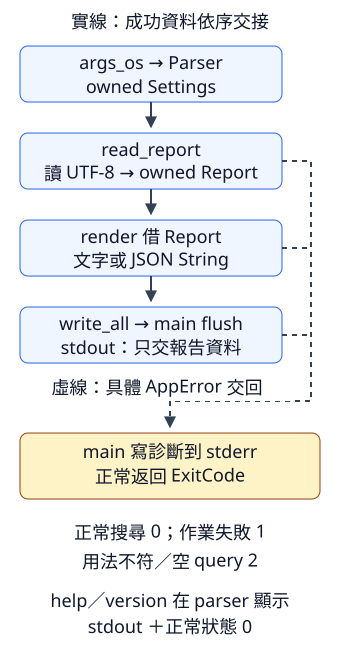

# 10.9 第一個完整 CLI：搜尋筆記，再交出文字或 JSON

前面已分別完成原生檔名、參數設定、文字讀取、JSON 與真正的 child 測試。現在把它們接成可使用的文字搜尋工具：呼叫者指定要找的文字與檔案，工具交出符合的整行及原行號，也能改用 JSON 報告。

這次仍讀完整的小文字檔，結果保存為 owned 資料。先用一份明確的材料決定答案，再寫純文字工作，最後接上 I/O 與行程邊界；每一層都有自己的可觀察結果。

本節使用 `intro-note-search` package。從 repo 根目錄執行 `cd examples/intro-workspace/note-search`，後面的 Cargo 指令以此為入口。

## 用材料固定搜尋規則與出口

`fixtures/note.txt` 有四行，內容如下：

```text
--8<-- "examples/intro-workspace/note-search/fixtures/note.txt"
```

預設找連續的文字片段，區分大小寫，保留原行內容與順序。例如查 Rust，符合第 1 與第 4 行；一行含兩次 Rust 仍只交出那一行一筆資料。

**ASCII（American Standard Code for Information Interchange，美國資訊交換標準碼）** 是包含英文字母、數字與基本符號等的字元編碼。本工具的 `--ignore-case` 只忽略其中 A–Z／a–z 的大小寫，其他字元保持原樣；例如 Ä 與 ä 仍不同。這個明確的小範圍讓目前的做法有完整的行為約定。

| 呼叫資料／選擇 | 本份材料的預期結果 |
| --- | --- |
| query 為 Rust，預設設定 | 第 1、4 行；文字輸出是 `1:Rust 很清楚`、`4:中有 Rust`，每筆有換行 |
| query 為 RUST，加入 `--ignore-case` | 第 1、3、4 行；原字母大小寫仍保留 |
| 加入 `--json` | stdout 是一份完整 JSON 報告，保存 query、選擇與符合行資料 |
| 查沒有符合行的文字 | 正常完成；文字輸出空白，JSON 的 matches 是空 array |
| query 是空字串 | 用法錯誤，先拒絕，不開始讀檔 |

lines 沿用第9.6節：LF／CRLF 分行、不包含行尾、最後的行尾不增加一行。行號從 1 開始，**空行也占原行號**；結果只是沒有符合的空行，不重新編號已保留的行。文字模式在每筆後加入 LF，並不重建原檔案的行尾格式。

行程結果也先固定：正常搜尋（包含零筆）、help／version 是 0；檔案／編碼／輸出失敗是 1；缺必要參數、未知開關或空 query 是 2。資料只進 stdout，診斷只進 stderr。讀取或用法失敗時尚未寫出資料；若寫 stdout 本身失敗，則可能已寫出部分 bytes，保留第10.4節的 Write 失敗邊界。

## 把設定、報告與錯誤放在各自的型別

沿用第10.1、10.6–10.8節的依賴設定，所有版本要求與features都已教過。以下是本節完整manifest，package欄位明寫，實際版本仍由入門workspace共享Cargo.lock保存：

```toml
--8<-- "examples/intro-workspace/note-search/Cargo.toml"
```

Settings 保留兩個 positional 與 ignore_case，再增加本節的 json long bool flag。這兩個開關都只保存選擇，執行工作交給後面的 helper：

```rust
--8<-- "examples/intro-workspace/note-search/src/config.rs"
```

一筆 **Match** 保存原行號與 owned 文字；**Report** 保存 query、ignore_case 與依原行序排列的 `Vec<Match>`。報告描述搜尋資料，檔名仍由 Settings 的原生 PathBuf 保存並交給讀取工作。

Serde 已替 usize 提供編解碼能力，在 JSON 中表示整數；能讀回的數字仍受目前平台 usize 範圍限制。Serde 的 `Vec<T>` 在元素 T 有相應能力時也能編解碼，因此 Match 的 derive 先建立能力，Report 的清單才能使用它。Debug／PartialEq 同樣逐欄作用，Vec 比較內容的規則已由第9.5節教過：

```rust
--8<-- "examples/intro-workspace/note-search/src/model.rs"
```

**AppError** 分開 EmptyQuery、Read、Encode、Output，讓「資料還沒讀到」與「報告已完成但出口失敗」有不同原因。只對 serde_json::Error 提供 From；io::Error 可能來自讀或寫，因此在發生的那一層明確放入對應 variant。

Display 沿用第8.3、10.7節的 borrowed 原因格式化。自訂 method **`status(&self) -> u8`** 只依 variant 交回我們剛定的 1 或 2，最後由 main 轉成 ExitCode；它不會自行終止行程：

```rust
--8<-- "examples/intro-workspace/note-search/src/error.rs"
```

檔案分工如下。lib.rs以第2.6節的公開module宣告納入各部分；它另外提供read_report、write_report與run，將各層連接起來。下面會先逐項說明工作，再列出完整library root：

```text
src/
  config.rs      arguments → owned Settings
  model.rs       owned Match／Report
  error.rs       具體失敗原因與狀態
  search.rs      query、文字、選擇 → Report
  render.rs      Report → 文字或 JSON String
  lib.rs         讀取、核心工作、寫出之間的連接
  main.rs        真正 arguments、出口、ExitCode
tests/
  writer.rs      可控制的輸出失敗
  cli.rs         真正 binary 的資料／診斷／狀態
```

## 純搜尋：判斷用的表示與保存的文字分開

除了已教的 lines、is_empty、to_owned、Vec，這一步增加三項選用方法：

| 方法 | 本次接收與結果 |
| --- | --- |
| `line.contains(query)` | shared 借用 str，query 本次也是 &str；有這段連續文字片段回 true，否則 false。它不要求是完整單字。 |
| `text.to_ascii_lowercase()` | shared 借用 str，產生新 String；ASCII 大寫 A–Z 改為 a–z，其餘內容保持原樣。原文字不變。 |
| `iterator.enumerate()` | 接手原 iterator，建立另一份 iterator；每筆 Item 是 `(usize, 原 Item)`，數字從 0 依序增加。對 lines 得到 `(usize, &str)`，仍只借原文字。 |

忽略大小寫時，把 query 與每行都轉成上述比較表示，再 contains。例如 RUST 與 Rust 都變成 rust；一行 Trust me. 轉成 trust me. 也包含 rust，因為規則查的是片段。**只轉 query 而不轉行內容，兩邊仍可能不同。**

這份新 String 用於判斷，符合時卻保存原 line 的 to_owned，所以輸出仍是讀者原來寫的大小寫。query 的比較表示只建立一次，每行的表示則在處理該行時建立；為了先讓流程清楚，區分大小寫的路徑也用 owned 複本，這份程式沒有宣稱最省配置或適合大型串流。

validate_query 保存非空規則。search 與稍後的檔案入口都呼叫它，避免 library 的不同入口接受空 query。第8.6節已教同型別的 From 會原樣交回錯誤，因此這些 AppError 之間的 `?` 不需要另寫轉換。

每次 enumerate 交出 index 與一行，index + 1 就是從 1 開始的原行號；只有符合時 push Match。index 對全部原行增加，沒有只數已保留的行。這個來源本來有行序，結果沿該順序保存，不用把 第9.6節的HashMap 任意順序問題帶進來：

```rust
--8<-- "examples/intro-workspace/note-search/src/search.rs:search"
```

先核對純工作，不讀檔也不寫stdout。下面測試保存預設與ASCII選擇的差別、非ASCII邊界、空行／CRLF行號、原輸入結束後資料仍有效，以及空query的失敗。

測試中的Rust字串literal用 `\"` 表示內容的一個雙引號，`\n`仍表示已教的LF；例如 `"Rust \"筆記\"\n"` 產生的內容是Rust、空白、帶雙引號的筆記與LF。這是Rust source的表示；稍後Serde會另將這份資料編成JSON表示。

```rust
--8<-- "examples/intro-workspace/note-search/src/search.rs:search-tests"
```

這五項的預期來自前面的材料與規則，不由程式輸出反推答案。本節先保存測試，等完整library各module都說明後再執行；名稱篩選只決定執行哪些測試，同一份library的其餘module仍會編譯。

## 先建立完整報告，再選一種輸出表示

render shared 借用 Report。文字模式依原序產生 `行號:原內容`，用已教的 format!／push_str 拼成 String；JSON 模式用第10.7節的 to_string_pretty，最後也加一個換行。

這裡另選 **`String::push(character)`**：mutable 使用 String，接收一個 char，將該字元的 UTF-8 bytes 追加到內容，回傳 unit。`'\n'` 是單一 LF 字元，和雙引號的 `"\n"` 文字 view 角色不同；我們用它追加 JSON 最後的換行。JSON 編碼可能失敗時，由既有 From 交成 AppError::Encode：

```rust
--8<-- "examples/intro-workspace/note-search/src/render.rs:render"
```

無符合行時，文字沒有任何資料可拼接，結果是空 String；JSON 則仍保存 query、選擇與空 matches。兩者描述的是同一次正常搜尋。render 的兩項 tests 分別核對文字的原行號／原內容，以及 JSON 全部欄位往返、雙引號跳脫與空結果。

接著連接真正的檔案。read_report **先檢查 query，再讀取**，因此空 query 配上不存在的檔案，仍是用法錯誤 2；正常 query 才可能遇到 Read。取得完整文字後交給純 search，回傳 owned Report，不借用已結束的檔案文字。

write_report 先 render，再用第10.4節的 write_all 交給 `W: Write` 的出口。它既能接 main 的 Stdout，也能接已教的可控制 writer；不自行寫診斷。本函式完成把bytes交給writer，沒有替它flush；若writer有buffer，由仍持有它的caller在需要確認送出時處理flush。run 將 read_report 與 write_report 接起來，沿用同型別 AppError 的 `?`：

```rust
--8<-- "examples/intro-workspace/note-search/src/lib.rs:run"
```

這份分工讓純搜尋不需模擬檔案，排版不需啟動 process，讀寫入口則保存各自的失敗。main 最後只決定 caller 看見哪些資料、診斷與狀態。

## main 負責真正的程式邊界

沿用第10.6節的 try_parse_from：help／version 的 Err 是正常顯示請求；其餘用法訊息進 stderr、狀態 2。取得 Settings 後才呼叫 run。AppError 的診斷透過已教的 ToString／writeln! 交到 stderr，status 再由 ExitCode::from 建立數字結果。

main持有Stdout，沿第10.5節在run成功後明確flush；這一步也成功，才回正常狀態。flush失敗用已有的AppError::Output保存io原因，再顯示診斷並回作業失敗1。library交付writer與真正CLI確認出口完成，各自有明確責任。

資料路徑只由 write_report 寫 stdout，沒有搜尋進度、檔案標題等其他訊息。這樣 --json 的完整 stdout 就能交給下一個程式解析：

```rust
--8<-- "examples/intro-workspace/note-search/src/main.rs"
```

圖中實線箭頭是資料依序交接，虛線箭頭是沒有得到下一份成功資料時，把原因交回 main。不同錯誤仍由具體 variant 保留；help／version 在 parser 階段直接完成顯示，沒有進入檔案搜尋：



## 完整source快照，再開始執行

上面已全檔列出config.rs、model.rs、error.rs與main.rs。以下保存完整lib.rs，以及含同檔測試的search.rs、render.rs；最早的Cargo命令放在這些能力都已解釋之後，會編譯這份已完成的library。

??? example "展開完整library root、search與render"

    `src/lib.rs`：

    ```rust
    --8<-- "examples/intro-workspace/note-search/src/lib.rs"
    ```

    `src/search.rs`：

    ```rust
    --8<-- "examples/intro-workspace/note-search/src/search.rs"
    ```

    `src/render.rs`：

    ```rust
    --8<-- "examples/intro-workspace/note-search/src/render.rs"
    ```

完整manifest與唯一固定fixture note.txt已列在本頁前面。這份package會永久保留完整CLI，前幾節的最小快照也各自保留。

現在可以先選library內的search測試，觀察五項通過；第10.8節已教名稱篩選，這裡仍會編譯全部library module：

```bash
cargo test --manifest-path Cargo.toml -p intro-note-search --lib search::tests --locked
```

再實際執行：

```bash
cargo run --quiet --manifest-path Cargo.toml -p intro-note-search --locked -- Rust fixtures/note.txt
cargo run --quiet --manifest-path Cargo.toml -p intro-note-search --locked -- RUST fixtures/note.txt --ignore-case
cargo run --quiet --manifest-path Cargo.toml -p intro-note-search --locked -- Rust fixtures/note.txt --json
```

前兩次輸出對應開頭的行號規則；第三次 stdout 只有 JSON，matches 依序保存第 1 與第 4 行。沿用第10.5節的 `>`／`2>` 與緊接 `echo $?`，可以分別保存資料／診斷，觀察成功 0、缺檔 1、缺少 positional 2；`--help`／`--version` 仍是 0。

## 分層驗收，避免只靠 main 看起來很短

現在除了純 search 與 render，還要測兩個原本無法由它們回答的問題：**出口失敗有沒有被誤認為讀取失敗？完整 stdout 真的能作為報告解析嗎？**

writer.rs 沿用第10.4節的自訂 Write 形式：RefusingWriter 的 called 記錄是否真正寫入；write 刻意回傳 ErrorKind 的 PermissionDenied（存取權限被拒絕）所建立的錯誤，沒有成功接收本次 bytes。這份可控制的 writer 不依賴真實檔案權限。它沒有中間 buffer，flush 直接 Ok。下面測試使用非空結果，保證 write_all 有工作，而不是拿空輸出誤當已測到 write：

```rust
--8<-- "examples/intro-workspace/note-search/tests/writer.rs"
```

CLI tests 沿用第10.8節的 TempDir、Command、Output 與借用 UTF-8 view。execute 把測試準備的 OsString array 借為 slice，逐筆 arg；**不包含程式名稱**，因為啟動 child 時 OS／Rust 已安排 argv 第一筆。這與直接傳給 try_parse_from 的完整序列分開。

assert_failure 分別核對失敗的 code、空 stdout 與診斷前綴，不把 OS 的完整訊息寫死。helper 的全部工作在這裡可見：

```rust
--8<-- "examples/intro-workspace/note-search/tests/cli.rs:cli-helper"
```

JSON 的 child test 解析**整份 stdout**，再核對全部模型角色；如果有人在資料前面插入「正在搜尋」，它就不能成為這份合法 JSON：

```rust
--8<-- "examples/intro-workspace/note-search/tests/cli.rs:json-cli-test"
```

其餘CLI tests使用同樣的已教helper，保存文字／ASCII開關、無符合行的文字與JSON、缺檔／非法UTF-8、空query優先判用法，以及parser用法／help／version的出口與狀態。完整tests/cli.rs在這裡，不需跳到外部網站取得其他測試或答案：

??? example "展開CLI helper與全部五項integration tests"

    ```rust
    --8<-- "examples/intro-workspace/note-search/tests/cli.rs"
    ```

測試中的所有材料也都在這份來源中：文字以完整Rust literal建立，非法UTF-8是單byte255，缺檔與缺少參數的情況則刻意不提供。TempDir與child的順序沿用上一節。

```bash
cargo test --manifest-path Cargo.toml -p intro-note-search --lib --locked
cargo test --manifest-path Cargo.toml -p intro-note-search --test writer --locked
cargo test --manifest-path Cargo.toml -p intro-note-search --test cli --locked
```

應有七項 library tests、一項 writer integration test、五項 CLI integration tests 通過。測試會真正啟動 child，而本頁明確選這三個targets，不用main的零項同檔測試取代它們。

## 練習：計算符合的行數

使用本節 search 取得 Report，沿用第9.5節的 slice iter／fold 計算 matches 的筆數。輸入 `Rust\nPython\nRust Rust\n`，預期是 2：它數符合的行，不數片段總共出現幾次。query 與原文規則不變。

??? note "完整參考答案"

    ```rust
    --8<-- "examples/intro-workspace/note-search/examples/count_solution.rs"
    ```

    執行 `cargo run --manifest-path Cargo.toml -p intro-note-search --example count_solution --locked`。

這個工具已能接受原生檔名、搜尋 UTF-8 文字、選擇文字／JSON，並留下從純工作到完整行程的驗收。之後擴充時，先決定新行為與已教前置，再修改對應層；第11章會進一步介紹資源收尾、smart pointer 與完整錯誤介面。

[下一章：型別大小與資源管理](11-01-lesson.md)

延伸閱讀：[英文 Rust Book：Modularity and Errors](https://doc.rust-lang.org/book/ch12-03-improving-error-handling-and-modularity.html)、[繁體對應章](https://rust-lang.tw/book-tw/ch12-03-improving-error-handling-and-modularity.html)、[English Book：Case-insensitive Search](https://doc.rust-lang.org/book/ch12-05-working-with-environment-variables.html)、[繁體對應章](https://rust-lang.tw/book-tw/ch12-05-working-with-environment-variables.html)。本節借鏡工作分層與同份材料比較，不沿用其提前借助 Box／dyn、立即 exit 或不明確的 Unicode 大小寫政策。
