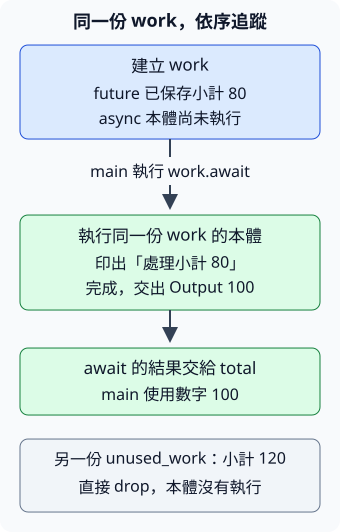

# 11.1 Future 與 async／await：先保存工作，再取得結果

第 10 章已能讓不同 thread 處理工作，也知道 channel 或鎖可能讓呼叫者等待。現在換一個等待安排的問題：當一份工作暫時沒有結果，能不能先保留它的進度，讓執行者處理其他可進行的工作，之後再回來繼續？

async 提供這種工作表示與組合方式。這不表示原來的 thread 方案不能完成，也不表示計算會自動變快。本節先把 **建立工作、執行工作、取得結果** 三個時點分清楚；下一節才讓多份工作交給 runtime 執行。

本節使用獨立的 `ch11-foundations` package。從 repo 根目錄執行 `cd examples/ch11-async/foundations`，後面的 Cargo 指令以此為入口。例子不用網路與 timer，先讓每一步的結果可重複觀察。

## 呼叫函式後，拿到的是答案，還是工作？

沿用小整數材料：小計 80，加上固定運費 20，總額為 100。先看這兩個函式共同要做的計算，再看呼叫時點的差異。

**future** 是代表一份可能稍後完成工作的值。它保存工作所需資料與進度，完成時交出結果；有些工作立即能完成，有些要等外部條件，也有些可能一直無法完成。Rust 的 **`std::future::Future` trait** 描述這種能力，其 associated type **`Output`** 指定完成後的結果型別，沿用 6.2 的「來源型別與輸出型別的關係」。

在函式宣告前加 **`async`**，呼叫時會取得一份 future，函式本體留在之後執行。**`async fn ... -> i32`** 的箭頭說的是這份 future 完成後的 Output 為 i32；呼叫本身還沒有交回 i32。

在 async 函式或稍後會教的 async block 中，使用 **`work.await`** 執行並等待這份工作，取得它的 Output。`.await` 是放在工作值後面的語法，不是 method 呼叫；不用寫括號。結果尚未就緒時，周圍的 async 工作可以保存進度並暫停；已就緒時直接往下執行，**不保證每次 await 都會暫停**。

下面的 `total_now` 是普通函式，呼叫就執行計算並交回 i32；`total_later` 則先交回 future。我們在後者本體加入一行輸出，讓執行時點可以被觀察。兩者的運算仍採小值，不涵蓋所有 i32 輸入的溢位處理：

```rust
--8<-- "examples/ch11-async/foundations/src/lib.rs:totals"
```

呼叫 `total_later(80)` 時，小計被保存進 future；執行那份 future 才印出「async 本體」，再交回 100。這裡說的「尚未執行」是 **async 函式本體**：呼叫前的引數仍會先求值，owned 引數也會在呼叫時交給 future，不能把它理解成呼叫時完全沒有任何動作。

## 誰負責把 future 執行到完成？

future 可以先保存，但它需要被驅動，才會執行本體並繼續等待。**runtime** 是執行 async 工作的基礎設施；其中的 **executor（執行器）** 推進可執行的工作，等待中的工作有機會繼續時再安排它。Rust 提供 Future 與 async 語法，這份程式選用 **Tokio** 作 runtime。

我們選 **current-thread runtime**：在呼叫者目前的 thread 上執行 async 工作，不建立額外的 async worker threads。這樣先分清兩種角色：thread 是實際執行程式的地方，future 是一份可被執行與保存進度的工作；建立一份 future 不會因此建立一條 thread。

設定沿用 7.1 的 dependency／feature／lock 分工：`rt` 提供 runtime，`macros` 提供這次使用的入口 attributes。只要求這兩項，不先啟用尚未使用的網路、timer 或 channel 能力：

```toml
--8<-- "examples/ch11-async/foundations/Cargo.toml:dependencies"
```

實際版本由共享 Cargo.lock 保存，本節查核的是 Tokio 1.53.3。

普通 Rust 入口仍是同步的 `fn main`。這次使用 **`#[tokio::main(flavor = "current_thread")]`**：它是作用在下一個函式上的 attribute macro，將下面寫成 async 的 main 轉成普通入口，建立所選 runtime，執行 main 的 future 到完成。這是這個 attribute 的具體契約，現在不需要自己寫 macro。

`flavor` 選執行方式；必須明寫 current_thread，因為不指定時 Tokio main 預設使用另一種 multi-thread 方式，需要額外 feature。runtime 初始化失敗時，這個方便入口會 panic；它與之後工作自己交回的 Result 是不同層次。future 的一般等待不需要我們在每個 await 重建 runtime。

## 如何看見建立、執行與丟棄的順序？

main 先呼叫普通函式，接著建立 `work`，印出建立標記，再 await。最後再建立小計 120 的另一份 future，直接用已教的 **`drop`** 接手並結束該值。對這份尚未執行的工作，drop 不會為了丟棄而執行 async 本體：

```rust
--8<-- "examples/ch11-async/foundations/src/main.rs"
```

```bash
cargo run -p ch11-foundations --locked
```

stdout 依序為：

```text
普通函式已交回：100
future 已建立，async 本體尚未執行
async 本體：處理小計 80
await 已取得結果：100
另一份 future 未執行就已丟棄
```

前兩行之間沒有 async 本體輸出；第三行在 `.await` 之後才出現。後面沒有「處理小計 120」，因為那份 future 沒有執行本體。這種建立後才執行本體的性質叫 **lazy**，可以把工作保存起來，之後決定要執行或丟棄。

圖從上往下對應這份 main 的操作順序。箭頭不表示耗時，也不表示多 thread 排程；綠框中的本體執行與 Output，都是同一份小計 80 工作的後續：



這份計算沒有外部等待，因此 await 可以立即完成。輸出證明本例的 **建立與本體執行時點**，沒有證明暫停、其他工作交錯或效能提升。async 也不會把普通計算或阻塞的 I/O 自動搬到其他 thread；本體執行在哪個 thread，仍由我們的執行安排決定。

前面保存 closure 之後，以呼叫執行它；現在保存 future 之後，以 await 取得它的成果。這份 `work` 的 ownership 在 await 時交出，之後使用的是結果 `total`，不再用原 work 要求第二次成果。後面的 task 會有不同的啟動方式，不能把本例的 lazy 結論套到所有「與 future 有關」的物件。

## async block 保存的資料由誰管理？

如果只想在目前位置包一段 async 工作，可以寫 **`async { ... }`**，稱為 async block。和 6.1 建立 closure 一樣，它產生一個可保存的值，並按 body 的需要捕捉環境；這次得到的是實作 Future 的值。block 的末尾值成為它的 Output。

捕捉規則沿用 closure：普通 async block 可按需要借用資料；**`async move { ... }`** 則按值保存用到的環境。move 作用在建立工作時，不是等到 await 才把資料交進去。對 non-Copy 的 String，原 owner 因此交出文字；對 Copy 值則保存副本，和 6.1 相同。

下面先讓 borrowed_work shared 借用 heading，取得 byte 長度；外面仍能 shared 讀 heading。再讓 owned_work 接手 note，完成後把 owned String 交給 saved：

```rust
--8<-- "examples/ch11-async/foundations/examples/block_capture.rs"
```

```bash
cargo run -p ch11-foundations --example block_capture --locked
```

```text
block 已建立，原文字仍可讀：Rust
async block 本體：借用 heading
借用工作的 Output：4
owned 工作已接手文字
owned 工作交回文字：配送
```

第一份工作借用 heading，所以原文字必須在這份借用的使用期間有效。第二份工作建立後，外面的 note 已交出；await 後的 saved 才是新的 owner。按值保存一個 reference 仍只保存借用資訊，async move 不會把借來的資料變成獨立的 owned 複本。

## 介面如何說明完成後會得到哪種值？

6.4 已看過 `impl Fn(...) -> ...` 用能力表達匿名 closure 型別。future 也可用相同介面表示：**`impl Future<Output = i32>`** 表示一個由函式實作選定的具體型別，具備 Future 能力，而且 associated type Output 是 i32。

這不是把 future 宣告成 i32，也不是一個名叫 Output 的欄位。呼叫者先取得那份工作，await 後才有 i32，可做數值操作。

下面用普通函式當工廠，明寫回傳介面。工廠本體立即印出準備標記、建立 async move block；其中的 total_now 計算留在之後執行。小計仍為 80，工作完成後仍為 100：

```rust
--8<-- "examples/ch11-async/foundations/examples/explicit_future.rs"
```

```bash
cargo run -p ch11-foundations --example explicit_future --locked
```

stdout 先是 `普通工廠：先保存小計 80`，再是 `Future 的 Output 是 i32：100`。普通工廠本體在呼叫時執行，async block 本體則在 await 時執行，所以不能把「回傳 future 的所有函式」都當成呼叫時不執行本體。Future 名稱從標準函式庫路徑引入；使用者不用知道編譯器替 async block 產生的具體型別名字，也不需要自己實作 Future 的底層方法。

`async fn total_later(...) -> i32` 與上面的工廠，都讓呼叫者取得 `Future<Output = i32>` 能力的值。前者用 async 函式語法表達，後者把 async block 與回傳能力明寫出來；本節的任務是讀懂這項使用契約。

## 如果 Output 是 Result，await 會替我處理錯誤嗎？

現在保留同一項總額工作，但接受使用者可能交來的負數。規則是：負小計不開始計算，交出 String 原因；非負的小值仍得到小計加 20。Result 的 Ok／Err 沿用第 3／5 章，與 async 的完成時點分開。

**`async fn ... -> Result<i32, String>`** 交回的工作，Output 就是 `Result<i32, String>`。因此 await 後仍然是 Result，呼叫者要用 match 或先前的 `?` 處理；await 不會自動把 Ok 取出，也不會把 Err 變成 panic。

```rust
--8<-- "examples/ch11-async/foundations/src/lib.rs:checked-total"
```

用兩項固定材料觀察結果：

```rust
--8<-- "examples/ch11-async/foundations/examples/fallible_output.rs"
```

```bash
cargo run -p ch11-foundations --example fallible_output --locked
```

```text
小計 -10 的工作完成，結果為 Err：小計不能為負數
小計 80 的工作完成，結果為 Ok(100)
```

兩份工作都已完成，一份 Output 是 Err，一份是 Ok。「工作已完成」沒有替應用決定「資料有效」。這裡每次迴圈都先 await，再處理下一項，所以仍依序；把函式標成 async，不會讓所有迴圈工作自動同時執行。

## 如何檢查本體是在什麼時候執行？

先用真正 binary 的完整輸出次序驗收 main，沿用 7.8 的 Command、Cargo binary 路徑、Output 與 UTF-8 view。沒有只檢查加法得到 100，因為那樣無法分辨本體是否在建立時就已執行；最後缺少小計 120 的本體輸出也是這份預期的一部分。

```rust
--8<-- "examples/ch11-async/foundations/tests/cli.rs"
```

再以一份可修改的狀態核對兩條路徑：丟棄未執行的工作，visits 保持 0；建立另一份工作並 await，visits 與 Output 都是 1。

這次選用 **`#[tokio::test(flavor = "current_thread")]`**。它把 async 測試接成普通測試入口，為每項測試建立自己的 current-thread runtime，執行裡面的 async 工作；需要的 features 仍是 rt／macros。它與 1.10 的普通 `#[test]` 角色相接，讓測試本體可以使用 await；不用在裡面再包普通 test attribute。

兩份 async block 都需要修改 visits，因此保存 mutable borrow，沿用 6.1 的 capture 規則。第一份被 drop、第二份被 await 接手之後，才直接讀 visits，沒有在後續仍需借用時插入衝突的 shared 讀取：

```rust
--8<-- "examples/ch11-async/foundations/src/lib.rs:lifecycle-test"
```

```bash
cargo test -p ch11-foundations --locked
```

CLI 與 unit 各一項。它們檢查建立、本體執行、結果與丟棄的關係，不檢查暫停或多工作排程；那些需要下一節先建立 task，才能用適當材料驗證。

## 練習：先保存訂單，再取得收據

寫 `async fn receipt(subtotal: i32, label: String) -> String`。它先等待既有的 total_later 取得總額，再建立一行收據文字。材料固定為小計 80、標籤「訂單 A」，完整答案應是 **`訂單 A：總額 100`**。

1. receipt 的本體可以 await，因為它本身是 async 函式；await 後的 total 是 i32，再用已教的 format! 與 label 建立 String。
2. 在 main 先建立 label，再呼叫 receipt 保存 future，印「收據 future 已保存小計與標籤」；這時 label 的 ownership 已交給工作，不再從外面使用它。
3. await 收據工作，對完整字串做 assertion，再印結果。先預測：建立標記、total_later 的本體標記、收據結果，應以什麼順序出現？

這裡是同一段工作等待另一份工作，沒有建立新的 task。receipt 的 Output 是 String，裡面那次 total_later 的 Output 是 i32；先區分兩種結果，就能把等待接到後面的文字工作。

??? example "完整參考答案"

    ```rust
    --8<-- "examples/ch11-async/foundations/examples/receipt_solution.rs"
    ```

    ```bash
    cargo run -p ch11-foundations --example receipt_solution --locked
    ```

    stdout：

    ```text
    收據 future 已保存小計與標籤
    async 本體：處理小計 80
    訂單 A：總額 100
    ```

現在已能分辨函式呼叫得到的 future 與 await 後的 Output，也能追蹤 future 捕捉的資料。下一節把這份可執行工作交給 runtime 的 task，才開始處理提交、等待、錯誤與收尾的生命週期。
