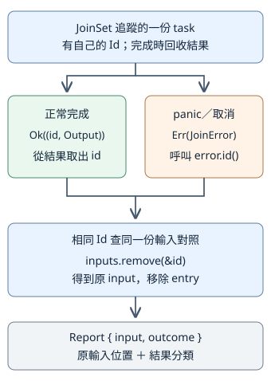

# 11.2 Task 的生命週期：提交工作，也收回它的結果

11.1 把 future 保存起來，再用 await 取得 Output。若迴圈每次都等完一份工作才建立下一份，其他工作還沒有開始。現在希望把幾份工作先交出去：某份等待時，runtime 可以處理其他可進行的工作；最後仍知道每份輸入得到什麼結果。

這也增加一項責任：提交之後，工作可能交回自己的 Err、panic，或在完成前被取消。我們要追蹤它，等到成果或清理完成，而不是只管提交。

本節使用獨立的 `ch11-tasks` package。從 repo 根目錄執行 `cd examples/ch11-async/tasks`，後面的 Cargo 指令以此為入口。本節不用 timer 或網路；以明確訊息放行工作，讓啟動與收尾可以重複觀察。

## 把 future 交出去後，誰讓它繼續執行？

**task** 是交給 runtime 排程的一份工作。Tokio 的 **`tokio::spawn(future)`** 接手 future，提交給目前 runtime，回傳 **`JoinHandle<T>`**；其中 T 是工作原來的 Future::Output。task 可以在 runtime 繼續運作時執行，**不必等呼叫者 await JoinHandle 才開始**。這與11.1僅保存、尚未執行的普通 future 不同。

JoinHandle 是我們追蹤與等待這份 task 的把手，不是原來的工作本體。current-thread runtime 仍在目前 thread 執行 async 工作：一份 task 等待未就緒的條件時，可以讓其他工作繼續；需要真正多核心同時計算時，這個設定並沒有新增 worker threads。

spawn 本身不在呼叫中同步執行 future 本體，所以「提交成功」也不表示本體此刻已經開始。接下來會讓 task 送出啟動訊息，直接觀察它已執行；不用猜 task 在提交後第幾毫秒開始。

這個 API 要求 **future 為 `Future + Send + 'static`，Output 也為 `Send + 'static`**。Send 與型別的 static bound 沿用10.1／10.2：工作交出後不能依賴將失效的短期借用，資料要符合跨 thread 移轉的能力。雖然本節選 current-thread，使用的仍是同一個 spawn 介面，這些 bound 不會因此消失。

檢查的對象是整份 future，包括提交時已捕捉的值，以及暫停時仍須保存的資料。`async move` 可接手 owned String；若只是把短期 reference 按值保存，並沒有把底層資料變成 owned 複本，也不會把 non-Send 值變成 Send。型別符合 static 不代表 task 必須活到程式結束，工作完成仍可釋放資料。

本節保留11.1的 rt／macros，增加 **`sync`** 以使用下一段的 Tokio channel：

```toml
--8<-- "examples/ch11-async/tasks/Cargo.toml:dependencies"
```

共享 Cargo.lock 保存實際版本，本節查核 Tokio 1.53.3。spawn 必須在 Tokio runtime 的執行環境內呼叫，否則會 panic；我們從已教的 current-thread main／test 入口提交工作。runtime 本身仍要持續執行；若 main 提早結束而關掉 runtime，未完成的 task 不會因此保證完成。

## 如何確定 task 已開始，又讓它暫時停在同一處？

沿用小金額材料，但先不做加法。我們要讓工作回傳金額80；觀察的重點改成「本體已開始，結果尚未完成」。因此安排兩條訊息路線：task 送出啟動訊息，再等待呼叫者放行，收到後才檢查與回傳金額。

10.5 已教同步 channel；現在選 **Tokio 的 `mpsc` channel**。mpsc 是 **multiple producer, single consumer**，多個送端、一個收端。送端可 clone，讓不同 task 各自持有送端；收端不 clone，這份程式由一個接收者讀訊息。這裡等待使用 await，未就緒時可暫停目前 async 工作，讓 runtime 執行其他 task。

先教本節要用的完整最低契約：

| 操作／型別 | 本節要知道的行為 |
| --- | --- |
| `mpsc::channel::<()>(1)` | 建立 buffer 容量為1的有界 channel，回傳 `(Sender<()>, Receiver<()>)`。容量必須大於0；本節只用1或4。`()` 沿用前文的 unit 值，這裡表示「收到一個訊號」，不攜帶金額。 |
| `Sender<T>` 與 `sender.clone()` | 各送端是同一條 channel 的入口；clone 增加送端把手，不建立另一條 channel。本節的 `Sender<()>`／`Receiver<()>` 是可交給 spawn 的 owned、Send、static 型別。 |
| `sender.send(value).await` | 借用送端、接手 value；buffer 滿時等待。結果是 `Result<(), SendError<T>>`。Ok 表示 channel 接受訊息，沒有保證收端已讀或工作已完成；收端關閉或丟棄時回 Err。 |
| `receiver.recv().await` | mutable 借用收端，交回 `Option<T>`。有訊息時 Some；送端尚存而 buffer 空時等待；所有送端都丟棄，且 buffer 已讀空，才得到 None。 |
| `drop(sender)` | 丟棄這個送端。若還有 clone 出來的送端，channel 仍能送訊息；最後一個送端丟棄才關閉送入路線。 |

unit 值也具備 Debug／PartialEq；和4.3的 Option 比較相接，稍後能以 `Some(())` 檢查啟動訊息。SendError 具備 Debug／Display，所以這些固定例子的 send 結果可以用已教的 expect；expect 仍會在 Err 時 panic。下面的啟動 send 只在 controller 保持收端存在的契約下使用 expect，不把它當成所有應用的錯誤處理政策。

library 以 `use tokio::sync::mpsc;` 引入這個 module，所以下面的 `mpsc::Sender`／`mpsc::Receiver` 使用 Tokio 端點，不是標準函式庫的同名型別。先定義工作自己的錯誤：負數拒絕，或放行送端被關閉。這些是工作交回的資料，不是 Tokio task 失敗：

```rust
--8<-- "examples/ch11-async/tasks/src/lib.rs:work-error"
```

下面的 `controlled_work` 是本節共用的可控制工作。`started` 是啟動送端，`release` 是放行收端；函式接手這兩個值。啟動訊息送出後，工作不再需要啟動送端，因此立即 drop。它接著等放行訊息；沒有任何放行送端存活時，就回傳 ControlClosed：

```rust
--8<-- "examples/ch11-async/tasks/src/lib.rs:controlled-work"
```

`panic_after_release` 暫時只作故障開關，稍後用它觀察 panic 會出現在哪一層。金額仍以本節的小值作材料。收到啟動訊息，表示 body 已走到 send；**不表示金額已回傳**，因為 release 的等待還沒有通過。放行 send 成功也不是完成證據，最後仍要等待 task 的結果。

## JoinHandle 的 await 得到哪一層結果？

10.2 的 thread JoinHandle 在 join 時回報正常完成或 panic。Tokio 的 JoinHandle 則實作 Future，**`handle.await` 得到 `Result<T, JoinError>`**。T 仍是工作自己的 Output：若 controlled_work 的 T 為 `Result<i32, WorkError>`，就有兩層 Result。

| await 的結果 | 表示什麼 |
| --- | --- |
| `Ok(Ok(80))` | task 正常完成，工作交回金額80。 |
| `Ok(Err(WorkError::Negative(-1)))` | task 正常完成，工作依自己的規則拒絕負數。 |
| `Err(join_error)` | task 沒有正常交回 Output，例如 panic 或取消；此時沒有內層 Result 可以取。 |

**`JoinError`** 是 Tokio 的 task 失敗資訊，可用 `is_panic()`／`is_cancelled()` 分辨原因，也具備 Debug／Display。它與 WorkError 的用途不同；await 不會把內層 Err 自動提升成 JoinError。

每份 task 還有 **`tokio::task::Id`**，一個用來辨認 task 的 opaque ID。opaque 表示不依賴它的內部編號規則：它不是我們的輸入位置，也不保證依提交順序遞增。`handle.id()` 取得這份 task 的 Id；Id 有 Copy／Eq／Hash，可保存、比較或作 HashMap key，也有 Debug／Display 可顯示。

task 尚未退出，或退出後仍有相關追蹤把手時，Id 不會重用；task 結束且已無相關 active 把手之後，才可能供後來 task 重用。單純保存一份 Id 不會讓這個編號永久保留，因此稍後會在收回成果時移除對照，不把 Id 當永久編號。

以下完整 example 先 await **啟動訊息**，還沒有 await JoinHandle。`handle.is_finished()` 查目前是否已完成，回 bool；由於我們仍持有放行送端、尚未放行，它在本例應為 false。接著放行並 await handle：

```rust
--8<-- "examples/ch11-async/tasks/examples/join_handle.rs"
```

```bash
cargo run -p ch11-tasks --example join_handle --locked
```

stdout 第一行是 `收到啟動訊息；還沒有 await JoinHandle`，第二行顯示 `已等待 task …，正常回傳金額 80`；其中 ID 依當次執行而定。第一行證明 task 已經執行到送訊息，啟動不依賴 handle.await。主工作等待 recv 時，runtime 能執行被提交的 task；recv 就緒後再繼續主工作。

**丟棄 JoinHandle 是 detach**：我們放棄等待這份工作的把手，但 task 仍可繼續，其結果不再由這個把手收取。drop handle 不等於取消，也不等於已等待完成。本節各條路徑都保留等待責任，不用丟棄把手作收尾。

## 提出取消後，怎麼確認工作真的清理了？

假設這份金額工作不再需要，呼叫 **`handle.abort()`** 向 task 提出取消。abort 不等待清理，也不保證返回那一刻 `is_finished()` 已為 true；完成與取消可能競爭，已完成的工作仍可能交回正常結果。

因此流程是 **提出取消，再 await 結果**。觀察到 JoinHandle 完成時，future 本體仍持有的資料已完成清理；正常回傳的 Output 則交給呼叫者。本例讓 release 一直未放行，且送端仍存在，工作既不能回傳金額，也不會走 ControlClosed，這樣可以確定測到的是取消路徑：

```rust
--8<-- "examples/ch11-async/tasks/examples/abort_and_wait.rs"
```

```bash
cargo run -p ch11-tasks --example abort_and_wait --locked
```

```text
已等待取消，仍可對應原 task
task 持有的接收端已清理
```

`JoinError::id()` 提供失敗 task 的 Id，與保存的 expected_id 相同。await 之後再嘗試送放行訊息，得到 Err：工作持有的 release 收端已丟棄。這個觀察把「我已要求取消」和「我已等到清理」分開；不能只呼叫 abort 就宣稱所有資源已回收。

取消也需要 runtime 有機會處理。若某份 async body 長時間只做同步計算、不讓執行者返回，abort 並不是立刻打斷任意指令的操作。本節工作停在未就緒的 recv，因此有可取消與清理的等待點。

## 多份工作失敗後，如何仍對回原輸入？

一份把手可以追蹤一份 task；多份相同 Output 型別的工作，可以放入 **`JoinSet<T>`**。`JoinSet::new()` 建立空集合，`tasks.spawn(future)` 提交並由集合追蹤工作，回傳 **`AbortHandle`**。這個把手可 id／abort，沒有 JoinHandle 的 await 能力；結果改由集合收取。丟棄 AbortHandle 本身也不會取消 task。

本節 T 是 `Result<i32, WorkError>`。**`tasks.join_next_with_id().await`** 等待下一份完成工作，mutable 借用集合，交回 `Option<Result<(Id, T), JoinError>>`：空集合為 None；有工作時為 Some，內部仍分正常 Output 與 task 失敗。集合按照可收取的完成順序交回結果，不承諾輸入順序。

為了知道每項原輸入的結果，提交時立即保存 **`Id → 輸入位置`**。正常結果帶 Id，panic／取消的 JoinError 也有 Id；不能只把輸入位置寫進正常 Output，否則失敗時那個 Output 根本沒有交回。

這份 library 以 `use std::collections::HashMap;`、`use tokio::task::Id;`、`use tokio::task::JoinSet;` 引入三個名稱。HashMap 的建立、insert、key 與查找沿用4.3。本節新增 **`inputs.remove(&id)`**：mutable 借用對照表，取走這個 key 的 entry，回傳 `Option<usize>`；已知 key 是 Some，找不到是 None。如此回收一次就移除一次，不留下舊 task 的對照。

先用 enum 記下我們要提供的報告。Value／WorkError 保存正常 Output 的分類；Panic／Cancelled 保存 task 失敗分類；OtherTaskFailure 保留未歸入這兩種原因的診斷文字。Report 的 input 是我們原來的輸入位置，不是 Tokio ID：

```rust
--8<-- "examples/ch11-async/tasks/src/lib.rs:outcome-model"
```

下面的 `collect_one` 專做「等待一份、分類、對回輸入、移除對照」。遇到空集合回 None；對照找不到則違反本例「每次 spawn 後立即登記」的程式契約，所以用 expect 揭露錯誤：

```rust
--8<-- "examples/ch11-async/tasks/src/lib.rs:collect-one"
```

正常路徑從 `(id, output)` 取 Id，失敗路徑從 error.id() 取 Id，最後都走同一份 remove。這就是 Id 對照的作用：無論哪一層失敗，報告仍有原輸入位置。

圖由上往下表示**同一份已提交 task**的回收路線；箭頭表示結果與 Id 的流向，不表示耗時。兩種路線最後都用相同 Id 查對照表，取出 input：



JoinSet drop 會向仍追蹤的 task 提出取消，與 JoinHandle drop 的 detach 不同。不過 drop 集合也沒有替我們 await 清理；需要知道收尾完成時，仍要逐項收取，直到集合回 None。本節保持集合活著並收齊四份結果，下一節再用它維持工作數量上限。

## 四份工作，能否把所有結果收齊？

現在固定四份輸入，分別觀察正常成果、自己的錯誤、panic、取消。每份工作都送啟動訊息，再等待各自的 release；啟動 channel 容量4，是讓四份訊息都能存入。每份放行 channel 容量1，因為只需一個訊號。

先建立集合與對照；spawn 後從 AbortHandle.id() 登記位置。原 started_tx 用完要 drop，因為它也是一個送端；若留下它，收端等完四份啟動訊息之後仍會等更多，無法得到 None：

```rust
--8<-- "examples/ch11-async/tasks/src/lib.rs:demo-setup"
```

這是 run_demo 的前半段，下一份片段接著完成同一個函式。啟動訊息迴圈結束，只表示所有啟動送端已丟棄、訊息已讀空；四份工作此時仍等待 release。**訊息路線關閉和 task 完成是不同狀態。** controlled_work 提早 drop started，正好讓這個差異可觀察。

為了觀察完成順序與輸入順序不同，依次放行 input 1、放行 input 2、取消 input 3、放行 input 0；每次都先回收那份結果才進下一步。其他工作仍被 gate 擋住，順序由我們的訊息控制，而不是宣稱 Tokio 會照這個順序排程：

```rust
--8<-- "examples/ch11-async/tasks/src/lib.rs:demo-collect"
```

最後再收一次得到 None，且 inputs 已空，表示每份提交工作都已回收並移除對照。main 把完整報告印出：

```rust
--8<-- "examples/ch11-async/tasks/src/main.rs"
```

```bash
cargo run -p ch11-tasks --locked
```

stdout：

```text
input 1：WorkError(Negative(-1))
input 2：Panic
input 3：Cancelled
input 0：Value(80)
四份 task 都已回收
```

另外 stderr 會出現「task 故意 panic」的 panic 診斷。抓到 JoinError 不會消除已輸出的診斷；本例把失敗列入報告，主工作仍收齊結果並正常退出，status 為0。應用要把哪些失敗反映成退出失敗，仍是第5章的錯誤政策問題。

本例只同時提交四份固定工作，以觀察完整生命週期；沒有推廣成「把任意數量輸入全 spawn 出去」。下一節會面對輸入很多的情況，限制集合中工作數量，完成一項才補下一項。

## 哪些測試能驗到啟動、身分與收尾？

單純檢查80這個數值，看不出是否提前啟動，也看不出 panic 後是否仍對回原輸入。第一項 async test 在 await JoinHandle 前等到啟動訊息；release 仍關著，因此 handle 應未完成。第二項收齊四份報告，逐項檢查完成順序、原輸入及分類：

```rust
--8<-- "examples/ch11-async/tasks/src/lib.rs:tests"
```

`#[tokio::test]` 的 current-thread 入口沿用11.1。報告的 Debug／PartialEq 由前面的 derive 提供；對錯誤的診斷與比較沒有改用未教的測試工具。這些測試用 channel 控制狀態，不用固定等待毫秒數猜 task 進度。

再沿用7.8／7.9的 Command、Output、UTF-8 view 與 str::contains，執行真正 binary：核對完整 stdout、status0與預期 panic 診斷。這項測試也要求程式真正退出，不能只留下幾份未完成 task：

```rust
--8<-- "examples/ch11-async/tasks/tests/cli.rs"
```

```bash
cargo test -p ch11-tasks --locked
```

## 練習：關閉放行送端，等於取消 task 嗎？

保留同一份金額80的 controlled_work，改用 JoinSet 追蹤唯一工作，登記 input 0。收到啟動訊息後，**drop 放行送端，而不呼叫 abort**。先預測：這次外層是 JoinError，還是 task 正常交回自己的 WorkError？

1. 建立啟動與放行 channel、JoinSet、HashMap；提交後立即以 AbortHandle.id() 登記0。
2. 收到啟動訊息後 drop release_tx。沒有其他放行送端，也沒有buffer訊息，工作中的 recv 會得到 None，依 controlled_work 的規則回 Err(ControlClosed)。
3. 用 collect_one 收回報告，檢查 input 與 outcome；再確認集合回 None、對照表空，最後印結果。

這項練習區分兩件事：channel 關閉使工作自己選擇回 Err，是正常 Output；abort 使 task 沒有正常交回 Output，才是取消的 JoinError。判斷依據是控制流程，不是都把它叫「失敗」。

??? example "完整參考答案"

    ```rust
    --8<-- "examples/ch11-async/tasks/examples/control_closed_solution.rs"
    ```

    ```bash
    cargo run -p ch11-tasks --example control_closed_solution --locked
    ```

    ```text
    input 0：WorkError(ControlClosed)
    ```

現在我們能提交、追蹤、分類與收齊工作，並在取消後等待清理。下一節保留這套 Id 對照與回收方式，讓大量輸入也只維持上限內的 task。
