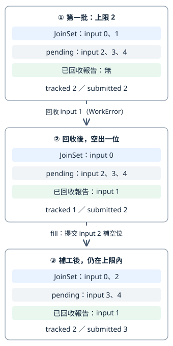

# 11.3 有上限的工作排程：完成一份，才補一份

11.2 能提交四份固定工作，並收齊正常成果、工作 Err、panic 與取消。現在把輸入數量與同時追蹤的工作數分開：即使有很多輸入，也只讓上限內的 task 交給 runtime；收回一份，才提交下一份。

這是在控制 **已提交、尚未回收的工作數量**。每份 task 要保存自己的工作狀態；若先提交全部輸入，這些狀態也已全部建立。這次把尚未輪到的輸入留在來源中，只有空位才建立與提交下一份 future。

本節使用 `ch11-bounded` package。從 repo 根目錄執行 `cd examples/ch11-async/bounded`，後面的 Cargo 指令以此為入口。繼續用可控制的 channel 放行小金額工作，不用 timer、網路或新的同步工具。

## 上限到底限制哪個數量？

材料改為五份，輸入位置仍由0開始，順序為：

| input | 金額與故障設定 | 放行後的結果 |
| --- | --- | --- |
| 0 | 80 | Value(80) |
| 1 | -1 | 工作自己的 Negative(-1) |
| 2 | 120，故意 panic | task 的 Panic |
| 3 | 200 | Value(200) |
| 4 | 30 | Value(30) |

仍沿11.2的 WorkError、Outcome、Report 與 collect_one 分類。它們在本 package 的 **`outcomes` module** 保留相同實作；library 用 `pub mod outcomes;` 載入，example 可沿1.9的公開路徑使用。這次新增的是排程，不改兩層錯誤與 Id→input 的規則。

假設上限為2，一開始只提交 input 0、1。其餘三份還是未提交輸入。先把三種狀態分清：

| 狀態 | 保存在哪裡 | 是否占這份排程的 task 空位 |
| --- | --- | --- |
| 未提交輸入 | pending 來源 | 否；還沒建立與提交它的工作 future。 |
| 已提交、尚未回收 | JoinSet 與 Id→input 對照 | 是；包含尚未啟動、等待中，或已完成但結果尚未被收取的 task。 |
| 已回收結果 | Report；交回後保存於報告清單 | 否；已從 JoinSet 取走，對照也已移除。 |

本節新增 **`JoinSet::len(&self) -> usize`**：shared 借用集合，查它目前仍追蹤多少份 task。這不是「此刻有幾份正在執行 body」；已完成但尚未收取的結果仍屬集合。我們以 `tasks.len() < limit` 判斷能不能再提交，保持 **`tasks.len() <= limit`**。

channel 的 buffer 容量只限制待收訊息，沿10.5；不會自動限制已提交 task 的數量。本節的 task 上限由每次 spawn 前的集合數量判斷提供。它也不限制全部輸入清單、已收回報告或整個程式的記憶體；這些資料的保存需求仍要另外考慮。

## 尚未提交的輸入，要怎麼保留下來？

每份輸入保存金額、故障開關與自己的放行收端，稱為 **`Job`**。它是一份資料描述；建立 Job 還沒有呼叫 async 函式，也沒有 spawn。

`prepare_jobs` 借用 `(i32, bool)` 清單，為每項建立容量1的放行 channel。回傳兩份相同順序的 Vec：jobs 保存收端，releases 保存送端；`releases.as_slice()[input]` 就是該輸入的放行送端。這個位置對應由 helper 的逐項 push 建立，不是使用 Tokio Id 作索引。

library 仍以 `use tokio::sync::mpsc;` 引入 Tokio channel。Sender／Receiver 的 ownership、send／recv／關閉與 Debug 能力沿11.2；這次只是把訊息型別與用途寫清楚：放行送 `()`，啟動訊息送 **`usize` 的 input 位置**。usize 也有 Send、static、Debug／PartialEq，所以端點可交給 task，接收結果可與 Some(input) 比較。

```rust
--8<-- "examples/ch11-async/bounded/src/lib.rs:jobs"
```

工作本體仍先送啟動訊息、丟棄該份送端，再等放行；相較11.2，啟動訊息現在帶 input，接收方知道哪份工作已開始。Job 的收端不是 Clone，helper 把唯一收端保存到對應 Job，之後一起交給工作：

```rust
--8<-- "examples/ch11-async/bounded/src/lib.rs:controlled-job"
```

啟動訊息表示本體已執行到 send，結果仍可能未完成。工作自己的 Err 與 panic 也仍分層：前者正常交出 Output，後者由 JoinError 表示。

## 排程需要保存哪些狀態？

**`Scheduler`** 是我們的排程狀態：保存未提交來源、已提交集合、Id 對照與上限。每次操作延續同一份狀態，呼叫者用 method 提交或回收，不直接修改它的私有欄位，以免破壞數量與身分的對應。

pending 使用6.5已教的 owned `Vec::into_iter()`。這次元素是 Job，因此工作型別是 **`std::vec::IntoIter<Job>`**，Item 是 owned Job；next 逐筆交出 Job，沒有 clone 收端。輸入清單的 ownership 交給排程後，外面保留的是各放行送端。

submitted 是累計提交筆數，也作下一份輸入的位置；由於 pending 按原清單順序交出，每提交一份就加一。它與當前集合數量不同：回收不會減少累計筆數。peak_tracked 保存過程中最大的集合數量，供這份小實驗核對上限。

上限只接受正整數。零不會提供第一份可提交工作，也就沒有可完成的 task 來騰出空位；介面在任何提交之前以 **`ConfigError::ZeroLimit`** 拒絕。ConfigError 的 Debug／PartialEq 由已教的 derive 提供，與工作自己的 WorkError 分開。

```rust
--8<-- "examples/ch11-async/bounded/src/lib.rs:scheduler-state"
```

WorkError、Report、collect_one 由 `crate::outcomes` 引入，HashMap 與 Id／JoinSet 的路徑沿11.2。接下來的 methods 都放在 `impl Scheduler` 中；它們是本節實作，不是 Tokio 新增的 API。

## 第一批工作，如何只提交到上限？

**`Scheduler::new(jobs, limit, &started_tx)`** 接手 jobs、保存 limit、借用啟動送端，交回 `Result<Scheduler, ConfigError>`。正上限才建立排程，並呼叫內部 fill 先提交第一批；不必另外啟動它。它會使用 JoinSet::spawn，因此和11.2一樣要在 runtime 環境內呼叫。

**`fill`** 只做補空位：集合數量低於 limit 才從 pending 取下一份；沒有下一份便停止。取得 Job 後，才呼叫 controlled_job 建立 future，spawn 接手它，再立即保存 Id→input。傳給 task 的啟動送端是 clone，沒有讓 task 借用呼叫者的局部送端。

```rust
--8<-- "examples/ch11-async/bounded/src/lib.rs:new-and-fill"
```

為什麼這個迴圈維持上限？進入 spawn 前數量嚴格小於 limit，一次只增加一份；下一輪重新檢查更新後的 len。即使工作立即完成，未收取前仍在集合，不會憑「可能已算完」再多補一份。第一批填滿或來源用完才停止，沒有先為剩下的 Job 建立 task。

零上限直接回 Err，連 fill 都不進入；空輸入配正上限則得到空排程。這兩件事不同：前者是設定拒絕，後者是合法但沒有工作。

## 回收一份後，怎麼把空位交給下一份？

**`scheduler.next(&started_tx).await`** mutable 借用排程，先用11.2的 collect_one 等待一份結果。它會把 task 移出集合、分類並移除 Id 對照；得到 Report 後才 fill，再把該份 Report 交給呼叫者。

因此 next 返回 Some(report) 時，新工作可能已經提交；**提交仍不等於 body 已開始**。呼叫者若想觀察啟動，要接著等啟動訊息。集合空時 collect_one 回 None；初始 fill 與每次回收後 fill 已處理可提交輸入，所以這時既沒有待回收 task，也沒有剩下可提交的 Job。

另外三個 shared methods 查觀察值：tracked 是現在的集合數量，submitted 是累計提交筆數，peak_tracked 是追蹤峰值。它們不等待工作，也不推進排程：

```rust
--8<-- "examples/ch11-async/bounded/src/lib.rs:next-and-counts"
```

我們選「回收一份就補空位」，讓仍有未提交輸入時能利用剛騰出的空位。若先等第一批全部完成再補下一批，一份較久的工作可能讓其他空位留著；兩種安排都能收齊結果，但這次不要求同批最慢工作結束才繼續提交。

下圖是上限2的**同一份排程**，由上往下追蹤 input 1 先完成的情況。灰框是未提交輸入，藍框是集合，綠框是已回收報告；箭頭表示回收與補工的狀態變化，不表示耗時或固定排程：



圖中②是 next 內剛回收、尚未 fill 的時點，Report 暫存於 method；③補工後才返回呼叫者。看中間的 tracked 從2變1：空位由回收產生。最下方才提交2，tracked 回到2，submitted 從2增為3。input 0 仍等待，不需要先收完它才讓 input 2 前進。

## 如何觀察錯誤之後仍會補工？

先定義實驗最後交回的 **`Batch`**：保存五份 Report，以及累計提交與峰值。它只是結果資料，不持有活著的 task：

```rust
--8<-- "examples/ch11-async/bounded/src/lib.rs:batch"
```

控制程式建立五份 Job、啟動 channel 與上限2的排程。啟動 channel 容量2，足以讓第一批兩份都送入；放行各自只有一份訊號。先查 submitted／tracked，再收到兩份啟動訊息。這兩份都必須是0、1，但哪份先送不指定：

```rust
--8<-- "examples/ch11-async/bounded/src/lib.rs:demo-initial"
```

這是 run_demo 的第一段，以下兩份片段接著完成同一個函式。先放行1，next 回收它自己的 WorkError 並補2；再放行2，回收 Panic 並補3；再放行3，正常回收並補4。每一步都核對累計提交加一、tracked 仍為2，以及下一份確實送出啟動訊息：

```rust
--8<-- "examples/ch11-async/bounded/src/lib.rs:demo-refill"
```

這份排程的政策是 **逐項記錄失敗，繼續處理剩餘輸入**。錯誤路徑同樣回收 task、釋出空位，panic 的 input 也由 Id 對照保留，沒有把工作 Err 當成所有工作必須停止的理由。需要遇到失敗就停止的應用，要另選停止政策；11.5才教中止與取消的整體收尾。

最後已沒有新輸入可補，依次放行0、4，每次回收後 tracked 減一。再呼叫 next 得到 None，對照表也空，才交回 Batch：

```rust
--8<-- "examples/ch11-async/bounded/src/lib.rs:demo-drain"
```

與11.2不同，這次 controller 保留原 started_tx，因為後續補工仍需要 clone 它。所以不能靠「收到第一批啟動訊息後，recv 等到 None」作下一步；那份原送端還在。控制程式按已知每批筆數收取，全部回收後才 drop 原送端、確認啟動路線已關閉。

main 印出峰值與完整報告：

```rust
--8<-- "examples/ch11-async/bounded/src/main.rs"
```

依賴仍只需11.2已教的 rt／macros／sync，沒有因排程加上其他 features：

```toml
--8<-- "examples/ch11-async/bounded/Cargo.toml:dependencies"
```

```bash
cargo run -p ch11-bounded --locked
```

stdout：

```text
上限 2；追蹤峰值 2；共提交 5
input 1：WorkError(Negative(-1))
input 2：Panic
input 3：Value(200)
input 0：Value(80)
input 4：Value(30)
五份工作全部回收；沒有未提交輸入
```

stderr 另有「task 故意 panic」的診斷，沿11.2的分層處理，程式仍正常退出。完成次序由每次放行後等待回收來確定，並沒有宣稱 Tokio 自己會讓這五份工作照同樣次序完成。

## 怎麼檢查上限，而不靠等待幾毫秒？

實驗在放行前檢查第一批只提交兩份，之後每次回收核對補工與新啟動；峰值記錄每次 spawn 後的集合數量。它檢查的不是「最後剛好得到五個數字」，而是控制流程是否維持上限、是否在兩種失敗之後繼續補工，與原輸入是否保留。

以下三項 unit tests 使用11.1已教的 current-thread async test。第一項執行受控流程並核對五份分類；另外測零上限在提交前拒絕、空輸入立即完成。拒絕後原 Job 的收端已清理，放行 send 會失敗；空輸入不等一份不存在的啟動訊息：

```rust
--8<-- "examples/ch11-async/bounded/src/lib.rs:tests"
```

真正 binary 測試沿7.8／7.9與11.2的 Command／Output／UTF-8／contains，核對整份stdout、status與panic診斷：

```rust
--8<-- "examples/ch11-async/bounded/tests/cli.rs"
```

```bash
cargo test -p ch11-bounded --locked
```

這些測試不需要猜 task 啟動需要多少時間；沒有放行就無法通過工作 gate，next 返回才表示已回收並補工。source 的數量判斷與可觀察狀態一起支持上限契約，沒有把一次執行當效能評測。

## 練習：上限1會保留哪種次序？

材料改為80、-1、120，都不觸發panic，上限改為1。繼續使用 prepare_jobs 與 Scheduler，不重寫排程。先預測：會先啟動哪些輸入？負數失敗之後，第三份還會不會提交？

1. 建立三份 Job 與容量1的啟動 channel，new 之後檢查 submitted 為1。
2. 依 input 0、1、2 接收啟動訊息；這時 tracked 都應為1。放行該項，再 next 收回同 input 的報告；只有上一份回收後，下一份才補進來。
3. 檢查結果分別為 Value(80)、WorkError(Negative(-1))、Value(120)，峰值1、共提交3，最後 tracked0、next為None。原啟動送端用完也要drop。

上限1讓工作在這份排程中逐份提交與回收，所以完成順序與輸入順序一致；上限大於1時，不能將此特例推廣成固定完成順序。

??? example "完整參考答案"

    ```rust
    --8<-- "examples/ch11-async/bounded/examples/one_slot_solution.rs"
    ```

    ```bash
    cargo run -p ch11-bounded --example one_slot_solution --locked
    ```

    ```text
    input 0：Value(80)
    input 1：WorkError(Negative(-1))
    input 2：Value(120)
    上限 1；追蹤峰值 1；三份工作全部回收
    ```

現在已能在上限內提交，回收後補工，也知道哪些輸入尚未提交。下一節加入時間限制，再把它與11.2的取消／等待責任接到整體收尾。
