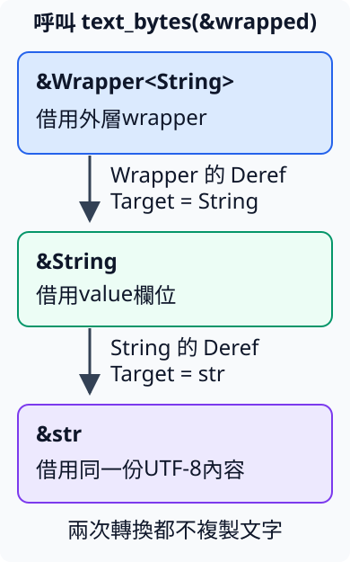

# 11.4 用 Deref 借用包在裡面的值

第 11.2 節用 `&*boxed` 借出 Box 內的值。現在自己建立 Wrapper，保存 String，卻要呼叫既有的 `text_bytes(text: &str)`。直接讀欄位再用 as_str 已能完成；這節讓外層提供共同的借用介面，省去每個呼叫者重寫欄位路徑。

## 外層擁有 T，Deref 借出 Target

Wrapper 只是一般 struct；value 欄位擁有 T，不會自行把 T 另外配置到 heap：

```rust
--8<-- "examples/intro-workspace/type-stages/examples/deref_basic/views/mod.rs:wrapper"
```

**`Deref`** 是 `std::ops` 的標準 trait，提供 shared 借用內容的契約。associated type **`Target`** 選定借出什麼型別；`deref(&self) -> &Self::Target` 借讀外層，交回指向目標的 reference。這沿用第 6.4 節的 associated type，以及第 7.4 節輸出連到 receiver 的省略規則。

標準契約允許 Target 是 `?Sized`，因此目標也可以是 str 或 slice。這份 Wrapper 實作先選欄位的 T，body 只借出原欄位：

```rust
--8<-- "examples/intro-workspace/type-stages/examples/deref_basic/views/mod.rs:deref"
```

`&self.value` 沒有 clone 或 move；欄位若是 String，仍由 Wrapper 持有。

## 星號讀取與 mutable 借用

對 Wrapper 使用 `*wrapped`，Rust 可經由 Deref 取得 `&T`，再存取它指向的 T。理解 shared 讀取時，可以連到 `*wrapped.deref()`。若 T 是 i32，可以 Copy 數字；若是 String，得到存取位置不等於能移出 ownership。

要透過外層修改內容，再實作 **`DerefMut`**。它同樣位於 std::ops，要求型別已有 Deref，沿用相同 Target；`deref_mut(&mut self) -> &mut Self::Target` 把 mutable 借用連到原欄位：

```rust
--8<-- "examples/intro-workspace/type-stages/examples/deref_basic/views/mod.rs:deref-mut"
```

呼叫者需要 mutable 的 Wrapper，其他借用仍不能重疊衝突。以下 basic 快照先只包含這兩項借用介面，完整設定與 source 如下：

```toml
--8<-- "examples/intro-workspace/type-stages/Cargo.toml"
```

```rust
--8<-- "examples/intro-workspace/type-stages/examples/deref_basic/views/mod.rs"
```

完整根檔案以 `mod views;` 載入它；直接呼叫 trait method 的地方也引入 Deref、DerefMut：

```rust
--8<-- "examples/intro-workspace/type-stages/examples/deref_basic/main.rs"
```

```bash
cargo run --manifest-path examples/intro-workspace/Cargo.toml -p intro-type-stages --example deref_basic --locked
```

```text
deref借到的數字=80
*語法借到的數字=80
修改後的原欄位=100
```

兩份 shared 借用都讀80；它們用完後，mutable 借用把原欄位加20，最後直接讀到100。沒有另建一個容器才修改。

## deref coercion：在需要的 reference 型別處繼續借用

**deref coercion** 指 Rust 在需要某種 reference 型別的位置，透過 Deref 把 reference 轉成借用內容的形式。coercion 在這裡是依型別要求的轉換，沒有複製內容或交出 owned 值。

例如函式要求 `&str`，卻收到 `&Wrapper<String>`：Wrapper 的 Deref 先借到 `&String`；標準 String 有 `Deref<Target = str>`，因此還能接著借到 `&str`。圖中每個向下箭頭都是繼續借讀原內容：



標準 Vec 也有 `Deref<Target = [T]>`，所以 `&Wrapper<Vec<i32>>` 能提供 `&[i32]`。mutable 形式透過 DerefMut 提供 `&mut T`；mutable 也能依需要提供 shared 借用，shared 則不能因此變成 mutable 權限。

下面的 helper 都是既有工作：文字 byte 長度、slice 項目數、修改數字。先列完整的借用模型快照，它沒有 owned 取出方法：

```rust
--8<-- "examples/intro-workspace/type-stages/examples/coercions/views/mod.rs"
```

完整根檔案如下，manifest 沿用本頁：

```rust
--8<-- "examples/intro-workspace/type-stages/examples/coercions/main.rs"
```

```bash
cargo run --manifest-path examples/intro-workspace/Cargo.toml -p intro-type-stages --example coercions --locked
```

```text
顯式借出文字=5
自動借用轉換=5
文字仍由wrapper持有=Rust!
借來的清單長度=2
透過mutable借用修改=101
```

前兩項呼叫取得同一段 Rust!；第二項讓 reference 轉換配合參數，而非重新建立文字。數字則先以星號加20，再以 mutable 參數加1，由80變101。

**method 查找也會沿 Deref 尋找內容的方法，再依 receiver 要求借用。** 因此對 mutable 的 `Wrapper<String>` 可呼叫既有 push_str，借改原 String；as_str 則借讀它。這適合外層確實要提供「像內容一樣借用」的介面；若只希望開放少數業務操作，可以保留具名 method，而不讓所有內容方法都參與查找。

## 借用介面不會交出 owned 內容

Box 支援以星號取出 owned 非 Copy 值，是第 11.2 節的特定契約。自訂 Deref 只提供 reference，不能因此對 `Wrapper<String>` 寫 `let taken = *wrapped;`。以下完整負例得到 **E0507**：

```rust
--8<-- "examples/intro-workspace/type-stages/fixtures/compile-fail/wrapper_move_out.rs"
```

```text
--8<-- "examples/intro-workspace/type-stages/fixtures/compile-fail/wrapper_move_out.expected"
```

放進獨立專案執行 `cargo check` 即可觀察。這份 Wrapper 沒有 Drop；失敗來自借用式介面，而不是上一節有 Drop 時不能移出欄位的限制。

需要交出內容時，另外提供 **`into_inner(self) -> T`**。它接手整份 Wrapper，再 move 出 value；這份 Wrapper 沒有自訂 Drop，因此可直接交出欄位：

```rust
--8<-- "examples/intro-workspace/type-stages/examples/deref_complete/views/mod.rs:into-inner"
```

Target 的其他 trait 也不會自動變成外層的能力。以下完整負例要求 owned 輸入有 Copy，傳入 Wrapper 而得到 **E0277**；雖然欄位是 i32，Wrapper 本身並未實作 Copy：

```rust
--8<-- "examples/intro-workspace/type-stages/fixtures/compile-fail/wrapper_copy_bound.rs"
```

```text
--8<-- "examples/intro-workspace/type-stages/fixtures/compile-fail/wrapper_copy_bound.expected"
```

只需要數字時，可以把 `*wrapped` 讀出的 Copy i32 交給函式。Deref 的借用轉換不會替一般 trait bound 改選另一個 owned 型別。

## 練習與完整答案：借用修改後，才接手取出

將內容為 Rust 的 String 交給 Wrapper，不直接寫 `.value`。透過 push_str 追加「 教學」，以 as_str 確認 `Rust 教學`，最後以 into_inner 取得 owned String。前兩步借用，最後一步接手整份外層。

這是完整模型與兩項測試。測試中的 text_bytes、add_one 都在同檔完整提供，只做前面已教的工作：

```rust
--8<-- "examples/intro-workspace/type-stages/examples/deref_complete/views/mod.rs"
```

完整答案根檔案如下，使用本頁 manifest：

```rust
--8<-- "examples/intro-workspace/type-stages/examples/deref_complete/main.rs"
```

```bash
cargo run --manifest-path examples/intro-workspace/Cargo.toml -p intro-type-stages --example deref_complete --locked
cargo test --manifest-path examples/intro-workspace/Cargo.toml -p intro-type-stages --example deref_complete --locked
```

輸出 `取回owned文字=Rust 教學`，兩項測試應通過：mutable 轉換確實修改原欄位，借讀後也仍可接手取出文字。下一節再把「型別內含借用」與 lifetime bound 連起來。

[下一節：型別內的借用與 'static](11-05-lesson.md)
