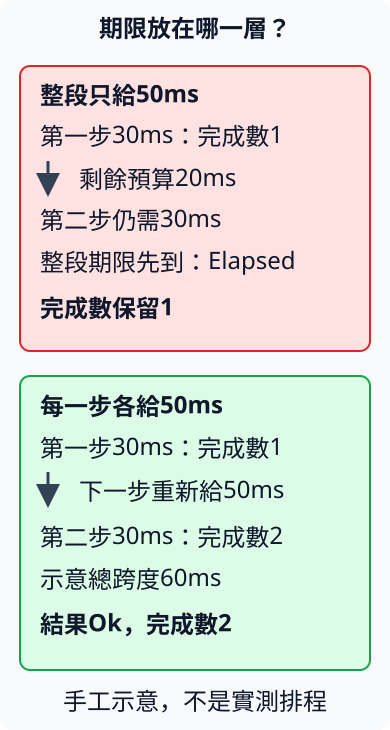

# 11.4 設定等待範圍，再分辨完成、逾時與取消

11.1已分清future的建立、本體執行與Output。現在有一項新需求：一份工作暫時無法完成時，我們願意繼續等多久？到了期限，應該交回哪種結果，哪些已經做過的事會留下來？

本節先用timer表示等待，再把期限包在工作外面。沿用11.1的小計80、運費20與負小計錯誤，不先接網路服務，讓期限與資料錯誤的關係容易辨認。所有指令從repo根目錄執行，使用獨立 `ch11-timing` package。

## 等多久，與從哪裡開始量，是兩種資料

**`std::time::Duration`** 表示一段非負時間跨度，例如20毫秒。**`std::time::Instant`** 保存適合量測經過時間的時鐘讀值；記住開始位置，再讀出從該處經過的跨度。Instant沒有年月日的意義，也不是已經經過的秒數。

先選這幾項操作：

| 操作 | 輸入與結果 |
| --- | --- |
| `Duration::from_secs(seconds)` | 接u64整數秒，建立Duration。1秒等於1000毫秒。 |
| `Duration::from_millis(milliseconds)` | 接u64整數毫秒，建立Duration。 |
| `duration.as_millis()` | shared借讀Duration，交回總毫秒數，型別u128；不足一毫秒的部分不計入這個整數。u64、u128分別是64、128-bit無符號整數。 |
| `Instant::now()` | 記住現在的時鐘讀值。 |
| `start.elapsed()` | shared借讀開始讀值，交回從該處到現在的Duration。 |

Duration具備Copy，所以將等待跨度交給函式後，仍可讀自己的副本。它也可以比較與用Debug檢視；本節輸出明寫 `as_millis()` 與 `ms`，讓數值與單位配在一起。

接著選 **`tokio::time::sleep(duration)`**。它是普通函式，建立名為Sleep的timer future；從建立時設定等待期限，完成時的Output是 `()`。在runtime內await它，工作可以保存進度、等待timer後再繼續，不需要用迴圈不停讀時鐘。

11.1的rt／macros繼續提供current-thread runtime與入口；新增 **time** feature提供timer。例子也沿用11.1的library，`path` 指向其package目錄，和7.1的本地dependency相同：

```toml
--8<-- "examples/ch11-async/timing/Cargo.toml:dependencies"
```

要在已建立的Tokio runtime內呼叫sleep或timeout。本節都放在已教的 `#[tokio::main(flavor = "current_thread")]` 本體，該入口會啟用選定的timer能力；缺少runtime或timer設定會panic，與後面正常回傳的逾時Err不同。

下面先建立20ms跨度，在記下start之後才建立並await timer，最後讀elapsed。這份量測範圍包括timer建立、等待與再次執行到讀值的時間：

```rust
--8<-- "examples/ch11-async/timing/examples/timing_measured.rs"
```

```bash
cargo run -p ch11-timing --example timing_measured --locked
```

前兩行固定是：

```text
1秒的總毫秒數=1000
設定等待=20 ms
```

最後一行是 `這次量測的經過時間=... ms`，數字依當次執行而定。timer的時間粒度、作業系統與runtime重新安排工作的時間，都會影響讀值；Tokio sleep採毫秒粒度，也有平台差異。不能把設定20ms讀成「硬體一定在第20ms立即執行下一行」，或用等於20的assertion當正確性證明。

## timeout給工作加一層期限結果

**`tokio::time::timeout(duration, work)`** 接等待跨度與一份future，建立新的Timeout future。它在呼叫時記下期限；本節建立後立即await，不把wrapper先存很久再當作新的完整預算。

await wrapper會得到 **`Result<T, tokio::time::error::Elapsed>`**，T就是內層work原本的Output：

- `Ok(output)`：取得原工作的完成結果，保留其型別與意義。
- `Err(elapsed)`：工作尚未交出結果，timer已經到期。Elapsed是這項逾時原因的型別，具備Debug／Display；它不是量測得到的Duration。

timeout接手work的值，wrapper執行它並觀察timer。本節使用的Tokio1.53.3會**先讓內層future取得執行機會，再檢查timer**；若內層在這次執行立即交出結果，就能取得Ok。這不是每到一個await就自動中斷工作的機制，稍後會看它對阻塞程式的影響。

先用兩種沒有排程猜測的材料。一份 `async { 100 }` 可以立即完成；另一份使用新標準API **`std::future::pending::<i32>()`**，建立永遠不交出結果的future。i32指定它的Output型別，不表示它會在某個時刻交出i32；把pending單獨await下去就不會完成，因此這裡在外面加timeout。

```rust
--8<-- "examples/ch11-async/timing/examples/timing_outcomes.rs"
```

```bash
cargo run -p ch11-timing --example timing_outcomes --locked
```

```text
立即完成：100
未完成工作已逾時
```

第二行需要timer條件成立才出現，沒有承諾它恰好在某個實際毫秒出現。輸出用Result分支決定行為，沒有比較錯誤顯示文字來辨認原因。

## Ok包住原Output，原Output可能又是Result

11.1的 `checked_total` 完成後交出 `Result<i32, String>`：80得到Ok(100)，−10得到負小計Err。把這份工作交給timeout，外面再增加一層，因此完整結果是 **`Result<Result<i32, String>, Elapsed>`**。

| 完整結果 | 回答的問題 |
| --- | --- |
| `Ok(Ok(total))` | 工作已完成，資料規則也成功。 |
| `Ok(Err(message))` | 工作已完成，原工作的資料規則拒絕這份小計。 |
| `Err(elapsed)` | 等待逾時，尚未拿到內層工作結果，不能假裝知道它將會成功或失敗。 |

所以外層Ok的意思是「拿到Output」，不是「所有資料都正確」。5.6的 `?` 每次也只處理所在的那一層Result；不會替我們把兩種錯誤自動合成一項原因。下面用nested patterns分別處理兩層，先讓小計錯誤與期限錯誤的用途清楚：

```rust
--8<-- "examples/ch11-async/timing/examples/timing_nested.rs"
```

```bash
cargo run -p ch11-timing --example timing_nested --locked
```

```text
小計 -10：工作已完成，資料失敗：小計不能為負數
小計 80：工作已完成，總額=100
```

checked_total沒有外部等待，兩份工作都在第一次執行時完成，因此這裡是兩種內層結果。下一段用明確未完成的材料觀察取消，再用受控timer補齊有等待的三條路。

## 取消會結束這份工作，不會回復已發生的修改

timeout逾時後，當本例await接手的wrapper結束並drop時，它保存的內層future也結束；尚未執行的後續不再繼續。這種以drop結束尚未完成future的行為稱為 **cancellation（取消）**，沿用11.1丟棄工作與8.2收尾的關係。

這次讓work mutable借用外面的visits。它先加1表示「開始過」，再等永不完成的 `pending::<()>()`，最後原本預定加100表示「完成後」。pending的Output改為unit，等待規則與剛才相同。

wrapper接手並丟棄這份工作之後，借用也結束，才直接讀visits。預期是1：已發生的第一項修改保留，後面的加100沒有執行。

```rust
--8<-- "examples/ch11-async/timing/examples/timing_cancelled.rs"
```

```bash
cargo run -p ch11-timing --example timing_cancelled --locked
```

```text
工作已逾時並結束
取消後保留的開始次數=1
```

若工作曾送出資料或改過外部狀態，drop同樣不會自動把它們還原。此例只核對保存在外面的數字，不代替某項外部服務的取消契約。把future的ownership交進去，也不會讓它保存的reference變成owned資料。

## timeout不能硬切斷同步本體

11.1已說await不保證暫停，async也不會自動搬走同步工作。這裡再選一項對照API **`std::thread::sleep(duration)`**：它同步暫停目前實際thread，至少指定跨度，可能因排程等因素更久。它不交回future，不能await。

以下是刻意展示限制的阻塞例：work在被執行時先讓thread停30ms，再交回100；中間沒有把控制權交還runtime。雖然timeout設1ms，wrapper仍必須等這次本體執行回來。依本版「先執行內層」的契約，拿到完成結果後就是Ok：

```rust
--8<-- "examples/ch11-async/timing/examples/timing_blocking.rs"
```

```bash
cargo run -p ch11-timing --example timing_blocking --locked
```

第一行固定為 `阻塞工作仍完成：100`，下一行印當次量測的經過毫秒。這個例子顯示**timer不是硬切斷thread的機制**。同樣地，長時間不停計算、沒有交還控制權的本體，也可能超過設定期限才交回；若一直不返回，timeout就無法讓這條執行路自行脫身。

因此期限的用途是替能適當等待、交還控制權的工作安排停止等待的政策。加timeout不能讓同步阻塞工作變成適當的async等待，也不能提供「整項操作絕對在某個真實時刻停下」的保證。

## 用Tokio測試時鐘固定timer條件

想驗證「timer在工作完成前到期」，不能只挑兩個實際毫秒，假設機器一定照預期安排。本節選Tokio的 **paused clock（暫停的測試時鐘）**：不讓測試時鐘跟著真實秒數流逝；當runtime沒有其他可進行工作、只剩timer等待時，自動推進到下一個timer。

這項能力需要新增 **test-util** feature。本節放dev-dependency，讓正常程式仍使用前段的rt／macros／time。Cargo的feature合併規則沿9.1；test-util也會提供它所需的其他feature，但本節不因此假設已教channel等API。

```toml
--8<-- "examples/ch11-async/timing/Cargo.toml:test-dependencies"
```

已教的 `#[tokio::test(flavor = "current_thread")]` 新增 **`start_paused = true`**，讓每項測試建立自己的current-thread runtime，起始即使用paused clock。它不會暫停整台機器。

**`tokio::time::Instant`** 是配合Tokio時鐘的另一個型別。它的 `now()` 記測試時鐘讀值、`elapsed()` 交回該時鐘經過的Duration；`std::time::Instant` 仍讀真實系統時鐘。用前者驗證timer條件，用後者量測實際程式經過時間，兩個數字回答不同問題。

下面只有一份等待timer的工作，不加入I/O或其他並行task。runtime可以自動推進到這個100ms timer，結果應是「Tokio時鐘至少經過100ms」。我們比較整數毫秒的下界，不斷言真實機器正好等了100ms，也不猜timer精確到哪個小數：

```rust
--8<-- "examples/ch11-async/timing/tests/timing_contracts.rs:clock"
```

接著給已有總額工作加等待。`total_after` 先await checked_total，`?` 在String錯誤時早退；成功才等待delay，再交出原總額。沿5.6，同型別String錯誤原樣交回，這個問號處理的是**小計工作的Result**：

```rust
--8<-- "examples/ch11-async/timing/src/lib.rs:total-after"
```

用paused clock固定三份材料：正小計等10ms，期限100ms，得到Ok(Ok(100))；負小計即時得到Ok(Err)，不等timer；正小計等100ms，期限10ms，得到外層Err。期間沒有阻塞工作或其他可進行工作，期限與等待相差很大，不測剛好相等時誰勝出。

```rust
--8<-- "examples/ch11-async/timing/tests/timing_contracts.rs:result-paths"
```

```bash
cargo test -p ch11-timing --test timing_contracts --locked
```

clock與三條Result路徑各一項。它們驗證本節受控材料的timer關係，沒有把paused clock的成功當成真實機器的延遲上限。

## 整段期限，與每一步重新給時間，範圍不同

現在把工作分成兩步：每步等30ms，timer完成才把completed加1。`two_steps` mutable借用completed，沿用前面借用在工作結束後才能直接讀的規則。Duration是Copy，所以兩次sleep可使用同一份delay值：

```rust
--8<-- "examples/ch11-async/timing/src/lib.rs:two-steps"
```

若需求是「整段工作共用50ms」，就把整份two_steps future交給**一次**timeout。第一個30ms timer先完成，第二步還要30ms；在這份受控時鐘中，總期限先到，因此結果是Elapsed，completed保留1。

若需求是「每一步各自可等50ms」，就建立兩次timeout，每次只包一步。兩個30ms等待都能完成，completed成為2；總工作跨過原來的50ms跨度，仍符合這份不同的每步需求。

圖中30／50／60ms是**手工示意的timer條件**，不是某次真實排程的精確截圖。框表示同一預算涵蓋的工作，向下箭頭表示下一步；第二種安排每次重設開始位置：



```rust
--8<-- "examples/ch11-async/timing/tests/timing_contracts.rs:scope"
```

```bash
cargo test -p ch11-timing --locked
```

timing_contracts裡的兩種scope各一項，加上前段四項，共六項契約測試；整包另含末尾練習的一項，共七項正常tests。沒有把不同需求的一種說成永遠正確；先決定預算覆蓋什麼工作，才知道timeout應放在哪一層。

若前面已做完資料準備，之後才呼叫timeout，那段準備也不在新建立的期限內。量測則同樣由Instant的記錄位置決定；「這條函式有timeout」並沒有自動交代整條呼叫流程的期限範圍。

## 練習：預測整段工作會留下幾步

保留two_steps每步相同等待的規則，以paused clock測三組材料：

| 每步等待／整段預算 | 預期完成數與結果 |
| --- | --- |
| 20ms／50ms | 2步，Ok(())。 |
| 30ms／50ms | 1步，Err(Elapsed)。 |
| 30ms／10ms | 0步，Err(Elapsed)。 |

先預測每條路最後一個完成的步驟，再寫測試。比對completed與預期數量，也核對Ok只出現在兩步都完成的那條路；不要把逾時看成completed一定回0。

??? example "完整參考答案"

    ```rust
    --8<-- "examples/ch11-async/timing/tests/timing_solution.rs"
    ```

    ```bash
    cargo test -p ch11-timing --test timing_solution --locked
    ```

延伸閱讀：[英文Book的timeout組合與阻塞例](https://doc.rust-lang.org/book/ch17-03-more-futures.html)、[中文對應章節](https://kaisery.github.io/trpl-zh-cn/ch17-03-more-futures.html)、[Tokio官方測試時鐘](https://tokio.rs/tokio/topics/testing)、[固定版Tokio timeout source](https://github.com/tokio-rs/tokio/blob/tokio-1.53.3/tokio/src/time/timeout.rs)。
