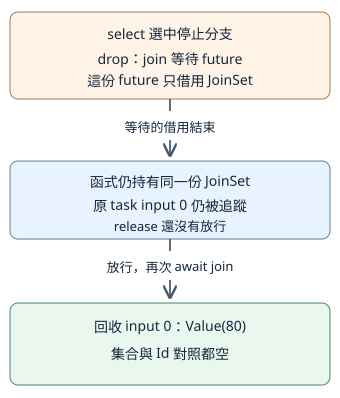
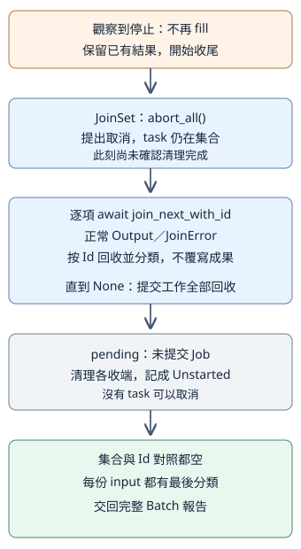

# 11.5 select!、取消與收尾：停止提交，也等到清理完成

11.3限制提交數，完成一份就補下一份；11.4替一段等待加上期限，也看過取消不會還原已發生的修改。現在新增另一種停止理由：使用者不再需要這一批工作。

我們希望停止後仍交回完整報告：哪些已完成、哪些回錯誤、哪些被取消、哪些根本沒提交。流程要同時照顧 **停止新提交、結束已提交工作、等待清理、保存每份輸入的分類**，不能只退出 main 或丟棄把手。

本節使用 `ch11-cancellation` package。從 repo 根目錄執行 `cd examples/ch11-async/cancellation`，後面的 Cargo 指令以此為入口。先用 channel 提供可控制的停止事件，再接上真正的 Ctrl+C。

## 等待工作結果時，如何也接收停止事件？

如果只 await 下一份結果，一份長時間等待的工作可能讓呼叫者一直無法處理停止要求。我們需要同時等待兩個條件：下一份結果可取，或停止來源有事件。

**`tokio::select!`** 是 Tokio 的 macro，用在 async 函式或 block 中。它在**同一份 task**等待多個分支；其中一份 future 完成且符合分支 pattern，就執行它的 handler，結束這次 select。它不會為每個分支建立新 task。

本節使用的分支形式是 **`名稱 = future 表達式 => handler,`**。名稱接住 future 的 Output，handler 是選中後執行的程式；花括號包住整份 select，分支以逗號分隔。右方先求值建立各份 future，再等待它們，和11.1「普通函式呼叫與 future 本體執行」的區別相接。這不是先 await 第一份，再 await 第二份。

**`biased;`** 放在最前面，讓 select 按列出的順序檢查。預設會隨機選擇先檢查哪份；本節把停止分支列第一，若停止與完成結果都已就緒，就先選停止。這是我們的停止優先政策，不是完成結果因此消失；後面仍會回收它。若某個優先分支永遠就緒，其他分支可能一直得不到處理，所以只在有明確理由時指定次序。

選中一份後，其他分支的等待 future 被丟棄。沿11.4，這種 cancellation（取消）不會自動還原已發生的修改。還要問：**被丟棄的是哪個值，它原本擁有什麼？** 丟棄工作本體與丟棄借用集合的等待，不是同一項清理。

**cancellation safety（取消安全）** 在此表示：等待中被丟棄、之後重建同一操作，不會因此遺失本來要收取的資料。本節選兩個有此契約的 API：

| 等待 | 另一分支先選中時，保留什麼 |
| --- | --- |
| `receiver.recv()` | 這份被取消的等待沒有取走訊息，之後還可再次接收。 |
| `tasks.join_next_with_id()` | 這份被取消的等待沒有移除 task，集合仍追蹤它，之後還可收取結果。 |

因此當工作結果先選中，停止訊息仍可在下一次接收時處理；當停止先選中，集合仍持有工作。取消安全是所選操作的具體契約，不表示每份 future 都有它，也不表示已發生的副作用會復原。

這些分支使用普通 binding，會接住 Option／Result 的所有情況；收到 None 或 Err 也要處理，不只為成功結果寫分支。select 在同 task 執行，因此任何分支若阻塞 thread，其他分支也無法繼續；11.4的同步阻塞限制仍適用。

## 停止原因和每份工作的結果，要怎麼分開？

資料型別放在 models module；library 以 `pub mod models;` 載入，再從 `crate::models` 引入需要的名稱，沿1.9的分工。沿用11.2的 WorkError／Report／Outcome，增加 **Unstarted** 表示尚未提交。它沒有 Tokio Id，也沒有 task 可以取消；已提交但被取消的才是 Cancelled：

```rust
--8<-- "examples/ch11-async/cancellation/src/models.rs:outcomes"
```

**StopEvent** 是停止來源送來的訊息：Requested 是明確要求停止；SignalFailed 保存監聽 Ctrl+C 失敗的原因。**EndReason** 是整批結束理由，另有正常 Finished，以及停止來源關閉卻沒有事件的 StopSourceClosed。

停止 channel 的訊息型別是 StopEvent，容量1；Batch 保存報告與整批理由。工作自己的 WorkError、task 的 JoinError、停止來源的失敗仍是三種不同責任：

```rust
--8<-- "examples/ch11-async/cancellation/src/models.rs:stop-model"
```

Job 與 prepare_jobs 沿11.3：兩個同序 Vec 分別保存放行收端與送端，位置就是原 input。新增的 **returning** 是可選的回傳前觀察送端，正常輸入為 None；測試設定 Some 時，工作會在算出 Output 後送一次 input，再直接返回。這個觀察點後面用來安排「完成但還沒收取」的受控測試，不把 send 成功當一般的完成證明。

```rust
--8<-- "examples/ch11-async/cancellation/src/lib.rs:jobs"
```

啟動訊息仍送 usize 的 input。library 以 `use tokio::sync::mpsc;` 使用已教的 Tokio channel；工作先送啟動、丟棄這份送端，再等待 release。returning 為 None 時，與11.3的工作流程相同：

```rust
--8<-- "examples/ch11-async/cancellation/src/lib.rs:controlled-job"
```

## select 丟棄 join 等待，會不會把原 task 一起取消？

先把11.2的分類拆成接受已取結果的 **classify**。它不自己等待，而是接手 `Result<(Id, Result<i32, WorkError>), JoinError>`，照原規則移除 Id 對照並建立 Report：

```rust
--8<-- "examples/ch11-async/cancellation/src/lib.rs:classify"
```

先用一份金額80的工作。controller 是控制實驗步驟的 task：它收到工作啟動訊息，才送出停止訊息。此時 release 還沒放行，所以工作不會完成，select 只能選停止。

停止分支接住 unit 訊息後，這次 select 返回。被丟棄的是 **借用 JoinSet 的 join 等待 future**；JoinSet 本身仍由目前函式持有，也仍追蹤原 task。接著檢查集合與 Id 對照都還有一份，放行並正常收回80，最後也等待 controller：

```rust
--8<-- "examples/ch11-async/cancellation/src/lib.rs:borrowed-join-demo"
```

```rust
--8<-- "examples/ch11-async/cancellation/examples/borrowed_join.rs"
```

```bash
cargo run -p ch11-cancellation --example borrowed_join --locked
```

```text
停止分支先返回；原 task 仍正常完成：Value(80)
```

圖中的箭頭對應這份實驗的後續順序：先結束 join 等待的借用，仍持有同一份集合；之後放行、重新 join，才回收原 task。



這份停止訊息只結束了選擇等待，沒有自動完成整批停止政策。要取消那些已 spawn 的工作，還須對集合提出取消，再等待結果；不能從「select 取消其他分支」直接推成「所有 task 已清理」。

## 排程怎麼記住每一份輸入，包括尚未提交的？

保留11.3的 pending、JoinSet、Id→input、正上限與峰值。現在另外準備 **`Vec<Option<Outcome>>`**，長度等於輸入數量；每個位置初始為 None，表示尚未記下最後分類。回收後填 Some(outcome)，停止時把仍在 pending 的位置填 Unstarted。

最後按原位置產生 Report，讓停止後也能逐項查整批輸入。這次報告順序由原 input 決定，不採完成順序；仍透過 Id 對照回收，所以 panic／取消不會遺失身分。

分類仍使用前段已教的 classify；它先移除 Id 對照，讓 record 得到原 input。

Runner 是目前函式持有的排程狀態，與11.3的 Scheduler 分工相近：

```rust
--8<-- "examples/ch11-async/cancellation/src/lib.rs:state"
```

new 只檢查與準備，不立即 fill；因為還要先查停止來源是否已有事件。fill 仍在每次 spawn 前檢查 len，record 則先取得原 input，再用已教的 as_mut_slice 修改該位置：

```rust
--8<-- "examples/ch11-async/cancellation/src/lib.rs:prepare-and-fill"
```

## 觀察到停止後，哪些工作還要收尾？

**`tasks.abort_all()`** mutable 借用 JoinSet，向其中所有 task 提出取消；它**沒有移除 task，也沒有等待清理**。所以後面必須持續 await join_next_with_id，直到 None，並分類每一份結果。

停止與完成可能競爭，沿11.2：已完成工作仍可能交回正常 Output。我們保留實際收回的 Value／WorkError／Panic／Cancelled，不把集合中的所有位置一律覆寫為 Cancelled。

已提交工作收齊後，submitted 之後的各位置就是未提交輸入；逐份取出 pending 的 Job 並 drop，清理其放行收端，記成 Unstarted。最後檢查集合與 Id 對照都空，再交回 Batch：

```rust
--8<-- "examples/ch11-async/cancellation/src/lib.rs:stop-and-drain"
```

into_batch 的 `into_iter().enumerate()` 沿6.5與7.9：接手所有 Option 值，逐項得到 `(usize, Option<Outcome>)`，位置由0增加。None 若仍留下，代表漏記輸入，是本例的程式契約錯誤；不拿 None 冒充取消。

圖從上往下對應這段方法。箭頭表示處理順序；藍框是已提交集合，灰框是未提交來源，綠框是清理後的完整報告：



這份流程不會撤銷已發生的修改，也不能硬切斷不交還控制權的同步計算。本節的工作停在 channel 等待，因此能讓 runtime 處理取消；若工作已送資料或寫檔，清理 local 值仍不等於外部動作被還原，與11.4相同。

## 補工之前，怎麼避免忽略已排入的停止事件？

只在 fill 之後 select，會先補工才發現 channel 早已有停止訊息。因此每次 fill 前先用 **`stop.try_recv()`**：它 mutable 借用收端、同步嘗試取一份訊息，**不等待**，回傳 `Result<StopEvent, TryRecvError>`。

`tokio::sync::mpsc::error::TryRecvError` 的兩種結果是：Empty 表示目前沒有訊息，但送端尚存；Disconnected 表示 buffer 空且已沒有送端。兩者不同，前者可繼續排程，後者代表這份停止來源已失去。若 buffer 已有事件，即使送端隨後關閉，也先取出事件。

再教本節用的兩個 **is_empty**：Vec 的 is_empty shared 借用清單、回 bool 表示長度為0；JoinSet 的 is_empty shared 借用集合、回 bool 表示沒有追蹤 task。前者處理空輸入，後者判斷是否已無工作；都不等待或推進排程。

停止 recv 的 None 依11.2表示來源已關閉且訊息已讀空，不是 Requested。我們將事件轉成整批理由：

```rust
--8<-- "examples/ch11-async/cancellation/src/lib.rs:stop-reason"
```

完整 run_batch 先準備 Runner；空輸入立即 Finished。非空輸入每輪先查停止，再 fill；集合空表示已全部完成。其他情況才 select 停止或下一份結果。工作結果先選中便 record，回到迴圈先查停止，不在 handler 裡立即補工：

```rust
--8<-- "examples/ch11-async/cancellation/src/lib.rs:run-batch"
```

**不再提交從「觀察到停止」起算**。停止來源與排程可能在不同 task 前進；事件尚未被觀察時，已有工作可能提交。try_recv 的保障是每次補工前檢查已排入事件，不是對訊號抵達的某個瞬間提供原子性的全程禁止。

## 怎麼確定停止時保留了錯誤，也清理了剩餘工作？

材料仍是11.3的五份，上限2。controller 先讓 input 1 回 Negative，等2啟動；再讓2 panic，等3啟動。這些新啟動證明回收後有補工。接著送 Requested；0、3的 gate 還關著，4還未提交。

controller 把放行送端清單交回，避免送完停止就把 gate 全部關閉，讓工作意外走 ControlClosed。批次收尾後再等待 controller，試送每一個 gate 都應失敗，表示已提交與未提交的收端都已清理：

```rust
--8<-- "examples/ch11-async/cancellation/src/lib.rs:stop-demo"
```

稍後會給 main 的完整 source。先跑預設受控模式：

```bash
cargo run -p ch11-cancellation --locked
```

```text
結束原因：Requested
共提交 4；追蹤峰值 2
input 0：Cancelled
input 1：WorkError(Negative(-1))
input 2：Panic
input 3：Cancelled
input 4：Unstarted
已回收全部提交工作，並清理未提交輸入
```

stderr 另有「task 故意 panic」的診斷。這份工具將 Requested 映成退出碼130，所以這次 Cargo 指令也以130結束；它表示主動停止的政策，不是報告漏收或清理失敗。下面會交代完整退出介面。

## 等待前為什麼要先結束不需要的 guard？

10.6已教 std MutexGuard 沒有 Send，Drop 時解鎖。若 task 在 await 時仍保存 guard，整份 future 就可能不符合11.2的 spawn Send bound；current-thread 設定也不移除這個要求。

以下完整負例在取得 guard 後等 release，接著還要用 guard：

```rust
--8<-- "examples/ch11-async/cancellation/fixtures/cross-crate-fail/examples/held_guard.rs"
```

它有獨立的 Cargo fixture manifest 與 lock，以固定 Tokio 依賴檢查故意失敗的 example；空的 `[workspace]` 表讓這份 fixture 自成 workspace，沒有加入主教材的正常 targets。`--manifest-path` 指定要檢查的 Cargo.toml；以下路徑以本節 package 目錄為起點，選到這份獨立 fixture。從該目錄執行：

```bash
cargo check --manifest-path fixtures/cross-crate-fail/Cargo.toml --example held_guard --locked
```

診斷指出 **future cannot be sent between threads safely**，以及 MutexGuard 跨 await、沒有 Send。這次只需要保存數值快照，先用內層 block 完成持鎖操作；block 結束解鎖，再等待：

```rust
--8<-- "examples/ch11-async/cancellation/examples/short_guard.rs"
```

```bash
cargo run -p ch11-cancellation --example short_guard --locked
```

輸出 `等待前 guard 已解鎖；保存的快照=80`。snapshot 是當時的數值；若其他工作稍後修改共享資料，它不會自動變成新值，沿10.6的短持鎖與觀察範圍。這個例子只有一份 owner，不以它聲稱多個 worker 的資料更新政策已完成。

## 真正 Ctrl+C 要怎麼轉成同一種停止事件？

**`tokio::signal::ctrl_c()`** 建立等待 Ctrl+C 通知的 future。Output 為 **`std::io::Result<()>`**，是 `Result<(), std::io::Error>` 的 type alias：Ok(()) 是收到通知，Err(io::Error) 是監聽失敗。io::Error 的 Display／to_string 沿7章；失敗要保存成 SignalFailed，不當作使用者已按 Ctrl+C。

它需要 **signal feature**；保留 rt／macros／sync，增加作業系統訊號能力。選用的 Tokio main 入口建立 runtime，啟用本次所需的訊號等待支援：

```toml
--8<-- "examples/ch11-async/cancellation/Cargo.toml:dependencies"
```

呼叫 async 函式還不表示監聽已開始；future 第一次實際執行才註冊 listener。為了提供可靠 ready 訊息，signal_controller 採 biased select：**先執行 ctrl_c 分支**，若尚未收到訊號，註冊後才進入另一個支路，送 entered，再等待11.4已教、永不完成的 `pending::<()>()`。

因此 ready 支路不會選中、也不會結束這次 select；Ctrl+C listener 仍保留。若第一次執行便遇到監聽失敗或已收到通知，Ctrl+C 分支直接處理，另一份 future 被丟棄，entered 收端可能得到 None；批次仍依真正事件收尾。

signal_controller 最後送 StopEvent，bool 只表示送入停止 channel 是否成功。批次可能已正常完成並丟棄收端，這時 false 是事件未送入，不是 task panic。

此外在 **Unix**，第一次註冊會改變整個 process 的 SIGINT 處理；丟棄 listener 不會恢復預設直接終止的行為。所以這份 CLI 收到事件後自己安排清理與退出，不能靠 drop controller 恢復作業系統的原行為。

批次正常完成時，等待 Ctrl+C 的 controller 也不能留下不管。**finish_signal_controller** 先 abort，再 await：已正常完成或被取消都可收尾；其他 task 失敗則交回 String 診斷：

```rust
--8<-- "examples/ch11-async/cancellation/src/lib.rs:signal-controller"
```

## CLI 怎麼等待 ready，並在退出前收齊所有 task？

最小模式解析選 `std::env::args()`，沿7.5的參數讀取角色，但這次取得的是 String iterator：第一項是程式名稱，後面接受單一 `--signal` 或沒有參數。它會在參數含非 Unicode 內容時 panic；這份固定模式入口沒有拿它替代7章處理任意 OS 路徑的 args_os。

next 沿6.5取 Option<String>。無參數跑受控 demo；`--signal` 等真正 Ctrl+C；其他輸入回 String 用法，尚未建立任何 task：

```rust
--8<-- "examples/ch11-async/cancellation/src/main.rs:mode"
```

real_signal 先建立 signal controller，再等 entered 路線有訊息或關閉，才提交工作。另有 observer task 接收兩份工作啟動訊息、印 READY；先保存 mutable Stdout，再 flush，沿7.4／7.5的 Write 與明確輸出確認，讓訊息真正交給輸出端。它沒有把 job 啟動本身當作 signal 註冊證明：listener 的先執行安排由上一段的 biased select 提供。

四份工作全不故意 panic，也全未放行，讓使用者按 Ctrl+C 後看到兩份 Cancelled、兩份 Unstarted。提前收到停止時，observer 可能收不到滿兩份，不印 READY；它仍讀到 channel 關閉並結束。批次回收完，再取消並等待 signal controller、等待 observer；這兩份 task 也納入收尾：

```rust
--8<-- "examples/ch11-async/cancellation/src/main.rs:real-signal"
```

最後選退出政策。沿7章的 ExitCode，沿用7.9的 **`ExitCode::from(u8)`**：以0到255的數字建立退出碼，2表示用法錯誤、130表示 Requested。From／型別推導沿5章；不是把 EndReason 自動轉成作業系統錯誤。正常完成用 SUCCESS，監聽來源或其他基礎失敗用 FAILURE：

下面的 `match` 用**單一 `|` 合併 patterns**：`p1 | p2` 表示符合任一種形狀，就執行同一個 branch。這裡讓 SignalFailed 與 StopSourceClosed 共用 FAILURE；它是 pattern 的「或」，與1.6用於布林表達式的 `||` 不同。

```rust
--8<-- "examples/ch11-async/cancellation/src/main.rs:main"
```

```bash
cargo run -p ch11-cancellation --locked -- --signal
```

看到 READY 後按 Ctrl+C。接著應有：

```text
結束原因：Requested
共提交 2；追蹤峰值 2
input 0：Cancelled
input 1：Cancelled
input 2：Unstarted
input 3：Unstarted
已回收全部提交工作，並清理未提交輸入
```

不需要第二次 Ctrl+C 才退出；controller 的等待也被收尾。這份 listener 的 process 行為用真 CLI 操作，常規 unit tests 則以可控制 channel 事件驗證，避免依賴 OS 訊號抵達的偶然時序。

## 測試怎麼區分停止要求、回收成果與清理？

使用11.1的 current-thread async test。本節檢查七種關係：

| 材料／路徑 | 核對什麼 |
| --- | --- |
| 停止分支先選中借用 join | 原 task 仍可正常回80，不把取消等待當作取消 task。 |
| 五份輸入，兩次失敗後補工再停止 | 峰值2；錯誤仍保留；0、3取消，4未提交，所有 gate 收端清理。 |
| 提前排入 Requested | 提交0，所有輸入 Unstarted，沒有多建立第一批 task。 |
| 已完成但尚未收取 | abort_all 後仍保留 Value(80)，其餘取消／未提交，不覆寫成果。 |
| 受控 SignalFailed／來源關閉 | 保存不同 EndReason，不混成 Requested。 |
| 空輸入 | Finished、沒有 task／報告，不等待不存在的啟動。 |
| controller 等待中／已正常完成 | finish 兩路都 await；等待中的 controller 收端已清理。 |

「已完成但未收取」的測試設定 Job.returning：工作送完觀察訊息後沒有下一個 await，直接回 Output。在 current-thread 這份可控制流程中，接收方重新執行時 body 已返回；此時測試還沒有 join，所以集合仍有兩份。這是這份測試安排的證據，不把任意 send 成功當全域完成保證。

??? example "完整 unit tests"

    ```rust
    --8<-- "examples/ch11-async/cancellation/src/lib.rs:tests"
    ```

真 binary 的兩項 integration tests 沿7.8／7.9核對完整 stdout、退出碼130與panic診斷，以及非法模式在建立工作前回2：

```rust
--8<-- "examples/ch11-async/cancellation/tests/cli.rs"
```

```bash
cargo test -p ch11-cancellation --locked
```

SignalFailed 的常規測試注入一份明確事件，驗停止政策；它沒有聲稱重現實際 OS 註冊失敗。作者另在獨立 CLI process 讀到 READY 才送 SIGINT，核對退出130與上面四份分類；沒有用固定 sleep 猜 listener 已就緒。

## 練習：停止已排入，還需要取消任何 task 嗎？

材料為80、120、200，上限2。先建立停止 channel、送入 Requested，再呼叫 run_batch。不要先放行工作。

1. 預測第一輪 try_recv 的結果，以及 fill 是否會執行。
2. 檢查 EndReason為Requested、submitted與峰值皆0、三份報告皆Unstarted。啟動收端應得到None，因為沒有工作提交。
3. 試送每份放行訊息應失敗：未提交 Job 已清理其收端。說明為什麼這與「建立兩份task再取消」不同，即使兩者最後都沒有金額成果。

??? example "完整參考答案"

    ```rust
    --8<-- "examples/ch11-async/cancellation/examples/prequeued_stop_solution.rs"
    ```

    ```bash
    cargo run -p ch11-cancellation --example prequeued_stop_solution --locked
    ```

    ```text
    input 0：Unstarted
    input 1：Unstarted
    input 2：Unstarted
    提交 0；沒有 task 需要取消
    ```

現在可以處理多個等待條件，辨認取消的是等待還是工作，並在停止後保存完整輸入分類、等到所有 task 清理。接下來把這些控制責任帶入 HTTP 工作，仍維持先教 API、再組合可用流程的順序。
