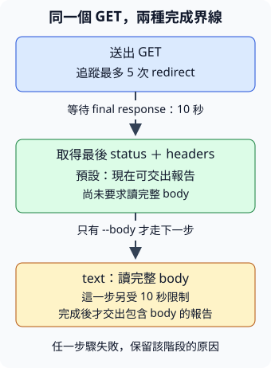

# 11.6 HTTP 基礎：有收到回應，和檢查通過，是兩件事

第 7.9 節的工具從本機檔案取得資料。現在把輸入來源換成一個網址：送出請求，知道對方回了什麼，也能分辨「對方說找不到」與「一直沒有取得回應」。本節先做一次同步請求，讓網路的行為清楚可見；使用的 Rust 前置是 7.9 及更早內容。

我們要完成一個小 CLI：接受一個 HTTP(S) URL，追蹤有限次 redirect，印出最後的 URL、HTTP status 與是否通過。預設只取得回應的 status 和 headers；使用者加上 `--body` 才讀完整內容。這兩種完成界線會影響等待時間，也會影響失敗如何解讀。

本節使用獨立的 `ch11-http` package，第三方依賴不加到前面的範例。從 repo 根目錄執行 `cd examples/ch11-http`，後面的 Cargo 指令以此為入口。

## 網址提供位置，HTTP 約定請求與回應

**URL（Uniform Resource Locator，統一資源定位符）** 是描述資源位置的表示。先看一個示意網址：

```text
https://example.org:8443/notes?lang=rust#intro
```

| 部分 | 本例 | 這次需要知道的角色 |
| --- | --- | --- |
| scheme | `https` | 決定使用的協定。本工具只接受 `http`／`https`。 |
| host | `example.org` | 指定要連線的主機名稱。名稱需要被解析成可連線的網路位址。 |
| port | `8443` | 同一主機上要連到的服務入口號碼。沒有明寫時，http 預設 80、https 預設 443。 |
| path | `/notes` | 指定該服務中的資源路徑。它不是本機檔案的 Path。 |
| query | `lang=rust` | 隨請求傳給服務的附加資料；具體意義由服務決定。 |
| fragment | `intro` | 由使用端解讀的資源內位置，不作為這次 HTTP 請求的目標傳給伺服器。 |

**HTTP（Hypertext Transfer Protocol，超文字傳輸協定）** 約定 client（發起請求的一方）與 server（提供回應的一方）怎麼交換訊息。它也可以傳文字以外的資料。**HTTPS** 是透過 **TLS（Transport Layer Security，傳輸層安全性協定）** 保護的 HTTP：連線中的資料受到加密，client 也會檢查伺服器憑證，確認對方的身分符合這個連線的要求。

先看一組簡化的 **HTTP/1.1 示意訊息**。這不是要我們自己拼出並解析網路 bytes；reqwest 會替我們處理這項工作。下面每行實際以 CRLF 結尾，空行是 headers 與 body 的分界。

```http
GET /notes?lang=rust HTTP/1.1
Host: example.org:8443

```

`GET` 是 **method**，表達「取得這個資源的表示」。這份請求不附 body。`Host` 是一項 **header**：headers 是名稱與值組成的附加資訊，協助對方解讀訊息。

伺服器可能回：

```http
HTTP/1.1 200 OK
Content-Type: text/plain; charset=utf-8
Content-Length: 5

hello
```

第一行有 **status code（狀態碼）** 200；`Content-Type` 說明內容的型態，`Content-Length` 在本例說明 body 有 5 bytes。空行後的 `hello` 是 **body**，也就是這份訊息承載的內容。較新的 HTTP 版本有不同的傳輸表示；我們要使用的是 method、status、headers、body 這些共同角色，不把所有 HTTP 都當成上面這種文字格式。

## 先決定「通過」和「失敗」指什麼

假設要檢查 `/notes`。下面三種結果需要留下不同資訊：

| 情況 | 我們實際知道什麼 | 本工具的結果 |
| --- | --- | --- |
| 最後回 `200` | 伺服器已回應，而且是成功類別 | 有 HTTP 報告，通過 |
| 最後回 `404` | 伺服器已回應，表示找不到該資源 | 有 HTTP 報告，HTTP 未通過 |
| 連線失敗，或等待最後回應超過期限 | 沒有取得最後的 HTTP 回應 | 請求錯誤，沒有 HTTP 報告 |

HTTP status 的百位數表示類別：2xx 是成功，3xx 包含重新導向等情況，4xx 表示請求相關問題，5xx 表示伺服器處理失敗。本工具明確選擇 **200–299 才算通過**。這個判準只說 HTTP 層通過，沒有檢查頁面內容是否符合你的應用需求。

**redirect（重新導向）** 是伺服器請 client 改向另一個 URL 請求。例如 `/old-notes` 回 `302`，headers 的 `Location` 指向 `/notes`；client 再請求 `/notes`，最後得到 200。我們要報告這個最後的 URL 與 200，而不是只留下中途的 302。不是所有 3xx 都會導向新 URL；若 client 最後交回 3xx，本工具仍保留該 HTTP 結果，並判為未通過。

追蹤次數必須有上限，否則一串導向可能讓工作不斷繼續。本例最多追蹤 **5 次**；如果還需要第 6 次，請求回錯誤。等待也設定期限，避免工具在對方一直不回應時一直卡住。

CLI 的出口沿用 7.9：報告寫 stdout，錯誤寫 stderr。通過、help／version 回 0；HTTP 未通過、client／請求／body／輸出失敗回 1；參數或 URL 不符合要求回 2。**同樣回 1 不代表同一種原因**：404 留在 stdout 的 HTTP 報告，沒有取得回應的原因則在 stderr。

## 取得這次需要的 client 能力

**reqwest** 是替 Rust 程式建立 HTTP 請求、處理連線與讀取回應的 library。本例使用 `reqwest::blocking` 的同步介面：呼叫者在該操作完成或失敗前等待，不同時往下執行下一步。之後才把同一個 HTTP 工作接到 async 介面。

依賴設定沿用 7.1 的版本要求與 features。本例打開 `blocking` 取得同步介面、`rustls` 取得 TLS 支援；關掉預設 features，不額外要求 HTTP/2、其他字元編碼或壓縮解碼等能力。HTTPS 的憑證檢查仍然啟用。`url` 提供 URL 解析，clap 沿用 7.6 的參數解析。

```toml
--8<-- "examples/ch11-http/Cargo.toml:dependencies"
```

Cargo.lock 保存本書實際版本；這份範例查核的是 reqwest 0.13.5、url 2.5.8。舊版 reqwest 教材可能用 `rustls-tls` 作 feature 名稱，不能直接搬到這份設定。

Settings 的 positional `url` 是 String；兩個 bool 欄位分別對應 `--body` 和 `--direct`。**proxy（代理伺服器）** 是 client 可以先交給它轉送請求的中間服務。`--direct` 選擇直接連線，供你需要排除代理影響時使用；一般執行則讓 client 保留它原有的環境代理處理。這裡不新增 clap 的參數形式：

```rust
--8<-- "examples/ch11-http/src/config.rs"
```

`http-inspect` 是設定的工具名稱，例如 `--version` 會顯示它；實際 Cargo binary target 仍叫 `ch11-http`。help 的用法行可以取 arguments 第一筆作為啟動名稱，沿用 7.6 的區別。

## 在寫流程前，讀懂選用的 API

我們只使用下面這些具體能力，不需要手寫 HTTP parser。URL 解析先做在本機，尚未連線：

| 操作 | 本例的輸入與結果 |
| --- | --- |
| `Url::parse(input)` | 借用 `&str`，回 `Result<Url, url::ParseError>`；接受可解析的 absolute URL，不能只交 `/notes`。 |
| `url.scheme()` | 借用 Url，回 `&str`，scheme 已轉成 ASCII 小寫且不包含冒號。因此 `HTTPS://...` 的 scheme 是 `https`。 |
| `url.as_str()` | 借用 Url，回它保存的標準化 URL 表示 `&str`。它可能與輸入字串不同，例如 `https://example.org` 會有結尾 `/`。 |

解析成功仍可能是 `file:///tmp/notes.txt`，所以還要檢查 scheme。第 7.9 節已教「有效輸入」與「工作失敗」分層；這裡也先拒絕不支援的 URL，再建立 client。

接著建立 client，設定它如何執行請求。**builder** 是逐項保存設定、最後建立物件的介面；這些設定 method 接手 builder，交回更新後的 builder，才能接著呼叫下一項：

| 操作 | 本次使用的契約 |
| --- | --- |
| `Client::builder()` | 建立同步 ClientBuilder，尚未送出請求。 |
| `.redirect(Policy::limited(5))` | 改用最多追蹤 5 次的策略；reqwest 預設上限是 10。 |
| `Duration::from_secs(10)` | `std::time::Duration` 表示時間長度，這個 associated function 接受以秒為單位的 `u64`，建立 10 秒的長度；它不是時鐘上的時間點。 |
| `.timeout(duration)` | 為同步連線、讀寫等待設定 timeout（逾時限制）；本例送請求的等待與稍後讀 body 都受這個設定限制。 |
| `.no_proxy()` | 清除代理，並關掉自動代理使用，讓這個 client 直接連線。 |
| `.build()` | 接手 builder，回 `Result<Client, reqwest::Error>`。例如 TLS 初始化或系統名稱解析設定載入失敗，可能在此發生。 |

最後是一次 GET 與回應操作：

| 操作 | 本次使用的契約 |
| --- | --- |
| `client.get(url)` | 借用 client，接手本例的 owned Url，建立 GET 的 RequestBuilder。該 method 也接受其他符合 `IntoUrl` 的輸入；本例只使用已解析的 Url。 |
| `.send()` | 接手 RequestBuilder 並執行，回 `Result<Response, reqwest::Error>`。連線、憑證、導向次數或等待期限等問題會回 Err；最後 HTTP 404 本身仍可回 Ok(Response)。 |
| `response.status()` | 借用 Response，交回 StatusCode 值；這個型別可 Copy，不會拿走 Response。 |
| `status.is_success()` | 借用 StatusCode，200–299 回 true，其餘回 false。 |
| `status.as_u16()` | 借用 StatusCode，交回對應的 `u16` 數字，供儲存與顯示。 |
| `response.url()` | 借用 Response，交回最後的 `&Url`；跟隨導向後可能已不是輸入 URL。 |
| `response.text()` | 接手 Response，**讀完整 body**，回 `Result<String, reqwest::Error>`。回應已取得，後面的 body 仍可能讀取失敗或逾時。 |
| `error.is_timeout()` | 借用 reqwest::Error，若錯誤與逾時有關回 true，讓診斷指出是等待期限造成的失敗。 |

這次的外部型別也提供格式化能力：Url 有 Debug，讓測試能顯示帶有 Url 的結果；url::ParseError 與 reqwest::Error 都有 Debug／Display，因此可以放進稍後逐欄 derive Debug 的 AppError，也能用 `{error}` 顯示具體原因。

本例沒有啟用 `charset` feature，因此 text 只以 UTF-8 解碼，遇到不合法序列會用替代字元 `�`，不會像 7.4 的 `String::from_utf8` 那樣把它判成嚴格 UTF-8 錯誤。它適合這次的文字查看，不能當成保存任意 binary bytes 的方法。

還要分清時間範圍：在這份 **blocking** 實作中，send 等到最後回應的期限是 10 秒；之後若呼叫 text，該次完整 body 讀取另有 10 秒限制。**這不是 send 加 text 合計 10 秒的總期限**。這裡也沒有承諾整個 CLI 在 10 秒內結束，因為還有 client 建立與輸出等工作。

## 把取得 headers 與取得完整 body 分成兩步

下面的圖從上往下讀，每支箭頭表示「完成前一步，才開始下一步」。預設模式在中間取得資料就能交出報告；`--body` 模式還需要完成下一段。



「取得 Response」表示最後的 status 與 headers 已可使用，**沒有要求程式先讀完整 body**。網路可能已同時帶來部分 body bytes；這個區別描述程式的完成條件，不是保證網路上尚未收到任何 body byte。這也是後續批次檢查只需要知道 HTTP status 時，能採用的工作界線。

先把結果保存成 owned Inspection。body 是 `Option<String>`：None 表示使用者沒有要求讀 body，Some 則表示已讀取並保存文字；空的 body 是 Some(empty String)，與沒有讀不同。String、u16、bool 及 `Option<String>` 都提供 Debug／PartialEq，因此這份報告沿用 4.2 的逐欄 derive 能力。

```rust
--8<-- "examples/ch11-http/src/lib.rs:model"
```

錯誤沿用 7.9 的具體 enum 與 Display，分開 URL、scheme、client 建立、請求、body、輸出。Client／Request／Body 都可能收到 reqwest::Error，所以不替它寫單一 From；在發生的地方明確包入相應 variant。Body 額外保存已收到的 status，診斷才能說「已收到 HTTP 200，但 body 逾時」，不把它改稱沒有取得 HTTP 回應。

`status(&self)` 是我們自訂的行程狀態選擇，回 `u8`；它與 HTTP 的三位數 status code 不同。named-field variant 沿用第 3 章，這次加兩項 pattern 寫法：`p1 | p2` 表示符合其中任一種形狀就選這個 arm，讓相同狀態的情況共用分支；`Body { .. }` 的 `..` 表示不取其中任何欄位，只判斷它是 Body。稍後的 `"http" | "https"` 也使用相同的「任一種符合」規則。

```rust
--8<-- "examples/ch11-http/src/error.rs"
```

library 的頂層宣告沿用 1.9：公開 config／error module，並引入已介紹的型別。reqwest 的同步 Client 路徑有 blocking；後面的短名稱都來自這些 use：

```rust
--8<-- "examples/ch11-http/src/lib.rs:imports"
```

URL 檢查只使用剛介紹的 parse 與 scheme。`other` 是未支援的 scheme `&str`；to_owned 把它保存成 String，所以錯誤不必借用之後離開函式的 Url：

```rust
--8<-- "examples/ch11-http/src/lib.rs:parse-url"
```

現在沿著圖接起流程。先取得 status 值、把最後 URL 複製成 owned String，再按 body 選擇呼叫 text。text 會取得 Response 的 ownership，所以需要的 response 資訊要先保存。

```rust
--8<-- "examples/ch11-http/src/lib.rs:inspect"
```

`Ok(Inspection { passed: false, ... })` 仍是一份成功取得的 HTTP 報告。Err 表示本次無法交出要求的完整報告；例如有 `--body` 時 body 失敗，雖已收到 headers，仍無法完成使用者要求的 body 讀取，原因與已有 status 留在 Body 錯誤裡。

## 接回熟悉的輸出與行程邊界

render 使用 7.4／7.9 的泛型 Write、io::Result 與 writeln!。本節把寫入與 `flush()` 一起交給 render：確認 writer 的待送資料已處理後，才算這份輸出完成。flush 失敗也由 io::Result 傳回，run 包成 AppError::Output，main 回作業失敗。`if let Some(body) = &inspection.body` 借用 Option；命中 Some 時取得 `&String`，不拿走報告中的文字。run 先完成 inspect，再完成輸出，最後回報 passed。

```rust
--8<-- "examples/ch11-http/src/lib.rs:render-run"
```

URL／請求／body 失敗都發生在 render 之前，因此不先輸出半份報告；但若 stdout 寫入途中失敗，仍可能已有部分資料，沿用 7.9 的輸出邊界。這份設定允許一次讀完整 body，沒有對 body 大小設上限；先用已知大小的文字頁面練習，後續只檢查 headers 的工具不需要這次完整讀取。

main 沿用 7.9 的 try_parse_from、help／version、stderr 與 ExitCode。唯一新增的正常結果分支是 `Ok(false)`：印出了 HTTP 未通過報告，行程狀態仍要回 1，供呼叫者判斷。

```rust
--8<-- "examples/ch11-http/src/main.rs"
```

完整可跑來源在 `src/lib.rs`，本文片段直接引用那份來源。

## 執行，並把每種結果讀回原本問題

先看 help，這次不需要網路：

```bash
cargo run -p ch11-http --locked -- --help
```

再檢查一個公開網站，這是手動操作示例，**不是固定內容或離線可通過的測試**：

```bash
cargo run -p ch11-http --locked -- https://www.rust-lang.org/
cargo run -p ch11-http --locked -- https://www.rust-lang.org/ --body
```

最終 URL、status、內容由網站當時的回應決定。假設最後回 200，預設輸出形狀如下；這裡的 URL 是示意結果，不保證網站使用它：

```text
final URL: https://rust-lang.org/
HTTP status: 200
passed: true
```

加 `--body` 時，後面另有 body 區段。兩次都用了 GET；沒有 body 開關的執行只是沒有要求**讀完** body，不是改成另一種 method。

如果你有回 404 的 URL，應看到 HTTP status 404、passed false，資料仍在 stdout。若沒有取得最後的回應，stderr 則會有「未取得 final response」或「取得 final response 逾時」。若只有讀 body 才失敗，則會有「已收到 HTTP ...，但讀取 body ...」。這些不同原因回到同一個判斷：**目前知道對方回了什麼，還是連這個答案都沒有取得？**

也可以不用網路，先試兩種輸入錯誤：

```bash
cargo run -p ch11-http --locked -- /notes
cargo run -p ch11-http --locked -- file:///tmp/notes.txt
```

第一個沒有 absolute URL，parse 就失敗；第二個是可解析的 URL，卻不屬於本工具接受的 scheme。兩者都在建立 client 前拒絕，行程回 2。

## 先測不用網路就能判斷的部分

前面的材料已給出三個固定答案：scheme 正規化後檢查、解析錯誤與不支援 scheme 分開、HTTP 404 仍能表示成報告。下面測試不請求公開網站。輸出測試使用 7.4 的 `Vec<u8>` 作 Write；body 選擇前後的差別也是輸出契約。scheme 是 String，先以 `.as_str()` 借讀，再與預期的 `&str` 比較，沿用 4.2 的文字比較方式。

另用 7.4／7.9 已教的自訂 Write 驗 flush 邊界。`RefuseFlush` 的 write 逐 byte 保存資料，交回已接收的長度；flush 則用 `io::Error::from(io::ErrorKind::PermissionDenied)` 回報拒絕。測試核對 render 傳回這份錯誤，並確認確實留下報告 bytes，讓成功寫入與完整輸出完成分開。

這次用 **byte string literal** 寫預期 bytes：`b"abc\n"` 交回 byte array 的 reference，內容是 ASCII 的 a、b、c 與 LF 四個 bytes。這份 byte array reference 與 output.as_slice() 的 `&[u8]` 都提供 Debug，而且這兩種借用 view 可以用 PartialEq 按順序比較全部 bytes；assert_eq! 因此能核對內容，失敗時也能顯示雙方資料。一般未轉義字元限 ASCII；它不是 String，也不會在執行時把 str 編碼。這份測試的固定輸出全是 ASCII，因此適合這個表示。

```rust
--8<-- "examples/ch11-http/src/lib.rs:unit-tests"
```

行程測試沿用 7.8 的 Command、Output 與 Cargo 提供的 binary 路徑。helper 改成接受 `&[&str]`，因為這次只有已知 ASCII 參數；for 每次交出 `&&str`，Command::arg 可以接受它，不需要先建立 OsString。每組參數以 slice 傳入，同樣能測沒有任何參數的情況：

```rust
--8<-- "examples/ch11-http/tests/cli.rs"
```

```bash
cargo test -p ch11-http --locked
```

這些測試沒有證明 redirect、timeout 或真實 HTTP 請求能正確運作；它們的範圍是輸入、報告表示與 CLI 邊界。要固定伺服器回應並可靠測試網路行為，還需要自己控制的測試服務；11.8 會先教那份服務，再把它加入學生程式的網路測試。

## 練習：把 HTTP 未通過也寫成清楚的摘要

另寫 `fn status_line(inspection: &Inspection) -> String`，讓已取得的報告有一行摘要。passed true 時以「通過」開頭，false 時以「HTTP 未通過」開頭；都保留 final URL 與 status。

這次不送網路請求。先手動建立 Inspection，body 設 None，讓例子只檢查格式與分類：

| 已有報告 | 完整預期摘要 |
| --- | --- |
| URL `https://example.org/notes`，status 200，passed true | `通過：https://example.org/notes（HTTP 200）` |
| 同一 URL，status 404，passed false | `HTTP 未通過：https://example.org/notes（HTTP 404）` |

先決定 label，再用已教的 format! 建立 String。函式借用整份 Inspection，不修改它，也不把 404 誤稱成連線失敗。每次把摘要保存成 String，再以 `.as_str()` 借讀，用 assert_eq! 核對完整文字；這是給定報告的格式練習，不是 HTTP status 判準或伺服器的測試。

??? example "參考答案：完整可跑的 status_line"

    ```rust
    --8<-- "examples/ch11-http/examples/status_line.rs"
    ```

    ```bash
    cargo run -p ch11-http --example status_line --locked
    ```

本節已把三個界線接起來：URL 先通過輸入檢查；取得 Response 才有 HTTP status 可判斷；需要 body 時，還有另一步讀取工作。下一節改用 async client 時，這些 HTTP 意義保持相同，改變的是等待工作的表達與組合方式。
