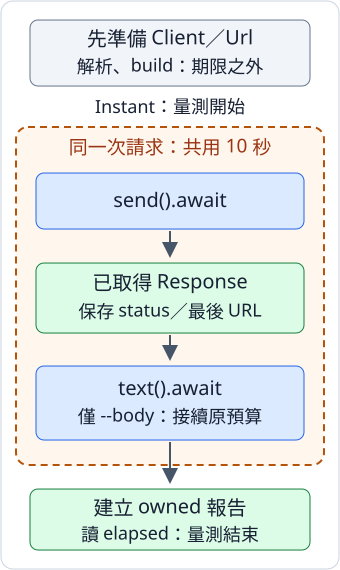

# 11.7 單一 async HTTP：等待回應，再決定是否讀 body

11.6 已能檢查一個 HTTP(S) URL。現在保留同一項工作：200–299 通過，404 仍是有回應的 HTTP 未通過，沒有取得回應才是請求錯誤。新增的是等待的表示：把網路步驟交給 future，再以 await 取得它的結果。

為什麼先只做一次？我們要先能指出「現在等的是 response，還是完整 body」，並固定每種結果與期限的意思，後面才把多份工作組合起來。對只送一次請求的 CLI，同步版已能完成；本例沒有其他工作需要交錯，也沒有證明改成 async 會更快。

本節使用獨立 `ch11-http-single` package。所有 Cargo 指令從教材 repo 根目錄執行；範例不把公共網站的當次回應當成固定測試答案。

## Runtime、client 與 future 各自負責什麼

11.1 的 Tokio runtime 負責推進可執行的 future。11.4 已讓它等 timer；這次還要等網路資料可用。reqwest 的 async client 使用 Tokio 的網路支援，等待尚未完成時，可保存工作進度並交回控制權；已就緒時仍可直接往下執行。

**Client** 保存 HTTP 設定與可重用的連線。**連線 pool** 是 client 保留已建立連線、在合適的後續請求再使用的安排；因此我們把 client 建立和單一檢查分開，讓 caller 能借同一份 client。這次只有一次請求，沒有量測重用帶來的效果。

Client 不是 runtime，也不是某次回應。builder 和 URL 解析仍是普通函式，立即準備資料；inspect 是我們稍後寫的 async 函式，先保存借用的 client、owned Url 與 body 選擇。它的 Output 是 `Result<Inspection, AppError>`，沿 11.1，await 後仍須處理 Result。

本節直接選用的 features：

- reqwest 的 `rustls` 支援 HTTPS／憑證檢查；使用 `reqwest::Client`，不要求 blocking。
- Tokio 的 rt／macros 沿 11.1；**net** 提供本次網路 I/O 所需的 runtime 支援，time 提供請求期限用的 timer。這不表示已教 TcpListener 或服務實作。
- 末尾 JSON 練習沿 7.7 使用 Serde derive 與 serde_json，先讀到 String 再解碼，不使用 reqwest 的 JSON shortcut。

版本要求與 lock 沿 7.1；本節查核 reqwest 0.13.5、Tokio 1.53.3、url 2.5.8。default-features=false 只控制這份直接設定，其他依賴仍可能依 9.1 的規則合併 features：

```toml
--8<-- "examples/ch11-async/http-single/Cargo.toml:dependencies"
```

## 先決定這一次請求的總期限

11.4 已分開「整段共用期限」與「每一步重新給時間」。這次 `reqwest::ClientBuilder::timeout(limit)` 是 **一次請求的總期限**：從開始連線，到完整 response body 讀取結束，共用 limit。這裡的一次是同一份 send 工作，包含它追蹤到最後回應的 redirects；不替每次轉向重給一份完整預算。

所以 limit=10 秒時，send 取得 headers 後，text **接續同一份預算**。假設前一步用了 4 秒，後面沒有另送新的 10 秒。這與 11.6 的 blocking 版 send／text 各自等待範圍不同；相同 method 名稱，不能省掉這份版本與介面差異。

沿 11.6 的 URL 檢查，先解析，再拒絕非 http／https。async Client::builder、redirect、no_proxy、build 的 builder 使用方式仍相同：設定最多追 5 次 redirect、總期限、是否明選直接連線，最後 build 同步交回 `Result<Client, reqwest::Error>`。build_client 把初始化錯誤包成 AppError::Client：

library 仍沿 1.9 的 module 分工：config 保存設定、error 保存前節同樣的錯誤分類，reply 留給最後的模型練習。以下 use 讓短名稱明確來自對應介面：Client 來自 reqwest root，沒有 blocking；Policy、Url、Write 與時間型別皆沿已教路徑。

```rust
--8<-- "examples/ch11-async/http-single/src/lib.rs:imports"
```

```rust
--8<-- "examples/ch11-async/http-single/src/lib.rs:input-client"
```

後面的 run 選 10 秒；helper 接 Duration，供之後已教用途需要其他期限時使用。每一次請求取得自己的預算，不是 client 建立後所有請求共享一個剩餘倒數。URL 解析、client 建立與報告輸出，都不在這份請求期限內。

請求期限也不是整個程式在某個真實時刻必定停止的保證。沿 11.4，timer 需要 runtime 取得執行機會；普通阻塞工作不會因函式叫 async 就被硬切斷。

## send 和 text 分別交回哪份工作

以下選用的是 **async** 介面；Response 和 RequestBuilder 也屬於這個介面。

| 操作 | 呼叫後的值／等待後的結果 |
| --- | --- |
| `client.get(url)` | shared 借 client、接手已解析的 Url，建立 GET RequestBuilder。 |
| `builder.send()` | 接手 RequestBuilder，準備請求，交回 `impl Future<Output = Result<Response, reqwest::Error>>`；立即 await 這份工作。 |
| `response.status()`／`response.url()` | 普通借讀，沿 11.6 取得可 Copy 的 StatusCode／最後的 `&Url`，不需要 await。 |
| `response.text()` | 接手 Response，建立讀完整 body 的 future；await 後是 `Result<String, reqwest::Error>`。 |

send 是普通 method，而不是宣告為 async 的函式。它在這個版本呼叫時準備請求與計時，所以我們在啟用網路與 timer 的 Tokio runtime 內呼叫，隨即 await；不先保存很久，再把等待當成新的完整 10 秒。這沿 11.1「普通 future 工廠也可能立刻做準備」的區別。

`.send().await` 得到 Ok(Response)，表示最後的 status 與 headers 已可使用，沒有要求先讀完整 body。HTTP 404 本身仍可以是 Ok(Response)，passed 用已教的 status.is_success() 判定。只有要求 body 時，才再等 `.text().await`；status、passed 和最後 URL 必須在 text 接手 Response 前保存。

和 11.6 一樣，本設定未要求 charset：text 以 UTF-8 轉文字，不合法序列使用替代字元 `�`。它不提供嚴格 binary bytes 保存，完整 body 也沒有大小上限；先選已知不大的文字資源。None 表示沒有要求讀 body，Some(empty String) 則是讀完了零長度 body。

圖只畫 **有要求 body 的路線**。藍框是等待步驟、綠框是已取得資料，向下箭頭表示先完成上一步。橘色虛線框是同一請求期限；它不是每一藍框各給一份時間。預設沒有 --body 時，在中間取得資料後就能建立報告：



## 保存報告，並讓錯誤留下它所屬的步驟

報告沿 11.6 的 owned Inspection，新增 **elapsed_ms**。沿 11.4，`std::time::Instant::now()` 記量測起點，`elapsed().as_millis()` 取得 u128 整數毫秒。本例從準備 GET 前記下，到要求的網路步驟完成、建立報告前讀值；包含請求等待、可選的 body 等待與中間資料處理，排除 parse、build 和輸出。

這是當次觀察，不能斷言固定毫秒或據此宣稱效能更快。量測起點由本函式決定；請求期限由 client 決定，兩者有各自的範圍：

```rust
--8<-- "examples/ch11-async/http-single/src/lib.rs:models"
```

AppError 沿前節的具體分類，URL／scheme 為輸入錯誤、Client 為準備失敗、Request 為沒有取得最後 Response、Body 為已有 status 但要求的內容未完成、Output 為寫出失敗。三步收到相同 reqwest::Error 型別，不用一份 From 把發生位置壓平；在當步明包 variant。is_timeout、Debug／Display 與行程 status 的契約亦沿 11.6：

```rust
--8<-- "examples/ch11-async/http-single/src/error.rs"
```

inspect shared 借 client，owned Url 在呼叫時交進 future。借用須在這份工作使用期間有效；await 後擁有報告，報告中的 String 不再借 Response：

```rust
--8<-- "examples/ch11-async/http-single/src/lib.rs:inspect"
```

每個 await 都只取得所在 future 的 Output。Request Err 時不往下取 status；Body Err 時則保留已有 HTTP status。取得 404 並讀完所需內容，仍回 Ok 的報告、passed=false，而不是把「HTTP 未通過」改名為連線失敗。

## 在 async 入口接回一份請求

Settings 的 URL positional、--body／--direct 和 clap 解析沿 11.6，只有工具說明改成 async 版本：

```rust
--8<-- "examples/ch11-async/http-single/src/config.rs"
```

run 先 parse、build，再 await inspect。render 仍是普通泛型 Write 函式：寫已經得到的資料，並依 7.4 的 flush 確認輸出完成；它不是網路 future。只有 render 包括 flush 都成功，run 才交回 passed：

```rust
--8<-- "examples/ch11-async/http-single/src/lib.rs:render-run"
```

這份小 CLI 在等待 HTTP 完成後才同步寫 stdout，沒有把普通 Write 說成 async I/O。如果之後有多份並行工作，同步且可能耗時的輸出要再考慮安排；本例沒有加入這種工作情況。

main 沿 11.1 明選 current-thread Tokio 入口；已選網路與 timer 能力由這個入口啟用。這次 main future 的 Output 是 ExitCode，attribute 讓執行到完成的結果成為普通入口的回傳值，再沿 11.6 交出行程狀態。clap／ExitCode 分支保持同樣意思，工作呼叫多一個 await。report_error 的 stderr 同樣檢查寫入與 flush，失敗回 FAILURE：

```rust
--8<-- "examples/ch11-async/http-single/src/main.rs"
```

這裡只有一份已呼叫的 inspect 工作依序完成，沒有 spawn 或同時檢查多個 URL。current-thread 說的是這個 runtime 的 async 執行方式，不承諾所有第三方準備工作都不使用其他 thread。

## 手動執行，分清觀察與固定答案

help 不需要網路。公開 URL 是手動練習；先確認環境允許連線，再執行：

```bash
cargo run -p ch11-http-single --locked -- --help
cargo run -p ch11-http-single --locked -- https://www.rust-lang.org/
cargo run -p ch11-http-single --locked -- https://www.rust-lang.org/ --body
```

如果當次最後回 200，預設報告的**形狀**如下，URL 與時間均是示意，不能當成公共網站的固定預期：

```text
final URL: https://rust-lang.org/
HTTP status: 200
passed: true
elapsed: 42 ms
```

--body 仍用 GET，再加 body 區段；沒有要求 body 時就不等它完整讀完。HTTP 未通過仍在 stdout 有報告、回 1；Client／Request／Body／Output 錯誤寫 stderr、回 1；URL 或參數不合法回 2；HTTP 通過與 help／version 回 0。

若環境必須使用代理，保留一般連線設定。--direct 的意義仍是明選不用 proxy，只在環境允許且你需要直接連線時使用；不把它當成修好所有連線問題的方法。

這兩項輸入沒有網路依賴，應拒絕並回 2：

```bash
cargo run -p ch11-http-single --locked -- /notes
cargo run -p ch11-http-single --locked -- file:///tmp/notes.txt
```

## 先驗收不需要伺服器的邊界

第一項用 11.1 已教的 Tokio async test，真正 await run。固定輸入在 parse／scheme 處拒絕，不建立 client、不送請求，stdout 不應有半份報告：

```rust
--8<-- "examples/ch11-async/http-single/src/lib.rs:input-test"
```

第二項給定人工報告，檢查完整格式、404 和量測欄位、None 與 Some(empty String)。12ms 是測試材料，沒有把真網路時間固定成 12；byte string 與 borrowed output slice 比較沿 11.6：

```rust
--8<-- "examples/ch11-async/http-single/src/lib.rs:render-test"
```

第三項沿 7.4／7.9 的人工 Write，讓 write 收下所有 bytes、flush 故意回 PermissionDenied。它檢查輸出完成邊界，不代表磁碟權限或網路錯誤：

```rust
--8<-- "examples/ch11-async/http-single/src/lib.rs:writer-test"
```

`tests/cli.rs` 另沿 7.8／11.6 真正啟動 binary，檢查 help／version、無參數、未知 flag、解析與 scheme 拒絕。helper 仍以 `&[&str]` 接參數、Command::arg 接迴圈的 `&&str`；沒有學生程式未教的 server 或 socket helper：

```rust
--8<-- "examples/ch11-async/http-single/tests/cli.rs"
```

```bash
cargo test -p ch11-http-single --locked
```

本節合計 4 library＋2 CLI 測試；第 4 library 是下面的 JSON 練習。這些固定檢查沒有證明真 HTTP、redirect 或網路 timeout；11.8 會先教受控本機服務，再讓學生以固定回應驗收那些行為。不能因這幾項通過，就改稱已測完全部網路契約。

## 練習：HTTP 通過後，body 仍要符合 JSON 模型

現在要取得頁面資料，而不只知道 HTTP 是否通過。需要的模型仍用 7.7 已教的 String／i32 與 owned Deserialize：

```json
{"title":"筆記","revision":3}
```

PageRecord 擁有 title／revision，deny_unknown_fields 拒絕未知名稱。ReplyError 保存三種不同的拒絕：HTTP 未通過、沒有要求讀完整 body、文字不符合 JSON 模型；Display 是已教的具體原因表示：

```rust
--8<-- "examples/ch11-async/http-single/src/reply.rs:reply-model"
```

寫 `decode_page(inspection: &Inspection) -> Result<PageRecord, ReplyError>`，按這個順序：

1. passed=false，先回 Http(status)。這是本練習的解碼政策，不讓應用資料代替 HTTP 判準。
2. passed=true 但 body=None，回 BodyNotRequested；不要把未讀當空 JSON。
3. 有 body 時，以 as_str 借文字，再用 `serde_json::from_str::<PageRecord>`；Json 保存失敗，成功交 owned 模型。

這份函式處理的是已 await 得到的報告，不再送請求。要接真網路，caller 應要求 read_body=true，先 await inspect，再處理 AppError 與這份解碼結果；兩個 Result 分別回答 HTTP 工作與應用模型。

??? tip "提示：兩層成功不一樣"

    HTTP 200 只說 HTTP 通過。若 revision 寫成 `"3"`，那是文字，不符合 i32；可以有完整 body，但解碼仍失敗。先 match 借入的 Option，不 move 報告中的 String。

??? example "完整參考答案"

    ```rust
    --8<-- "examples/ch11-async/http-single/src/reply.rs:reply-solution"
    ```

    ```rust
    --8<-- "examples/ch11-async/http-single/examples/page_reply_solution.rs"
    ```

    ```bash
    cargo run -p ch11-http-single --example page_reply_solution --locked
    ```

    印 `筆記：revision=3`。這份 example 是人工材料的解碼，沒有送 HTTP 請求。

驗收用一份內層 Inspection：解碼後原報告結束，PageRecord 仍保存全部欄位。再分別給沒有 body、200 但錯型別、404 的材料；最後一項先判 HTTP，不因 body 本身也有錯就改判 Json：

```rust
--8<-- "examples/ch11-async/http-single/src/reply.rs:reply-test"
```

現在 HTTP 工作已能在所選 runtime 等待，並交出保持原意的 Result；同一請求的期限、量測與 body 完成界線也能分開指出。下一節先建立可控制的服務與收尾契約，才為網路行為寫可靠的整合測試。

延伸閱讀：[English Book 的兩個 HTTP 等待步驟](https://doc.rust-lang.org/book/ch17-01-futures-and-syntax.html)、[簡中對應](https://kaisery.github.io/trpl-zh-cn/ch17-01-futures-and-syntax.html)、[Tokio Hello Tokio](https://tokio.rs/tokio/tutorial/hello-tokio)、[固定版 reqwest send](https://docs.rs/reqwest/0.13.5/reqwest/struct.RequestBuilder.html#method.send)、[async 總期限](https://docs.rs/reqwest/0.13.5/reqwest/struct.ClientBuilder.html#method.timeout)。
