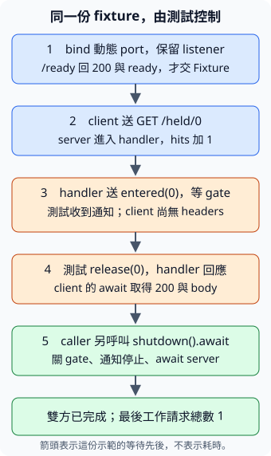

# 11.8 受控本機服務：讓 HTTP 測試自己安排條件

11.7的 client 能把 URL 變成 owned 報告，但公共網站的狀態、內容與延遲都可能改變。我們現在要驗收固定問題：**200、404與redirect會得到什麼報告？請求已到達、回應還沒交出時，timeout與取消會留下什麼？退出測試前，服務有沒有收尾？**

沿7.8的 fixture，我們自己建立內容和用途已知的材料；這次材料是正在運作的本機 HTTP service。沿11.5，不只要求停止，也保留 owner、等待工作完成。本節逐步加上固定回應、共享計數與可控制的 gate，不寫通用 Web 應用框架。

本節使用 `ch11-local-service` package，以7.1的 path dependency 重用11.7的 `ch11-http-single`。所有 Cargo 指令從教材 repo 根目錄執行。讀者先知道 HTTP client／response、async task／channel／取消與收尾，以及10.6的 Arc／Mutex和10.8的 atomic。

## 一個 GET，要怎麼得到我們指定的回應？

**server（服務端）** 接收請求、交出回應；11.7的 client 是發出請求、讀回應的一方。兩者在本節同一台機器上運作，但仍透過真正 HTTP 連線互動。**axum** 是建立 HTTP 路由與處理請求的 library，使用 Tokio 推進工作。

**route（路由）** 指定「這個 method和路徑，要交給哪份處理工作」。**handler（處理函式）** 是 axum呼叫的 async函式；它收到所需資料，最後回傳可轉成 HTTP回應的值。它產生的future需要Send，沿11.2判斷等待時保存哪些資料；後面取出gate時也要遵守這個要求。我們先只做 `GET /ok`，讓它固定回200與文字 `Rust 本機服務`。

axum提供 **`IntoResponse`** trait。`value.into_response()` 接手 value，建立 **`axum::response::Response`**；這個名稱是 HTTP Response的 type alias，預設保存 axum使用的 body型別。本節只透過既有轉換建回應，不直接操作 body內部。**它是 server準備送出的回應**，和11.7的 `reqwest::Response`「client已取得回應」是兩個不同角色。

這裡的 `axum::http::StatusCode` 使用相同 HTTP狀態碼型別；先選 associated constants `OK`（200）、`NOT_FOUND`（404）、`INTERNAL_SERVER_ERROR`（500）與 `SERVICE_UNAVAILABLE`（503）。`(StatusCode, &'static str)` 已實作 IntoResponse：第一欄指定 status，第二欄轉成 UTF-8文字 body；回應的 content-type是 `text/plain; charset=utf-8`。8.4的 static字串來源足以支援這份文字。

以下是稍後完整 example中的 handler片段：

```rust
--8<-- "examples/ch11-async/local-service/examples/basic.rs:handler"
```

**`Router::new()`** 建立沒有路由的設定；**`axum::routing::get(welcome)`** 把函式保存為 GET處理工作；**`router.route("/ok", get(welcome))`** 接手設定，加入這條路由，再交回 Router。此時沒有收到請求，也沒有執行 handler。本節的請求都是 GET。

```rust
--8<-- "examples/ch11-async/local-service/examples/basic.rs:route"
```

這兩段是 interface片段，完整的 imports／runtime／client／server收尾會在下一段一起給出。路由只是設定，還需要接收連線的資源。

## 服務在哪個 port 接請求，最後由誰停止它？

**`tokio::net::TcpListener`** 是接收 TCP連線的資源 owner。TCP是 **Transmission Control Protocol（傳輸控制協定）**；本節HTTP/1的請求與回應在這份連線上傳送，axum負責處理HTTP格式，我們不用手寫 parser。**IP** 是 **Internet Protocol（網際網路協定）**；本節用IP位址指出連線的目的位置，**port（連接埠）** 再區分該位置上的服務。URL中的IP位址與port合起來，才能指向我們持有的listener。

先用 **`TcpListener::bind("127.0.0.1:0").await`**：127.0.0.1是只指向這台機器的 **loopback（本機迴送）** 位址，0表示請作業系統分配目前可用的port。Output為 `io::Result<TcpListener>`；成功時listener已綁定、可接受連線，失敗是io::Error。每份測試各自bind，不共用硬寫的port。

**`listener.local_addr()`** shared借listener，回 `io::Result<SocketAddr>`。**`std::net::SocketAddr`** 保存IP與port，有Copy／Debug／Display／PartialEq；我們以 `format!("http://{address}/ok")` 建URL文字。要把**同一份仍活著的listener**交給server；先查port、drop它再重綁，會讓另一份程式有機會拿走port。

**`axum::serve(listener, router)`** 接手listener和已備妥的Router，交回服務設定 `Serve`。這個值可以await，但尚不是11.2的spawn要求的Future。現在才需要 **`std::future::IntoFuture`**：它描述把值轉成Future的能力；`into_future(self)` 接手值，交回 associated type `IntoFuture`所指定的Future，完成結果由 associated type `Output`指定。沿6.2的associated type與11.1Future的Output，這是兩份工作：選哪種future，以及它最後交什麼結果。

`.await`會先使用IntoFuture轉換再等待；普通Future本身也有這份轉換。本節把server交給 `tokio::spawn`時，明用 `service.into_future()`，取得真正Future；不能直接寫 `tokio::spawn(service)`。Future內部的推進介面仍留第13章。

還要先替service設定停止條件：**`service.with_graceful_shutdown(stop_future)`** 接手設定與一份 `Future<Output = ()> + Send + 'static`，回傳仍可轉成Future的服務設定。**graceful shutdown（等待目前工作收尾的關閉）** 在stop_future完成後停止接新連線，讓正在處理的連線收尾；server future才完成。若一份handler一直等而不結束，它也可能一直等；通知沒有替我們解除測試的gate。

我們用已教的容量1 mpsc：async move取得停止收端，recv得到訊息或None就結束block，Output是unit。本節選定的 `service.into_future()` 有 **`Send + 'static`**：它持有listener、Router與停止future，不借caller的區域變數，符合11.2的spawn要求。它的Output為 **`io::Result<()>`**，本版正常關閉回Ok(())；`io::Error`有Send，這份owned結果也能移交caller。spawn後得到 `JoinHandle<io::Result<()>>`，await有task結果與工作結果兩層，沿11.2。通知、等server、檢查兩層，是三個不同動作。

先教本節選定的直接features。axum的 **http1** 提供HTTP/1服務，**tokio**提供與Tokio服務端的整合；Tokio的net／time沿11.7，sync沿11.2，rt／macros沿11.1。test-util沿11.4，只在測試中使用測試時鐘；這個依賴沒有要求multi-thread入口：

```toml
--8<-- "examples/ch11-async/local-service/Cargo.toml:dependencies"
```

完整的最小可跑程式如下。沿11.7 **`build_client(true, limit)`** 明選 `no_proxy()`：清除並停用client的自動代理，讓本機測試直接連自己持有的loopback服務。一般使用者的client仍可採原本的環境代理政策；這裡有明確且可控制的測試對象。

```rust
--8<-- "examples/ch11-async/local-service/examples/basic.rs"
```

```bash
cargo run -p ch11-local-service --example basic --locked
```

```text
真 HTTP 回應：200，Rust 本機服務
已通知停止，並等待 server 完成
```

bind只證明listener已備妥；這份200與文字才證明handler實際處理請求。程式保存client結果，通知停止並等待server後，才檢查回應與task結果。若HTTP失敗，也會先走完server收尾再報錯。spawn前的expect表示這份有限示範需要的本機環境與固定材料；下面可重用的fixture會把啟動失敗回傳caller。

## 多份 handler，如何更新同一份計數？

現在要知道「服務已進入幾份工作handler」，不把收到response數量當成同一件事。用10.8的AtomicUsize，每份handler先fetch_add(1,SeqCst)，再做本次工作；load只取得當下快照，計數本身沒有等待完成的能力。

**`State<S>`** 是 axum提供的 **extractor（資料取得介面）**：axum在呼叫handler前，準備它需要的資料。本節的State取得Router設定的共享狀態。`State<Arc<FixtureState>>` 是tuple struct，公開欄位`.0`是本次取得的Arc，沿10.5使用公開tuple欄位的讀法，不新增參數解構寫法。

**`router.with_state(state)`** 接手state，供各請求取得。State會為每次請求clone所需的狀態；Arc clone保留同一份FixtureState，沒有複製成獨立計數。狀態需要Clone／Send／Sync／static，本例Arc提供可clone的ownership；內部atomic與Mutex依10.6、10.8提供共享操作。Arc不會把任意內部型別自動變成Sync。

FixtureState另外保存接下來要教的gate與啟動通知；它們沿11.2的Tokio mpsc。這裡unit／usize收端有Send，送端有Clone／Send／Sync；Mutex保存收端的map，待下一段在短持鎖範圍取出owned收端。`/ready`是健康檢查，不算工作handler的hits。

```rust
--8<-- "examples/ch11-async/local-service/src/lib.rs:shared-state"
```

其餘固定回應仍沿相同模型。**`Redirect::temporary("/ok")`** 準備307回應與Location `/ok`，保留redirect前的method；本節原method為GET，client按11.7的政策送下一份GET。Redirect亦實作IntoResponse，轉成同一個server Response型別。`/loop`每次都redirect回自己，供之後驗收上限：

```rust
--8<-- "examples/ch11-async/local-service/src/lib.rs:responses"
```

比如 `/redirect`→`/ok`是一份client檢查，但服務實際進入兩份工作handler，hits增加2。計數的對象是每次進入這些handler，並不是URL輸入行數、成功數或尚在等待的數量；Path解析被拒絕、尚未進入handler的請求也不算。

## 請求已到達，怎麼讓 headers 暫時還拿不到？

固定sleep不能告訴測試「網路請求是否已到達」。我們用兩份方向不同的channel：handler先送**已進入**的input通知，接著等caller送**放行**。測試收到通知後，能確定工作已進入handler；只要仍保留且尚未使用放行送端，這份handler便不能交回Response。

為了控制兩份請求，加入路由 `/held/{input}`。**`{input}`** 是單段路徑的capture：`/held/0`捕捉文字0。**`axum::extract::Path<usize>`** 把它按7.7的Deserialize能力解析成owned usize；其公開`.0`是解析結果。文字不是合法usize時，axum先回400，handler不執行。axum 0.8的capture使用花括號，與舊教材的`:input`寫法不同。

每份input在gates map有一個Receiver。handler在短block中lock、`remove(&input)`取得 `Option<Receiver<()>>`，block結束解鎖；再以owned receiver等待。這沿11.5「guard先結束再await」，沒有MutexGuard跨await。沒有對應或已用過gate，回404；收到放行回200，送端全關閉則回503。三種情況都是我們明訂的HTTP回應。

```rust
--8<-- "examples/ch11-async/local-service/src/lib.rs:held-handler"
```

entered通知送出後，handler仍未回傳Response，因此這次client的send尚未得到headers。它不是「已收到headers後暫緩body」；沒有把兩種期限位置混在一起。本節的body都是已知的小文字，延後headers足以建立現在需要的等待條件。

加入State後的完整router如下。**`Router<S>`** 表示還缺S狀態才能服務的router；with_state補上資料後，本例回傳不缺狀態的 `Router<()>`，簡寫Router，才能交給serve。這份泛型參數不是「裡面存著哪種state」的標籤：

```rust
--8<-- "examples/ch11-async/local-service/src/lib.rs:router"
```

## Fixture 要持有什麼，才能明確結束服務？

7.8的TempDir保存目錄owner，PathBuf只保存位置。本節也分開：URL文字只保存位置；**Fixture**保存狀態、控制端與server把手，才能安排完整收尾。下面欄位仍用前面已教的具體型別：

```rust
--8<-- "examples/ch11-async/local-service/src/lib.rs:fixture-owner"
```

先固定helper介面，再看實作。表中start以 `Fixture::start(n).await` 呼叫；其餘是fixture的方法，標為async者需要await。操作欄保留完整方法名：

| 操作 | 需要與結果 |
| --- | --- |
| <code style="white-space: nowrap">start</code>（async） | 建n份gate，input為0到n−1，n=0時沒有gate；成功交owned Fixture，已收到真ready回應。失敗回String診斷，啟動過的server會先收尾。 |
| <code style="white-space: nowrap">url</code> | shared借fixture，將以`/`開頭的本節固定path接到本機位址，交owned String；不送請求。 |
| <code style="white-space: nowrap">hits</code> | shared借fixture，讀工作handler進入數的快照；不等待。 |
| <code style="white-space: nowrap">next_started</code>（async） | mutable借fixture，等待下一份held handler的input通知，回`Option<usize>`；訊息不代表client已完成。 |
| <code style="white-space: nowrap">next_started_within</code>（async） | mutable借fixture，等下一份通知至指定Duration期限；取得通知、channel關閉與逾時分別保留。 |
| <code style="white-space: nowrap">release</code>（async） | mutable借fixture，至多使用一次指定input的送端；成功送入回true，沒有可用送端或收端已結束回false。 |
| <code style="white-space: nowrap">shutdown</code>（async） | 接手fixture，關閉仍持有的gate、通知server停止，再await server；成功交最後工作handler總數，失敗回String診斷。 |

`next_started`是原始通知等待。Fixture仍持有state中的通知送端，沒有訊息時不會自動回None。即使client已經得到Request錯誤，這份Sender也還在；若caller只等通知，就可能一直等不到、無法走到收尾。

所以caller改用 **`next_started_within(limit)`**：沿11.4，以timeout包原next_started，回 `Result<Option<usize>, tokio::time::error::Elapsed>`。`Ok(Some(input))`表示收到通知，`Ok(None)`表示channel已關閉，`Err(Elapsed)`表示本次觀察期限已到。取消這份借用等待不會丟棄Fixture，也不會取消client task；依11.5的取消安全契約，recv等待取消不會取走尚未收到的訊息。

下面選 **5秒的entered觀察期限**，先確認控制條件；11.7的 **10秒HTTP請求期限** 則限制client的網路工作。caller await next_started_within時才建立觀察期限；HTTP則在inspect內的send建立請求預算，不因對方發生錯誤就自動結束。5秒是這份有限本機示範選的等待上限，沒有保證任何機器都在此時間內成功；逾時會收尾並回報診斷。

release要從 `Vec<Option<Sender<()>>>` 接手一份送端。先教 **`option.take()`**：mutable借Option，將它改成None，交回原Option中的owned值；原本None就仍回None。因此不用clone送端，也不會重複向同一份gate塞訊息。先檢查input是否在範圍，避免索引越界：

```rust
--8<-- "examples/ch11-async/local-service/src/lib.rs:controls"
```

shutdown先drop這份Vec。每個仍未使用的送端關閉；若handler正在recv，沿11.2會收到None，按前段約定回503。接著通知stop、await server，依11.2的兩層結果保留「server工作」與「server task」的不同失敗。正常路線最後才讀計數，這時已沒有尚在工作的server handler：

```rust
--8<-- "examples/ch11-async/local-service/src/lib.rs:shutdown"
```

這份Fixture沒有用Drop假裝等待async收尾。caller必須明確呼叫shutdown並await；它消耗Fixture後，就不能再向同一份owner要求新URL或放行。

若觀察沒成立，仍要把client的owned把手收回。小函式 **`finish_client<T>(client: JoinHandle<T>) -> Result<T, JoinError>`** 只封裝11.2的abort＋await。沿泛型的讀法，T保留該client原本的Output；此處是 `Result<Inspection, AppError>`，因此外層仍是task結果，內層仍是HTTP工作結果。它不額外要求新的trait。

abort是提出取消，await才確認收尾；若task早已完成，還會交回原Output。保留T可讓我們看到已發生的Request錯誤，而不是把它統一改寫成「entered逾時」。caller先收回**所有仍持有的client把手**，再shutdown Fixture，最後才panic、expect或assert：這樣驗收失敗也不會跳過需要的收尾。

```rust
--8<-- "examples/ch11-async/local-service/src/lib.rs:finish-client"
```

## start 如何證明 HTTP 已就緒，而不是猜等了夠久？

start先準備直接連線client，bind動態port，建立各份gate與共享狀態，再spawn已轉換的service future。n=0仍可測固定路由；mpsc容量不能為0，所以沒有held工作時，通知channel選容量1。

開始驗HTTP時，service已擁有listener，沒有重綁的空窗。start對 `/ready`真正送GET、讀body，只有固定200與`ready`才交回Fixture。client等待時，server task能在相同current-thread runtime前進。這是**一次觀察到服務能處理HTTP的確認**，不承諾它之後永遠不會失敗。

任何ready錯誤先保存診斷，再呼叫前段shutdown；不能在spawn後用一個提早返回，丟掉仍需等待的把手。bind／local_addr失敗時尚未spawn，local listener也依owner正常清理。完整start如下：

```rust
--8<-- "examples/ch11-async/local-service/src/lib.rs:start"
```

library imports的短名稱均來自本節或已教的介面；Path與State屬於axum，URL解析和client工作重用11.7，server的io::Result與JoinHandle仍分開：

```rust
--8<-- "examples/ch11-async/local-service/src/lib.rs:imports"
```

## 如何觀察先進入、後放行，再等待雙方收尾？

先補本次client task所需的型別契約：**reqwest 0.13.5的Client有Send與Sync**。Send讓owned client可交給spawn；`async move`只交出ownership，不能把原本不是Send的值變成Send。inspect會持有 `&Client` 跨await，依10.1，Client的Sync讓這份shared reference也有Send。Url亦有Send；本節owned報告及AppError的欄位可移交，符合11.2對task與Output的要求。

main把owned client與URL文字交給task，在task中沿11.7解析URL，再用5.6已教的 `?` 保留AppError。若5秒內沒有確認input0進入，先finish_client、再shutdown，把通知結果、client原結果與server收尾結果一起報出。正常路線先放行並等待client，再shutdown；所有assert與expect都在相關資源收尾之後。下面的stdout是**收尾後列出的步驟紀錄**，第一行記當時收到通知、尚未放行的狀態：

```rust
--8<-- "examples/ch11-async/local-service/src/main.rs"
```

```bash
cargo run -p ch11-local-service --locked
```

```text
服務已收到 input 0；尚未交回 headers
放行後：HTTP 200，body=Some("held 已放行")
已等待 server；共處理 1 份工作請求
```

下圖是**正常請求確實進入的流程**；ready成功只證明先前的一次HTTP觀察，不能替未來的entered等待保證成功。若沒收到entered，程式走前面已教的有限等待與收尾分支。圖中藍框記啟動與請求進入，橘框記gate通知、放行與接著取得回應，綠框記最後服務收尾。向下箭頭表示這份示範有明確等待的先後；它不按框高表示時間長短：



由entered通知到release之前，held handler不能交回Response；release送入後，還要等真正HTTP與client body工作。最後一行又多確認server完成。三種通知／結果各有範圍，沒有把單一send成功當成整份流程已完成。

## 固定回應，怎麼驗收 HTTP 的不同結果？

integration test沿7.2放在tests/http.rs；每項current-thread async test有自己的一份Fixture與runtime。先收集200、404、500的status／passed／body，再收集redirect到最後 `/ok`的結果；沒有要求body時仍是None。Vec保存每份材料、位址與Result，shutdown後才逐項檢查，HTTP失敗也不會先panic而跳過server收尾。ready不算工作handler，因此這份測試總共5次。

```rust
--8<-- "examples/ch11-async/local-service/tests/http.rs:fixed-responses-test"
```

這些404與500都有正常取得Response，所以是Ok(Inspection)、passed=false。下一份 `/loop`每次redirect回自己；11.7設定最多追5次，包含初始請求共進入6次handler，下一次轉向遭拒，沒有得到最後Response。

本項新增 **`reqwest::Error::is_redirect()`**：shared借錯誤，回bool表示錯誤來自redirect政策；沿11.6的is_timeout，兩者是對原因的查詢。本例匹配已教的 `AppError::Request`後核對is_redirect，不能把這份錯誤當成HTTP 307未通過的報告：

```rust
--8<-- "examples/ch11-async/local-service/tests/http.rs:redirect-limit-test"
```

最後另建兩份同時活著的Fixture，先保存URL是否不同，再各自shutdown，收齊兩份結果後才assert；第二份啟動失敗時也先收尾第一份。它證明本次兩份listener保留各自作業系統分配的port，不以查到port後釋放再重綁來做測試：

```rust
--8<-- "examples/ch11-async/local-service/tests/http.rs:dynamic-port-test"
```

## 不用固定 sleep，怎麼驗先完成與逾時？

第一份測試同時送 `/held/0`與`/held/1`。先教 **`reqwest::Client::clone()`** 的本次契約：前段已教Client的Send／Sync；此處再用Clone，clone保留共用的內部設定與連線pool，適合給owned task；不新建另一份獨立pool。我們給第一份task一個clone，再將原client交給第二份。

兩個entered通知順序不固定，各自以5秒期限取得，保存input與is_finished快照。任一觀察失敗，都先finish_client兩份把手，再shutdown，並保留兩份client結果。正常路線的gate皆未放行，兩個JoinHandle的is_finished皆false，沿11.2。先放行1並await它，保存0仍未完成的快照；再放行0。兩份client與Fixture收尾後，才驗通知確實是0、1及這些快照。原本的完成先後由我們安排，不靠挑毫秒猜哪份比較快：

```rust
--8<-- "examples/ch11-async/local-service/tests/http.rs:gates-test"
```

第二份要驗11.7的10秒請求期限，但不需真實等10秒。沿11.4的paused clock，本節新增 **`tokio::time::pause()`** 和 **`resume()`**：兩者同步呼叫、回傳unit；pause保存當前Tokio時間，之後在沒有可進行工作時自動推到下一timer；resume恢復跟隨真實時間。它們需要time／test-util，pause要求current-thread且尚未暫停，resume要求正處於暫停；不符合會panic。它們不修改std::time::Instant，也不暫停真網路。

本測試沿11.7：client task進入inspect，在runtime內呼叫send時建立這次10秒請求預算，隨即await。收到entered沒有重設倒數；pause保留當時的Tokio時間，已建立的deadline仍是原本那一份。

**先以真實時間、最多5秒等handler送出entered，再pause。** 觀察失敗時先收回client並shutdown，不進入paused clock測試。正常路線此時請求真的已到達，gate仍關著，沒有response可完成，只剩這份client的期限可以讓它離開等待。await request後resume，再做HTTP服務收尾；不從一開始就start_paused，讓自動推timer在網路還沒到達前超時。

```rust
--8<-- "examples/ch11-async/local-service/tests/http.rs:timeout-test"
```

結果是 `Ok(Err(AppError::Request(error)))`且is_timeout=true：task正常完成，但client沒有取得Response。本測試驗「已到達而headers受阻時的請求期限」，**沒有**以量測的elapsed_ms斷言真實10秒，也沒有驗「先收到headers、再讀body逾時」的另一條路。11.7的兩步共用預算仍是已教的介面契約。

## client 已失敗卻沒有 entered，等待能結束嗎？

再用同一份Fixture驗失敗出口：準備一份held gate，卻把client送向 `/loop`。redirect上限會得到Request錯誤，這條route不送held entered；Fixture仍保存entered的Sender，所以原始next_started不會因沒有消息而回None。這份材料讓我們驗**觀察有期限、client原錯誤仍保留、server有收尾**。

為了不把Tokio測試時鐘的自動推進套到還在進行的真HTTP，先由client以容量1 mpsc通知「HTTP Result已算出」。沿11.5的current-thread控制例，task保存result，send後沒有下一個await便回傳；收端取得通知後，才pause並測5秒的entered期限。這是本份task安排提供的條件，並非任意send成功都代表task已完成。結果通知也以15秒timeout等候；缺少通知時，同樣先收回client與server再報錯。

取得entered的Elapsed後resume，再finish_client與shutdown。client已完成，所以abort不覆蓋原Output；最後核對 `Ok(Err(AppError::Request(error)))`、is_redirect=true與server總數6。這裡的5秒是虛擬Tokio時間，沒有要求測試真等5秒。

```rust
--8<-- "examples/ch11-async/local-service/tests/absent_entered.rs"
```

這份測試用既有redirect失敗建立「沒有held通知」的條件；它驗這條有限失敗路線，不宣稱涵蓋所有server故障。和正常gate測試一起看，現在兩條路都能離開等待，且在斷言前完成資源收尾。

## 取消 client，為什麼還要管 server？

11.5的abort＋await能收尾我們spawn的client task。它不會撤銷server已經進入handler、hits已加1的事實；也沒有取得server把手的ownership。client斷線後，server可能結束該handler，我們不能用這種可能性替整份fixture收尾。

下面以有期限的觀察確認held0已進入，再finish_client取消並await client；觀察失敗也收回client結果，fixture仍要shutdown＋await。它先解除自有gate、再等待服務完成，不把client取消等同整個服務結束：

```rust
--8<-- "examples/ch11-async/local-service/tests/http.rs:cancel-test"
```

`tests/cli.rs`也沿7.8啟動真正的有限示範binary，核對完整stdout、空stderr與退出0。這裡的output會等child結束，本節binary自行建立與停止server，不把一份永不結束的服務交給Command::output：

??? example "完整 CLI test"

    ```rust
    --8<-- "examples/ch11-async/local-service/tests/cli.rs"
    ```

```bash
cargo test -p ch11-local-service --locked
```

共有7項正常HTTP integration tests、1項entered缺席的失敗路線測試與1項真CLI test。最後一項HTTP檢查是下方練習的「未放行就shutdown」。這些測試有真正loopback HTTP、可觀察的通知與明確收尾；不依公共服務、固定port或固定sleep。

## 練習：不放行就 shutdown，client會拿到什麼？

建立一份gate，送 `/held/0`且要求body；先以5秒期限等待entered，**不要release**。沒有確認進入時，先finish_client與shutdown，再保留三份結果回報。

1. 預測shutdown的drop(releases)會讓handler的recv得到什麼，因而回哪個status與body。
2. spawn `fixture.shutdown()`，讓server收尾與client等待回應能一起前進；保留這份新的把手。
3. 分別await client和shutdown把手，先保存兩份結果、全部收尾後才expect或assert；預期HTTP 503、passed=false、body為`gate 已關閉`，最後總數1。不是client的Request錯誤，也不是取消client task。

shutdown取得Fixture的ownership後，caller不能再release。它等待的是server連線工作；client是否已讀完body，仍由client自己的await確認，兩份把手不能互代。

??? example "完整參考答案"

    ```rust
    --8<-- "examples/ch11-async/local-service/examples/closed_gate_solution.rs"
    ```

    ```bash
    cargo run -p ch11-local-service --example closed_gate_solution --locked
    ```

    ```text
    未放行便 shutdown：HTTP 503，body=gate 已關閉
    已等待 client 與 server；共處理 1 份工作請求
    ```

    對應的完整integration test：

    ```rust
    --8<-- "examples/ch11-async/local-service/tests/http.rs:shutdown-test"
    ```

現在能把真實HTTP材料保留在測試的控制範圍，分清位置與資源owner、進入與完成、取消client與等待server。第11章的等待、上限、期限、停止與HTTP邊界都有各自的可觀察條件；後面的實戰將使用這些已教能力建立完整工具。

延伸閱讀：[Tokio Unit Testing](https://tokio.rs/tokio/topics/testing)、[固定版本axum testing範例](https://github.com/tokio-rs/axum/blob/axum-v0.8.9/examples/testing/src/main.rs)、[axum graceful shutdown](https://github.com/tokio-rs/axum/blob/axum-v0.8.9/examples/graceful-shutdown/src/main.rs)、[RustCourse優雅關閉](https://github.com/sunface/rust-course/blob/main/src/advance-practice/graceful-shutdown.md)、[axum 0.8.9 State](https://docs.rs/axum/0.8.9/axum/extract/struct.State.html)、[IntoFuture](https://doc.rust-lang.org/std/future/trait.IntoFuture.html)。中文《漫遊AXUM》的回應／狀態／路由教法可供比較，但舊版本API以本節固定正式文件為準。
