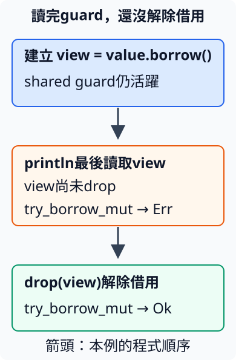

# 11.9 用 Cell 與 RefCell 管理內部修改

記錄器的 trait 若規定 `record(&self, amount: i32)`，呼叫端只有 shared receiver，實作卻想把金額加入清單。普通 Vec 欄位的 push 需要獨占借用，不能直接從 `&self` 取得：

```rust
--8<-- "examples/intro-workspace/type-stages/fixtures/compile-fail/shared_record_vec.rs"
```

這份完整負例會得到 E0596：

```text
--8<-- "examples/intro-workspace/type-stages/fixtures/compile-fail/shared_record_vec.expected"
```

若介面由自己決定，可以改用 `&mut self`；但要實作既定的 shared 介面，就需要在型別內安排受控的修改方式。**interior mutability** 指能經 shared reference 修改內部狀態的設計。Cell 和 RefCell 是標準庫提供的兩種介面，仍需遵守各自的安全條件；普通 `&T` 不會因此都能修改 T。

## Cell 以值的交接避免交出內部借用

**`Cell<T>`** 位於 std::cell。它不以這裡的操作交出指向內部 T 的 reference，而是讓我們交入、複製或取回值：

| 操作 | 值如何交接 |
| --- | --- |
| `Cell::new(value)` | 接手 T，建立 Cell。 |
| `get(&self)` | 當 T: Copy，複製出一份 T。 |
| `set(&self, value)` | 接手新 T，取代並清理舊值。 |
| `replace(&self, value)` | 接手新 T，回傳原本的 owned T，不要求 Copy。 |
| `into_inner(self)` | 消耗 Cell，取出 owned T。 |

計數器每次只需讀一個 i32、加1、寫回；get 交回副本後沒有借用仍指向內部數字，因此同一個 shared receiver 可以完成更新。

這一步完整 helper 位於 `examples/cell_values/cells/mod.rs`，只有 Counter，沒有後面的記錄器或測試：

```rust
--8<-- "examples/intro-workspace/type-stages/examples/cell_values/cells/mod.rs"
```

String 沒有 Copy，不能使用 get；以下完整負例得到 E0599，診斷指出未滿足 Copy bound：

```rust
--8<-- "examples/intro-workspace/type-stages/fixtures/compile-fail/cell_string_get.rs"
```

```text
--8<-- "examples/intro-workspace/type-stages/fixtures/compile-fail/cell_string_get.expected"
```

仍可用 replace 交入另一份 String、接回原字串，最後用 into_inner 取出目前字串。這不複製文字，也沒有讓兩份 owner 同時管理同一個 String。

本節所有 example 都使用以下完整 manifest，沒有 library：

```toml
--8<-- "examples/intro-workspace/type-stages/Cargo.toml"
```

完整 caller 同時示範計數與文字交接：

```rust
--8<-- "examples/intro-workspace/type-stages/examples/cell_values/main.rs"
```

```bash
cargo run --manifest-path examples/intro-workspace/Cargo.toml -p intro-type-stages --example cell_values --locked
```

```text
shared method第一次計數=1
shared method第二次計數=2
replace取回owned舊文字=Rust
接手Cell內的owned新文字=Rust 教學
```

## RefCell 把借用檢查放在執行期

清單 push 需要借用 Vec；每次都把整個 Vec 換出來不一定是合適的介面。**`RefCell<T>`** 也位於 std::cell，保存 T 和目前的借用狀態。`RefCell::new(value)` 接手 T；以下兩個方法都接受 `&self`，但會先檢查執行期狀態：

| 操作 | 成功時取得 | 當下限制 |
| --- | --- | --- |
| `borrow()` | `Ref<'_, T>` | 可同時有多份 shared guard，不能有 mutable guard。 |
| `borrow_mut()` | `RefMut<'_, T>` | 只能有一份 mutable guard，也不能有 shared guard。 |

Ref、RefMut 是 **borrow guard**：持有它，就維持這次執行期借用；guard 結束並執行 Drop，才釋放借用狀態。它們也借自 RefCell，不能活得比來源久。Ref 提供 `Deref<Target = T>`，RefMut 另外提供 DerefMut，讓我們以星號或 method 操作 T。它們不是取走內部 T 的 owned 值。

衝突時，borrow／borrow_mut 會 panic。檢查發生在呼叫時，不能因程式通過編譯就假設一定成功。以下完整程式先建立兩份 shared guard，兩份都 drop 後才取得 mutable guard；修改完成再 drop writable，讓讀取恢復：

```rust
--8<-- "examples/intro-workspace/type-stages/examples/refcell_guards.rs"
```

```bash
cargo run --manifest-path examples/intro-workspace/Cargo.toml -p intro-type-stages --example refcell_guards --locked
```

```text
兩份shared guard讀同一值=80、80
修改後有2項，總額=200
```

普通 reference 的借用可在最後使用後結束；guard 是有 Drop 行為的值，不能把「最後讀取」當成 guard 已釋放。

下面刻意省略 drop(view)。即使 println! 已是 view 的最後讀取，接下來仍會在 borrow_mut panic：

```rust
--8<-- "examples/intro-workspace/type-stages/fixtures/runtime-fail/guard_used_then_conflict.rs"
```

此程式**能編譯，執行才失敗**；預期診斷為：

```text
--8<-- "examples/intro-workspace/type-stages/fixtures/runtime-fail/guard_used_then_conflict.expected"
```

## try_borrow 把衝突交回 Result

若衝突是呼叫端要處理的可能情況，可以使用不因借用衝突而 panic 的版本：

- `try_borrow()` 回傳 `Result<Ref<'_, T>, BorrowError>`。
- `try_borrow_mut()` 回傳 `Result<RefMut<'_, T>, BorrowMutError>`。

成功的 Ok 保存相同 guard；Err 保存 std::cell 的對應錯誤值，沒有取得新借用。本例不需要錯誤的內容，便以 `Err(_)` 處理。它不會等待另一份 guard 結束，也不會替我們釋放它。

下圖追蹤一份 view：取得後即維持 shared 借用，最後一次 println! 沒有釋放它，所以 try_borrow_mut 回 Err；drop(view) 後才可成功重試。向下箭頭是程式順序：



完整程式先留下 view，觀察 try_borrow_mut 被拒；drop 後重試成功。接著留下 writable，觀察 try_borrow 被拒：

```rust
--8<-- "examples/intro-workspace/type-stages/examples/try_borrows.rs"
```

```bash
cargo run --manifest-path examples/intro-workspace/Cargo.toml -p intro-type-stages --example try_borrows --locked
```

```text
shared guard最後讀取=80
讀完還沒drop，mutable借用被拒絕
drop shared guard後更新=100
mutable guard仍在，shared借用被拒絕
guard釋放後讀回=120
```

## 記錄器回傳的 view 也持有 guard

現在回到 shared 介面的 Record。Recorder 將欄位改為 `RefCell<Vec<i32>>`；record 取得短暫 mutable guard、push、在函式結束時釋放。view 則回傳 `Ref<'_, Vec<i32>>`：`'_` 依 receiver 省略規則，表示這份 guard 借自 self。

這份 view 沒有 clone 清單；它讓呼叫端借看原資料，代價是呼叫端保留 view 時，record 不能取得 mutable guard。先 drop view，再新增40，才能再次讀清單。

這一步的完整 `examples/recorder/cells/mod.rs` 只有 Record／Recorder：

```rust
--8<-- "examples/intro-workspace/type-stages/examples/recorder/cells/mod.rs"
```

完整 caller：

```rust
--8<-- "examples/intro-workspace/type-stages/examples/recorder/main.rs"
```

```bash
cargo run --manifest-path examples/intro-workspace/Cargo.toml -p intro-type-stages --example recorder --locked
```

```text
shared介面記錄2項，總額=200
釋放view後新增，第3項=40
```

RefCell 的執行期檢查沒有取代來源的 lifetime 檢查。以下從區域 RefCell 回傳 guard，來源在函式結束就消失，編譯時便得到 E0515：

```rust
--8<-- "examples/intro-workspace/type-stages/fixtures/compile-fail/refcell_guard_escape.rs"
```

```text
--8<-- "examples/intro-workspace/type-stages/fixtures/compile-fail/refcell_guard_escape.expected"
```

## Rc 決定存活，RefCell 決定當下借用

把兩者組成 `Rc<RefCell<Vec<i32>>>`，Rc 讓多個 owner 保活同一個 RefCell；RefCell 則管理內部 Vec 的借用。clone Rc 增加 owner，不增加 RefCell 的 shared guard。borrow／borrow_mut 增加執行期借用，也不增加 Rc owner。

因此能經由 second 修改，再由 first 讀到同一清單。完整程式中的 mutable guard 限在短 block，先釋放才建立 view：

```rust
--8<-- "examples/intro-workspace/type-stages/examples/shared_cells.rs"
```

```bash
cargo run --manifest-path examples/intro-workspace/Cargo.toml -p intro-type-stages --example shared_cells --locked
```

```text
另一個Rc看到同一清單=80、120
Rc strong數量=2
只剩second仍有2項
```

## 用 Weak 建立不保活父節點的反向連結

第 11.8 節的假設 strong 循環，現在可以換成實際的樹：父節點的 children 以 Rc 保活子節點；子節點的 parent 只用 Weak 觀察父節點。parent 包在 RefCell 中，是因為 leaf 建立時還沒有父節點，建立 branch 後才經 shared leaf 更新這個連結。

`Node` 的 children 是普通 Vec，本例建立時就填妥，之後只讀，不需要把每個欄位都改成 RefCell。

完整程式先把空 Weak 換成觀察 branch 的 Weak，再借讀 parent、upgrade。成功取得的暫時 Rc 限在 match 分支；block 結束時，shared guard 也結束。計算 strong 時已沒有這份暫時 owner：

```rust
--8<-- "examples/intro-workspace/type-stages/examples/weak_parent.rs"
```

```bash
cargo run --manifest-path examples/intro-workspace/Cargo.toml -p intro-type-stages --example weak_parent --locked
```

```text
父節點有子節點=1
子節點找到父id=2
branch的strong=1
leaf的strong=2
清理節點id=2
父結束後leaf的strong=1
子節點的父已結束
清理節點id=1
```

branch 只有區域 owner，離開內層 scope 就清理；其 children 移除一份 leaf owner，但外層 leaf 還在。leaf 的 Weak 不保活 branch，所以再次 upgrade 得到 None。清楚安排哪個方向負責保活，才解決循環；只把更多值放入 Rc 並不會自動處理。

本節的 Cell／RefCell 介面用於這些執行緒內的狀態管理，沒有提供跨執行緒的同步保護。跨執行緒需另依型別與共享方式選擇工具，留待第 13 章。

## 練習與完整答案

用兩個 Rc owner 共用一個 Recorder。分別記錄80、120，確認 view 有兩項、總額200；釋放 view 後再記錄40，重新讀取三項、總額240。解釋為什麼只需 `Rc<Recorder>`，不必額外包一層 `RefCell<Recorder>`。

Recorder 已把需要修改的 Vec 放入 RefCell，record 也接受 shared receiver，因此 Rc 的 Deref 就足以呼叫它。以下完整 `examples/cells_complete/cells/mod.rs` 此時才合併 Counter、Recorder 與三項測試：

```rust
--8<-- "examples/intro-workspace/type-stages/examples/cells_complete/cells/mod.rs"
```

完整答案根檔案：

```rust
--8<-- "examples/intro-workspace/type-stages/examples/cells_complete/main.rs"
```

```bash
cargo run --manifest-path examples/intro-workspace/Cargo.toml -p intro-type-stages --example cells_complete --locked
cargo test --manifest-path examples/intro-workspace/Cargo.toml -p intro-type-stages --example cells_complete --locked
```

應顯示 `共享記錄器新增後總額=240`，三項測試通過。計數器測值的交接，第二項測兩份 shared guard 都需結束，第三項測 view 釋放後仍保留原記錄與順序。

[下一節：newtype 與運算介面](11-10-lesson.md)
