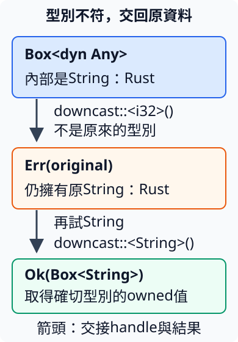

# 11.11 用 Any 辨識並取回確切資料型別

第 11.6 節依共同 amount 能力處理不同型別。現在事件帶著 id 與呼叫端自訂的附加資料；傳遞層只保存它，處理者才取回 i32、String 或自訂 struct。這份附加資料稱為 **payload**，也就是隨事件一起交給後續處理的內容。

已知種類可用 enum；有共同業務操作可用相應 trait。若種類由 caller 擴充，傳遞層不想每次增加 variant，也沒有共同業務操作，就可考慮辨識確切型別再取回。**`std::any::Any`** 提供這項型別辨識能力。

## Any 的 static bound 與這次借用不同

Any 要求實作型別符合 `'static`；標準庫已為符合條件的型別提供實作，本節數字、String、沒有 borrow 欄位的自訂 struct 都能直接使用，不另手寫 Any impl。

沿第 11.5 節，String 符合 `'static` 型別 bound，仍可在局部 scope 建立、使用、清理。把它借成 `&dyn Any`，這次 reference 仍只能在原 String 有效期間使用。內部型別不依賴短命借用，與 reference 此次能使用多久，是兩個問題。

若交入局部 String 的 as_str 結果，型別卻是借自它的文字 reference；沒有因此取得 String 的 ownership。先看有效介面，再用完整負例確認這道限制。

## downcast 檢查確切型別，不轉換內容

**downcast** 在這裡指從 dyn Any 的共同視圖，嘗試取回確切型別 T 的資料。caller 在編譯時指定 T，執行時檢查原型別是否相同；不把數字或文字轉成 T。

| 借用操作 | 結果 |
| --- | --- |
| `view.is::<T>()` | T 須符合 Any；回傳 bool，判斷內部是否就是 T，不取走內容。 |
| `view.downcast_ref::<T>()` | 回傳 `Option<&T>`；相同時借原 T，否則 None。reference 依這次 shared borrow 有效。 |

Any 的 trait method 提供辨識資訊；標準庫另為 dyn Any 提供這些泛型 helper。它們是對 dyn Any 定義的操作，不是第 11.6 節禁止放入動態呼叫介面的泛型 trait method。

完整程式讓 i32 與 usize 都保存80，只嘗試取回 i32，再借看一個局部 String：

```rust
--8<-- "examples/intro-workspace/type-stages/examples/any_borrowed.rs"
```

本節所有 example 使用以下完整 manifest，沒有 library：

```toml
--8<-- "examples/intro-workspace/type-stages/Cargo.toml"
```

```bash
cargo run --manifest-path examples/intro-workspace/Cargo.toml -p intro-type-stages --example any_borrowed --locked
```

```text
確切型別是i32=true
借回i32=80
確切型別是i32=false
這份資料不是i32
原資料仍是amount=80、count=80
局部String也能借成Any=Rust
```

同樣的數值沒有讓 usize 成為 i32。對 usize 請求 i32 得到 None；成功取得的 reference 也只借原值，沒有移走它。

Any 不能查詢「有沒有實作任意 trait」，也不能按文字欄位名找到資料。取回 String 後能用 as_str，是因為現在有已知的 String reference。若始終只要 amount，直接要求 Charge 就能表達需要，不必猜每一種原型別。

## 事件接手 payload，再提供借讀與借改

Event 保存 id 與 `Box<dyn Any>`。event 的 `payload: impl Any` 沿第 9.3 節的參數形式，由 caller 選具體型別；函式接手它、交入 Box，再轉成共同的 owned handle，沒有 clone。

payload_number 借 Event，以 `&*event.payload` 取得 `&dyn Any`，再 downcast_ref。回傳 `Option<&i32>` 的來源依單一輸入省略規則連回 Event。

修改則使用 **`downcast_mut::<T>()`**：需要 `&mut dyn Any`，回傳 `Option<&mut T>`。成功時借原 T 供修改，失敗時 None；沒有新建 T，也不是經 shared reference 任意修改。

add_to_number 接受 `&mut Event`，透過 Box 的 `&mut *` 借內容，找到 i32 才加 extra、回傳 true；其他型別不動、回傳 false。

這一步完整 `examples/any_events/payloads/mod.rs` 只有事件與數字操作，不含 TypeId helper 或測試：

```rust
--8<-- "examples/intro-workspace/type-stages/examples/any_events/payloads/mod.rs"
```

完整 caller：

```rust
--8<-- "examples/intro-workspace/type-stages/examples/any_events/main.rs"
```

```bash
cargo run --manifest-path examples/intro-workspace/Cargo.toml -p intro-type-stages --example any_events --locked
```

```text
事件id=1，數值更新成功=true
事件中的原數值現在=100
文字事件更新數值成功=false
原文字未被改成數字=Rust
```

i32 從80變100，String 仍為原文字。傳遞層保存不同 payload，各處理者只操作自己確實理解的型別。

### owned Box 不能隱藏短命借用

以下交入的內容是借自局部 String 的 `&str`，不能符合 Any 的 `'static` 要求，得到 E0597：

```rust
--8<-- "examples/intro-workspace/type-stages/fixtures/compile-fail/any_non_static_borrow.rs"
```

```text
--8<-- "examples/intro-workspace/type-stages/fixtures/compile-fail/any_non_static_borrow.expected"
```

外層 Box 是 owned，內部 reference 卻仍借原文字。寫 `+ '_` 也不會取消 Any 自己的 static bound。若需要 owned 文字就交入 String；若資料本來必須借來源，就保留能描述來源的具體型別或其他合適介面。

## owned downcast 成功交回具體 Box，失敗交回原 Box

**`boxed.downcast::<T>()`** 接手整份 `Box<dyn Any>`，回傳 `Result<Box<T>, Box<dyn Any>>`：

- Ok 保存符合 T 的 owned Box，可以使用或交出 T。
- Err 保存原 Box，內容仍在，可以保留或再試其他 T。

它與 downcast_ref 的 `Option<&T>` 責任不同。呼叫後原 boxed 已 move，成功失敗都要從 Result 接手 owner。

圖中 String 原值沒有變；第一次請求 i32 失敗，接回 Err 的原 handle，第二次請求 String 成功。箭頭表示 ownership 交接：



完整程式在成功取得 `Box<String>` 後以 DerefMut 追加文字，再沿第 11.2 節 Box 的特殊 move-out 取出 owned String：

```rust
--8<-- "examples/intro-workspace/type-stages/examples/any_owned.rs"
```

```bash
cargo run --manifest-path examples/intro-workspace/Cargo.toml -p intro-type-stages --example any_owned --locked
```

```text
型別不符，原payload仍可再試
再取回owned文字=Rust 教學
```

沒有為了辨識而 clone 資料。下面在 downcast 後繼續讀原 boxed，得到 E0382；正確流程需接手 Ok 或 Err：

```rust
--8<-- "examples/intro-workspace/type-stages/fixtures/compile-fail/any_after_downcast_move.rs"
```

```text
--8<-- "examples/intro-workspace/type-stages/fixtures/compile-fail/any_after_downcast_move.expected"
```

## TypeId 要先選對查詢對象

**`std::any::TypeId`** 是用來比較型別身分的值。`TypeId::of::<T>()` 取得符合 `'static` 的 T 之身分，`==` 比較是否同型別。TypeId 提供 PartialEq 與 Debug，所以也能用 assert_eq!；不用解讀內部表示，它不是事件 id 或資料內容。

Any 的 **`type_id(&self)`** 回傳 receiver 的 TypeId。透過 `&dyn Any` 呼叫，得到內部具體型別的身分。下面的 concrete_id 則由 `&T` 決定 T，再查 T 的 Any 身分。

完整 `examples/any_type_id/payloads/mod.rs` 只有這項 helper：

```rust
--8<-- "examples/intro-workspace/type-stages/examples/any_type_id/payloads/mod.rs"
```

**Box 自己也是型別。** `Box<dyn Any>` 本身符合 Any，直接 `boxed.type_id()` 會使用 Box 自己的 Any 能力，得到 Box 的身分。要查內容，就先以 `&*boxed` 取得 `&dyn Any`，再呼叫 type_id。

完整 caller 明列兩種對象；concrete_id(&boxed) 的 T 明確是 `Box<dyn Any>`：

```rust
--8<-- "examples/intro-workspace/type-stages/examples/any_type_id/main.rs"
```

```bash
cargo run --manifest-path examples/intro-workspace/Cargo.toml -p intro-type-stages --example any_type_id --locked
```

```text
內部資料的TypeId是i32=true
把Box本身當T時得到Box的TypeId=true
```

若把直接 boxed.type_id 的結果當成 i32，以下完整負例能編譯，執行時 assert_eq! 失敗：

```rust
--8<-- "examples/intro-workspace/type-stages/fixtures/runtime-fail/any_box_type_id.rs"
```

預期訊息包含：

```text
--8<-- "examples/intro-workspace/type-stages/fixtures/runtime-fail/any_box_type_id.expected"
```

它在比較 Box 與 i32 的身分。TypeId 適合程式內判斷確切型別；其內部表示、hash 與排序沒有跨 Rust 版本的固定保證，不拿它作持久保存格式或外部事件編號。一般處理 payload 時，多半直接用 is／downcast helper 就足夠。

## 練習與完整答案

自訂 ExtraInfo，保存 count2，交給 event 建立 id3 的事件。owned downcast 請求 ExtraInfo，成功後 count 加1，再從 Box 取出 owned struct，確認 count3；失敗分支接回原 payload。

完整 `examples/any_complete/payloads/mod.rs` 此時才合併本節所有 helper 與兩項測試：

```rust
--8<-- "examples/intro-workspace/type-stages/examples/any_complete/payloads/mod.rs"
```

完整答案根檔案：

```rust
--8<-- "examples/intro-workspace/type-stages/examples/any_complete/main.rs"
```

```bash
cargo run --manifest-path examples/intro-workspace/Cargo.toml -p intro-type-stages --example any_complete --locked
cargo test --manifest-path examples/intro-workspace/Cargo.toml -p intro-type-stages --example any_complete --locked
```

應顯示 count3，兩項測試通過，檢查同數值不同型別、只修改原 i32、owned 失敗後仍能取回並追加原 String。

本章依需要選擇不同責任：Box 接手單一值，Rc 管理共同存活，Cell／RefCell 管理內部修改；newtype 建立型別邊界，dyn 與 Any 分別提供共同操作與確切型別辨識。下一章先處理 Cargo 的共用工程設定，再將路徑與錯誤介面用於檔案工作。

[下一章：Cargo 工程設定與檔案處理](12-01-lesson.md)
