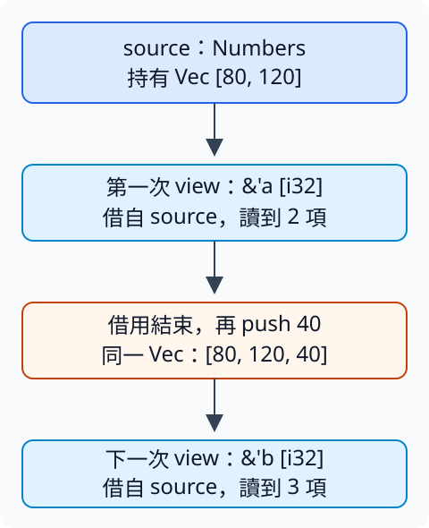

# 12.1 讓借用結果的型別跟著這次借用：GAT

6.2 的 Extract 接手來源，交出該實作指定的 Output。現在要保留來源，只借讀內容：普通 Vec 可以交出 slice，RefCell 則交出代表活躍借用的 guard。我們希望用同一項「借出視圖」操作取得兩者，但保留各自的結果型別與借用規則。

只替普通 Vec 寫 `fn view(&self) -> &[i32]` 已經可以完成第一種需要。本節新增的問題是：**把不同視圖型別放進同一份 trait 契約，而且結果仍能連到每次呼叫借用 self 的有效範圍。** 不需要建立通用容器或重新實作 RefCell。

## 來源留下來，結果借自來源

Numbers 儲存普通 Vec；GuardedNumbers 儲存 8.8 已教的 `RefCell<Vec<i32>>`。後者仍用原本的 borrow guard 管理讀寫。本章 package 叫 ch12-unsafe，library 路徑是 ch12_unsafe；本節的程式沒有 unsafe 操作，這個 package 會隨本章逐節增加內容。

```rust
--8<-- "examples/ch12-unsafe/src/gat.rs:models"
```

我們要選的兩種視圖如下。表中的 `'a` 表示某一次對來源的借用，尚不是固定的全域 lifetime。

| 來源 | 這次想交回的視圖 | 視圖提供什麼 |
| --- | --- | --- |
| Numbers | `&'a [i32]` | 借讀 Vec 的數字，不取得 Vec 的 ownership。 |
| GuardedNumbers | `Ref<'a, Vec<i32>>` | 讀相同 Vec，並維持 RefCell 的活躍 shared borrow，直到 guard 清理。 |

兩種結果都不複製清單。區別仍沿用 8.8：普通 reference 的使用由編譯器檢查，Ref guard 還負責維持 RefCell 的執行期狀態。共同函式不應偷偷把 guard 換成沒有這項責任的普通 reference。

## associated type 也可以接收參數

**generic associated type（GAT，泛型關聯型別）** 是帶有泛型參數的 associated type。本節只使用 lifetime 參數：一份實作不再只選一個固定的 View 型別，而是指定「給定這次借用的 lifetime，要用哪個 View 型別」。

`type View<'a>` 在 View 名稱後宣告 `'a`；`Self::View<'a>` 把某次借用的 lifetime 帶進這份實作的選擇。這和 `Vec<i32>` 把 i32 帶入泛型型別相似，但 View 是 trait 裡的 associated type，而 `'a` 是有效性參數。

method 寫 `fn view<'a>(&'a self) -> Self::View<'a>`：method 自己宣告一次借用的 `'a`，receiver 借用 self，回傳的 View 使用同一個 `'a`。不同呼叫可以使用不同的借用範圍；它不是把 receiver 永久借住。

### 為什麼還要 `where Self: 'a`

8.4 的 `T: 'a` 要求 T 內的借用符合 `'a`。現在把 T 換成實作型別 Self，**`where Self: 'a`** 表示這個 View 只在 Self 符合該有效性要求時使用。where 的位置與語意沿用 8.5，只是這次放在 associated type 的宣告上。

receiver `&'a self` 本身就要求 Self 符合 `'a`。這份 trait 的 View 由這樣的 method 借出，所以 Rust 要求我們也在 GAT 宣告中明寫這個條件。它讓實作能依此使用借自 self 的型別；不是要求某份 self 值真的存活到任意遠的未來。

BorrowView 的完整契約現在可以寫成：

```rust
--8<-- "examples/ch12-unsafe/src/gat.rs:trait"
```

View 宣告中的 `'a` 和 method 宣告中的 `'a` 各自是參數名稱；method 用 `Self::View<'a>`，才把本次 receiver 的 lifetime 帶進 View。這裡沿用相同名稱，讓關係容易對照，並沒有讓所有呼叫共享同一份借用。

## 每份實作選自己的借用型別

Numbers 選 `type View<'a> = &'a [i32]`，body 用既有 as_slice 借出 Vec 的內容。GuardedNumbers 選 `Ref<'a, Vec<i32>>`，body 用 RefCell::borrow 交回 guard。兩份定義也保留宣告的 `where Self: 'a` 條件。

這兩種 Self 都沒有外部借用欄位，因此它們容易滿足這個條件。即使如此，View 的回傳結果仍借自這次 receiver，不能越過來源的有效性；條件不是替結果製造 `'static`。

```rust
--8<-- "examples/ch12-unsafe/src/gat.rs:impls"
```

圖中只有一份 Numbers source。第一次借出的結果使用當次的 `'a`；用完後新增 40，再借出的結果使用下一次的 `'b`。視圖框中的「借自 source」指認同一份資料來源，向下箭頭表示程式順序；兩個 lifetime 名稱只標示不同借用，不表示固定長短。



## 共用函式保留輸出關係

`S: BorrowView` 表示來源提供這份 trait。回傳 `S::View<'_>` 使用實作選定的視圖；`'_` 沿 4.4 的唯一 reference 輸入規則，接到 source 的借用。函式只轉交視圖，不取得 S，不把結果統一成新的清單：

```rust
--8<-- "examples/ch12-unsafe/src/gat.rs:helper"
```

這項 bound 只保證有 view 操作，沒有保證未知的 `S::View<'_>` 一定能索引、Deref 或追加。下面在具體來源上呼叫，結果型別才分別確定成 slice 與 Ref guard，因此可以使用它們已教過的讀取能力。

```rust
--8<-- "examples/ch12-unsafe/examples/gat_views.rs"
```

```bash
cargo run -p ch12-unsafe --example gat_views --locked
```

```text
普通視圖總額=200
下一次借用有3項
guard視圖總額=200
guard清理後，下次借用有3項
```

普通 slice 的最後使用在第一行輸出；之後原 Vec 能 push。Ref guard 則沿 8.8 顯式 drop，才解除活躍 borrow；writer 在短 block 裡追加，離開 block 後再借 shared guard。GAT 保留這些差別，沒有改變 guard 的清理規則。

## 兩種失敗，仍由不同原因造成

第一份 fixture 只移除 View 上必要的 bound，其餘契約保持原樣：

```rust
--8<-- "examples/ch12-unsafe/fixtures/compile-fail/gat_missing_bound.rs"
```

編譯訊息包含 `missing required bound on View`，要求補 `where Self: 'a`。這是 GAT 宣告沒有寫足本次 receiver 能提供的條件，不是讀者應隨意將 lifetime 改成 `'static`。

第二份已寫足 GAT，卻想把借自內層 source 的視圖交到外層。完整 fixture 得到 `E0597`：

```rust
--8<-- "examples/ch12-unsafe/fixtures/compile-fail/gat_owner_too_short.rs"
```

source 隨內層 block 結束，View 內的 slice 沒有取得 Vec 的 ownership。修正仍沿 4.4：需要借用就保留來源，需要獨立資料就交出 owned 內容。GAT 本身沒有延長資料存活。

## 練習：借出 mutable 視圖，再還回使用權

建立 LendMut trait，GAT 名稱仍叫 `View<'a>`，method 改成借用 `&'a mut self`。Numbers 的 View 選 `&'a mut [i32]`，由 body 借出 values。

這份練習需要 **`Vec::as_mut_slice(&mut self) -> &mut [T]`**：它從 mutable Vec 借出全部已有元素的 mutable slice，不改變長度，也不取得 Vec 的 ownership。它是 as_slice 的 mutable 版本；要用它，就先有 mutable receiver 的借用。

用 `[80, 120]` 建立來源，在短 block 中借出視圖，把第一項改成 100；結束這次借用後 push 40，再借一次，確認長度 3、總額 260。先指出修改落在原 Vec，再確認下一次視圖仍能看到修改。

可對照[完整參考程式](https://github.com/birdhackor/learn_rust/blob/main/examples/ch12-unsafe/examples/gat_solution.rs)，或執行 `cargo run -p ch12-unsafe --example gat_solution --locked`。

library 的三項測試分別核對原 slice 資料、guard 清理前後的寫入權限，以及兩種空清單的視圖。測試使用 **`Result::is_err(&self) -> bool`**：結果是 Err 時回傳 true，Ok 時回傳 false；它只檢查 variant，不取得內部值。這讓 assertion 能直接確認「guard 仍在時，取得 writer 的嘗試被拒絕」。執行 `cargo test -p ch12-unsafe --locked` 可核對這些關係。

GAT 把「實作選哪種視圖」與「本次借用有效多久」結合起來。下一節則問另一個問題：已有較長 lifetime 的資料，放進不同型別後，哪些替換仍然合法？

延伸閱讀：[Rust Reference：GAT](https://doc.rust-lang.org/reference/items/associated-items.html#associated-types)。這裡沒有建立通用 lending iterator；本節的必要關係都由有限 BorrowView 介面說明。
