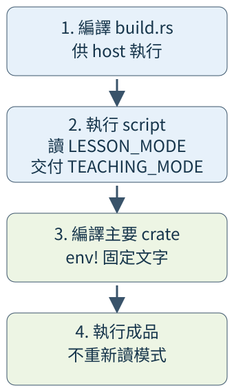

# 12.2 在編譯程式之前執行Rust工作

想讓練習版成品記住自己是demo還是practice，每次啟動都回報同一份建置模式。若主要程式每次啟動都讀環境，模式會隨執行環境改變；這次需要的是**在建置時決定，再把文字固定進成品**。

第12.1節已能選profile、feature與target。現在再加一個步驟：Cargo先執行一支Rust程式，讓它把設定交給主要crate的編譯。這支程式叫**build script**，通常放在package根目錄的`build.rs`；它與成品的`src/main.rs`有各自的執行時點。

本節使用教材repo根workspace中的`ch09-build-script`，位於`examples/ch09-build-script/`。以下命令都從repo根目錄執行；不再指向上一頁的獨立lesson-workspace。

## Cargo先編譯並執行script

build script自己也要先編譯成能在host執行的程式。Cargo執行它，成功後才編譯主要crate，最後才有讀者啟動的成品。

manifest的`build = "build.rs"`明寫script入口，路徑相對於**這個package根目錄**。Cargo也能自動發現這個慣用檔名，本例明寫是為了看清工作入口。其餘共同欄位採用第12.1節已核對的教材repo根設定：

```toml
--8<-- "examples/ch09-build-script/Cargo.toml"
```

### 讀環境可能缺值，也可能不是Unicode

**`std::env::var("名稱")`**讀取目前正在執行的行程所收到的環境值，回傳`Result<String, VarError>`。這裡正在執行的是build script。

`std::env::VarError`有兩個variants：`NotPresent`表示缺少這個值；`NotUnicode(OsString)`表示值存在，但不能轉成Rust String。第10.5節已區分原生OsString與UTF-8文字，這裡同樣不能把轉換失敗當成「沒有設定」。VarError有Debug，可符合第8.1節的expect契約。

本例替`LESSON_MODE`訂出政策：沒有設定就採demo；有值只接受demo或practice；其他文字或非Unicode值都讓建置失敗。`CARGO_CFG_TARGET_OS`則由Cargo啟動script時提供，內容描述**主要crate的目標作業系統**，例如linux或windows。這份script只由Cargo啟動，因此能以這項保證為依據使用expect。

第12.1節已區分host與target。script內的`cfg!(target_os = "windows")`判斷這支script自己的目標，也就是host；若要知道主要crate的target，應讀Cargo傳入的資料。一般本機建置時兩者碰巧相同，跨平台建置時就可能不同。

## stdout逐行交付編譯設定

第10.5節的stdout是行程的標準輸出。build script在這個出口印出特定格式，Cargo依每行的**建置協定**處理，而非接收main的回傳值作設定。

本節使用固定工具鏈支援的`cargo::`形式：

| script印出的指令 | Cargo接手的工作 |
| --- | --- |
| `cargo::rerun-if-changed=build.rs` | 縮小檔案變動追蹤範圍。script本身需要重編時，Cargo也會處理並重新執行。 |
| `cargo::rerun-if-env-changed=LESSON_MODE` | 追蹤啟動Cargo時這個外部環境值的變動，包括設定與取消設定，必要時重跑script。 |
| `cargo::rustc-env=名稱=值` | 提供接下來package crate編譯時可讀取的環境值。 |
| `cargo::error=訊息` | script結束後顯示錯誤，讓這次建置失敗；即使main正常回傳也不算建置成功。 |

rerun-if-env-changed追蹤的是使用者交給Cargo的外部配置；Cargo自己提供的TARGET等建置資料有另一套追蹤，不能靠這條指令追蹤它們。

現在看完整`build.rs`。它先驗證有限的模式名稱，才印rustc-env，所以任意外部文字也不會直接成為多行協定。錯誤分支中的`return;`結束這個回傳unit的main，Cargo接著處理剛印出的error：

```rust
--8<-- "examples/ch09-build-script/build.rs"
```

LESSON_MODE改變時，script會重新交付TEACHING_MODE；TEACHING_TARGET_OS與TEACHING_HOST_WINDOWS則分別保存target名稱與host條件。後者保存的是true／false的**文字**，沒有在主要程式中暗中解析成bool。

## env!在編譯時把文字固定下來

**`env!("名稱")`**是編譯時讀取指定環境值的macro，交出`&'static str`。第11.5節已說明這種文字reference可在程式剩餘的執行期間使用；這裡的內容來自編譯時嵌入的文字。

編譯時缺值或不能表示成Unicode，env!會讓編譯失敗。它不在每次函式呼叫時讀執行環境，所以library可以用三個普通函式借出建置結果。完整`src/lib.rs`：

```rust
--8<-- "examples/ch09-build-script/src/lib.rs"
```

主要binary只借用這三份文字並顯示。完整`src/main.rs`：

```rust
--8<-- "examples/ch09-build-script/src/main.rs"
```

現在把程式對應回四個階段。圖中向下箭頭只表示先後；第二框交出的TEACHING_MODE，在第三框由env!固定，第四框才由build_mode交給顯示工作：



### 先改建置環境，再改執行環境

以下採Bash。`NAME=value command`只把該環境值交給這次命令及它啟動的子行程，不是永久修改shell設定：

```bash
LESSON_MODE=demo cargo run -p ch09-build-script --locked
LESSON_MODE=practice cargo run -p ch09-build-script --locked
```

第一種模式是demo，第二種是practice。因為追蹤的LESSON_MODE變了，Cargo重新執行script並編譯主要crate。教材Linux環境中的後兩行是`主要 crate 的 target OS=linux`與`script 的 host 是 Windows=false`；你的平台以實際target／host為準。

接著直接執行剛才的dev成品。預設產物在教材repo根的target/debug/；Windows的成品檔名另有.exe：

```bash
LESSON_MODE=demo ./target/debug/ch09-build-script
```

它仍顯示`建置時選的模式=practice`。這次沒有啟動Cargo或重新編譯，runtime環境中的demo不能改寫已固定的文字。若需求改成每次啟動讀新模式，才在主要程式呼叫env::var並處理Result。

### 配置失敗發生在哪一階段

```bash
LESSON_MODE=wrong cargo check -p ch09-build-script --locked
```

這次建置失敗，訊息包含`LESSON_MODE 只接受 demo 或 practice`。失敗來自script交出的cargo::error，不是成品執行後才拒絕。改回demo即可再建置，不必刪除target。

env!的缺值則是另一個編譯失敗。以下完整fixture故意取一個未提供的值：

```rust
--8<-- "examples/ch09-build-script/fixtures/compile-fail/missing_env.rs"
```

它的診斷包含`not defined at compile time`；這時還沒有main可執行。可沿用上一節直接編譯fixture的方式，且不要提供這項刻意缺少的環境值：

```bash
rustc --edition=2024 examples/ch09-build-script/fixtures/compile-fail/missing_env.rs -o target/missing-env
```

## option_env!讓編譯時缺值成為None

若額外標記可以省略，就用**`option_env!("名稱")`**：它在編譯時交出`Option<&'static str>`，有Unicode值時是Some，缺值則是None；有值但不是Unicode仍是編譯錯誤。這與runtime的env::var不同，也沒有把主要模式的驗證規則改成可有可無。

下面的完整獨立example以match選顯示方式，沒有修改library或build script：

```rust
--8<-- "examples/ch09-build-script/examples/optional_build_tag.rs"
```

在沒有LESSON_OPTIONAL_TAG的環境中執行，會顯示`編譯時沒有額外標記`；再提供一個值：

```bash
cargo run -p ch09-build-script --example optional_build_tag --locked
LESSON_OPTIONAL_TAG=lab cargo run -p ch09-build-script --example optional_build_tag --locked
```

第二次顯示`編譯時的額外標記=lab`。Cargo與編譯器也會追蹤source中的env!／option_env!所讀值的變更，所以這項標記不需先讓build script讀一次。它仍是建置時值；直接啟動已編譯的example，會保留那一次編譯的標記。

## 生成檔案與建置依賴各放哪裡

Cargo執行script時還提供`OUT_DIR`，指向這次建置使用的輸出目錄。生成供編譯使用的檔案應寫到這裡，保持原始碼目錄作為輸入。OUT_DIR可能留有前次檔案，script須自行管理需要重建的內容。本節只交付文字設定，因此沒有生成檔案或加入讀生成檔案的macro。

若script自己需要第三方Rust library，放在package的`[build-dependencies]`，供host上的script編譯使用；`[dependencies]`則供主要crate。兩組須各自明確宣告。本例只用標準函式庫，所以完整manifest沒有這兩個區段，也沒有隱藏的第三方helper。

後面與原生library合作時，還會用到**linker（連結器）**：它將編譯結果與所需library組成最後成品。build script要先找到或建好target需要的library，再交付搜尋位置及名稱：

| 協定指令 | 交給連結工作的資訊 |
| --- | --- |
| `cargo::rustc-link-search=native=路徑` | 把這個目錄加入原生library搜尋位置。 |
| `cargo::rustc-link-lib=static=名稱` | 要求連結名為該名稱的靜態library；靜態連結會將所需程式納入成品。 |

這些指令負責連結設定；library的取得、目標平台相容性，以及Rust端外部函式宣告與ABI契約，仍須由實際整合工作完成。第15章會在學過那些必要介面後實作。本頁script沒有印這兩條指令，也不需要C工具鏈。

## 保留建置結果的測試與完整答案

完整`tests/embedded.rs`用公開library確認模式屬於允許集合，並在Linux／Windows測試對應target文字。條件編譯與integration test沿用上一節：

```rust
--8<-- "examples/ch09-build-script/tests/embedded.rs"
```

```bash
LESSON_MODE=demo cargo test -p ch09-build-script --test embedded --locked
```

script一般stdout不會像程式輸出直接顯示；需要查建置過程時，`cargo ... -vv`提供詳細訊息。輸入未變時Cargo可以沿用結果，不保證每次命令都重新執行script。

### 練習：回報一行建置識別

建立example，把package名稱、建置模式與target組成String，再顯示，例如：

```text
package=ch09-build-script; mode=practice; target=linux
```

Cargo編譯package的crate時，會自動提供`CARGO_PKG_NAME`，內容是manifest的package名稱；用env!取得，不必為它另寫script協定。模式與target則由本頁完整library提供，再用第8.3節的format!保存整行。

??? example "完整可執行答案"

    沿用本頁完整manifest、build.rs與library，這份完整`examples/build_identity_solution.rs`只組合已固定的文字：

    ```rust
    --8<-- "examples/ch09-build-script/examples/build_identity_solution.rs"
    ```

    ```bash
    LESSON_MODE=practice cargo run -p ch09-build-script --example build_identity_solution --locked
    ```

    模式是這次建置的practice，target依實際平台。主要程式若改讀runtime的LESSON_MODE，就無法交出這次要求的建置識別。

讀完完整答案後，CARGO_PKG_NAME與兩份example的介面都已說明，也可把它們一起編譯檢查：

```bash
LESSON_MODE=demo cargo test -p ch09-build-script --all-targets --locked
```

本節已將外部模式驗證與建置資料交付放在編譯之前。下一節回到執行時的檔案工作，逐筆保存原生路徑與觀察失敗。

[下一節：走訪檔案，保留路徑與失敗](12-03-lesson.md)

延伸閱讀：[Cargo Build Scripts](https://doc.rust-lang.org/cargo/reference/build-scripts.html)、[RustCourse中文章](https://github.com/sunface/rust-course/blob/main/src/cargo/reference/build-script/intro.md)。
