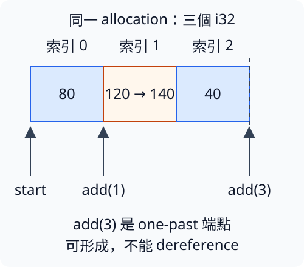

# 12.3 raw pointer：找到位置，還不等於可以存取

2.3 的 reference 把存取能力與借用有效性放進型別；8.1 的 Box 另外管理 owned 資料與清理責任。接下來要認識一種較低層的表示：儲存資料位置，卻不由型別替我們完成相同的有效性檢查。

這種表示叫 **raw pointer**。本節先在單一 thread 中，從已知的局部數字與 array 建立 pointer，分開觀察建立、檢查、讀寫三種動作。直接使用 reference 已能完成這些數值修改；這次採 raw pointer，是為了理解後面安全抽象與外部函式介面所要處理的責任。

## 型別的星號，與讀取時的星號

raw pointer 有兩種常用型別：

| 型別 | 可以表達的存取方式 |
| --- | --- |
| `*const T` | 指向 T 的 raw pointer，不能直接透過這份型別寫入。 |
| `*mut T` | 指向 T 的 raw pointer，能寫出讀寫操作；真正寫入仍必須有合法權限。 |

這裡的 `*` 是型別名稱的一部分。後面表達式中的 `*pointer` 才是 dereference：存取 pointer 指向的那個位置。型別中的 mut 也不等於 pointer 變數本身的 binding 必須是 mutable；我們可以保留同一份 pointer 值，透過它修改資料。

和 reference 不同，raw pointer 可以是 null，也可能指到已結束的資料或不符合 T 的位置。它沒有借用 lifetime 參數替我們追蹤資料來源，也不會因為 pointer 值離開 scope，就自動釋放被指向的 allocation。這些都不表示該位置可以任意讀寫。

`*const T` 與 `*mut T` 的 pointer 值都有 **`Copy`**，不要求 T 有 `Copy`。複製的是 pointer 資訊，不是被指向的 T；它不延長來源存活，也不增加配置的 ownership 或釋放權限。mutable raw pointer 能複製，同樣不會放寬存取有效性與衝突存取的限制；不能把它套成 mutable reference 也有 `Copy`。

**allocation** 在這裡表示一份可指認的記憶體配置範圍：局部數字有自己的範圍，一個 array 的全部元素在同一範圍，Box 的 heap 資料也有其配置範圍。pointer 的合法存取必須連回對應範圍，而不是只找到一個看似合理的地址。

## 建立與檢查 pointer，可以先用 safe 操作

**`&raw const place`** 直接建立指向 place 的 `*const T`；**`&raw mut place`** 建立 `*mut T`。它們是 raw borrow operator，不是先建立普通 reference 再讓借用規則失效。

本例的 place 是仍存在、已初始化的局部 i32，因此可以清楚追蹤來源。另使用以下安全 API；它們都不讀取被指向的 T：

| API | 所需材料與結果 |
| --- | --- |
| `std::ptr::null::<T>()` | 建立型別為 `*const T` 的 null pointer，不配置 T。turbofish 沿 3.3。 |
| `pointer.is_null()` | 檢查這份 pointer 是否是 null，回傳 bool；false 不代表可以 dereference。 |
| `std::mem::align_of::<T>()` | T 是 Sized 時，回傳這種型別要求的 alignment，型別 usize、單位 bytes。 |

**alignment（對齊）** 限制某型別可從哪些地址正常存取。例如 alignment 為 4，就要求起始地址是 4 的倍數；這和 8.1 的 size 不同，size 說明佔多少 bytes。實際要求依型別與平臺查詢，不能從「地址非零」推出它已正確 aligned。

```rust
--8<-- "examples/ch12-unsafe/examples/raw_construction.rs"
```

```bash
cargo run -p ch12-unsafe --example raw_construction --locked
```

在本教材驗證的環境，前三行依序為 false、false、true，最後一行為 `i32要求的alignment=4 bytes`。原資料仍由 amount 持有；null 沒有讓我們多建一份 i32。alignment 的查詢也沒有檢查 readable 的完整存取資格。

## dereference 前，先交代必須成立的條件

**`unsafe { ... }`** 是允許執行特定低層操作的區塊。這裡需要它，因為 raw pointer dereference 的有效性不能單靠型別保證；作者要在操作前確認契約。它不關掉普通 reference 的借用檢查，也不會在執行時自動替 pointer 做驗證。

**undefined behavior（UB，未定義行為）** 表示違反語言或 API 對執行的基本要求，不能再依正常的程式語意預測結果。它不等於固定會 crash 的錯誤；看似正常完成也不能使違反條件的存取變合法。

對本節正常讀寫一個 i32，至少要有以下條件。將 pointer 轉成其他型別，或只加入 is_null 檢查，都無法代替這些理由：

| 條件 | 本次局部數字例子的依據 |
| --- | --- |
| 非 null，整個 i32 位於仍有效的 allocation | pointer 直接來自 amount；raw 存取時 amount 未結束、未移動。 |
| 正確 alignment | 普通局部 i32 由編譯器安排符合 i32 的位置，不是任意整數地址。 |
| 已初始化，內容是有效 i32 | amount 在建立 pointer 前已有數值 80，之後寫入有效 i32 的 100。 |
| 存取有權限，沒有衝突別名存取 | amount 是 mutable 局部資料；raw 操作期間沒有其他 reference 或 pointer 讀寫它。 |
| 此次存取沒有跨 thread 的衝突 | 本例全部在同一個 main 中順序執行。 |

**aliasing（別名存取）** 是有多條路徑可以找到相同資料。例如一份 reference 與一份 raw pointer 指向同一值。不是一看到兩份 pointer 值就有 UB；要判斷的是各路徑在何時、以哪些權限實際存取。這裡採容易核對的安排：raw 讀寫期間只使用一條路徑，不與其他 reference 交錯。

下面保持同一個 amount，只用一份 raw pointer。讀出的 i32 是 Copy 數值，可以放進 tuple 交出來顯示；沒有讓 println 在 raw 存取中另借同一個位置。`SAFETY` 註解記錄這次操作的依據，不是因為寫了註解就自動安全。

```rust
--8<-- "examples/ch12-unsafe/examples/raw_local.rs"
```

```bash
cargo run -p ch12-unsafe --example raw_local --locked
```

```text
raw read取得=80，raw write後=100
raw操作結束後原值=100
```

unsafe block 中讀到80，將原位置改成100，再讀到100。之後不再使用 pointer 存取資料，才由 amount 讀回結果。正常執行支援這個有限例子的值變化；安全理由仍來自前面的來源、有效範圍與存取權限，而不是輸出剛好正確。

如果省掉 unsafe block，下面完整 fixture 得到 `E0133`：raw pointer dereference 需要 unsafe block。

```rust
--8<-- "examples/ch12-unsafe/fixtures/compile-fail/raw_without_unsafe.rs"
```

加上 unsafe 只滿足語法上的責任標記。它不是修復所有 raw pointer 的通用方法；仍須先有可核對的存取理由。

## 在同一 array 中移到下一個元素

現在把單一數字換成三項 array，目標只改第二項。array 的元素數量固定，所有元素屬於同一 allocation，便於在同一範圍追蹤 pointer。

這裡第一次直接把 array reference 交給 slice 介面：當預期型別為 `&mut [i32]`，Rust 可將 `&mut values` 的 array reference 轉成借同一份元素的 slice reference；shared 的 `&values` 也可轉成 `&[i32]`。長度來自原 array，沒有複製元素或延長來源存活。這是語言提供的 array→slice coercion，與8.3的 Deref coercion 是不同的轉換規則；前面的 `&mut values[..]` 仍可使用。

取得 slice 後，用 **`slice.as_mut_ptr()`** 取得指向第一項的 `*mut i32`；它不取得 allocation 的 ownership，也不讓我們自由縮長 slice。對 shared slice 使用的 **`slice.as_ptr()`** 則回傳 `*const T`，也仍依賴原資料有效。

**`pointer.add(n)`** 形成往後 n 個 T 的 pointer，n 是元素數量，不是 byte 數。對本例的 i32，add(1) 跨過一個 i32，落在第二項的開頭；不需要手算地址再把整數轉回 pointer。

add 本身就是 unsafe API。計算必須在來源的同一 allocation 內，或剛好形成範圍尾端的 **one-past pointer**；位移的 byte 數不能超出 `isize::MAX`，也不能發生地址 overflow。isize 是和 usize 對應的有號整數型別，這裡只用其可表示範圍描述 API 限制，沒有把實際 pointer 轉成數字。

one-past pointer 指向最後一項之後的端點，**可以依 add 的契約形成，卻不能當成下一項 dereference**。它不是 null，也不是替 array 多配置一項。對這個三項 array，add(1) 指向第二項，add(3) 形成 one-past；只有前者拿來讀寫。

圖中方框是一個 i32，箭頭落在該元素的起點。右側虛線只標 allocation 的端點，沒有第四個元素；第二項由120改成140，其餘兩項保留。



本例的 i32 array 提供 `Debug` 與 `PartialEq`：`Debug` 可列出各元素；與同長度的 i32 array 比較時，每個位置的值都相等，兩份 array 才相等。因此下面可用已教的 `assert_eq!` 核對整份 array，不是只因 i32 有能力就假定任何容器都相同。

```rust
--8<-- "examples/ch12-unsafe/examples/raw_array.rs"
```

執行 `cargo run -p ch12-unsafe --example raw_array --locked`，得到：

```text
第二項由120改成140
one-past pointer是null=false
原array總額=260
```

view 最後用來取得 start，raw 操作期間不再從 view 或其他 reference 讀寫。三個元素都已初始化，add(1) 仍在同一 allocation 中；add(len) 只形成端點、不讀取。最後 raw 存取結束，再用原 array 的索引核對結果。

## provenance：來源資格不只是地址

**provenance** 指 pointer 與來源 allocation 及其允許存取範圍之間的關係。地址回答「位置在哪裡」，provenance 還涉及「這條路徑從哪個有效配置衍生、能存取哪個範圍」。

即使兩個局部變數碰巧排在相鄰地址，它們仍是不同 allocation。從第一個變數的 pointer 位移到另一個變數，看起來像只跨幾個 bytes，也不能只靠地址相鄰就宣稱可以存取。array 的例子合法，是因為來源本來就涵蓋整份 array。

也不能把已釋放資料的舊 pointer 當成新資料的 pointer，只因為新配置碰巧用了相同地址。這些來源與有效性責任，正是只檢查非 null、地址或型別名稱仍不足的原因。本節不以整數地址製造可執行的失效存取；完整 aliasing 模型的細節在 Rust 官方規則中仍有未定部分。

### raw pointer 轉成 reference，還要守 reference 的契約

`&*pointer` 會建立 shared reference，`&mut *pointer` 會建立 mutable reference。這不僅是讓語法較方便：建立時就必須有正確 alignment、有效且已初始化的 T，以及符合該 reference 的存取限制；不能等到第一次使用才補足。

reference 的回傳 lifetime 還必須連到真正的有效來源。不能僅由 raw pointer 加上 `'static` 回傳型別，就讓局部資料延長存活。下一節會在有限 safe wrapper 中，把這些前置條件與輸出關係逐項整理。

## 練習：從同一 allocation 修改第三項

把材料換成 `[10, 20, 30]`，從整個 array 的 mutable slice 取得 pointer，使用 add(2) 找到第三項，讀回30並改成50。raw 存取結束後，確認原 array 是 `[10, 20, 50]`、總額80。

在動筆前用自己的話指出：pointer 從哪裡來，為什麼第三項仍在同一範圍，哪些資料已初始化，raw 操作期間還有哪些存取路徑，以及什麼時候才能回到普通索引。不要把 add(3) 當成第三項，那是 one-past。

可對照[完整參考程式](https://github.com/birdhackor/learn_rust/blob/main/examples/ch12-unsafe/examples/raw_solution.rs)，或執行 `cargo run -p ch12-unsafe --example raw_solution --locked`。本節的 assertion 檢查已定義輸入下的結果，不代表由有限測試證明任何 raw pointer 程式都安全。

延伸閱讀：[英文 Book：raw pointer](https://doc.rust-lang.org/book/ch20-01-unsafe-rust.html#dereferencing-a-raw-pointer)、[中文對應章](https://kaisery.github.io/trpl-zh-cn/ch20-01-unsafe-rust.html#解引用裸指针)、[std ptr 的有效性規則](https://doc.rust-lang.org/std/ptr/index.html)、[pointer::add 的 Safety 契約](https://doc.rust-lang.org/std/primitive.pointer.html#method.add)。
