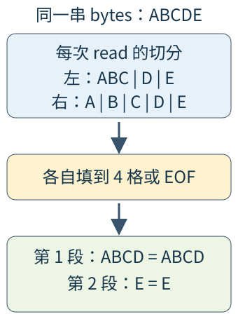
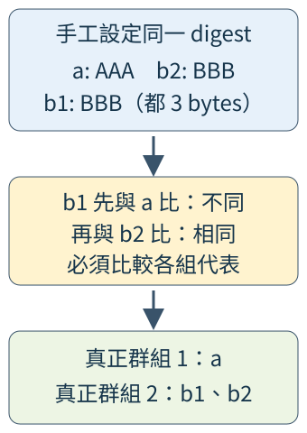

# 12.4 從檔案候選到真正相同的內容

第12.3節已保存一般檔案的原生路徑與觀察資料。現在要回答：**哪些不同路徑的檔案，讀出的 bytes 完全相同？** 檔名相同、長度相同、修改時間相同都不足以回答這個問題。

我們分配三種工作，讓每一步都只回答自己能判斷的事：

| 步驟 | 能排除什麼 | 還不能判定什麼 |
| --- | --- | --- |
| 依 byte 長度分組 | 長度不同，完整 bytes 必定不同 | 同長檔案可能是 `AAA` 與 `BBB` |
| 對候選計算 hash 摘要 | 摘要不同，讀出的 bytes 不同 | 摘要相同仍是候選，需要內容確認 |
| 直接比較 bytes | 確認讀出的完整序列相等 | 不能保證外部程式之後永遠不改動檔案 |

先分大小，是利用已經取得的 metadata 減少讀取工作：若 6-byte 檔案只有一份，就沒有另一份相同長度可配對。對留下的檔案再算摘要，讓直接內容比較集中在更小的候選桶，而不是一開始就讓所有檔案兩兩重讀。這是工作分配的理由；本節沒有測量或承諾特定倍數的加速。

本節使用`examples/ch09-content/lesson-workspace/`的獨立workspace，以下命令都從**教材repo根目錄**執行。依工作選四個階段，避免只看大小時就載入後面的內容分群：

| package | 負責的工作 |
| --- | --- |
| `lesson-file-sizes` | 只依賴第12.3節掃描library，先形成大小候選。 |
| `lesson-content-streams` | 對Read來源算摘要、填比較段與比較內容。 |
| `lesson-checked-files` | 讀取前後觀察真實檔案；自己的candidate example再組合大小與摘要。 |
| `lesson-content-groups` | 將同一候選桶細分真正內容群組，計算按路徑的重複量。 |

完整根manifest如下，語法回用第12.1節。blake3是稍後用的摘要library，tempfile供已教的受控材料；先列來源設定，Rust介面在各段介紹。ch09-files的path從這份小root往上兩層，再進入同層的ch09-files：

```toml
--8<-- "examples/ch09-content/lesson-workspace/Cargo.toml"
```

ch09-files仍採用它所屬的教材repo根共同設定，不會改成繼承呼叫者的小workspace。本頁會完整重列它的manifest與library來源。本頁四個階段則明列在小workspace中。

這裡交付可驗證的有限元件；完整CLI參數、報告與部分失敗政策留第18章檔案專案整合。

## 本頁實際依賴的scan與輸入全檔

四個階段的本地library依賴都已教過。以下重列第12.3節的完整scan manifest、library根及scan.rs；該package的main與它自己的測試沒有被本頁依賴者選中：

??? example "展開完整scan dependency"

    ```toml
    --8<-- "examples/ch09-files/Cargo.toml"
    ```

    ```rust
    --8<-- "examples/ch09-files/src/lib.rs"
    ```

    ```rust
    --8<-- "examples/ch09-files/src/scan.rs"
    ```

size與file_confirmation使用的完整固定材料如下，最後皆有換行。其餘檔案由答案／測試在各自TempDir建立，完整內容保存在下方的答案與測試程式中：

`first.txt`：

```text
--8<-- "examples/ch09-files/fixtures/tree/first.txt"
```

`nested/second.txt`：

```text
--8<-- "examples/ch09-files/fixtures/tree/nested/second.txt"
```

`.hidden/third.txt`：

```text
--8<-- "examples/ch09-files/fixtures/tree/.hidden/third.txt"
```


## 先只看大小，保留 FileRecord 的借用

沿用第6.5／6.6節的HashMap與第9.7節的排序。`HashMap<u64, Vec<&FileRecord>>` 以 byte 長度為鍵，值保存借自掃描結果的檔案 reference；它不複製檔案內容，也不接管原 `FileRecord`。`u64` 有數值的 Eq／Hash／Ord，能作這份 map 的鍵與排序鍵。

size階段的完整manifest只明選scan依賴：

```toml
--8<-- "examples/ch09-content/lesson-workspace/size/Cargo.toml"
```

教材的三份檔案長度為 5、5、6，應只留下 5-byte 的兩筆候選。先收集，再將 `(長度, 候選清單)` 排序；map 自己的走訪順序仍無保證：

```rust
--8<-- "examples/ch09-content/lesson-workspace/size/src/main.rs"
```

```bash
cargo run --manifest-path examples/ch09-content/lesson-workspace/Cargo.toml -p lesson-file-sizes --locked
```

得到 `5 bytes 的候選數=2` 與 `掃描項目失敗數=0`。這只是依大小形成候選，還沒讀內容；掃描失敗數也仍然保留，不能因找到候選就宣稱整個工作沒有錯誤。

## digest 是固定長度摘要

**hash** 在這裡指把任意長度 bytes 算成一份固定長度摘要的工作，摘要叫 **digest**。相同 bytes 必須得到相同摘要；不同 bytes 也可能得到相同摘要，這種情況叫 **collision**（碰撞）。因此摘要是縮小候選的工具，不能替代本次「真正相同內容」的判準。

我們選用 **BLAKE3** 演算法，由 `blake3` crate 提供。只使用它的普通、依序更新 API，不另開平行讀取或記憶體映射功能。依第10.1節的依賴設定，先在streams階段宣告：

```toml
--8<-- "examples/ch09-content/lesson-workspace/streams/Cargo.toml"
```

| API／型別 | 輸入、結果與角色 |
| --- | --- |
| `blake3::Hasher::new()` | 建立尚未收到任何 bytes 的摘要計算狀態 |
| `hasher.update(bytes)` | mutable 借用 hasher、接收 `&[u8]`，追加這次有效 bytes；回傳同一 hasher 的 `&mut Hasher`，本例不使用回傳值 |
| `hasher.finalize()` | shared 借用狀態，回傳這時累計內容的 `blake3::Hash`；不接手或清空 hasher |
| `blake3::Hash` | 32-byte 摘要值，具有 Debug／Display、Clone／Copy、Eq／Hash；Display 可直接顯示摘要文字 |

最後一列的 `blake3::Hash` 是**保存摘要的型別**；第6.5節的 `std::hash::Hash` 則是「能提供 map 鍵雜湊」的 **trait**。它們同名但角色不同。摘要型別實作這個 trait，所以能當 HashMap key；map 的鍵契約不因此替我們證明兩個原檔案內容相同。

按順序 `update("ABC".as_bytes())` 再 `update("DE".as_bytes())`，和一次送入 `ABCDE` 是同一串輸入。第10.4節的 Read 可能短讀取，因此每次只送 `buffer[..count]`，不能把舊尾段一起算入，也不能因第一次沒填滿就停止。

streams階段的library把這份工作寫成 `hash_reader<R: Read>`。它沿用第10.4節的 Interrupted 重試與其他錯誤傳回，成功才交出摘要。4096 格是本例重用的 byte buffer 容量，不是要求檔案大小能整除 4096：

```rust
--8<-- "examples/ch09-content/lesson-workspace/streams/src/lib.rs:hash"
```

空來源也有合法摘要；資料不是 UTF-8 也能計算，因為這次處理的是 bytes，沒有要求解碼成文字。資料不全部存進 Vec，主要讀取 buffer 可以重用；稍後保存路徑／群組的記憶體則仍隨檔案數增加。

## 比較內容前，先消除讀取切分的差異

同一串 `ABCDE`，左來源可以先交 `ABC` 再交 `DE`，右來源可以每次只交一個 byte。若只呼叫一次 read，看到左長 3、右長 1 就回報不同，判斷會是錯的：切分是讀取行為，完整序列才是內容。



圖中直線分隔**原始 read 的批次**，不是內容裡的 byte。向下箭頭把批次重新接成相同位置的比較段。圖為了看清楚用四格，實作使用 4096 格；容量改變不改判準。在這張四格圖中，左邊第一次收 ABC 後只剩一格，下一次 read 只能交 D；填滿第一段後，下一段才收 E。因此左邊實際批次是 ABC、D、E，仍和右邊逐 byte 的內容一致。

先做 `fill_chunk`：對每邊分別重複 read，直到這份 buffer 滿，或非空剩餘 buffer 得到 `Ok(0)`，表示這輪來源結束。`filled` 是這份 buffer 目前已保存幾格；下一次只借剩餘後段，不覆蓋前面新收到的 bytes：

```rust
--8<-- "examples/ch09-content/lesson-workspace/streams/src/lib.rs:fill"
```

接著比較兩份有效 slice。`[u8]` 的 PartialEq 要求**長度相同且每個位置 byte 相同**；不同長度也會比較為不同。這時兩邊都已填到相同容量或結尾，才能把段長不同當成完整內容長度的差異，而不是不同短讀取的差異。

`CompareReadError::Left(io::Error)`／`Right(io::Error)` 保留失敗來源。I/O 失敗不是 `Ok(false)`；否則後面會把「不能確認」誤當「已確認不同」。兩份 slice 都空且相等時，兩邊都已結束，才交回 `Ok(true)`：

```rust
--8<-- "examples/ch09-content/lesson-workspace/streams/src/lib.rs:equal"
```

### 用可控制的短來源驗收

回收第10.4節的ShortReader：保存 owned bytes、目前位置與每次上限。`short_reader(data, maximum)` 複製 byte slice 成 Vec，建立每次至多交出 maximum 格的來源；maximum 必須為正數，零會 panic，因為那不是這份測試來源的有效設定。

```rust
--8<-- "examples/ch09-content/lesson-workspace/streams/src/readers.rs:short"
```

回用第2.7節的 **`assert!(condition)`** 核對 bool：true 時繼續，false 時 panic；`assert!(!condition)` 則要求原條件為 false。它和第2.7節的 `assert_eq!` 一樣用於檢查已知答案，不是處理使用者配置錯誤的介面。

另一份 `failing_reader()` 沿用第10.4節的事件來源：第一次 Interrupted、第二次交出 R、第三次 PermissionDenied。hash／比較都要重試第一次，再保留第三次失敗；比較還要指出是左還是右來源。完整 source 只有這三種已教事件：

```rust
--8<-- "examples/ch09-content/lesson-workspace/streams/src/readers.rs:failure"
```


streams的main分別以3與1的上限讀相同資料，先比較完整內容，再對照分批 hash 和一次 update。這讓「切分不同但內容相同」有實際執行的材料：

```rust
--8<-- "examples/ch09-content/lesson-workspace/streams/src/main.rs"
```

### streams階段的全部來源

前面已列完整manifest與main。以下兩檔是main實際載入的完整library與readers module，包含所有imports和剛介紹的兩種來源：

??? example "展開streams library與全部readers"

    ```rust
    --8<-- "examples/ch09-content/lesson-workspace/streams/src/lib.rs"
    ```

    ```rust
    --8<-- "examples/ch09-content/lesson-workspace/streams/src/readers.rs"
    ```


```bash
cargo run --manifest-path examples/ch09-content/lesson-workspace/Cargo.toml -p lesson-content-streams --locked
```

第一行是 `切分不同，內容相同=true`，第二行顯示分批與一次 update 相同的 digest。測試另換 9001 bytes 與左右不同正數上限，跨過多個 4096 格 buffer；也驗收空來源、最後一個 byte 改變、較短的尾段。

## 真正檔案還可能在讀取前後改變

Read 的流程正確，仍不足以把檔案當成固定內容。其他程式，或本程式另一項 `fs::write`，都能在 File 打開期間修改磁碟資料；shared reference 限制的是這份 Rust 借用，沒有替檔案系統所有操作上鎖。

沿用第12.3節的 `Snapshot`，本節作**盡力而為的觀察**：開啟前、開啟後的讀取前、hash／內容比較後，都觀察類別、len、modified。除了按原生路徑呼叫 `observe`，再用新 method **`File::metadata() -> io::Result<Metadata>`** 查已打開的 File handle 所指檔案。兩者指向資料的方式不同；每次成功觀察都和掃描記錄比較。

checked-files階段的完整設定明選scan、streams與摘要library，測試再選tempfile：

```toml
--8<-- "examples/ch09-content/lesson-workspace/checked-files/Cargo.toml"
```

`FileIssue` 保存確切失敗者的原生 `PathBuf`、當時動作，以及 I/O／metadata／可觀察變動的具體原因。比較左邊失敗就指左路徑，右邊失敗就指右路徑；不是一律指新候選。Display 用 Debug 路徑供人辨認，仍不拿顯示字串當 key：

```rust
--8<-- "examples/ch09-content/lesson-workspace/checked-files/src/lib.rs:issues"
```

`observe_handle` 查 File，`verify_unchanged` 查路徑及 handle，兩份都要和原記錄相等。`open_checked` 在打開前先查路徑，再打開並驗證。後續 wrapper 必須在讀取後再次驗證，不能只呼叫 open_checked 就宣稱整個讀取過程沒有變動：

```rust
--8<-- "examples/ch09-content/lesson-workspace/checked-files/src/lib.rs:observe"
```

`hash_file` 只有在摘要讀取及後續觀察都成功，才交回摘要：

```rust
--8<-- "examples/ch09-content/lesson-workspace/checked-files/src/lib.rs:hash"
```

`equal_files` 開兩份檔案，按剛才的左右錯誤保留確切失敗路徑；就算 bytes 比較得到 false，也完成兩邊讀取後的觀察，再交回這個正常比較結果：

```rust
--8<-- "examples/ch09-content/lesson-workspace/checked-files/src/lib.rs:equal"
```

這些檢查能揭露**可觀察到的差異或讀取失敗**。沒有看見差異，不代表取得一致快照：例如內容可能改過又恢復成相同長度／修改時間，時間記錄也有其精度。前後觀察不是原子操作，路徑替換也可能發生在兩次查詢之間。本節適用於穩定目錄的一般整理，不承諾抵抗惡意同時替換或保證檔案往後不變。

這是checked-files的完整`src/lib.rs`，沒有候選分群或稍後的metrics。開檔、前後觀察、hash與左右比較的helper都在同一檔：

??? example "展開完整檔案觀察library"

    ```rust
    --8<-- "examples/ch09-content/lesson-workspace/checked-files/src/lib.rs"
    ```

對教材固定檔案，先看真實摘要再做內容確認；這份 example 的 expect 只依固定可讀材料，不替一般使用者檔案吞錯誤：

```rust
--8<-- "examples/ch09-content/lesson-workspace/checked-files/examples/file_confirmation.rs"
```

```bash
cargo run --manifest-path examples/ch09-content/lesson-workspace/Cargo.toml -p lesson-checked-files --example file_confirmation --locked
```

`first.txt` 與 `nested/second.txt` 得到同一摘要，真正比較也是 true。換成 `.hidden/third.txt` 的另一份內容後，真正比較是 false。兩個判斷步驟仍各自有責任；摘要相同不是省略後者的理由。

## 把大小與 digest 形成候選鍵

這次以 `(u64, blake3::Hash)` 作 key：第一欄是長度，第二欄是摘要。標準 tuple 在兩欄都有 Eq／Hash 時也提供相應能力，只有**兩欄都相等**才是同一鍵。因此不同長度不會進同桶，同長度同摘要則仍等待內容確認。

`DigestBuckets` 是第8.2節已教的type alias，只替這份 `HashMap<(u64, Hash), Vec<FileRecord>>` 取較短名稱。`hash_candidates` 接手 owned 記錄，成功才交回候選 map；第一次 FileIssue 就返回，沒有把之前的局部 map 當完整成功：

```rust
--8<-- "examples/ch09-content/lesson-workspace/checked-files/examples/candidate_digests/candidates.rs"
```

上面完整candidates.rs還包含兩項測試，保存size+digest兩欄都參與分桶，以及中途失敗不回傳局部成功map。它是example自己的module，沒有放進前一階段library；接下來main以`mod candidates;`載入同層檔案，沿用第2.6節的資料夾型example規則。

下面只把先前已知會留下的兩份 5-byte 檔案交給這個元件。filter 借用 owned Item 判斷，保留後的 FileRecord 才 move 進 collect，沿用第9.5節：

```rust
--8<-- "examples/ch09-content/lesson-workspace/checked-files/examples/candidate_digests/main.rs"
```

```bash
cargo run --manifest-path examples/ch09-content/lesson-workspace/Cargo.toml -p lesson-checked-files --example candidate_digests --locked
```

這份固定材料形成一個候選桶，候選數 2。任意資料可能形成多桶，HashMap 仍無固定走訪順序；下一步是各桶內真正確認，完成後才按路徑排序。

## 同一候選桶中，必須找各個真正內容群組

最後的groups階段使用這份完整manifest。它的main就是受控實驗答案，會用TempDir建立三份檔案，因此tempfile放在一般dependencies；依賴的streams只供讀取後觀察測試使用，放在dev-dependencies：

```toml
--8<-- "examples/ch09-content/lesson-workspace/groups/Cargo.toml"
```

假設故意把三份 3-byte 記錄放進同一 digest 桶，依序為 a 的 `AAA`、b2 的 `BBB`、b1 的 `BBB`。這是**受控同摘要的測試安排**，不是找到 BLAKE3 真實碰撞的實驗。

a 先建立第一組；b2 和 a 不同，建立第二組；b1 和 a 不同之後，還要和第二組的 b2 比，才能加入 B 組。若只和桶第一份 a 比，就會漏掉 b1／b2：



圖中的a、b2、b1對應練習的a.txt、b2.txt、b1.txt。上框是**候選桶**，下框才是真正內容群組。中框的第二次比較是關鍵：同一桶可以已經有兩種內容，不能把「和第一組不同」直接當成「沒有其他相同者」。

`ContentGroup<'a>` 保存 `Vec<&'a FileRecord>`，借用來源記錄，沒有複製檔案。`refine_bucket` 的回傳 `ContentGroup<'_>` 沿用第7.1／7.2節的單一reference來源：回傳借用連到輸入 slice，來源記錄必須在使用群組時仍有效。

元件先以 `HashMap<PathBuf, ()>` 記已處理過的原生路徑。unit 值只是「看過這個 key」的標記；同一路徑重複輸入會略過，不當成兩份檔案。每個新候選再依序和各組第一位代表比較，相同就加入；全部不同才建立新組。

新組只有一位時還沒有另一份資料能比較，所以仍以 `hash_file` 完整讀一次，驗證可讀性與前後 metadata；不用它的摘要當內容判準。這會增加一次讀取，本例選擇把獨立元件收到的候選也完整驗證，而不是假設 caller 剛才一定已讀完。

最後只改變 reference 的排列：各組先按原生路徑排序，再依各組最小路徑排序。`sort_by` callback 的元素是 `&FileRecord`，因此參數是 `&&FileRecord`，和第9.5節的 reference Item 多一層借用同樣道理。元件建立的每一組都有至少一位，取第一位的索引才有效；空輸入則回傳零組：

```rust
--8<-- "examples/ch09-content/lesson-workspace/groups/src/lib.rs:refine"
```

這個有限元件保留單一路徑組，讓測試能檢查真正分組；報告重複時才留下至少兩個不同路徑的組。排序是同平台、同組有效輸入的固定順序，不宣稱各平台路徑都有相同順序。

遇到第一次 FileIssue，元件交回 Err，不交出尚未完成的群組。caller 要保存那筆問題，以原生路徑移除**確切失敗者**，才可對剩餘候選重試；一次報出的錯誤不能證明其他項目都沒問題。每次確實移除一份已在候選中的失敗路徑，才有有限次進展。完整工具的繼續／報告政策留到練功專案；這裡不把 Err 當不同內容，也不默默丟棄有效候選。

## 按路徑計算重複內容量

一組相同內容若有 `path_count` 個不同路徑，每份長 `len` bytes，留下其中一路徑的內容後，其餘路徑的重複內容量是 `(path_count - 1) × len`。三份各 3 bytes，就是 6 bytes；兩份各 3 bytes，就是 3 bytes。空內容的重複量是零，零／一路徑也回報零。

這是**按路徑**的指標。**hard link**（硬連結） 是同一個實際檔案的另一個名字；兩個 hard-link 路徑仍在這個指標中各算一路徑。因此數字不是實體磁碟可回收量，也不是刪除建議。

長度是 u64、清單數量是 usize。沿用第8.4節的TryFrom契約，這裡選 `u64::try_from` 轉換額外路徑數。這份標準整數轉換的錯誤型別是 **`std::num::TryFromIntError`**，表示來源數字無法由目的整數型別表示；用 `use std::num::TryFromIntError;` 引入。它已有 Debug，所以 `MetricError` 保存它之後也能 derive Debug。這是本節首次選用的標準錯誤型別，不是第8.4節的自訂Count轉換錯誤。

再選本節新 API **`u64::checked_mul`**／**`checked_add`**。兩者按值接收數字，成功回傳 `Some(result)`，超出 u64 範圍回傳 None，不繞回較小數字。

`MetricError::Count` 保存轉換原因，`Overflow` 描述計算超出範圍；它們已有 derive Debug，方便 caller 檢查。`duplicate_bytes` 算單組，`add_duplicate_bytes` 安全累加群組量：

```rust
--8<-- "examples/ch09-content/lesson-workspace/groups/src/lib.rs:metrics"
```

這是完整groups library，包含refine、singleton驗證helper與metrics；沒有其他module：

```rust
--8<-- "examples/ch09-content/lesson-workspace/groups/src/lib.rs"
```

## 練習：驗證 A／B／B，不依賴真的 hash 碰撞

先自己實作本節的候選分組或重建元件呼叫，材料用第10.8節的TempDir：a.txt 為 AAA，b2.txt 與 b1.txt 為 BBB，沒有額外換行。三份都是 3 bytes，故意以同一 `blake3::Hash` 作 map key。

依下面步驟完成，不先開答案：

1. 建三份檔案，再用第12.3節的 `observe` 與原生 PathBuf 建 FileRecord；TempDir owner 保留到確認結束。
2. 用 `Hasher::new().finalize()` 取得一份固定摘要，**只作測試鍵**，不是聲稱它是 AAA 或 BBB 的真實摘要。Hash 有 Copy，因此三筆可以使用同一鍵。
3. 把三筆放到一個桶，確認後應得到大小 1、2 的兩組。原輸入先是 b2，但組內排序後應是 b1、b2。
4. 第一組按路徑重複量 0，第二組 3，安全累加後合計 3 bytes。不要把三份同摘要直接算成 6 bytes。

??? example "完整可執行答案"

    ```rust
    --8<-- "examples/ch09-content/lesson-workspace/groups/src/main.rs"
    ```

    ```bash
    cargo run --manifest-path examples/ch09-content/lesson-workspace/Cargo.toml -p lesson-content-groups --locked
    ```

    TempDir 路徑每次不同；固定的結果是兩組、路徑數 1／2、最後 `合計重複內容量=3 bytes`。

### 正常與失敗，都保留可控制的驗收材料

streams 測試檢查不同正數短讀取上限、跨 buffer、空與非 UTF-8 bytes、不同尾段及左右讀取失敗。files／groups 測試檢查真檔案、同摘要 A／B／B、重複輸入同一路徑不加倍、確切失敗者移除後能重建其餘群組，以及前後觀察的可見變動。

讀取後觀察測試先讀完，再以 `fs::write` 改成不同長度，最後呼叫與 wrapper 相同的 `verify_unchanged`；它驗證這項觀察能揭露變動，不佯稱在測試中同步修改每次 File read。溢位材料用 **`u64::MAX`**，這個 associated constant 是 u64 最大可表示值，無需建立巨大檔案。

Unix 的 hard-link 測試另用 **`fs::hard_link(original, new_path) -> io::Result<()>`** 建立指向同一實際檔案的另一名字，驗收兩個路徑仍算 3 bytes；這項 fixture 不編入其他平台，沒有把平台未跑的結果算已驗證。

完整驗收程式如下。streams的六項測試保留不同正數短讀取上限、跨buffer及左右失敗；candidate example的兩項測試已在本頁完整candidates.rs。groups的測試保留實際檔案、觀察變化、A／B／B、確切失敗者與metrics，Unix另外驗收hard link：

??? example "展開完整streams與files／groups測試"

    ```rust
    --8<-- "examples/ch09-content/lesson-workspace/streams/tests/streams.rs"
    ```

    ```rust
    --8<-- "examples/ch09-content/lesson-workspace/groups/tests/files_groups.rs"
    ```

最後的`--workspace`選這份小workspace的四個成員，`--all-targets`再包含它們的library／binary／examples／tests。到這裡各階段的完整設定、來源、helper與答案都已介紹：

```bash
cargo test --manifest-path examples/ch09-content/lesson-workspace/Cargo.toml --workspace --all-targets --locked
```

現在大小、摘要與內容確認各有自己的判準，短讀取與可觀察失敗也不會混成正常差異。這些元件可以交給最後的檔案練功專案組合；先保留原生身分、具體原因與限定，才有後續完整報告的依據。

延伸閱讀：[BLAKE3 Hasher](https://docs.rs/blake3/1.8.7/blake3/struct.Hasher.html)、[File::metadata](https://doc.rust-lang.org/std/fs/struct.File.html#method.metadata)、[英文 Rust Cookbook：Hashing](https://rust-lang-nursery.github.io/rust-cookbook/cryptography/hashing.html)、[中文Cookbook摘要原章](https://github.com/zzy/rust-cookbook-zh-cn/blob/master/src/cryptography/hashing/sha-digest.md)。後兩份以另一種演算法示範分批摘要；本節回收有效 byte 前段，另補真正內容分組與錯誤／變動的判準。
