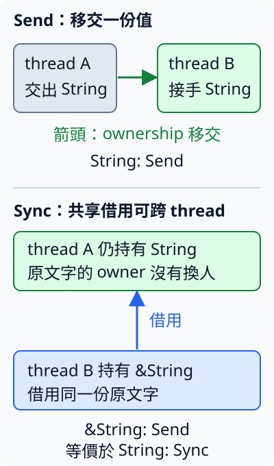

# 13.1 Send 與 Sync：檢查跨 thread 的移交與共用

前面已能把清單與計算工作保存成值。接下來想讓一份數列的計算在另一條執行路徑上進行，原路徑繼續準備其他資料。交接之前，要先回答兩個問題：**整份資料能否交給另一方？若保留原資料，借用它的 reference 能否交給另一方？**

我們沿用已懂的 String、Vec、Rc、Cell 與 closure，先把型別的交接契約看清楚。這一節的程式只做契約檢查與一般呼叫；下一節才真正建立 thread、取得計算結果並等待收尾。

## thread 是程式內的一條執行路徑

**thread（執行緒）** 是程式內能獨立推進工作的一條執行路徑。它有自己的呼叫進度與 stack；同一程式的不同 thread，也可能透過適當的介面接觸共同資料。`main` 起初就在一個 thread 上執行。普通函式呼叫仍沿當前路徑進行，不會因為呼叫另一個函式，就自動建立另一個 thread。

**concurrency（並行）** 表示多份工作的進行期間可以重疊，例如這份工作等結果時，另一份工作繼續。**parallelism（平行）** 則是實際在同一時刻執行多份工作。作業系統的排程會安排哪個 thread 何時取得執行機會；多個 thread 可能交錯執行，也可能在不同 CPU 核心同時執行。建立多個 thread 本身，不保證工作一定更快或輸出有固定順序。

3.5 的 borrowing 規則仍然適用，但現在還多一個維度：型別的介面是否適合跨 thread 使用。11.8 的 Rc、11.9 的 Cell／RefCell 在單一 thread 中合法，不代表可以直接讓不同 thread 一起操作它們。

本章從教材 repo 根目錄執行命令。第 12.1 節已解釋根 workspace 的共同欄位；下面是本章 member 的**完整** `Cargo.toml`，採用該 workspace 的 version、edition、rust-version 與 publish。沒有 dependencies，也沒有 `src/lib.rs`：

```toml
--8<-- "examples/concurrency-stages/Cargo.toml"
```

根 workspace 的 members 已列入 `examples/concurrency-stages`；`-p concurrency-stages` 選這個 package，再以 `--example` 選本頁的獨立程式。它的預設 binary 只提示選擇 example，完整 `src/main.rs` 是：

```rust
--8<-- "examples/concurrency-stages/src/main.rs"
```

## Send 檢查值能否跨 thread 移交

**`Send`** 是一個 trait，表示這種值可以安全地跨 thread 移交。交出 owned String 時，新持有者接手文字與清理責任；交出一份 reference 值時，交出的是借用資訊，不會取得被借資料的 ownership。

Send 屬於 **marker trait（標記能力的 trait）**：它表達一項型別性質，沒有像 Charge 的 amount 或 Clone 的 clone 那樣提供操作方法。它也是 **auto trait**，編譯器會依型別及其組成判定能否提供這項能力。以普通 struct 為例，欄位都符合 Send 時，這個 struct 也能自動符合。Send／Sync 不是6.2中可用 derive 生成的項目。

Send／Sync 位於標準函式庫的 `std::marker`，也是 Rust 預先放進一般名稱範圍的常用 trait，可以直接寫進 bound。沿用 11.5 的 require_static 做法，先寫一個刻意只檢查契約的 helper：

```rust
--8<-- "examples/concurrency-stages/examples/send_sync/contracts/mod.rs:send-check"
```

`T: Send` 要求呼叫者提供符合 Send 的型別。函式接手 value 後原樣交回，沒有 clone、儲存或建立另一個 thread。編譯器核對 bound，helper 本身沒有執行跨 thread 移交。這讓我們先把型別能否交接，與建立／等待工作的操作分開。

## Sync 檢查 shared reference 能否跨 thread

**`Sync`** 回答的是 shared borrowing：如果 `&T` 可以安全地移交到另一個 thread，T 就符合 Sync。精確地說：

> `T: Sync` 等價於 `&T: Send`。

因此 `String: Send` 是「這份 String 值能移交」；`String: Sync` 則是「借用 String 的 shared reference 能跨 thread」。Sync 不轉移原文字的 ownership，也不讓 ordinary shared reference 取得 mutable 存取。能讀取或修改哪些內容，仍依型別介面與 borrowing 契約判斷。

圖的上半部是移交 String，綠箭頭表示 ownership 換持有者；下半部則是原 owner 保留 String，藍箭頭由另一個 thread 的 `&String` 指向被借的原文字。這是允許關係的示意，不是本節程式的執行紀錄。



再用一個只檢查 Sync 的 helper：

```rust
--8<-- "examples/concurrency-stages/examples/send_sync/contracts/mod.rs:sync-check"
```

它接收 `&T`、交回同一份借用。`Sync + ?Sized` 使用 11.5 的 bound 組合：既要求 Sync，也沿 11.1 允許 T 是 str 這種 DST。輸出的省略 lifetime 連到唯一輸入，仍是 7.1 已教的來源契約。

### 先用普通資料確認兩項要求

本章使用根 workspace 中的 `concurrency-stages` package，**沒有 library**。每個 example 都只載入自己的完整根程式與 module；`pub mod contracts;` 與 `use crate::contracts::...` 沿用第 2.6 節的模組分工。這份 target 的 contracts 只包含剛教的兩個檢查函式。

Batch 擁有 String 標籤與 Vec 數列。`String`、`i32` 都有 Send 與 Sync；`Vec<i32>` 也有這兩項能力，因此這個普通 struct 會自動符合。`require_send(batch)` 檢查 owned Batch；`require_sync(&batch)` 檢查 Batch 的共享借用能力；最後再把取得的 `&Batch` 交給 require_send，對應上面的等價關係：

完整的 target-local `contracts/mod.rs`：

```rust
--8<-- "examples/concurrency-stages/examples/send_sync/contracts/mod.rs"
```

```rust
--8<-- "examples/concurrency-stages/examples/send_sync/main.rs"
```

從 repo 根目錄執行：

```bash
cargo run -p concurrency-stages --example send_sync --locked
```

```text
通過兩項契約：Rust有2項，小計=200
```

80 與 120 仍按已有的加總規則得到200，原 Batch 最後也仍有兩項。能否通過 Send／Sync 是編譯期的型別檢查；這行輸出只核對目前資料與加總，沒有證明兩個 thread 已執行或比較速度。

## Send 與 Sync 不一定一起成立

11.9 的 Cell 可以透過 shared receiver 更新值，RefCell 則透過 guard 管理活躍借用。它們的介面沒有提供不同 thread 之間的同步：**同步** 是限制衝突操作如何進行，或建立工作之間先後關係的機制，後面會具體學習。

以 Rc 計數、Cell 內容或 RefCell 狀態的普通讀寫而言，不同 thread 對同一個記憶體位置有未同步的衝突存取，且至少一方寫入，就可能形成 **data race（資料競爭）**。這些管理資訊也屬於資料；不能只看自己是否打算修改外面的業務欄位。

| 已教型別 | Send | Sync |
| --- | --- | --- |
| i32、String | 有 | 有 |
| `Vec<i32>`、`Box<String>` | 有 | 有 |
| `Cell<i32>` | 有 | 沒有 |
| `RefCell<i32>` | 有 | 沒有 |
| `Rc<i32>` | 沒有 | 沒有 |

String 與 i32 的 owned 值、shared reference 都符合相應能力；Vec／Box 及這些內部型別也符合，有 heap 不等於不能跨 thread。Cell 的 set、RefCell 的借用狀態，以及 Rc clone／清理時的計數更新，則沒有跨 thread 的共享保護。

Cell／RefCell 的 Send 還取決於內部 T 是否 Send；表中採用的 i32 符合，數值清單 `Vec<i32>` 也符合。**「可以移交整份容器」與「可以讓不同 thread 共用 shared reference」是兩個不同要求。** 例如移交 Cell 的 owner，就沒有因此在舊位置留下另一份可用的 shared reference；原有 borrowing 規則也禁止把還被借用的 owned 值隨意移走。

下面只檢查 owned Cell／RefCell 的 Send，再依已教介面在目前 thread 繼續使用：

完整的 target-local `contracts/mod.rs`：

```rust
--8<-- "examples/concurrency-stages/examples/cells_send/contracts/mod.rs"
```

```rust
--8<-- "examples/concurrency-stages/examples/cells_send/main.rs"
```

```bash
cargo run -p concurrency-stages --example cells_send --locked
```

```text
owned Cell通過Send，計數=4
owned RefCell通過Send，小計=200
```

Cell 的3加一得到4；RefCell 的 mutable guard 在 block 結束後清理，才借讀80與120。這兩份值通過 Send，並沒有使用 Sync 或跨 thread 的共享修改。

### 要求 Sync 時，失敗的是哪項能力

以下是完整的故意編譯失敗 fixture。Cell 的 get／set 都已教，但 `require_sync(&counter)` 要求的是 `Cell<i32>: Sync`：

```rust
--8<-- "examples/concurrency-stages/fixtures/compile-fail/cell_not_sync.rs"
```

實測診斷比對字串：

```text
--8<-- "examples/concurrency-stages/fixtures/compile-fail/cell_not_sync.expected"
```

編譯器以 `E0277` 指出 Cell 不能安全地讓 threads 共享。即使這段只寫 get，bound 檢查的也是型別的共享使用契約；不是看這次 body 剛好沒有 set 就略過要求。

RefCell 同樣不符合 Sync，另一份完整 fixture 保留這個對照：

```rust
--8<-- "examples/concurrency-stages/fixtures/compile-fail/refcell_not_sync.rs"
```

實測診斷比對字串：

```text
--8<-- "examples/concurrency-stages/fixtures/compile-fail/refcell_not_sync.expected"
```

它也得到 `E0277`。RefCell 的執行期檢查是在管理單一 thread 中的內容借用，沒有保證不同 thread 更新借用狀態時能互相協調。把外部變數改成 mut，或只改成 try_borrow，都不會替型別增加 Sync。

## move capture 不會替 Rc 增加 Send

Rc 的問題連它的管理資訊也包括在內。11.8 的 `Rc::clone` 建立新 handle，strong 加一；清理 handle 時，strong 也會改變。若讓兩個 thread 各持一個 handle，這些操作就可能碰到同一份計數。Rc 的契約限定單一 thread，所以連 `Rc<i32>` 也不符合 Send，不是只要內部 i32 能 Send 就足夠。

先看直接移交 Rc 的完整失敗例：

```rust
--8<-- "examples/concurrency-stages/fixtures/compile-fail/rc_not_send.rs"
```

實測診斷比對字串：

```text
--8<-- "examples/concurrency-stages/fixtures/compile-fail/rc_not_send.expected"
```

錯誤碼是 `E0277`，缺少 `Rc<i32>` 的 Send。即使這一次只建立一份 handle，標準 Rc 仍沒有提供 Send 契約。

9.1 的 move closure 會按值保存環境。closure 是否 Send，也要看它實際保存的資料或 reference。先讓工作擁有 String；它只讀 byte 長度，仍能重複呼叫，與9.2的 Fn 能力相容：

完整的 target-local `contracts/mod.rs`：

```rust
--8<-- "examples/concurrency-stages/examples/capture_send/contracts/mod.rs"
```

```rust
--8<-- "examples/concurrency-stages/examples/capture_send/main.rs"
```

執行 `cargo run -p concurrency-stages --example capture_send --locked`，輸出 `擁有String的工作通過Send，bytes=4`。require_send 仍交回相同型別的 closure，沒有在 helper 裡呼叫它；後面的 work() 才讀取保存的文字。

若保存的是 Rc handle，move 只把這份 handle 的 ownership 交進 closure，不會改造 Rc 的內部計數：

```rust
--8<-- "examples/concurrency-stages/fixtures/compile-fail/rc_capture_not_send.rs"
```

實測診斷比對字串：

```text
--8<-- "examples/concurrency-stages/fixtures/compile-fail/rc_capture_not_send.expected"
```

這次仍收到 `E0277`。owner 與 another 先共用同一份配置，another 又被 closure 接手；shared ownership 關係沒有因為 move capture 消失。這份工作在當前 thread 讀數字本身是合法的，失敗的是把含 Rc 的工作交給 Send bound。**Fn 系列描述怎麼呼叫；Send／Sync 描述跨 thread 怎麼使用，兩者不能互相代替。**

## 跨 thread 型別能力，與 'static 是不同維度

Sync／Send 沒有說來源會活多久。借用局部 String 的 `&str` 可以符合 Send，但來源仍必須在借用用完之前有效；11.5 的 `'static` bound 是另一個要求。

接收介面如果還要排除短命外部借用，就必須另外要求 `T: 'static`。用已教的加號組合這兩項要求：

```rust
--8<-- "examples/concurrency-stages/examples/borrow_bounds/contracts/mod.rs:send-static-check"
```

下面先檢查局部文字的 shared view：require_sync 收到的是 `&str`，所以此呼叫的 T 是 str；require_send 再接收這份 `&str` 值。借用最後使用之後，才把 owned String 交給有 static 要求的 helper：

完整的 target-local `contracts/mod.rs`：

```rust
--8<-- "examples/concurrency-stages/examples/borrow_bounds/contracts/mod.rs"
```

```rust
--8<-- "examples/concurrency-stages/examples/borrow_bounds/main.rs"
```

```bash
cargo run -p concurrency-stages --example borrow_bounds --locked
```

```text
局部文字的reference通過Send，bytes=4
owned文字通過Send與static，內容=Rust
owned值仍隨block結束
```

前一個借用只在原文字有效的區域使用，因此通過 Send；後一個 owned String 不含短命外部借用，所以也符合 static，仍按11.3的普通 scope 規則清理。最後一行表示流程回到外層，不是量測清理時刻。static 約束型別的借用依賴，不要求值永久存在。

把局部借用直接交給這兩項 bound，就會失敗：

```rust
--8<-- "examples/concurrency-stages/fixtures/compile-fail/send_borrow_not_static.rs"
```

實測診斷比對字串：

```text
--8<-- "examples/concurrency-stages/fixtures/compile-fail/send_borrow_not_static.expected"
```

這次錯誤是 `E0597`：局部文字無法滿足所要求的 static 借用。已知 str 是 Sync，所以其 shared reference 的 Send 沒有問題；缺少的是來源有效性。只是用 move closure 保存這份 reference，也不會延長原 String 的存活。

Send／Sync 的檢查建立跨 thread 型別使用的安全界線；值仍須有效，工作也仍需要正確的計算、等待與收尾安排。通過這些 bound 不能保證結果符合需求，或保證所有工作已完成。

## 練習：模型中的 Cell 會影響哪項能力

建立 Report，欄位為 `label: String` 與 `visits: Cell<i32>`。標籤為Rust，次數從0開始；先交給 require_send，接手後依Cell介面增加兩次，確認文字仍Rust、次數為2。只用小數值，避免加法溢位。

再預測：若把 `&Report` 交給 require_sync，能否通過？指出要檢查的是哪個型別，以及哪個欄位使要求無法成立。先按本節的自動組成與容器契約判斷，不以 label 可以讀取就推整份模型能共享。

下面是同頁完整答案。自己的 contracts 快照仍只提供已教的 require_send；完整 helper 與根程式如下：

完整的 target-local `contracts/mod.rs`：

```rust
--8<-- "examples/concurrency-stages/examples/send_sync_answer/contracts/mod.rs"
```

```rust
--8<-- "examples/concurrency-stages/examples/send_sync_answer/main.rs"
```

執行：

```bash
cargo run -p concurrency-stages --example send_sync_answer --locked
```

```text
Report通過Send：Rust，次數=2
```

Report 可以 Send，因為這些欄位都可移交；它不符合 Sync，因為 Cell 欄位沒有 Sync。下一節開始使用真正的 thread API，讓工作接手資料、回傳答案，並把等待完成與錯誤處理寫進流程。

延伸閱讀：[英文 Rust Book：Send／Sync](https://doc.rust-lang.org/book/ch16-04-extensible-concurrency-sync-and-send.html)、[繁體 Rust Book 對應章](https://rust-lang.tw/book-tw/ch16-04-extensible-concurrency-sync-and-send.html)、[Send 官方契約](https://doc.rust-lang.org/std/marker/trait.Send.html)、[Sync 官方契約](https://doc.rust-lang.org/std/marker/trait.Sync.html)。外部教材中的 Arc、Mutex 與 unsafe 手寫實作，依本書後續順序再學。

[下一節：thread、join 與 panic payload](13-02-lesson.md)
