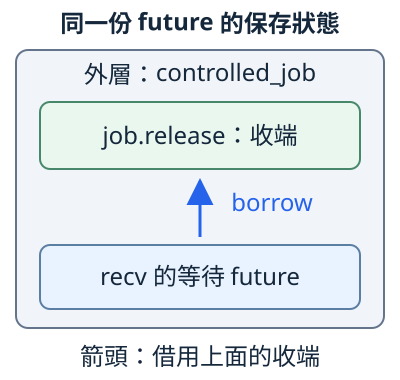
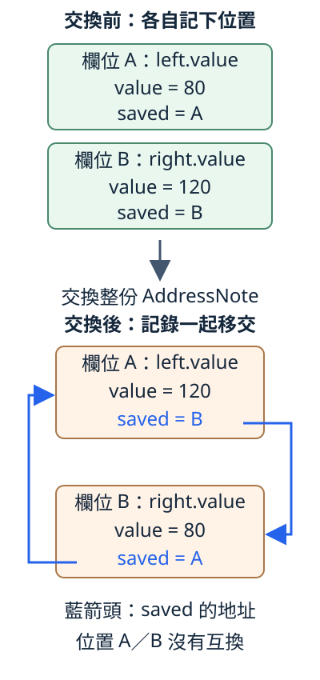

# 13.1 self-reference：資料還活著，地址也可能對不上

11.5 的工作停在 `job.release.recv().await` 時，尚未處理後面的金額。工作要保存稍後還會用的 `job`，這份 recv 等待又借用 `job` 裡的收端。外層工作保存資料，裡面的等待借用它；這讓 async 不只需要回答「資料還活著嗎」，也可能需要回答：**內部保存的位置資訊，之後仍對得上同一處資料嗎？**

本節先用兩份數字資料觀察這個問題。要看的是資料與地址記錄的關係，不是特定電腦印出的地址數字；相同程式不需得到相同的十六進位地址，才算驗收成功。

## 等待會保存狀態，也可能保存內部借用

**self-reference（自我參照）** 指一個值裡面保存的位置資訊，指向同一個值內的另一部分。例如外層 future 保存收端，內部的 recv 等待借用那份收端；借用的目標也在這份外層狀態中。

async 函式會產生一份保存執行狀態的 future。等待尚未完成時，執行可以交還控制權；稍後繼續時，仍需要等待中的資料及位置關係。不是每份 future 都實際保存 self-reference，但我們不能假定 async 產生的 future 一律沒有這種關係。

下圖借用 11.5 的 `controlled_job`：兩個框都在同一份外層 future 中，箭頭表示 recv 等待借用 job 的收端。這是需要保留的資料關係示意，不是編譯器承諾的實際 struct 欄位布局：



若保存收端的整份狀態換了位置，內部保存的地址不會只因「仍然叫 job」就自動更新。接下來把 channel 的細節換成 i32，讓我們只觀察這一項關係；最後再接回 future 的需求。

## lifetime、move 與地址，問的是三件事

前文的規則仍成立，但不能互相代答：

| 問題 | 前文已教的關係 | 還不能由它推出什麼 |
| --- | --- | --- |
| reference 的來源夠有效嗎？ | 4.4／4.5 的 lifetime 描述借用來源與使用範圍；annotation 不延長原值的存活。 | 資料仍存在，不代表先前記錄的任意 raw pointer 可以合法存取。 |
| 值現在由誰持有？ | 2.2 的 move 轉交 ownership；8.2 已看過 move 不是當場清理。 | ownership 交接不會自動修正值內的 pointer 記錄。 |
| 記錄地址和現在位置一致嗎？ | 12.4 的 raw 讀取契約要求來源在存取時仍有效、位置與權限正確。 | raw pointer 沒有像 reference 欄位那樣，讓 borrow checker 自動維持來源關係。 |

這裡的**地址穩定性**，是需要依賴某份資料在一段期間留在同一個位置。move 是 ownership 的語意；具體資料有沒有換位置，要看交接的對象與操作，不能把每個 move 都當成一定搬動 heap 中的全部資料。

### 一般 reference 已能擋住衝突交接

先認識本節要用的新操作 **`std::mem::swap(left, right)`**：收到兩個指向同型別 T 的 mutable reference，交換這兩個位置裡的整份 T，回傳 `()`。呼叫結束後兩邊都有完整的值；它不在交換時執行兩份值的 Drop，也不呼叫我們自訂的「更新地址」方法。

用 `use std::mem;` 引入標準 module 名稱，便能寫 `mem::swap(&mut left, &mut right)`。8.2 已使用過 std::mem 的 drop；swap 是這個 module 的另一項函式，輸入與工作不同。

如果欄位保存真正的 reference，而且交換後還要使用這份借用，borrow checker 會拒絕衝突的 mutable 存取。`BorrowedNote<'a>` 沿用 4.5 的 borrowed model；`saved` 是可選的數字 reference，先用 None 建立，之後記下自己 value 欄位的借用：

```rust
--8<-- "examples/ch13-futures/fixtures/compile-fail/reference_blocks_swap.rs"
```

這份完整 fixture 編譯得到 `E0502`。`left.saved`／`right.saved` 仍要借用原欄位，swap 卻需要 mutable 借用整份 left／right。不能先交換整份值，再假設之前的 reference 會自動跟著更新。拒絕發生在編譯時，這份失敗程式沒有執行。

這也不表示 reference 只能指向外部資料：上面在原位置建立借用的步驟可以成立，衝突的是後續想同時交換整份值。接下來改用 raw pointer 地址記錄，觀察沒有這份編譯期借用限制時，整份值交換會發生什麼。

## 保存地址記錄，再交換整份值

本節 package 為 `ch13-futures`，位置是 `examples/ch13-futures`；library 路徑從 `ch13_futures` 開始，沿 1.9 的連字號／底線規則。這一節只用標準函式庫，Cargo 指令都從 repo 根目錄執行。

**AddressNote** 保存兩個欄位：`value: i32` 是一般數字，`saved: *const i32` 是之前記錄的地址資訊。i32 放在這份 struct 裡，避免把 String 自己管理的 heap 資料也混進第一個實驗。AddressNote 沒有 Copy；整份交換時，數字與 saved 記錄一起交接。

先列出這份觀察模型選用的標準操作與介面：

| 操作 | 本節的輸入、結果與用途 |
| --- | --- |
| `ptr::null()` | 建立 null 的 `*const i32`，由欄位型別推導 i32；表示尚未記錄地址。沿 12.3 的 raw pointer 構造，不拿 null 讀取資料。 |
| `&raw const self.value` | 取得目前 value 欄位位置的 raw pointer，沿 12.4 已用的 raw borrow operator；不建立一份要跨方法保存的 Rust reference。 |
| `ptr::eq(first, second)` | 本例接收兩個 `*const i32`，回 bool，比較它們保存的地址是否相同；不是比較兩個 i32 的內容，也沒有讀取它們指向的資料。 |
| `AddressNote::new(value)` | 收到 i32，建立保存數字與 null 記錄的 AddressNote。先不記自己的地址，因為回傳值還要交給 caller。 |
| `note.remember()` | mutable 借用目前的 note，將當下 value 欄位地址存進 saved，回傳 unit。 |
| `note.address_matches()` | shared 借用 note，比較 saved 與目前 value 欄位的地址，交回 bool；不修改或修復 saved。 |

**地址相同只是一項有限觀察。** ptr::eq 不檢查來源資格、資料有效性或存取權限；true 不能單獨證明可以 dereference saved，false 則足以顯示這份地址記錄與目前欄位位置不一致。範例透過一般 value 欄位讀數字，只用 raw pointer 比較地址。

library 的 `addresses` module 先以 `use std::ptr;` 引入 ptr 名稱，再定義模型：

```rust
--8<-- "examples/ch13-futures/src/addresses.rs:model"
```

先把兩份資料放到 left／right，再呼叫 remember。若把記錄工作藏在 new 的局部值上，回傳後仍要重新考慮位置是否改變；這裡讓「何時記下地址」清楚可見。

現在只改一件事：把**整份 AddressNote** 互換。swap 一起交換 value 與 saved，沒有為 saved 重新取得目的位置的地址：

```rust
--8<-- "examples/ch13-futures/examples/inline_swap.rs"
```

```bash
cargo run -p ch13-futures --example inline_swap --locked
```

```text
交換前：left 記錄地址與目前欄位相同=true，right=true
交換後：left 值=120，right 值=80
交換後：left 記錄地址與目前欄位相同=false，right=false
```

兩個變數仍持有完整 AddressNote，數字也可以正常讀取；但原 right 的記錄隨整份值來到 left，仍保存原 right 那處的地址。只確認「新 owner 還存在」無法修復這項關係。

圖中 A／B 分別標示原 left.value／right.value 的兩個欄位位置；交換前後保留這兩個位置標號，不是實際地址數字或物件 id。框代表整份 AddressNote，箭頭對到其中 value 的位置。灰色向下箭頭表示整份交換的步驟；藍箭頭表示 saved 保存的地址，**不表示此刻可以透過它讀取資料**：



若把兩個初始值都改成80，交換後數字看起來沒有改，address_matches 仍會得到兩個 false。位置是否一致不能用數字內容相等代答。明確再次呼叫 remember 可以重記這份有限模型的地址；普通 move／swap 不會替我們找出所有內部 pointer，逐一呼叫這種方法。

## 移交 Box owner，不等於交換裡面的資料

8.1 的 Box 把 owned T 放在另一處；轉交 Box 不需連那份 heap 配置一起搬走。仍用 AddressNote，但先以 `Box::new` 放好資料，然後才記下 heap 中 value 欄位的地址。

下面 swap 的 T 是 **`Box<AddressNote>`**，所以交換的是兩個 Box owner。兩份 heap 中的 AddressNote 留在原位置，只換了哪個 Box 找到它們。`(*left).remember()` 先找到 Box 的內容，再呼叫已教的方法；交換後以 `&*left`／`&*right` 借出內容，仍沿 8.1 的操作：

```rust
--8<-- "examples/ch13-futures/examples/box_handles.rs"
```

```bash
cargo run -p ch13-futures --example box_handles --locked
```

```text
交換 Box owner 後：left 值=120，right 值=80
記錄地址與目前欄位相同：left=true，right=true
```

對比上一個實驗：left／right 讀到的數字都互換，但這次交換 Box，沒有把 AddressNote 與其欄位搬到另一個位置，地址記錄因此保持一致。穩定性要問**哪一份資料**的位置，不能只看到某個外層 owner 發生 move 就判定失效。

這個結果只支持本次 owner 交換。普通 Box 還允許 8.1 已教的 move-out；若取出裡面的 AddressNote，或以別份值取代它，仍要重新考慮地址關係。Box 本身沒有提供「之後禁止移出這份內容」的介面契約。

## 練習：只換數字，地址記錄也會失配嗎？

回到第一個實驗的兩份 inline AddressNote，value 為80／120，先各自 remember。這次只對 `&mut left.value`／`&mut right.value` 呼叫 swap，交換兩個 i32，保留外層的 saved。

1. 先預測數字與兩個 address_matches 結果，不開答案。
2. 執行後檢查 left=120、right=80；說明「欄位內容改變」與「欄位的位置改變」的差別。
3. 對照整份 AddressNote／Box owner／只有 value 三種交換：哪一份東西真正交接？saved 有沒有跟著離開它原來的欄位位置？

??? example "完整可執行答案"

    ```rust
    --8<-- "examples/ch13-futures/examples/field_swap_solution.rs"
    ```

    ```bash
    cargo run -p ch13-futures --example field_swap_solution --locked
    ```

    兩個數字互換，兩份記錄仍是 true：value 所在的欄位位置沒有互換，saved 也留在各自外層中。

本節四項 library tests 核對整份交換與顯式重記、相同數字仍有不同位置、Box owner 交換，以及只交換欄位值。它們只驗這份地址觀察模型，沒有透過失配的 saved 存取資料：

```bash
cargo test -p ch13-futures --locked
```

現在回到 async：等待中的內部借用要能繼續使用，就不能只保證「資料還沒清理」，還須保留它依賴的位置關係。11.5 的 await／runtime 已替使用端安排這項責任，不需要我們在日常 await 前自己建立 raw pointer。接下來要理解的是，Rust 的標準介面如何讓不同 future 能共同依賴地址穩定，而不要求每個 caller 猜內部有哪些 pointer。

下一節介紹 Pin 與 Unpin，建立這項介面約定；同時連回 8.2 的 Drop，確認資料在收尾前仍符合約定。這一節先完成地址問題與必要對照，下一節才使用固定介面的 API。

延伸閱讀：[英文 Rust Book：Async traits／內部借用圖](https://doc.rust-lang.org/book/ch17-05-traits-for-async.html)、[中文 Async Book：固定／self-reference](https://huangjj27.github.io/async-book/04_pinning/01_chapter.html)、[std：moving 與地址敏感狀態](https://doc.rust-lang.org/std/pin/index.html)、[mem::swap](https://doc.rust-lang.org/std/mem/fn.swap.html)、[ptr::eq](https://doc.rust-lang.org/std/ptr/fn.eq.html)。外部教材有提早的 Pin／poll 與 unsafe 範例；本節的必要地址關係已在正文與安全觀察中建立。
