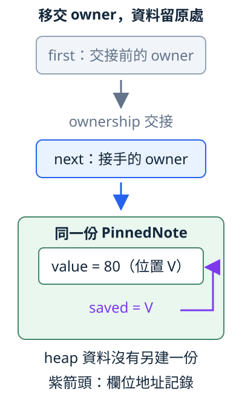

# 13.2 Pin 與 Unpin：把地址穩定放進介面約定

13.1 的兩份80／120資料，交換整份值會讓地址記錄對不上；只交換 Box owner 則保留內部資料位置。但普通 Box 仍允許取出內容。現在要讓地址敏感的資料可以交給別人處理，同時明確約定：**這份原值仍有效時，不能任意移出它所在的位置；收尾也要在該位置完成。**

這個需要不只屬於我們的數字模型。不同 async 函式產生的 future 可能各有內部借用；使用端需要一項共同介面，才能保留這些關係，而不用猜每份 future 的欄位。本節仍只用數字與地址觀察，先把這項約定與 safe／unsafe 的分工弄清楚。

## Pin 包住 pointer，約定作用在 pointee

**`std::pin::Pin`** 是標準函式庫提供的 pointer wrapper。**pointee** 指 pointer 找到的那份資料。`Pin<Ptr>` 包住 Ptr，地址穩定的對象則是 Ptr 的 pointee；這兩份東西要分開：

| 型別 | 包住什麼 | 對哪份資料建立約定 |
| --- | --- | --- |
| `Pin<Box<T>>` | 擁有 T 的 Box | Box 找到的 T，wrapper 仍管理 ownership。 |
| `Pin<&mut T>` | 借用 T 的 mutable reference | 所借的 T，沒有取得它的 ownership，也沒有配置新資料。 |
| `Pin<&T>` | 借用 T 的 shared reference | 同一份 T 的 shared 存取；不能由此直接移出 T。 |

因此，交回或移交 `Pin<Box<T>>` 不等於移出 T。和13.1一樣，pointer 資訊可以交接，而資料留在原位置。

Pin 是 **library contract**：safe API 限制取得可能移出資料的能力；使用 unsafe API 的作者則必須維持約定。它沒有改寫 Rust 的 move 語意，也不會自動修正內部 pointer。若 unsafe 程式違反約定，後面的 safe 使用也可能受影響，不能以「編譯成功」代替契約。

這項約定也不只是「目前方法執行時別搬」。對真正依賴 pinning 的原值，要回收或重用它的儲存空間，必須先在原位置執行 Drop；空間不能在該呼叫返回或 panic 前先被釋放或改作別用。這是 **Drop guarantee**。它不是主動安排每份值最終都清理；8.2已教的正常清理仍依 owner 進行，這裡多了收尾時也須保留位置的要求。稍後會核對自訂 Drop。

## Unpin：這個型別不依賴 pinning 限制

**`Unpin`** 是 `std::marker` 中的 auto trait：表示這個型別不依賴 pinning 的保證。auto trait 沿10.1的意思，由型別與欄位性質決定是否自動具備。對 **`T: Unpin`**，Pin 可以提供普通的 mutable 存取，不再用 pinning 禁止移出 T；原本 borrowing／ownership 規則仍要遵守。

i32 就是 Unpin。可以讓數字使用同一套 Pin 介面，而不把原本合法的交換封鎖。先介紹這個實驗需要的兩項 API：

| 操作 | 輸入、結果與條件 |
| --- | --- |
| `Pin::new(pointer)` | 接手一份 pointer，回傳包住它的 Pin；safe 版本要求 pointee 是 Unpin。本例接收 `&mut i32`，得到 `Pin<&mut i32>`。 |
| `pinned.get_mut()` | 接手 `Pin<&mut T>` 這份借用 wrapper，回傳其內部的 `&mut T`；要求 T 是 Unpin。沒有執行期 Err 分支，不符合 bound 就不能編譯。 |

`get_mut` 在這裡消耗借用 wrapper，沒有取得 i32 的 ownership。交回的 mutable reference 沿2.4的借用規則使用；swap 完成借用後，原 left／right 可以再讀。`use std::pin::Pin;` 將標準型別名稱引入 scope：

```rust
--8<-- "examples/ch13-futures/examples/unpin_access.rs"
```

```bash
cargo run -p ch13-futures --example unpin_access --locked
```

```text
i32 是 Unpin，取得普通 mutable 借用後可交換：120、80
```

所以「放進 Pin 就一律不能 move」並不正確。是否提供這些存取，要看 **pointee T** 是否 Unpin，不是看 Box handle 是否 Unpin。

反過來，**`!Unpin`** 在解說中表示「這個型別沒有實作 Unpin」，不是讓所有未固定的值天生不能 move。值還沒進入 pinning 約定時，仍可以正常建立、回傳或交進 Box；我們要保護的是進入約定後的位置。

## 同一份數字模型，增加受限制的介面

13.1的 AddressNote 只觀察地址。它的 i32 與 raw pointer 欄位本身都具備 Unpin，因此**只改成 `Box::pin(AddressNote)`，還不能依賴它限制移出**。現在另建 `PinnedNote`，保留 value／saved，增加一個用來取消自動 Unpin 的欄位；舊模型不改。

**`std::marker::PhantomPinned`** 是標準的 marker 型別，本身沒有 Unpin。把它放進 struct 欄位，會使外層不自動具備 Unpin；本節也不另外手寫 Unpin 實作。它是沒有欄位的 unit struct，值可以直接寫 `PhantomPinned`，不用 `{}` 或參數。`_pin` 是我們選的欄位名稱，開頭底線表示這個標記不需要被一般操作讀取，並不是固定語法。

標記本身也無法交給安全的 `Pin::new`。下面故意對 `&mut PhantomPinned` 使用它，編譯得到 `E0277`；這只觀察 new 所要求的 Unpin bound，沒有執行失敗程式：

```rust
--8<-- "examples/ch13-futures/fixtures/compile-fail/pin_new_requires_unpin.rs"
```

### 先安置資料，再記地址

本節沿用 package `ch13-futures`／library `ch13_futures`，新模型放在 `pinning` module。所有欄位 private；safe client 從 constructor 得到已完成初始化的 wrapper，不能自行填 saved 或取得整份可移出的值。

接下來需要的標準 API 如下。表中的 T 都是要保留位置的 PinnedNote；完整呼叫見下方實作：

| 操作 | 在本模型的輸入、結果與用途 |
| --- | --- |
| <code style="white-space: nowrap">Box::pin</code> | 取得 owned T，將它放在 owned heap 空間，回傳 `Pin<Box<T>>`。對沒有 Unpin 的 T，safe 介面會保留 pinning 限制。 |
| <code style="white-space: nowrap">as_ref</code> | shared 借用 Pin wrapper，回傳 `Pin<&T>`，借同一份 T；沒有另配一份 T。 |
| <code style="white-space: nowrap">as_mut</code> | mutable 借用 Pin wrapper，回傳 `Pin<&mut T>`；保留約定，不直接交出普通 `&mut T`。 |
| <code style="white-space: nowrap">get_ref</code> | 接手 `Pin<&T>`，交回裡面的 `&T`；可以 shared 讀取，不因此能移出非 Copy 的 T。 |
| <code style="white-space: nowrap">get_unchecked_mut</code> | unsafe 地接手 `Pin<&mut T>`，交回 `&mut T`。作者須確保透過它不移出被固定的資料，並一直維持 pinning／Drop 契約。 |

as_ref／as_mut 是重新借用 owner，後續仍能再從 owner 取得借用。若某個 method 接手 `Pin<&mut T>`，需要多次呼叫時，可以在原借用 wrapper 上再次 as_mut，交出較短的借用；不能用「method 只借 T」誤以為那份非 Copy 的 mutable wrapper 沒有被接手。

### typed self 與本模型的安全責任

2.5的 `&self`／`&mut self` 決定 method 怎樣取得 receiver。這裡使用 **`self: Pin<&Self>`**／**`self: Pin<&mut Self>`**，直接寫出 method 要接收哪種 wrapper。Self 仍指目前的 PinnedNote；第一種做 shared 觀察，第二種允許受控的修改。這不是接手整份 PinnedNote，也不是任意型別都能填進 self 的位置。

我們的介面只有四項：

- `PinnedNote::new(value)` 接收 i32，回傳已在 heap 放好、記完地址的 `Pin<Box<PinnedNote>>`。先以 null 建立普通值，再 Box::pin，最後記當下欄位地址；回傳只移交 wrapper。
- `view.value()` 接收 `Pin<&PinnedNote>`，回傳正常 value 欄位的 i32 副本。
- `view.address_matches()` 接收相同 shared wrapper，回 bool；沿13.1只比較 saved 與目前欄位地址，不證明 raw 存取資格。
- `view.set_value(value)` 接收 `Pin<&mut PinnedNote>` 與 i32，回 unit；只改數字內容，保留整份資料及 value 欄位位置。

為什麼實作要使用 unsafe getter？PinnedNote 沒有 Unpin，所以不能像上一個實驗直接用 get_mut。但作者確實要在安置後記 saved，也要提供只改數字的操作。`get_unchecked_mut` 讓作者取得更大的能力；是否安全，須回到12.4的原則，逐項檢查實際做法與所有 safe 介面：

| 責任 | 本模型維持的關係 |
| --- | --- |
| constructor 已安置資料 | Box::pin 完成後才記地址；後面只回傳 owner wrapper，不移出 T。 |
| 取得 mutable 能力仍不移出 T | constructor 只寫 saved；set_value 只改既有 i32 欄位。沒有交換或覆蓋整份 PinnedNote。 |
| 不讓 safe caller 取得這份能力 | getter 的 `&mut PinnedNote` 留在 method body；沒有公開普通 mutable 存取，也不回傳欄位的 Pin。 |
| 數字內容與欄位位置分開 | 改 i32 不改欄位的位置；本模型沒有需要移交的 owned 資源，也沒有對欄位建立其他固定契約。 |
| Drop 也遵守同一約定 | Drop 只讀正常數字、比較地址，沒有移出或取代整份值；之後 Box 在正常流程中處理空間。 |

**Drop 的 receiver 仍是 `&mut self`，不會自動換成 Pin。** 因此，不能只審查 unsafe block：若自訂 Drop 利用這份普通 mutable reference 把地址敏感的原值移走，也會破壞約定。我們把 Drop 納入同一份檢查，它只觀察原位收尾。位置穩定也不表示空間永遠不能再用；回收之前，仍須先依上述契約在原位收尾。

下面是完整模型，包含 constructor、所有公有 methods 與 Drop。unsafe 操作前的 SAFETY 註解說明上述理由；正常程式仍**不 dereference saved**：

```rust
--8<-- "examples/ch13-futures/src/pinning.rs:model"
```

### 移交 wrapper，再修改內容與收尾

仍用80／120，交換的是 `Pin<Box<PinnedNote>>` 兩個 owner，和13.1的 Box owner 交換保留相同關係；新介面則限制直接移出 PinnedNote。接著只把 left 的數字設成140，再用8.2的 `mem::drop` 正常收尾：

```rust
--8<-- "examples/ch13-futures/examples/pinned_owner_swap.rs"
```

```bash
cargo run -p ch13-futures --example pinned_owner_swap --locked
```

```text
交換前：left=80，right=120
交換 Pin<Box> owner 後：left=120，right=80，兩份地址仍一致
只改 left 的 value：140，地址仍一致
清理 PinnedNote：value=140，地址仍一致=true
left 的 owner 已清理，right 仍是=80
清理 PinnedNote：value=80，地址仍一致=true
兩份資料已正常收尾
```

value 可以變，欄位位置與 saved 記錄仍對得上。Drop 的兩行顯示原位收尾時仍可觀察這項關係；它們不等於完整安全證明，仍要靠前面的介面與實作理由。

下圖先保留數字80，只看一個 owner 的移交：first 灰框表示交接之前的名稱；灰色向下箭頭表示 ownership 交接給 next。next 藍框保存 `Pin<Box<PinnedNote>>`，藍箭頭表示 wrapper 找到 heap 中的整份 PinnedNote。V 是其中 value 欄位的位置；紫色箭頭只表示 saved 記錄，不表示可透過它讀資料。圖中只畫一次 heap 資料，移交不重新建立它：



### safe client 不能以 get_mut 交換整份資料

若像前面的 i32 實驗，對兩份 `Pin<&mut PinnedNote>` 取得普通 mutable reference，再交換整份值呢？這次 PinnedNote 沒有 Unpin，get_mut 的 bound 會拒絕：

```rust
--8<-- "examples/ch13-futures/fixtures/cross-crate-fail/examples/pinned_get_mut.rs"
```

這份 fixture 真正使用同一個 library 的公有介面，編譯得到 `E0277`，指出 PhantomPinned 使 PinnedNote 不符合 Unpin。它沒有先執行交換，再檢查地址。

驗證它時，Cargo 以獨立 fixture manifest 的 path dependency 連到本 package；沿1.9／9.1已教的 package 分工，避免把不能編譯的 target 放進正常範例。本命令預期失敗；`--manifest-path` 指明要檢查哪份 Cargo.toml：

```bash
cargo check --manifest-path examples/ch13-futures/fixtures/cross-crate-fail/Cargo.toml --example pinned_get_mut --locked
```

本節沒有提供讓 caller 使用的 unsafe 解套函式。unsafe 作者可以取得更大的能力，仍須遵守 pinning；把 get_mut 改寫成 unsafe getter，並不是讓那次整份交換變合法的理由。

## 練習：換 owner 名稱，改數字，再正常清理

建立80的 PinnedNote，將 first 直接交給 next。從 next 的 mutable 借用把數字改成100，再檢查數值與地址記錄，最後顯式 drop(next)。

先預測三件事：哪個名稱還能使用、地址記錄是否要重新初始化、Drop 顯示哪個數字。說明「wrapper move」「欄位內容修改」「原位收尾」各自做了什麼；不要為了保持位置，連數字修改也一起禁止。

??? example "完整可執行答案"

    ```rust
    --8<-- "examples/ch13-futures/examples/pinning_solution.rs"
    ```

    ```bash
    cargo run -p ch13-futures --example pinning_solution --locked
    ```

    first 交出 owner 後不再可用；next 接手同一份 wrapper，無須重記地址。顯示100後，原位 Drop 也顯示100，地址比較仍為true。

本節新增三項 tests，核對 owner 交換、同一 mutable Pin 借用反覆重新借用後改負數／零並移交 owner，以及 Unpin 數字仍可經 get_mut 交換。所有 source 只用本節已介紹的操作；連同13.1的四項，可執行：

```bash
cargo test -p ch13-futures --locked
```

現在已有共同的表示：caller 交入 `Pin<&mut T>`，需要地址穩定的實作就能依約定工作；不依賴它的 Unpin 型別仍能使用同樣介面。private Box wrapper 也能保護單一型別，Pin 的價值是把這項分工放進可共同使用的標準契約。借用形式不要求每個參與者另外擁有 Box；本節用 Box 只是讓安置與 ownership 容易看清楚，Pin 本身不等於 heap 配置。

下一節將這個 receiver 接回 Future：如何表示尚未完成、何時通知可以再檢查，以及誰負責再執行。這些狀態與通知 API 會在使用前逐一介紹。

延伸閱讀：[std Pin 契約與 Drop guarantee](https://doc.rust-lang.org/std/pin/index.html)、[Pin methods](https://doc.rust-lang.org/std/pin/struct.Pin.html)、[Unpin](https://doc.rust-lang.org/std/marker/trait.Unpin.html)、[PhantomPinned](https://doc.rust-lang.org/std/marker/struct.PhantomPinned.html)、[英文 Rust Book 17.5](https://doc.rust-lang.org/book/ch17-05-traits-for-async.html)、[中文 Async Book 第4章](https://huangjj27.github.io/async-book/04_pinning/01_chapter.html)。本節所需的介面與安全責任已在正文，外部教材中的 projection 或 stack pinning 範例不作本節先備。
