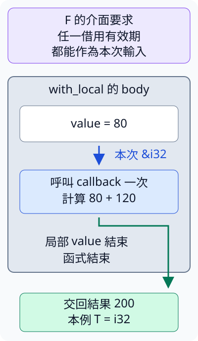

# 13.3 HRTB：讓 callback 接受當次的借用

9.2 已讓共用函式接收 callback，7.1–7.4 也能表達 reference 的來源。現在把兩者接起來：**共用函式自己建立資料，再把它借給 callback 使用，這份 callback 要提供什麼契約？**

我們仍用80加120得到200。小數字讓計算簡單，焦點留在「借用由誰提供、可以使用到哪裡」。本節先用一般函式處理；下一節安排可以借用資料的 thread 時，會用到同一種 callback 契約。

本節各程式使用相同的 no-lib package，完整 member 設定如下；共同欄位沿第 12.1 節從 repo 根 workspace 採用。命令都從 repo 根目錄執行：

```toml
--8<-- "examples/concurrency-stages/Cargo.toml"
```

## 先看呼叫者已經有資料的情況

on_caller 接收呼叫者提供的 `&'a i32`，把這份 reference 交給 callback。沿9.2的 FnOnce 呼叫形式，把括號內的參數由空白改成 `&'a i32`：呼叫一次時借讀一個 i32，得到 owned i32。

本節沿用第 13.1 節的 no-lib package 與完整 manifest。每份 example 都用自己的 higher_ranked/mod.rs 快照；最早的 caller_input 只包含 on_caller，沒有提前載入 HRTB 或後面的 projection。`pub mod` 與 `use crate::...` 沿第 2.6 節使用。

```rust
--8<-- "examples/concurrency-stages/examples/caller_input/higher_ranked/mod.rs"
```

`'a` 是這個函式的 lifetime 參數，輸入 value 與 callback 的參數使用同一個名稱。呼叫端先提供合法的借用，這次呼叫只需要 F 能接受該借用對應的 `'a`；bound 沒有再要求 F 能處理其他每一種 lifetime。

```rust
--8<-- "examples/concurrency-stages/examples/caller_input/main.rs"
```

```bash
cargo run -p concurrency-stages --example caller_input --locked
```

輸出 `呼叫者提供借用，結果=200`。來源 value 在 main 裡；on_caller 不需要自己建立一個要活到 `'a` 的局部來源。

## 資料改在函式內建立，單一外層 'a 就不夠

現在呼叫者只提供「加120」的規則，value 改由共用函式在自己的 body 裡建立。callback 呼叫結束後，共用函式只交回計算結果，局部 value 可以隨函式結束。

若沿用函式參數上的 `<'a>`，要求 F 接受 `&'a i32`，我們會遇到以下完整的故意編譯失敗 fixture：

```rust
--8<-- "examples/concurrency-stages/fixtures/compile-fail/callback_fixed_lifetime.rs"
```

實測診斷比對字串：

```text
--8<-- "examples/concurrency-stages/fixtures/compile-fail/callback_fixed_lifetime.expected"
```

`E0597` 指出 value 活得不夠久。這個函式宣告的 `'a` 可以是呼叫端需要的一段借用有效期，而 body 裡的 value 只有局部來源的有效範圍。泛型函式必須依自己宣告的契約成立，不能假定外面選的 `'a` 一定剛好短到能配合這個 value。

問題不在加法或這份 closure 的讀取。**我們只從 bound 得知 F 能接受一個外層 `'a`，還沒有取得「函式內選擇哪段合法借用，F 都能接受」的能力。** 替 value 補同名 lifetime annotation，也不會延長來源。

## `for<'a>`：把通用能力寫進 callback 的 bound

**HRTB** 是 **Higher-Ranked Trait Bounds** 的縮寫，可理解成「對所有借用 lifetime 都成立的 trait bound」。這裡要的能力是：共用函式先收到 F，之後在 body 內提供哪一段合法的 i32 借用，F 都可以接受。

寫成 `F: for<'a> FnOnce(&'a i32) -> T`：

- `for<'a>` 在這個 trait bound 裡宣告 `'a`，表示以下能力對任一 `'a` 都成立；這次實際借用仍必須有有效來源。
- `FnOnce(&'a i32)` 描述呼叫時接收的 reference。這個 `'a` 在後面的 trait 中使用，沒有變成整個 with_local 的外層 lifetime 參數。
- `T` 是另外選定的結果型別，位於 `for<'a>` 的選擇之外。下例 T 是 i32，沒有要交出局部來源的借用。

此處的 for 是型別契約，不是2.3的執行期迴圈；程式不會為每種 lifetime 都呼叫一遍。with_local 仍只執行 callback 一次：

```rust
--8<-- "examples/concurrency-stages/examples/local_callback/higher_ranked/mod.rs"
```

with_local 在 body 裡建立80、借給 callback，依這份通用契約取得 T，最後交回結果。其 F 與 T 依5.1、9.2的泛型方式推導：

```rust
--8<-- "examples/concurrency-stages/examples/local_callback/main.rs"
```

```bash
cargo run -p concurrency-stages --example local_callback --locked
```

輸出 `函式內提供借用，結果=200`。與第一份程式一樣算出200，但來源現在位於 with_local 內；新的 bound 讓這個局部借用安排成為函式可使用的契約。

圖中藍箭頭是本次借用，綠箭頭是交回 i32 成果；灰框是 with_local 的 body 範圍，不把框的高度當作 lifetime 的長度。本圖採 T=i32，讓局部來源與交出成果容易分辨：



看藍箭頭：callback 使用的來源仍是函式內的 value。看綠箭頭：交到外面的200是計算所得的 i32，沒有保存指向 value 的 reference。HRTB 改變的是 F 承諾能接受哪些借用，不會讓 value 活得更久。

### 只接受 static，反而不夠通用

11.5 的 `&'static i32` 要求來源足以支援 static 借用。若一個 callback 只接受這種輸入，就無法處理函式內的短借用。下面把普通函式保存成9.2的 function pointer，再作為 callback，卻不符合要求所有 lifetime 的 bound：

```rust
--8<-- "examples/concurrency-stages/fixtures/compile-fail/callback_only_static.rs"
```

實測診斷比對字串：

```text
--8<-- "examples/concurrency-stages/fixtures/compile-fail/callback_only_static.expected"
```

診斷指出 `implementation of FnOnce is not general enough`：static_only 的參數限定 static，不能提供 for 所要求的全部借用能力。修正是讓 callback 接受本次有效的 reference，而不是把局部資料宣稱成 static。

## HRTB 不要求 capture 的來源是 static

for 要求對各種 lifetime 都通用的，是傳給 callback 的輸入 reference。closure 另外保存哪些外部資料或 reference，仍依9.1的 capture 與普通 borrowing 規則；本節沒有替 F 加 `Send` 或 `'static` bound。

因此 callback 可以借讀外面的 String，也可以交回借自該 String 的文字 view。這份輸出 T 是外部文字的 `&str`，不連到 with_local 裡80的借用：

完整的 target-local `higher_ranked/mod.rs`：

```rust
--8<-- "examples/concurrency-stages/examples/callback_borrow/higher_ranked/mod.rs"
```

```rust
--8<-- "examples/concurrency-stages/examples/callback_borrow/main.rs"
```

```bash
cargo run -p concurrency-stages --example callback_borrow --locked
```

```text
函式結束後，仍借自外部文字=Rust
外部owner仍可讀取，bytes=4
```

with_local 的 value 已結束，外部 text 還在，所以 saved 可以繼續使用。這與7.4的 original method 把借用連到原文字，而不連到短暫模型，是同一種來源判斷。T 可以含借用；要看它借自哪裡，不能把 HRTB 看成「所有輸出都必須 owned」或「capture 必須永久有效」。

### 局部輸入的 reference，不能用固定 T 帶出去

若把 callback 改成直接回傳收到的 number，with_local 的 T 沒有使用 for 裡當次輸入的 `'a`，而呼叫者又要在 value 已結束後使用它。以下完整 fixture 因這個借用關係無法成立而編譯失敗：

```rust
--8<-- "examples/concurrency-stages/fixtures/compile-fail/callback_local_escape.rs"
```

實測診斷比對字串：

```text
--8<-- "examples/concurrency-stages/fixtures/compile-fail/callback_local_escape.expected"
```

診斷包含 `lifetime may not live long enough`。number 的來源是 with_local 內的 value，無法成為函式結束後仍有效的結果。前一份程式能交回外部 text 的 view，不代表這份局部資料也能交出去。

## 借用通用性，與能呼叫幾次，是兩個問題

`for<'a>` 描述輸入 lifetime 的通用能力；FnOnce／FnMut／Fn 描述怎麼使用 callback 自身。下面的 closure 接手 owned String，在 body 裡用11.3的 drop 消耗它，因此這份工作只提供 FnOnce 的一次按值呼叫；它仍能接受任一本次合法的 i32 借用。這個普通函式是 `std::mem::drop`，也由5.2已教的 prelude 提供名稱，所以本例不必明寫 use；它與自訂清理的 `Drop` trait 是不同的介面：

完整的 target-local `higher_ranked/mod.rs`：

```rust
--8<-- "examples/concurrency-stages/examples/callback_once_hrtb/higher_ranked/mod.rs"
```

```rust
--8<-- "examples/concurrency-stages/examples/callback_once_hrtb/main.rs"
```

執行 `cargo run -p concurrency-stages --example callback_once_hrtb --locked`，輸出 `工作接手owned文字，呼叫一次，結果=200`。static 與 for 是不同要求，for 與 Fn 系列的呼叫能力也不能互相代替。

## callback 回傳借用時，連到每一次的輸入

再把7.1的回傳 reference 契約放到 callback：如果希望它從 tuple 借出一個欄位，可以寫 `F: for<'a> Fn(&'a (i32, i32)) -> &'a i32`。輸入與輸出都使用同一次選定的 `'a`，表示 **每次回傳的 reference 都受當次輸入借用約束**。

這份 bound 說明輸出的有效性；具體選哪個 reference，仍由選擇器的 body 決定。先看共用的 `sum_selected` helper；後面的 `callback_projection/main.rs` 傳入 second，才固定選擇第二個欄位。

這與前面的固定 T 不同：這份 bound 把輸出也明確連到 for 裡的 `'a`。下面 helper 沿9.2的 apply_shared，只借用選擇器，收到 `&F`；只有 shared access，所以用 Fn 呼叫它。每次把借出的 i32 讀出為數值，才合併它們。第二份 tuple 位於內層 block，在第二個選值用完之後結束：

```rust
--8<-- "examples/concurrency-stages/examples/callback_projection/higher_ranked/mod.rs"
```

本例讓選擇器固定借出 tuple 的第二個欄位，得到120與6，合計126。單一輸入借用的省略規則也適用於9.2的 function pointer：`fn(&(i32, i32)) -> &i32` 會讓輸出連到該次輸入，能接受各次合法的借用；下面用這個既有 pointer 形式保存普通函式 second：

```rust
--8<-- "examples/concurrency-stages/examples/callback_projection/main.rs"
```

執行 `cargo run -p concurrency-stages --example callback_projection --locked`，輸出 `兩次各借出第二個欄位，合計=126`。choose 交回的 reference 都在來源仍有效時讀取；sum_selected 交回的是相加後的 i32，沒有把內層 tuple 的 reference 帶出去。

### 常見省略形式，仍保留同一份契約

closure trait 的參數也可用 lifetime elision。已讀懂上面的明寫形式後，再看這兩組 **bound 片段**：

```rust
F: for<'a> FnOnce(&'a i32) -> T
F: FnOnce(&i32) -> T
```

```rust
F: for<'a> Fn(&'a (i32, i32)) -> &'a i32
F: Fn(&(i32, i32)) -> &i32
```

每組是相同能力的明寫／省略形式，片段用來閱讀介面，不是完整程式。省略形式沒有把本節最初函式外層的 `'a` 自動拿進來；那份 `F: FnOnce(&'a i32)` 只要求外層給定的借用，是不同契約。

## 練習：同一份 callback 處理兩段局部借用

寫 local_twice，在兩個相繼的內層 block 各建立80與120，借給同一個 callback。callback 會把外部 visits 加一，再把收到的數值加20。回傳 tuple `(100, 140)`；函式結束後 visits 應為2。

1. 先選能重複呼叫、允許修改 capture 的 FnMut；接手的 callback 參數需要 mut。
2. 再用 for 表達：callback 要能處理函式內各次合法的借用，不靠呼叫端提供一個外層 `'a`。
3. 每個 block 只交回 callback 算出的 i32，資料來源結束後再組合兩份結果。不要保存指向已結束局部值的 reference。

??? example "完整參考答案"

    ```rust
    --8<-- "examples/concurrency-stages/examples/hrtb_answer/main.rs"
    ```

    執行 `cargo run -p concurrency-stages --example hrtb_answer --locked`，輸出 `兩次結果=100、140，處理次數=2`。同一份 closure 的 capture 保存 visits 的 mutable borrow，兩次呼叫更新同一個計數；local_twice 結束後 callback 不再使用，外面才讀取 visits。

你現在能分開判斷：借用來源活到哪裡、callback 能接受哪種輸入 lifetime，以及 callback 自身能怎麼呼叫。下一節把這份通用 callback 契約與13.2的工作收尾接起來。

## 來源與延伸閱讀

- [Rustonomicon：Higher-Rank Trait Bounds](https://doc.rust-lang.org/nomicon/hrtb.html)、[中文對應章節](https://nomicon.purewhite.io/hrtb.html)。
- [Rust Reference：Higher-ranked trait bounds](https://doc.rust-lang.org/reference/trait-bounds.html#higher-ranked-trait-bounds)。
- [Rust Reference：function pointer 與 closure trait 的 lifetime elision](https://doc.rust-lang.org/reference/lifetime-elision.html#lifetime-elision-in-functions)。

[下一節：scoped threads 借用外部資料](13-04-lesson.md)
