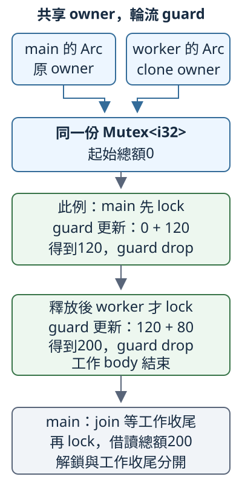

# 13.6 Arc 與 Mutex：共同持有，輪流修改

上一節讓各 worker 把訊息交給 main，再由 main 集中處理。現在改成 **多份工作共同使用一個仍留在共享模型裡的總額，各自短暫取得修改權限，完成後 main 讀回結果**。channel 仍能安排集中處理；這次要學的是共享資料的另一種分工，不是宣稱它一定更快。

11.9 的 `Rc<RefCell<T>>` 已分開兩個問題：Rc 保活同一份資料，RefCell 管理內部 borrowing。跨 thread 也需要分開：誰保活同一份資料，誰保護資料的存取。先學輪流存取，再接上跨 thread 的共享 ownership。

本節使用沒有 library 的 `concurrency-stages` package。完整 member 設定如下，沿第 12.1 節採用 repo 根 workspace 的共同欄位；命令都從 repo 根目錄執行。每份 example 的根程式與實際載入的 helper 都在當頁完整列出。

```toml
--8<-- "examples/concurrency-stages/Cargo.toml"
```

## Mutex 管理一份獨佔存取權限

**Mutex** 來自 **mutual exclusion（互斥）**。`std::sync::Mutex<T>` 持有 T，讓呼叫者取得鎖（lock）後才存取內部資料；同一份 Mutex 一次只交出一份持鎖權限。其他 thread 要取得這個鎖時，可能 blocking 等待目前持有者釋放。

### guard 是持鎖值，正常清理才解鎖

**`MutexGuard<'a, T>`** 是持有鎖、借用 Mutex 內部資料的管理值。它和11.9的 RefMut 一樣，不是普通 `&mut T`：

- 它有 `Deref<Target = T>`，可借讀內部 T；也有 DerefMut，能透過 mutable guard 修改 T。沿11.4，method 查找也會跟著 Deref 找到 T。
- 它的 Drop 在 guard 正常清理時解除鎖。離開內層 block 或顯式 `drop(guard)` 都能結束這份權限。
- `'a` 連到被借的 Mutex，不能靠 guard 把局部 Mutex 的存活延長。**最後一次讀 guard 不等於立即 drop 它**；這點與11.9相同。

所以一份 Mutex binding 可以是 immutable，取得的 guard 則可以是 mutable。修改能力由 Mutex 的受控 API 提供，是11.9所教 interior mutability 的另一種安排；沒有讓普通 shared reference 可以任意修改資料。

### lock 的正常結果與 poison 警告

`Mutex::new(value)` 接手 T，建立尚未上鎖的 Mutex。`mutex.lock()` 使用 shared receiver `&self` 取得鎖，再回傳 `LockResult<MutexGuard<'_, T>>`；`'_` 依這次借用 Mutex 的來源推導。

先介紹 **poisoning**：若 Mutex 偵測到持鎖 thread panic，會留下 **poison（中毒）** 標記，提醒後來的使用者檢查資料是否只修改了一部分。`PoisonError<G>` 是攜帶這項警告及操作成果 G 的錯誤型別。

`LockResult` 是 type alias。我們把它的泛型參數改記作 G，分開「操作成果」與 Mutex 裡面的 T；角色與官方 alias 相同。以下只是介面宣告：

```rust
pub type LockResult<G> = Result<G, PoisonError<G>>;
```

因此 lock 的兩個分支都與 **已取得的 guard** 有關：Ok 交回 guard；poison 時 Err 裡也持有 guard，並不是鎖永遠拿不到。下面先使用正常路徑，稍後才教如何檢查並修復 poison 的資料。

```rust
pub fn lock(&self) -> LockResult<MutexGuard<'_, T>>
```

lock 若要等別的 thread 釋放鎖，會等到取得才返回；不把「目前有人持鎖」當作上述 poison Err。`PoisonError<G>` 有 Debug，因此8.1的 expect 可以用於這份 Result。這只是讓已知條件失敗時產生診斷，不表示 expect 能替我們修好資料。

### 先在單一 thread 看取得與釋放

從總額0開始，先加80、再加120。兩次修改用不同 guard，第一份在 block 結尾解鎖，第二份顯式 drop，之後再取得一份讀回200：

```rust
--8<-- "examples/concurrency-stages/examples/mutex_guard/main.rs"
```

```bash
cargo run -p concurrency-stages --example mutex_guard --locked
```

```text
兩次持鎖更新，總和=200
再次取得guard，讀到=200
```

`*guard` 沿 Deref／DerefMut 借用內部 i32；清理 guard 解鎖，沒有清理那份200。這個例子沒有跨 thread，也沒有需要等待的競爭，先讓管理值與原資料的分工直接可見。

## Arc 保活同一份資料，不替內容取得修改權限

**`Arc<T>`** 位於 `std::sync`，名稱展開為 **Atomically Reference Counted**。它沿11.8的 reference counting 模型，讓多個 strong handle 共同保活同一份 heap 資料；差別是 **計數更新可由不同 thread 安全地進行**。

名稱中的 atomic 在這裡指不可拆開的計數更新：不同 thread 增減 handle 時，不會把彼此的更新當成沒有發生。完整 atomic API 與 memory ordering 在13.8才教；此處只使用 Arc 已提供的共享 ownership 契約。

先看本節選用的操作與能力：

- `Arc::new(value)` 接手 T，回傳保活它的第一份 Arc。
- `Arc::clone(&owner)` 借用原 Arc，建立指向同一份配置的新 Arc，strong 數量增加。**這不是 clone T，也不要求 T 有 Clone**。
- 一份 Arc 被丟棄，移除它的一份 strong ownership；最後一份 strong 結束時，內部 T 才清理。普通 move 只交接同一份 Arc，不增加計數。
- Arc 有 `Deref<Target = T>`，可以借讀 T、使用它的 shared method；沒有 DerefMut。外層 `let mut` 不會因此產生對共同 T 的 mutable reference。
- 本節使用的一般 `Arc<T>` 要跨 thread，T 必須同時符合 **Send 和 Sync**。Arc 保護自己的計數，沒有替任意 T 增加同步操作。

先把共享內容改成只讀的 `Rust` 文字，單獨看 Arc 的保活與借讀；下一段才回到總額修改，把兩層組合。String 有 Send 和 Sync，也沒有局部借用，可以把它的 Arc clone 移到普通 spawn。兩份 owner 都讀同一份文字；worker 返回的是 UTF-8 byte 長度4，main 在 join 後仍保有自己的 Arc：

```rust
--8<-- "examples/concurrency-stages/examples/arc_shared_read/main.rs"
```

```bash
cargo run -p concurrency-stages --example arc_shared_read --locked
```

```text
main也讀同一份文字=Rust
worker讀到長度=4，已收尾；main仍持有Arc
```

`.as_str()` 與 `.len()` 經 Arc 的 Deref 找到 String method。join 讓 main 知道 worker 已結束，包含那份工作持有的 Arc 清理；main 的 Arc 仍保活 String，最後才 drop。這沒有安排誰先讀，只要求 main 印完整工作結果之前先等待。

### Arc 的計數保護，不等於內容也能跨 thread

13.1已教 `Cell<i32>` 有Send、沒有Sync。把它包進 Arc，仍不符合 Arc 的兩項要求；以下完整 compile-fail 收到 `E0277`：

```rust
--8<-- "examples/concurrency-stages/fixtures/compile-fail/arc_cell_not_send.rs"
```

實測診斷比對字串：

```text
--8<-- "examples/concurrency-stages/fixtures/compile-fail/arc_cell_not_send.expected"
```

兩份 Arc 可能提供對同一個 Cell 的 shared borrowing；Cell 自己的 get／set 沒有多 thread 同步保護，不能只靠強 owner 計數解決這個問題。

只在單一 thread，多份 owner 的直接修改也仍受 Deref 能力限制。下面的 mutable Arc binding 沒有讓共同 Vec 可以直接 push，收到 `E0596`：

```rust
--8<-- "examples/concurrency-stages/fixtures/compile-fail/arc_no_deref_mut.rs"
```

實測診斷比對字串：

```text
--8<-- "examples/concurrency-stages/fixtures/compile-fail/arc_no_deref_mut.expected"
```

這裡要共同修改同一份資料，接上剛學到的 Mutex 管理短暫存取權限。

## Arc 和 Mutex 分別負責哪一層？

**`Arc<Mutex<T>>`** 讓多份 Arc 保活同一個 Mutex；每個使用者再透過 Mutex 的 lock，取得對同一份內部 T 的 guard。clone Arc 沒有取得鎖，lock 也沒有增加 strong owner。

跨 thread 的能力分開推：**`Mutex<T>` 的 Send 和 Sync 都需要 `T: Send`，不另外要求 `T: Sync`**。它安排內部資料輪流由持鎖者存取，而不讓非 Sync 的 T 被多個 shared caller 任意同時使用。把符合這兩項能力的 Mutex 放進 Arc，就能滿足 Arc 對內容的 Send／Sync 要求；因此本節的 `Arc<Mutex<i32>>` 可以交給不同 worker。

反過來，Mutex 不會替外層 Rc 的計數同步。`Rc<Mutex<i32>>` 的內部操作受保護，Rc 自己仍沒有 Send，這份完整 fixture 收到 `E0277`：

```rust
--8<-- "examples/concurrency-stages/fixtures/compile-fail/rc_mutex_not_send.rs"
```

實測診斷比對字串：

```text
--8<-- "examples/concurrency-stages/fixtures/compile-fail/rc_mutex_not_send.expected"
```

### 保留 main 的 owner，讓 worker 和 main 各加一次

沿用0、80、120。worker 接手 Arc clone，main 保留自己的 Arc；兩邊各鎖住同一總額，加上80或120，再釋放 guard。main 的 guard 在 join 之前已離開內層 block：

```rust
--8<-- "examples/concurrency-stages/examples/arc_mutex/main.rs"
```

```bash
cargo run -p concurrency-stages --example arc_mutex --locked
```

輸出 `同一Mutex輪流更新，總和=200；worker已收尾`。小 i32 不會溢位，兩次都以「取得、讀改寫、釋放」的完整區段更新同一份總額。誰先得到guard不固定：0→80→200或0→120→200都符合本例目的；不指定是哪一份工作先取得鎖。

圖畫出 **main 先取得 guard** 的一種可能次序。藍箭頭表示兩個 Arc 都連同一 Mutex；灰箭頭是這種次序下的取得／釋放流程。worker 必須等 main 的 guard 解鎖才取得自己的 guard；改成 worker 先取得時，兩份工作的先後可對調，總額仍是200：



先看頂部的兩個 Arc：沒有兩份各自的總額；看下方兩份 guard：它們在這個次序中輪流成立，不是同時修改同一個 i32。圖底的 join 是工作收尾，與前面每次 drop guard 的解鎖分開。

### T 不必有 Sync，但仍要遵守 Mutex 的存取安排

用已教的 Cell 讓這個 bound 差別可見。`Cell<i32>` 有 Send，所以 `Mutex<Cell<i32>>` 可以有 Send／Sync，再由 Arc 共同持有。Cell 的 get／set 必須透過取得的 guard 使用；本例 **從 get、計算到 set 都保留同一份 guard**。

```rust
--8<-- "examples/concurrency-stages/examples/mutex_cell/main.rs"
```

執行 `cargo run -p concurrency-stages --example mutex_cell --locked`，輸出 `Cell沒有Sync，由Mutex保護輪流操作，總和=200`。guard 不需要 mut，因為 Cell::set 的 receiver 是 shared `&self`；Mutex 仍讓這次讀改寫保持獨佔。這與前面失敗的 `Arc<Cell<i32>>` 有不同的存取管理，沒有把 Cell 本身改成 Sync。

## guard 留在哪裡，決定誰還在等

取得 guard 後，哪怕已經完成最後一次讀取，guard 仍可能留在目前 scope 裡。用短 block 或 drop 表示這份存取權限何時結束，不把不相關工作放在持鎖區段內。

沿13.5的等待循環來看：若 main 仍保留 total 的 guard，就去 join 一份要 lock 同一 total 的 worker，main 等 worker 結束，worker 等 main 解鎖，形成 deadlock。前面 main 的內層 block 在 join 之前結束，就是解除這項依賴；不是「讀完 guard 最後一行」就會自動解鎖。

同一個 thread 若尚未釋放 guard，又對同一個 Mutex 呼叫 lock，官方契約不指定確切結果：第二次可能 panic，也可能形成 deadlock，**不保證正常返回**。不要把它當成可以重複取得同一鎖的介面；本節不執行永久等待的反例。

### guard 不能當成跨 thread 的工作成果

`MutexGuard` 沒有 Send。它要在取得鎖的 thread 正常清理並解除鎖，不能把這份 owned guard 移到另一份 thread 再 drop。沿13.1的 bound 檢查，以下完整 fixture 把 guard 交給 require_send，收到 `E0277`：

```rust
--8<-- "examples/concurrency-stages/fixtures/compile-fail/mutex_guard_not_send.rs"
```

實測診斷比對字串：

```text
--8<-- "examples/concurrency-stages/fixtures/compile-fail/mutex_guard_not_send.expected"
```

可以從 guard 讀出本來就能移交的資料，再先結束 guard、交回成果；不要把持鎖權限誤認成有 Send 的 i32。持有 Arc 的生命週期、持有 guard 的生命週期，以及 worker 結束，都是要分別安排的邊界。

## poison 提醒檢查資料，不自動恢復業務狀態

現在保存 `Totals { total: i32, count: usize }`：total 是已完成項目的總額，count 是完成筆數。每完成一項，總額與筆數都要更新；尤其 count 是0時，總額應是0。這項資料必須維持的關係，叫 **invariant（不變條件）**。

故意讓 worker 只把 total 加80，還沒加完成筆數就 panic。MutexGuard 在 unwind 時清理，解除鎖並留下 poison 警告；資料已成為80與0。**互斥存取避免同時改寫，不保證多行業務操作會自動全部成功或全部還原**。

先教這次處理用的兩個方法：

- `error.into_inner()` 取得 `PoisonError<G>` 的 ownership，交回 G。這次 G 就是已經持鎖的 MutexGuard；取得它不會清除 poison，也不會撤銷前面的80。
- `mutex.clear_poison()` 使用 shared receiver，清除 poison 標記、回傳 unit。呼叫它不會檢查或修復內容，要先由應用恢復已知有效的狀態。

本例選擇 **捨棄這批未完成狀態，重設為總額0、完成筆數0**；不是一般應用都應採用的復原政策。我們在 guard 還持鎖時先重設，再清標記，最後讓 guard 清理。Totals 只含具備 Send 的數字欄位；欄位存取 guard.total 沿11.4的 Deref 找到 Totals：

這份 target 的完整 `workers/mod.rs`：

```rust
--8<-- "examples/concurrency-stages/examples/mutex_poison/workers/mod.rs"
```

```rust
--8<-- "examples/concurrency-stages/examples/mutex_poison/main.rs"
```

```bash
cargo run -p concurrency-stages --example mutex_poison --locked
```

main 的 stdout：

```text
已等待worker，收到panic：尚未更新完成筆數就panic
取回guard仍見部分修改：總額=80，完成筆數=0
重設後再次lock成功：總額=0，完成筆數=0
```

stderr 仍有 worker 的 panic 診斷；main 處理 join 的 Err 後正常結束。`into_inner` 讓 main 在持鎖下讀到部分狀態，依本例政策重設再 clear；分支離開時解鎖，後一次 lock 才得到 Ok。若只拿回 guard、沒有清標記，之後仍會看到 poison 警告；若只清標記、不修復資料，80與0的不一致仍存在。

poison 是 **檢查提醒**，panic 偵測不是所有情境都完整。沒有 poison 不能單獨證明業務資料正確；取得 guard 也不能單獨證明整份工作成功。這裡沿13.2的 unwind 設定讓故意 panic 可由 join 處理，不把 abort 也當成相同復原流程。

## 練習：兩份工作，輪流記錄同一個清單

main 建立 `Arc<Mutex<Vec<i32>>>`，保留自己的 Arc。兩份 worker 各接手一份 Arc clone，把 `[80, 120]` 與 `[1, 2, 3]` 逐項 push 到同一個清單；不在 worker 裡複製兩份清單。

1. 沿2.3的 array 逐項走訪；每一項更新都先取得 guard，再 push。guard 在每次迴圈 body 結尾清理，各 worker 另外用自己的 usize 計數，正常完成時分別返回2與3。
2. main 的兩個 handle 都先 join，把結果存起來，再判斷。兩份工作都正常回傳時，才 lock 清單、檢查長度5與 sum 的206。
3. 記錄順序可交錯，不指定五項固定排列；總和與筆數不依賴這些小數值的交錯順序。至少一份 panic，清單可能已部分更新，不把它當完整成果。
4. 比較13.5：前面的 channel 讓 main 接收後獨自更新；這次各 worker 透過 guard 輪流修改仍留在共享模型中的同一 Vec。兩種方法都能得到206，差別是存取和更新的分工，不是這個結果證明哪一種更快。

??? example "完整參考答案"

    這份 target 的完整 `workers/mod.rs`：

    ```rust
    --8<-- "examples/concurrency-stages/examples/mutex_answer/workers/mod.rs"
    ```

    ```rust
    --8<-- "examples/concurrency-stages/examples/mutex_answer/main.rs"
    ```

    執行 `cargo run -p concurrency-stages --example mutex_answer --locked`，輸出 `同一清單收到5項，總和=206；兩個worker已收尾`。worker 回傳各自的追加筆數；main 在所有工作收尾後，才鎖住同一清單讀取長度與總額。沒有用當次順序假裝保證以後順序。

下一節學不同的讀寫鎖與同步設計：哪些工作需要互斥寫入，哪些可以共同借讀，以及鎖的範圍和取得順序如何影響等待。

## 來源與延伸閱讀

- [Rust Book：Shared-State Concurrency](https://doc.rust-lang.org/book/ch16-03-shared-state.html)、[正體中文對應章](https://rust-lang.tw/book-tw/ch16-03-shared-state.html)。
- [`Arc` 的 Clone／Deref／Send／Sync](https://doc.rust-lang.org/std/sync/struct.Arc.html)、[`Mutex` 的 lock、poison 與 clear_poison](https://doc.rust-lang.org/std/sync/struct.Mutex.html)。
- [`MutexGuard` 的 Drop 與 !Send](https://doc.rust-lang.org/std/sync/struct.MutexGuard.html)、[`LockResult`](https://doc.rust-lang.org/std/sync/type.LockResult.html)、[`PoisonError::into_inner`](https://doc.rust-lang.org/std/sync/struct.PoisonError.html#method.into_inner)。

[下一節](13-07-lesson.md)
